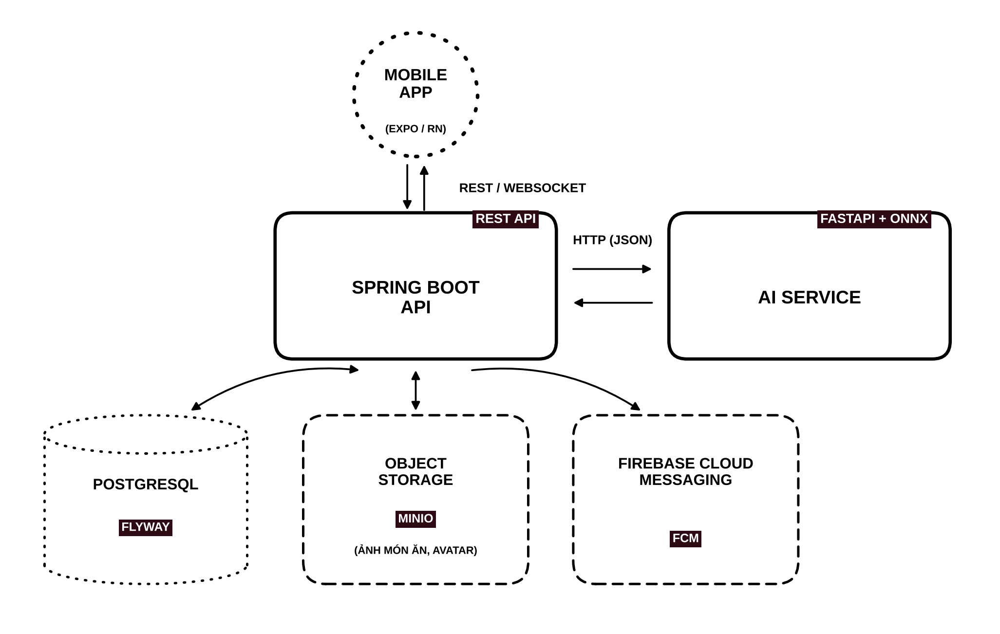

# Kallo – Backend API

> Backend RESTful API (Spring Boot) cho **Kallo** – ứng dụng di động hỗ trợ chăm sóc sức khỏe và dinh dưỡng tích hợp AI: theo dõi bữa ăn, cân nặng, vận động; nhận diện món ăn Việt Nam qua ảnh và ước lượng calo.


## Mục lục

- [Giới thiệu](#giới-thiệu)
- [Tính năng chính](#tính-năng-chính)
- [Kiến trúc hệ thống](#kiến-trúc-hệ-thống)
- [Công nghệ sử dụng](#công-nghệ-sử-dụng)
- [Yêu cầu hệ thống](#yêu-cầu-hệ-thống)
- [Cài đặt & chạy dự án](#cài-đặt--chạy-dự-án)
- [Database & Migration](#database--migration)
- [API Documentation](#api-documentation)
- [Testing](#testing)
- [Docker](#docker)
- [License](#license)

## Giới thiệu

Kallo đóng vai trò như một trợ lý sức khỏe cá nhân, giúp người dùng theo dõi dinh dưỡng, kiểm soát cân nặng và vận động thể chất một cách tiện lợi, tự động hoá. Hệ thống tích hợp pipeline nhận diện món ăn Việt Nam (YOLO, tập dữ liệu VietFood68) và ước lượng calo, được xây dựng và triển khai độc lập, không phụ thuộc API AI bên thứ ba.

Repository này chứa **Backend chính** (Spring Boot). Các thành phần khác của hệ thống:

| Thành phần         | Công nghệ                          | Repository                 |
|--------------------|------------------------------------|----------------------------|
| Mobile app         | React Native, Expo, TypeScript     | _(cập nhật link)_          |
| AI service         | Python, FastAPI, ONNX Runtime      | _(cập nhật link)_          |
| **Backend (repo này)** | Java, Spring Boot 4.x          | –                          |

## Tính năng chính

- **Tài khoản & hồ sơ sức khoẻ:** đăng ký/đăng nhập (Email, Google OAuth2), khôi phục mật khẩu, thể trạng – mục tiêu cân nặng – dị ứng; tự tính BMI, TDEE, mục tiêu calo hàng ngày.
- **Dinh dưỡng & bữa ăn:** nhật ký bữa ăn (Sáng/Trưa/Tối/Bữa phụ), nhận diện món ăn qua ảnh, tra cứu món, quét mã vạch, món ăn tuỳ chỉnh.
- **Kế hoạch bữa ăn & trợ lý AI:** gợi ý thực đơn cá nhân hoá theo calo/dị ứng/ngân sách, chatbot tư vấn dinh dưỡng.
- **Vận động & chỉ số cơ thể:** nhật ký tập luyện, đồng bộ Google Fit / Apple Health, lịch sử cân nặng, nước uống.
- **Báo cáo & thống kê:** dashboard, biểu đồ calo/macro/cân nặng theo ngày/tuần/tháng, dự đoán xu hướng cân nặng.
- **Streak & động lực:** chuỗi ngày, thử thách, huy hiệu, kết bạn, bảng xếp hạng thời gian thực (WebSocket).
- **Tiện ích:** thông báo đẩy (FCM), nhắc nhở thông minh, hỗ trợ đồng bộ khi offline.

## Kiến trúc hệ thống



## Công nghệ sử dụng

| Thành phần      | Công nghệ                                              |
|-----------------|--------------------------------------------------------|
| Ngôn ngữ        | Java 21                                               |
| Framework       | Spring Boot 4.x                                        |
| Bảo mật         | Spring Security, JWT, Google OAuth2                    |
| ORM             | Spring Data JPA / Hibernate                            |
| Database        | PostgreSQL                                             |
| Migration       | Flyway                                                 |
| Build tool      | Gradle (Gradle Wrapper)                                |
| Real-time       | Spring WebSocket                                       |
| Thông báo đẩy   | Firebase Cloud Messaging (FCM)                         |
| Lưu trữ tệp     | MinIO              |
| API docs        | SpringDoc OpenAPI (Swagger UI)                         |
| Testing         | JUnit 5, Mockito, Testcontainers                       |
| Container       | Docker, Docker Compose                                 |

## Yêu cầu hệ thống

- JDK 21
- PostgreSQL 17 (hoặc chạy qua Docker)
- Docker & Docker Compose (tuỳ chọn)
- Không cần cài Gradle riêng – dùng `./gradlew`

## Cài đặt & chạy dự án

### 1. Clone repository

```bash
git clone https://github.com/tranductrung04/kallo-backend.git
cd kallo-backend
```

### 2. Cấu hình môi trường

```bash
cp .env.example .env
```

Cập nhật thông tin database, JWT secret, Google OAuth2, FCM, storage trong file `.env` (xem [Cấu hình](#cấu-hình)).

### 3. Khởi động PostgreSQL (nếu chưa có)

```bash
docker compose up -d postgres
```

### 4. Build

```bash
./gradlew clean build
```

### 5. Chạy ứng dụng

```bash
./gradlew bootRun --args='--spring.profiles.active=dev'
```

Ứng dụng chạy tại: http://localhost:8080  
Flyway sẽ tự động chạy migration khi ứng dụng khởi động.


## Database & Migration

Dự án dùng **Flyway** để quản lý schema; Hibernate chỉ validate, không tự sinh bảng:

```yaml
spring:
  jpa:
    hibernate:
      ddl-auto: validate
  flyway:
    enabled: true
    locations: classpath:db/migration
```

Quy ước đặt tên: migration khởi tạo hiện có dùng `V1__init_schema.sql`; các migration mới
dùng `V<yyyyMMddHHmm>__<module>_<mô_tả>.sql` với thời gian tạo theo UTC, ví dụ
`V202611121030__act_weight_logs.sql`. Số phiên bản phải tăng theo thứ tự phụ thuộc trong
cùng module. Khi phát triển local, profile `dev` cho phép Flyway chạy migration lệch thứ tự;
production vẫn giữ mặc định an toàn.
**Không sửa** file migration đã chạy – hãy tạo phiên bản mới.

```bash
# Xem trạng thái migration (nếu cấu hình plugin Flyway cho Gradle)
./gradlew flywayInfo
```

## API Documentation

- Đặc tả API (OpenAPI): [docs/api-specs](docs/api-specs)
- Swagger UI: http://localhost:8080/swagger-ui/index.html
- OpenAPI JSON: http://localhost:8080/v3/api-docs

## Testing

- Tài liệu test: [docs/tests](docs/tests)

```bash
# Chạy toàn bộ test
./gradlew test

# Build kèm kiểm tra
./gradlew check
```

Integration test dùng **Testcontainers** (PostgreSQL) nên cần Docker đang chạy.

## Docker

```bash
# Build image
docker compose build

# Chạy toàn bộ stack (backend + PostgreSQL)
docker compose up -d

# Xem log
docker compose logs -f app

# Dừng
docker compose down
```

## License

MIT. See [LICENSE](LICENSE) file.