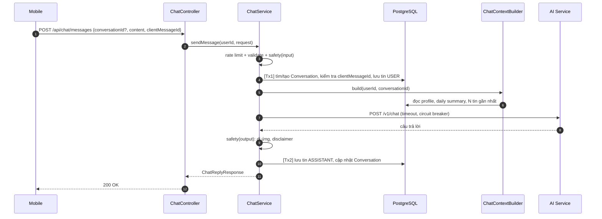

# Kế hoạch triển khai Module Chat (Chatbot tư vấn dinh dưỡng)

| Mục | Nội dung |
| --- | --- |
| Dự án | `kallo-backend` (Spring Boot 4.x, Java 21, PostgreSQL, Flyway) |
| Module | `chat` – trợ lý AI tư vấn dinh dưỡng & sức khoẻ |
| Package gốc | `com.healthcare.kallo` |
| Ngày soạn | 16/11/2026 |
| Trạng thái | Phase 0 hoàn tất; hợp đồng AI chờ xác nhận |

---

## Mục lục

0. [Tóm tắt nhanh](#0-tóm-tắt-nhanh)
1. [Bối cảnh & phạm vi](#1-bối-cảnh--phạm-vi)
2. [Yêu cầu](#2-yêu-cầu)
3. [Kiến trúc](#3-kiến-trúc)
4. [Thiết kế dữ liệu](#4-thiết-kế-dữ-liệu)
5. [Thiết kế API](#5-thiết-kế-api)
6. [Luồng xử lý gửi tin nhắn](#6-luồng-xử-lý-gửi-tin-nhắn)
7. [Tích hợp AI service](#7-tích-hợp-ai-service)
8. [Ngữ cảnh người dùng, prompt & guardrails](#8-ngữ-cảnh-người-dùng-prompt--guardrails)
9. [Streaming / realtime](#9-streaming--realtime)
10. [Bảo mật & quyền riêng tư](#10-bảo-mật--quyền-riêng-tư)
11. [Cấu hình & biến môi trường](#11-cấu-hình--biến-môi-trường)
12. [Cấu trúc code](#12-cấu-trúc-code)
13. [Lộ trình & phân rã công việc](#13-lộ-trình--phân-rã-công-việc)
14. [Kế hoạch kiểm thử](#14-kế-hoạch-kiểm-thử)
15. [Observability & vận hành](#15-observability--vận-hành)
16. [Rủi ro & giải pháp](#16-rủi-ro--giải-pháp)
17. [Definition of Done](#17-definition-of-done)
18. [Câu hỏi mở cần chốt](#18-câu-hỏi-mở-cần-chốt)
19. [Phụ lục: code skeleton](#19-phụ-lục-code-skeleton)

---

## 0. Tóm tắt nhanh

**Mục tiêu:** cho phép người dùng hội thoại với chatbot dinh dưỡng của Kallo; câu trả lời được cá nhân hoá theo hồ sơ sức khoẻ (BMI, TDEE, mục tiêu calo, dị ứng) và nhật ký ăn uống trong ngày. Backend Spring Boot đóng vai trò **điều phối**: xác thực, lưu lịch sử, dựng ngữ cảnh, gọi AI service (FastAPI), áp guardrails và trả kết quả về mobile.

**Các quyết định chính (đề xuất):**

| # | Quyết định | Lý do |
| --- | --- | --- |
| D1 | Lưu hội thoại trong PostgreSQL (`Conversation`, `ChatMessage`) qua Flyway | Khớp thiết kế hiện có trong README, dễ truy vấn/phân trang |
| D2 | Phase 1 làm **REST đồng bộ** (`POST /api/chat/messages`), streaming để Phase 3 | Giao hàng nhanh, giảm rủi ro; endpoint này đã có trong README |
| D3 | Streaming dùng **SSE** (không dùng WebSocket) | Chat AI chỉ cần server → client; SSE đơn giản hơn, đi qua proxy/HTTP thường; WebSocket giữ cho bảng xếp hạng |
| D4 | Gọi AI service qua interface `ChatAiClient` | Chưa rõ engine bên dưới (rule/RAG/LLM tự host) → dễ thay thế, dễ mock khi test |
| D5 | **Không giữ transaction DB** trong lúc chờ AI | Tránh cạn connection pool khi AI chậm |
| D6 | Idempotency bằng `clientMessageId` do mobile sinh | Mobile có offline sync → tránh gửi trùng khi retry |
| D7 | Rate limit theo user (Redis nếu có, in-memory làm fallback) | Bảo vệ AI service (tốn tài nguyên) và chống lạm dụng |
| D8 | Guardrails có kiểm tra **dị ứng** ở phía backend sau khi AI trả lời | Không phó mặc hoàn toàn an toàn cho AI |

**Phase 0 đã hoàn tất:** đối chiếu code hiện tại và ghi quyết định tại [`docs/CHAT_PHASE_0_DECISIONS.md`](CHAT_PHASE_0_DECISIONS.md). Hợp đồng AI đề xuất tại [`docs/CHAT_AI_CONTRACT.md`](CHAT_AI_CONTRACT.md). Phase 1 chỉ bắt đầu sau khi owner AI service xác nhận contract.

**Lộ trình (ước lượng 1 dev, xem chi tiết ở mục 13):**

| Phase | Nội dung | Ước lượng |
| --- | --- | --- |
| 0 | Chuẩn bị, chốt hợp đồng với AI service | 1–2 ngày |
| 1 | Nền tảng: DB + CRUD hội thoại + gửi/nhận tin (AI mock) | 3–4 ngày |
| 2 | Tích hợp AI thật + context cá nhân hoá + guardrails | 4–5 ngày |
| 3 | Streaming SSE | 2–3 ngày |
| 4 | Hardening: rate limit, retention, observability, load test | 3–4 ngày |
| 5 | Tính năng mở rộng (tuỳ chọn): ảnh trong chat, feedback, FCM | 3–5 ngày |

---

## 1. Bối cảnh & phạm vi

### 1.1 Hiện trạng (trích từ README của repo)

- Stack: Java 21+, Spring Boot 4.x, Spring Security + JWT, Spring Data JPA, PostgreSQL, Flyway (`ddl-auto: validate`), Spring WebSocket, FCM, MinIO, SpringDoc, JUnit 5 + Mockito + Testcontainers.
- Tổ chức code theo **layer**: `controller → service (interface + impl) → repository`, kèm `dto`, `entity`, `mapper`, `exception`, `common`, `config`.
- README đã liệt kê nhóm thực thể **Chatbot: `Conversation`, `ChatMessage`** và endpoint ví dụ `POST /api/chat/messages`.
- Có biến `AI_SERVICE_URL` (mặc định `http://localhost:8000`) trỏ tới AI service FastAPI.
- Hệ thống cam kết **không phụ thuộc API AI bên thứ ba** → chatbot phải chạy trên AI service tự xây dựng/tự host.
- `docker-compose.yml` có tham chiếu Redis (`PROD_REDIS_HOST`, `PROD_REDIS_PASSWORD`) và Elasticsearch (`PROD_ES_URIS`) trong profile prod.

### 1.2 Hiện trạng đã đối chiếu

- [x] Kiểu khoá chính: `UUID`, theo `User.id` và `users.id`.
- [x] Wrapper response: `ApiResponse<T>` với `success/data/error`.
- [x] User hiện tại: `CurrentUser.id(Authentication)` lấy subject từ JWT.
- [x] `Conversation`/`ChatMessage` chưa có; migration chat cần tạo mới và dùng `ON DELETE CASCADE`.
- [x] Redis đã dùng qua `RateLimiter`, có trong dependency, Docker và CI.
- [x] Spring Scheduling đã bật; Actuator/Micrometer chưa có.
- [ ] Owner AI service xác nhận contract và engine thực tế; xem `docs/CHAT_AI_CONTRACT.md`.

Chi tiết quyết định Phase 0: [`docs/CHAT_PHASE_0_DECISIONS.md`](CHAT_PHASE_0_DECISIONS.md).

### 1.3 Phạm vi

**Trong phạm vi**

- Tạo/liệt kê/đổi tên/xoá hội thoại; gửi tin nhắn; xem lịch sử có phân trang.
- Gọi AI service, cá nhân hoá theo hồ sơ + nhật ký ăn uống trong ngày.
- Guardrails (chủ đề, dị ứng, cảnh báo y tế), rate limit, idempotency.
- Streaming phản hồi (Phase 3).
- Test, tài liệu OpenAPI, cập nhật README.

**Ngoài phạm vi (giai đoạn này)**

- Chat người dùng ↔ người dùng (bạn bè). Nếu cần, làm module riêng (`direct-message`) dựa trên WebSocket đã có.
- Huấn luyện/triển khai model AI (thuộc AI service).
- Giao diện mobile (chỉ đặc tả API để mobile tích hợp).

---

## 2. Yêu cầu

### 2.1 Yêu cầu chức năng

| ID | Yêu cầu | Ưu tiên |
| --- | --- | --- |
| FR-01 | Người dùng gửi tin nhắn; nếu chưa có `conversationId` thì hệ thống tự tạo hội thoại mới | P0 |
| FR-02 | Nhận câu trả lời của chatbot và lưu cả hai phía vào lịch sử | P0 |
| FR-03 | Liệt kê hội thoại của tôi (mới nhất trước, phân trang) | P0 |
| FR-04 | Xem tin nhắn của một hội thoại (cursor pagination, cũ → mới) | P0 |
| FR-05 | Đổi tên / xoá hội thoại (soft delete) | P1 |
| FR-06 | Chống gửi trùng bằng `clientMessageId` | P0 |
| FR-07 | Cá nhân hoá câu trả lời theo hồ sơ sức khoẻ, mục tiêu calo, dị ứng, tổng kết dinh dưỡng hôm nay | P0 |
| FR-08 | Tự sinh tiêu đề hội thoại từ tin nhắn đầu tiên | P1 |
| FR-09 | Giới hạn tần suất gửi tin theo người dùng | P0 |
| FR-10 | Phản hồi dạng streaming (token-by-token) | P1 |
| FR-11 | Gợi ý nhanh (quick prompts) theo ngữ cảnh | P2 |
| FR-12 | Đánh giá câu trả lời (👍/👎) để cải thiện chất lượng | P2 |
| FR-13 | Gửi ảnh món ăn trong chat (tái sử dụng pipeline nhận diện) | P2 |
| FR-14 | Thông báo đẩy khi câu trả lời hoàn tất lúc app ở nền | P2 |

### 2.2 Yêu cầu phi chức năng

| ID | Yêu cầu | Chỉ tiêu đề xuất |
| --- | --- | --- |
| NFR-01 | Độ trễ phản hồi (không streaming) | p95 ≤ 8 s (phụ thuộc AI service) |
| NFR-02 | Độ trễ token đầu tiên (streaming) | p95 ≤ 2 s |
| NFR-03 | Độ trễ các API đọc (list/history) | p95 ≤ 200 ms |
| NFR-04 | Sẵn sàng khi AI lỗi | API vẫn trả lỗi có cấu trúc, lưu tin nhắn user, cho phép thử lại |
| NFR-05 | Bảo mật | Chỉ chủ sở hữu truy cập hội thoại; không lộ dữ liệu giữa user |
| NFR-06 | Quyền riêng tư | Không log nội dung chat/dữ liệu sức khoẻ ở mức INFO; hỗ trợ xoá dữ liệu |
| NFR-07 | Khả năng mở rộng | Backend stateless; có thể chạy nhiều instance |
| NFR-08 | Khả năng kiểm thử | AI client mock được; integration test dùng Testcontainers |

---

## 3. Kiến trúc

### 3.1 Tổng quan

```
┌────────────┐  REST / SSE   ┌─────────────────────────────────────────────┐   HTTP (JSON/SSE)   ┌────────────┐
│ Mobile App │ ────────────▶ │ Spring Boot API                             │ ──────────────────▶ │ AI Service │
│ (Expo/RN)  │ ◀──────────── │  ChatController                             │ ◀────────────────── │ (FastAPI)  │
└────────────┘               │   └▶ ChatService                            │                     └────────────┘
                             │        ├▶ ChatRateLimiter  (Redis/in-mem)   │
                             │        ├▶ ChatContextBuilder ─▶ Profile/DailySummary services
                             │        ├▶ ChatAiClient ───────────────────────▶ (HTTP, timeout, circuit breaker)
                             │        ├▶ ChatSafetyService (guardrails)    │
                             │        └▶ Conversation/ChatMessage repos    │
                             └──────────────────────┬──────────────────────┘
                                                    ▼
                                               PostgreSQL
```

### 3.2 Thành phần

| Thành phần | Trách nhiệm |
| --- | --- |
| `ChatController` | Nhận request, validate, gắn user từ JWT, trả DTO |
| `ChatService` (+ `ChatServiceImpl`) | Điều phối toàn bộ luồng; quản lý transaction ngắn |
| `ConversationService` | CRUD hội thoại, kiểm tra quyền sở hữu, đặt tiêu đề |
| `ChatContextBuilder` | Gom hồ sơ sức khoẻ + tổng kết hôm nay + lịch sử gần nhất thành payload gửi AI |
| `ChatAiClient` (interface) | Trừu tượng hoá việc gọi AI; có `HttpChatAiClient` (thật) và `MockChatAiClient` (dev/test) |
| `ChatSafetyService` | Kiểm tra đầu vào/đầu ra: chủ đề, dị ứng, từ khoá nhạy cảm, gắn disclaimer |
| `ChatRateLimiter` | Giới hạn theo phút/ngày |
| `ChatMapper` | Entity ↔ DTO |
| `ChatSseService` (Phase 3) | Quản lý `SseEmitter`, relay luồng từ AI service |

### 3.3 Sequence (gửi tin nhắn đồng bộ)



---

## 4. Thiết kế dữ liệu

### 4.1 Mô hình quan hệ

```
users 1 ───< conversations 1 ───< chat_messages
```

### 4.2 Migration Flyway

Đã chốt kiểu khoá `UUID` theo `users.id`. Phase 0 đã tạo migration `V20261116100000__chat_schema.sql`; không sửa `V1__init_schema.sql`. Migration dùng `ON DELETE CASCADE` để xoá tài khoản không giữ lại dữ liệu chat.

Tên file theo quy ước timestamp UTC của repo: `V<yyyyMMddHHmmss>__chat_<mô_tả>.sql`. **Nếu migration khác đã tạo bảng chat trước khi merge thì đổi thành migration `ALTER`, không sửa file migration đã chạy.**

```sql
-- UUID matches users.id.
CREATE TABLE conversations (
    id               UUID PRIMARY KEY DEFAULT gen_random_uuid(),
    user_id          UUID       NOT NULL REFERENCES users (id) ON DELETE CASCADE,
    initial_client_message_id UUID,                -- first-message idempotency when conversationId is omitted
    title            VARCHAR(120),
    summary          TEXT,                         -- tóm tắt cuộn (rolling summary) cho hội thoại dài
    message_count    INTEGER      NOT NULL DEFAULT 0,
    last_message_at  TIMESTAMPTZ,
    deleted_at       TIMESTAMPTZ,                  -- soft delete
    created_at       TIMESTAMPTZ  NOT NULL DEFAULT now(),
    updated_at       TIMESTAMPTZ  NOT NULL DEFAULT now()
);

CREATE UNIQUE INDEX uq_conversations_initial_idempotency
    ON conversations (user_id, initial_client_message_id)
    WHERE initial_client_message_id IS NOT NULL;

CREATE INDEX idx_conversations_deleted_at
    ON conversations (deleted_at)
    WHERE deleted_at IS NOT NULL;

CREATE INDEX idx_conversations_user_recent
    ON conversations (user_id, last_message_at DESC NULLS LAST, id DESC)
    WHERE deleted_at IS NULL;

CREATE TABLE chat_messages (
    id                 UUID PRIMARY KEY DEFAULT gen_random_uuid(),
    conversation_id    UUID       NOT NULL REFERENCES conversations (id) ON DELETE CASCADE,
    role               VARCHAR(16)  NOT NULL CHECK (role IN ('USER', 'ASSISTANT', 'SYSTEM')),
    content            TEXT,
    status             VARCHAR(16)  NOT NULL DEFAULT 'COMPLETED'
                       CHECK (status IN ('PENDING', 'COMPLETED', 'FAILED')),
    CONSTRAINT ck_chat_messages_content_status CHECK (
        (status = 'COMPLETED' AND content IS NOT NULL)
        OR (status IN ('PENDING', 'FAILED') AND role = 'ASSISTANT' AND content IS NULL)
    ),
    client_message_id  UUID,                       -- idempotency key (chỉ với role USER)
    parent_message_id  UUID REFERENCES chat_messages (id),  -- tin ASSISTANT trỏ tới tin USER
    prompt_tokens      INTEGER,
    completion_tokens  INTEGER,
    model_version      VARCHAR(64),
    latency_ms         INTEGER,
    metadata           JSONB,                      -- gợi ý món ăn, cảnh báo, nguồn tham khảo...
    feedback           SMALLINT,                   -- -1 / 1 (FR-12), NULL nếu chưa đánh giá
    created_at         TIMESTAMPTZ  NOT NULL DEFAULT now()
);

CREATE INDEX idx_chat_messages_conv_time
    ON chat_messages (conversation_id, created_at, id);

CREATE INDEX idx_chat_messages_parent
    ON chat_messages (parent_message_id)
    WHERE parent_message_id IS NOT NULL;

CREATE UNIQUE INDEX uq_chat_messages_pending_assistant
    ON chat_messages (conversation_id)
    WHERE role = 'ASSISTANT' AND status = 'PENDING';

CREATE UNIQUE INDEX uq_chat_messages_idempotency
    ON chat_messages (conversation_id, client_message_id)
    WHERE client_message_id IS NOT NULL;
```

### 4.3 Ghi chú thiết kế

- **Soft delete** `deleted_at` + job dọn dẹp định kỳ (xem mục 10.4).
- `chat_messages.metadata` dùng JSONB để mở rộng (món ăn gợi ý, cờ `allergen_warning`, `disclaimer_added`) mà không cần migration mới.
- **Phân trang tin nhắn:** cursor theo `(created_at, id)`; không dùng OFFSET vì hội thoại dài.
- `message_count` và `last_message_at` cập nhật trong cùng transaction với lúc lưu tin nhắn.
- JPA: `@ManyToOne(fetch = LAZY)` cho quan hệ; `@Enumerated(EnumType.STRING)` cho `role`, `status`; ánh xạ JSONB bằng `@JdbcTypeCode(SqlTypes.JSON)`.
- `ddl-auto: validate` ⇒ tên cột/kiểu trong entity phải khớp migration.

---

## 5. Thiết kế API

Tiền tố `/api/chat`, tất cả yêu cầu JWT (`Authorization: Bearer <token>`). Response bọc theo wrapper chung của dự án.

| Method | Endpoint | Mô tả | Phase |
| --- | --- | --- | --- |
| POST | `/api/chat/messages` | Gửi tin nhắn, nhận câu trả lời đầy đủ | 1–2 |
| GET | `/api/chat/conversations` | Danh sách hội thoại (`page`, `size`) | 1 |
| POST | `/api/chat/conversations` | Tạo hội thoại rỗng (tuỳ chọn) | 1 |
| GET | `/api/chat/conversations/{id}` | Chi tiết hội thoại | 1 |
| PATCH | `/api/chat/conversations/{id}` | Đổi tên | 1 |
| DELETE | `/api/chat/conversations/{id}` | Xoá (soft delete) | 1 |
| GET | `/api/chat/conversations/{id}/messages` | Lịch sử tin nhắn (`before`, `limit`) | 1 |
| POST | `/api/chat/messages/stream` | Gửi tin, nhận SSE | 3 |
| POST | `/api/chat/messages/{id}/retry` | Thử lại câu trả lời bị lỗi | 2 |
| POST | `/api/chat/messages/{id}/feedback` | 👍/👎 | 5 |
| GET | `/api/chat/suggestions` | Gợi ý nhanh | 5 |

### 5.1 `POST /api/chat/messages`

Request:

```json
{
  "conversationId": "550e8400-e29b-41d4-a716-446655440000",
  "content": "Hôm nay tôi còn bao nhiêu calo? Tối nên ăn gì?",
  "clientMessageId": "7c1f2a3e-9b2d-4f5e-8a77-1f0e3c9d1234"
}
```

- `conversationId`: tuỳ chọn; bỏ trống ⇒ tạo hội thoại mới.
- `content`: bắt buộc, 1–2000 ký tự sau khi trim.
- `clientMessageId`: bắt buộc, UUID do client sinh. Khi `conversationId` bỏ trống, backend deduplicate theo `(userId, clientMessageId)` trước khi tạo hội thoại.

Response `200`:

```json
{
  "success": true,
  "data": {
    "conversationId": "550e8400-e29b-41d4-a716-446655440000",
    "userMessage": {
      "id": "550e8400-e29b-41d4-a716-446655440001",
      "role": "USER",
      "content": "Hôm nay tôi còn bao nhiêu calo? Tối nên ăn gì?",
      "createdAt": "2026-11-16T12:30:10Z"
    },
    "assistantMessage": {
      "id": "550e8400-e29b-41d4-a716-446655440002",
      "role": "ASSISTANT",
      "content": "Hôm nay bạn đã nạp 1.350 / 1.800 kcal, còn khoảng 450 kcal...",
      "status": "COMPLETED",
      "metadata": {
        "suggestedFoods": [{ "name": "Canh chua cá", "kcal": 180 }],
        "disclaimerAdded": false
      },
      "createdAt": "2026-11-16T12:30:14Z"
    }
  }
}
```

> Ví dụ trên chỉ minh hoạ cấu trúc; điều chỉnh theo wrapper thực tế của dự án.

### 5.2 `GET /api/chat/conversations/{id}/messages`

Query: `before` (cursor, `messageId` hoặc token), `limit` (mặc định 30, tối đa 100). Trả về tin nhắn mới nhất trước khi cuộn lên (client đảo thứ tự để hiển thị) kèm `nextCursor`, `hasMore`.

### 5.3 Mã lỗi

| HTTP | Mã lỗi | Khi nào |
| --- | --- | --- |
| 400 | `VALIDATION_ERROR` | Thiếu/ sai trường, `content` rỗng |
| 401 | `UNAUTHORIZED` | Token thiếu/hết hạn |
| 404 | `NOT_FOUND` | Không tồn tại **hoặc không thuộc user** (không phân biệt để tránh dò ID) |
| 409 | `CHAT_CONVERSATION_BUSY` | Hội thoại đang chờ câu trả lời trước đó |
| 413/422 | `PAYLOAD_TOO_LARGE` | Vượt giới hạn độ dài |
| 422 | `INVALID_PARAMETER` | Vi phạm chính sách chủ đề/an toàn |
| 429 | `TOO_MANY_REQUESTS` | Vượt hạn mức; kèm header `Retry-After` |
| 503 | `CHAT_AI_UNAVAILABLE` | AI service lỗi/circuit breaker mở |
| 504 | `CHAT_AI_TIMEOUT` | AI service quá thời gian |

Khi lỗi 503/504: **tin nhắn của user vẫn được lưu**, response có `userMessageId` để client gọi `retry`.

---

## 6. Luồng xử lý gửi tin nhắn

1. **Validate & chuẩn hoá:** trim, giới hạn độ dài, loại ký tự điều khiển.
2. **Rate limit:** kiểm tra theo `userId` (phút & ngày) → 429 nếu vượt.
3. **Safety (input):** chặn nội dung ngoài phạm vi/độc hại (mục 8.3).
4. **Tx1 – ngắn, chỉ thao tác DB:**
   - Nếu có `conversationId`: tải và kiểm tra thuộc `userId`, chưa bị xoá; nếu không có: tạo mới.
   - Idempotency: nếu `conversationId` có giá trị, dùng `(conversationId, clientMessageId)`; nếu bỏ trống, dùng `(userId, clientMessageId)` trên `conversations` → trả lại kết quả đã có (hoặc tiếp tục chờ nếu đang `PENDING`), **không gọi AI lần nữa**.
   - Kiểm tra không có tin ASSISTANT `PENDING` khác trong hội thoại (409 nếu có).
   - Lưu tin `USER` và (tuỳ chọn) tạo sẵn tin `ASSISTANT` trạng thái `PENDING`.
5. **Dựng context** (ngoài transaction) – mục 8.1.
6. **Gọi AI** với timeout/circuit breaker – mục 7.
7. **Safety (output):** kiểm tra dị ứng, thêm disclaimer, làm sạch.
8. **Tx2 – ngắn:** cập nhật tin ASSISTANT → `COMPLETED` (hoặc `FAILED` kèm lý do), cập nhật `message_count`, `last_message_at`, sinh tiêu đề nếu là tin đầu tiên.
9. **Trả response.**

**Điểm cần lưu ý**

- Không dùng `@Transactional` bao quanh toàn bộ `sendMessage` (D5). Tách thành các method transactional riêng trong bean khác (tránh self-invocation làm mất proxy).
- Race condition khi mobile retry song song: unique index `uq_chat_messages_idempotency` là chốt chặn cuối; bắt `DataIntegrityViolationException` rồi đọc lại bản ghi hiện có.
- Dọn dẹp tin `PENDING` bị kẹt (do instance chết): scheduled job đánh dấu `FAILED` nếu `PENDING` quá 2 phút.

---

## 7. Tích hợp AI service

### 7.1 Interface

```java
public interface ChatAiClient {
    ChatAiReply generate(ChatAiRequest request);          // đồng bộ
    void stream(ChatAiRequest request, ChatAiStreamHandler handler); // Phase 3
}
```

Cài đặt: `HttpChatAiClient` (dùng `RestClient` của Spring, đặt `connect/read timeout`), `MockChatAiClient` (profile `dev`/`test`, trả câu trả lời cố định hoặc mô phỏng độ trễ/lỗi).

### 7.2 Hợp đồng đề xuất với AI service (cần thống nhất)

`POST {AI_SERVICE_URL}/v1/chat`

Header: `X-Internal-Api-Key: <AI_SERVICE_API_KEY>`, `X-Request-Id: <uuid>`.

Request:

```json
{
  "conversationId": "550e8400-e29b-41d4-a716-446655440000",
  "locale": "vi",
  "systemContext": {
    "profile": { "age": 28, "sex": "FEMALE", "heightCm": 160, "weightKg": 58, "goal": "LOSE_WEIGHT" },
    "targets": { "dailyKcal": 1800, "tdee": 2100 },
    "allergies": ["tôm", "đậu phộng"],
    "today": { "consumedKcal": 1350, "protein": 62, "carb": 170, "fat": 40 }
  },
  "messages": [
    { "role": "user", "content": "..." },
    { "role": "assistant", "content": "..." },
    { "role": "user", "content": "Tối nên ăn gì?" }
  ],
  "options": { "maxTokens": 512, "stream": false }
}
```

Response:

```json
{
  "message": { "role": "assistant", "content": "..." },
  "suggestedFoods": [{ "name": "Canh chua cá", "kcal": 180 }],
  "usage": { "promptTokens": 640, "completionTokens": 210 },
  "modelVersion": "kallo-chat-0.1"
}
```

Streaming (Phase 3): `stream=true` ⇒ AI service trả `text/event-stream` với các sự kiện `delta`, `done`, `error`.

### 7.3 Độ bền (resilience)

| Cơ chế | Giá trị đề xuất |
| --- | --- |
| Connect timeout | 2 s |
| Read timeout (đồng bộ) | 30 s |
| Retry | Tối đa 1 lần, **chỉ** với lỗi kết nối/5xx tức thời, có jitter |
| Circuit breaker (Resilience4j) | Mở khi ≥ 50% lỗi trong cửa sổ 20 request; thử lại sau 30 s |
| Bulkhead | Giới hạn số request AI đồng thời (vd 20) để không nghẽn thread |
| Fallback | Trả `CHAT_AI_UNAVAILABLE` + thông điệp thân thiện; **không** bịa câu trả lời |

Spring Boot 4 / Java 21: có thể bật **virtual threads** (`spring.threads.virtual.enabled=true`) để chờ AI không chiếm platform thread – kiểm tra tương thích với các thư viện đang dùng trước khi bật.

### 7.4 Bảo mật kênh nội bộ

- Header khoá nội bộ giữa backend ↔ AI service, đặt AI service trong mạng nội bộ Docker, không public cổng.
- Không chuyển `userId`, email, họ tên sang AI service; chỉ chuyển dữ liệu **cần thiết** cho tư vấn (nguyên tắc tối thiểu hoá dữ liệu).

---

## 8. Ngữ cảnh người dùng, prompt & guardrails

### 8.1 Dựng context (`ChatContextBuilder`)

| Nguồn | Dữ liệu |
| --- | --- |
| `UserHealthProfile` | Tuổi, giới tính, chiều cao, cân nặng, mục tiêu, dị ứng, BMI, TDEE, mục tiêu calo |
| `DailySummary` / `UserFoodLog` | Calo & macro đã nạp hôm nay, các bữa đã ăn |
| `WeightLog` (tuỳ chọn) | Xu hướng cân nặng 7–30 ngày |
| `ChatMessage` | Cửa sổ trượt N tin gần nhất (mặc định 12) + `summary` nếu có |

**Ngân sách token:** ước lượng theo số ký tự; nếu vượt, cắt từ tin cũ nhất. Khi hội thoại dài (> ~40 tin), gọi AI sinh `summary` bất đồng bộ và lưu vào `conversations.summary`; lần sau gửi `summary + 12 tin gần nhất`.

**Cache:** profile/daily summary là dữ liệu đọc nhiều → cache ngắn (30–60 s) theo user nếu cần; vô hiệu hoá khi người dùng ghi bữa ăn mới.

### 8.2 System prompt (đặt ở AI service hoặc template phía backend)

Nguyên tắc tối thiểu:

- Vai trò: trợ lý dinh dưỡng của Kallo, trả lời bằng tiếng Việt, ngắn gọn, thân thiện.
- Chỉ tư vấn **dinh dưỡng, ăn uống, vận động nhẹ, thói quen sống lành mạnh**.
- Dựa trên dữ liệu người dùng được cung cấp; nếu thiếu dữ liệu thì hỏi lại thay vì đoán.
- Không chẩn đoán bệnh, không kê đơn/thay thế tư vấn y tế; với triệu chứng nghiêm trọng, khuyên gặp bác sĩ.
- Tuyệt đối không gợi ý thực phẩm chứa chất người dùng dị ứng.
- Không đưa mức ăn quá thấp/cực đoan (ví dụ dưới ngưỡng an toàn) và không cổ vũ hành vi ăn uống tiêu cực.

### 8.3 Guardrails phía backend (`ChatSafetyService`)

**Đầu vào**

- Phân loại chủ đề cơ bản (từ khoá + quy tắc; có thể gọi endpoint phân loại của AI service về sau): ngoài phạm vi → trả lời mẫu lịch sự, **không** gọi AI.
- Phát hiện dấu hiệu rối loạn ăn uống/tự làm hại: trả phản hồi an toàn có sẵn, khuyến khích tìm hỗ trợ chuyên môn; không đưa số liệu calo/chế độ hạn chế cho các trường hợp này.
- Chống prompt injection ở mức cơ bản: coi nội dung user là dữ liệu, không cho ghi đè system prompt; loại bỏ chuỗi giả mạo role.

**Đầu ra**

- **Kiểm tra dị ứng:** so khớp tên món/nguyên liệu trong `suggestedFoods` và nội dung với danh sách dị ứng (chuẩn hoá tiếng Việt: bỏ dấu, từ đồng nghĩa như *tôm/tép*, *lạc/đậu phộng*). Nếu vi phạm: loại món đó hoặc yêu cầu AI sinh lại 1 lần, ghi `metadata.allergenWarning = true`.
- **Disclaimer y tế:** tự động thêm câu lưu ý khi nội dung chạm tới bệnh lý/thuốc/chế độ đặc biệt (đái tháo đường, thai kỳ...).
- Cắt độ dài tối đa, loại bỏ nội dung rỗng/lặp.

---

## 9. Streaming / realtime

### 9.1 So sánh phương án

| Tiêu chí | REST đồng bộ | **SSE** | WebSocket (STOMP) |
| --- | --- | --- | --- |
| Độ phức tạp | Thấp nhất | Trung bình | Cao |
| UX (hiện chữ dần) | Không | Có | Có |
| Hướng truyền | – | Server → client | Hai chiều |
| Hạ tầng (proxy/LB) | Dễ | Dễ (cần tắt buffering) | Cần cấu hình sticky/heartbeat |
| Hỗ trợ React Native | Sẵn | Cần polyfill / `fetch` streaming | Sẵn (WebSocket) |

**Đề xuất:** Phase 1–2 dùng REST; Phase 3 thêm SSE (`POST /api/chat/messages/stream`). Giữ WebSocket cho bảng xếp hạng/tính năng xã hội.

### 9.2 Thiết kế SSE

- Dùng `SseEmitter` (hoặc `Flux<ServerSentEvent>` nếu dự án dùng WebFlux), timeout ~60 s.
- Sự kiện: `meta` (id tin nhắn), `delta` (đoạn text), `done` (usage, metadata, id cuối), `error`.
- Gửi heartbeat (`:ping`) mỗi 15 s để giữ kết nối qua proxy; đặt header `X-Accel-Buffering: no` nếu dùng Nginx.
- Khi client ngắt kết nối: huỷ request tới AI service, lưu phần đã sinh với `status = FAILED` (hoặc `COMPLETED` partial theo quyết định sản phẩm).
- Guardrail đầu ra với streaming: kiểm tra dị ứng **sau khi** hoàn tất; nếu vi phạm, gửi sự kiện `replace` để client thay nội dung đã hiển thị.
- Kết hợp `Authorization` header: lưu ý `EventSource` gốc không gửi được header → dùng thư viện cho phép header hoặc `fetch` streaming.

### 9.3 Fallback khi app ở nền

- Nếu mất kết nối giữa chừng, tin ASSISTANT vẫn được hoàn tất phía server; client mở lại app gọi `GET .../messages` để đồng bộ.
- (Phase 5) Gửi FCM "Kallo đã trả lời bạn" khi câu trả lời hoàn tất mà không còn kết nối.

---

## 10. Bảo mật & quyền riêng tư

### 10.1 Xác thực & phân quyền

- Mọi endpoint yêu cầu JWT; `userId` luôn lấy từ token, **không** nhận từ body/query.
- Mọi truy vấn hội thoại/tin nhắn đều ràng buộc `user_id` (chống IDOR): `findByIdAndUserIdAndDeletedAtIsNull`.
- Trả 404 (không phải 403) khi truy cập tài nguyên của người khác.

### 10.2 Rate limit & chống lạm dụng

| Giới hạn | Mặc định đề xuất |
| --- | --- |
| Số tin/phút/user | 10 |
| Số tin/ngày/user | 200 (có thể chia gói sau này) |
| Độ dài 1 tin | 2000 ký tự |
| Số hội thoại tối đa/user | 200 (tự xoá cũ nhất hoặc báo lỗi) |

Triển khai bằng Bucket4j + Redis (nếu Redis có trong mọi môi trường), ngược lại dùng bộ đếm in-memory cho dev và Redis cho prod. Trả `429` kèm `Retry-After`.

### 10.3 Bảo vệ dữ liệu

- Dữ liệu sức khoẻ là **dữ liệu cá nhân nhạy cảm**: cân nhắc yêu cầu tuân thủ quy định bảo vệ dữ liệu cá nhân của Việt Nam (Nghị định 13/2023/NĐ-CP) – cần xác nhận với người phụ trách pháp lý, gồm cả việc có cần sự đồng ý rõ ràng khi dùng dữ liệu để cá nhân hoá chatbot.
- Không log `content` tin nhắn ở mức INFO; log chỉ gồm `conversationId`, `messageId`, độ dài, thời gian.
- Che (mask) dữ liệu nhạy cảm trong log lỗi; không đưa nội dung chat vào Sentry/APM nếu không cần.
- HTTPS bắt buộc ở môi trường prod.

### 10.4 Lưu trữ & xoá dữ liệu

- Xoá hội thoại ⇒ `deleted_at`; job hằng đêm xoá cứng bản ghi quá **30 ngày** (cấu hình được).
- Xoá tài khoản ⇒ cascade xoá `conversations`/`chat_messages`.
- Cho phép người dùng xoá toàn bộ lịch sử chat (`DELETE /api/chat/conversations` – tuỳ chọn).
- Quy định thời gian giữ dữ liệu dùng để cải thiện model (nếu có) và cần đồng ý rõ ràng.

---

## 11. Cấu hình & biến môi trường

Bổ sung vào `application.yml` và `.env.example`:

| Biến | Mô tả | Mặc định đề xuất |
| --- | --- | --- |
| `AI_SERVICE_URL` | (đã có) URL AI service | `http://localhost:8000` |
| `AI_SERVICE_API_KEY` | Khoá nội bộ gọi AI service | *(bắt buộc ở prod)* |
| `CHAT_AI_CONNECT_TIMEOUT_MS` | Connect timeout | `2000` |
| `CHAT_AI_READ_TIMEOUT_MS` | Read timeout | `30000` |
| `CHAT_AI_MOCK_ENABLED` | Dùng `MockChatAiClient` | `true` ở dev, `false` ở prod |
| `CHAT_HISTORY_WINDOW` | Số tin gần nhất gửi AI | `12` |
| `CHAT_MAX_MESSAGE_LENGTH` | Độ dài tối đa 1 tin | `2000` |
| `CHAT_RATE_LIMIT_PER_MINUTE` | Giới hạn/phút/user | `10` |
| `CHAT_RATE_LIMIT_PER_DAY` | Giới hạn/ngày/user | `200` |
| `CHAT_PENDING_TIMEOUT_SECONDS` | Quá hạn đánh dấu `FAILED` | `120` |
| `CHAT_RETENTION_DAYS` | Số ngày giữ hội thoại đã xoá mềm | `30` |

Gom thành `@ConfigurationProperties(prefix = "app.chat")` thay vì rải `@Value`.

```yaml
kallo:
  chat:
    ai:
      base-url: ${AI_SERVICE_URL:http://localhost:8000}
      api-key: ${AI_SERVICE_API_KEY:}
      connect-timeout: 2s
      read-timeout: 30s
      mock-enabled: ${CHAT_AI_MOCK_ENABLED:true}
    history-window: 12
    max-message-length: 2000
    rate-limit:
      per-minute: 10
      per-day: 200
    retention-days: 30
```

---

## 12. Cấu trúc code

Bám theo cấu trúc layer hiện có trong `com.healthcare.kallo`:

```
controller/
  ChatController.java
dto/chat/
  SendMessageRequest.java
  ChatReplyResponse.java
  ChatMessageResponse.java
  ConversationResponse.java
  ConversationUpdateRequest.java
  MessagePageResponse.java
entity/
  Conversation.java
  ChatMessage.java
  enums/ChatRole.java, ChatMessageStatus.java
repository/
  ConversationRepository.java
  ChatMessageRepository.java
service/
  ChatService.java
  ConversationService.java
  chat/ChatAiClient.java
  chat/ChatContextBuilder.java
  chat/ChatSafetyService.java
  chat/ChatRateLimiter.java
service/impl/
  ChatServiceImpl.java
  ConversationServiceImpl.java
  chat/HttpChatAiClient.java
  chat/MockChatAiClient.java
mapper/
  ChatMapper.java
config/
  ChatProperties.java
  ChatAiClientConfig.java
exception/
  ChatException.java  (+ đăng ký trong GlobalExceptionHandler)
resources/db/migration/
  V20261116100000__chat_schema.sql
test/...
```

---

## 13. Lộ trình & phân rã công việc

> Ước lượng cho **1 dev**, chưa tính review/chờ phối hợp với AI service. Điều chỉnh theo năng lực thực tế.

### Phase 0 – Chuẩn bị (1–2 ngày)

- [x] Đọc code hiện có: `User`, wrapper response, security util, `GlobalExceptionHandler`, migration, Redis rate limiter.
- [ ] Chốt **hợp đồng API** với AI service và engine chatbot; contract đề xuất nằm trong `docs/CHAT_AI_CONTRACT.md`.
- [x] Chốt quy ước khoá chính `UUID`, tên bảng, migration timestamp.
- [x] Ghi quyết định Phase 0 trong `docs/CHAT_PHASE_0_DECISIONS.md`.
- [x] Thêm cấu hình chat vào `application.yml`, `.env.example`, Docker Compose; không thêm dependency mới.

**Phase 0 hoàn tất phần backend.** Còn chờ owner AI service xác nhận contract trước khi đóng Phase 0 hoàn toàn.

### Phase 1 – Nền tảng (3–4 ngày)

- [ ] Migration `V20261116100000__chat_schema.sql` + chạy trên Testcontainers.
- [ ] Entity `Conversation`, `ChatMessage`, enum; repository + các query có ràng buộc `user_id`.
- [ ] `ConversationService`: tạo/list/get/rename/soft-delete.
- [ ] `ChatController` + DTO + validation + OpenAPI annotations.
- [ ] `ChatService.sendMessage` với `MockChatAiClient` (luồng Tx1 → mock → Tx2).
- [ ] Idempotency bằng `clientMessageId` + unique index.
- [ ] Phân trang cursor cho lịch sử tin nhắn.
- [ ] Exception handling + mã lỗi mục 5.3.
- [ ] Unit test service + repository test (Testcontainers) + WebMvcTest controller.

**Hoàn thành khi:** mobile có thể chạy đầy đủ luồng chat với câu trả lời giả; test xanh; Swagger hiển thị đúng.

### Phase 2 – AI thật & cá nhân hoá (4–5 ngày)

- [ ] `HttpChatAiClient` (RestClient, timeout, header khoá nội bộ, request-id).
- [ ] Resilience4j: circuit breaker, retry giới hạn, bulkhead; ánh xạ lỗi → 503/504.
- [ ] `ChatContextBuilder`: profile + daily summary + cửa sổ lịch sử + `summary`.
- [ ] `ChatSafetyService`: phân loại chủ đề, kiểm tra dị ứng, disclaimer, mẫu phản hồi an toàn.
- [ ] Sinh tiêu đề hội thoại (từ tin đầu hoặc gọi AI nhẹ).
- [ ] Endpoint `retry` cho tin bị `FAILED`.
- [ ] Job dọn tin `PENDING` kẹt.
- [ ] Contract test với WireMock; integration test end-to-end với AI giả lập.

**Hoàn thành khi:** chatbot trả lời được theo dữ liệu cá nhân; AI sập không làm app lỗi; các test dị ứng/guardrail đạt.

### Phase 3 – Streaming (2–3 ngày)

- [ ] `stream()` trong `ChatAiClient`, relay SSE từ AI service.
- [ ] `POST /api/chat/messages/stream` với `SseEmitter`, heartbeat, xử lý ngắt kết nối.
- [ ] Cơ chế `replace` khi guardrail đầu ra phát hiện vi phạm.
- [ ] Hướng dẫn mobile (polyfill/`fetch` streaming) trong tài liệu API.
- [ ] Test streaming (WireMock SSE / test client), kiểm thử qua reverse proxy.

**Hoàn thành khi:** token đầu tiên hiển thị p95 ≤ 2 s; ngắt kết nối không để lại tin `PENDING`.

### Phase 4 – Hardening (3–4 ngày)

- [ ] Rate limit (Redis/Bucket4j) + header `Retry-After` + test.
- [ ] Job retention (xoá cứng sau 30 ngày), xoá cascade khi xoá tài khoản.
- [ ] Metrics Micrometer, log có cấu trúc, dashboard cơ bản (mục 15).
- [ ] Load test (k6/Gatling): 100 user đồng thời, AI giả lập chậm.
- [ ] Rà soát bảo mật: IDOR, log nhạy cảm, validation, kích thước payload.
- [ ] Cập nhật README (endpoint, biến môi trường) + `.env.example`.

**Hoàn thành khi:** đạt NFR mục 2.2; checklist bảo mật đạt; tài liệu cập nhật.

### Phase 5 – Mở rộng (tuỳ chọn, 3–5 ngày)

- [ ] Feedback 👍/👎 và báo cáo tổng hợp chất lượng.
- [ ] Gợi ý nhanh (`/suggestions`) theo thời điểm trong ngày/mục tiêu.
- [ ] Gửi ảnh món ăn trong chat: upload MinIO → gọi pipeline nhận diện → đưa kết quả vào context.
- [ ] FCM khi có câu trả lời mới lúc app ở nền.
- [ ] Hành động từ chat: "Thêm món này vào nhật ký" (gọi `UserFoodLog` service) – cần xác nhận của người dùng.

---

## 14. Kế hoạch kiểm thử

| Tầng | Công cụ | Nội dung chính |
| --- | --- | --- |
| Unit | JUnit 5, Mockito | `ChatServiceImpl` (luồng, idempotency, lỗi AI), `ChatContextBuilder`, `ChatSafetyService` (dị ứng, chuẩn hoá tiếng Việt), `ChatRateLimiter` |
| Repository | Testcontainers (PostgreSQL) | Query có ràng buộc user, cursor pagination, unique idempotency, soft delete |
| Web | `@WebMvcTest` + Spring Security Test | Validation, 401/404/409/429, không lộ dữ liệu user khác |
| Contract | WireMock | Request gửi AI đúng schema; xử lý 4xx/5xx/timeout/response sai định dạng |
| Integration | `@SpringBootTest` + Testcontainers | Luồng end-to-end với AI giả lập, retry sau lỗi, job dọn `PENDING` |
| Streaming | Test client SSE | Thứ tự sự kiện, heartbeat, ngắt kết nối giữa chừng |
| Performance | k6/Gatling | Tải đồng thời, AI chậm, kiểm tra không cạn connection pool |
| Security | Test thủ công + tự động | IDOR, injection, payload lớn, rate limit bypass |

**Ca kiểm thử trọng yếu**

1. Gửi cùng `clientMessageId` hai lần (kể cả song song) → chỉ một lần gọi AI, một cặp tin.
2. User A truy cập hội thoại của user B → 404.
3. AI timeout → tin USER vẫn lưu, trả 504, `retry` thành công khi AI hồi phục.
4. Người dùng dị ứng *tôm*, AI gợi ý "bún riêu tôm" → bị loại/sinh lại, có `allergenWarning`.
5. Gửi tin khi còn `PENDING` → 409.
6. Vượt rate limit → 429 + `Retry-After`.
7. Hội thoại > 40 tin → context được cắt/tóm tắt đúng ngân sách.
8. Xoá hội thoại → không xuất hiện trong list/history; job retention xoá cứng đúng hạn.

---

## 15. Observability & vận hành

**Metrics (Micrometer)**

- `chat.messages.sent` (tag: `status`)
- `chat.ai.latency` (Timer, percentile 0.5/0.95/0.99)
- `chat.ai.errors` (tag: `type=timeout|5xx|circuit_open|invalid_response`)
- `chat.ratelimit.hits`
- `chat.safety.blocked` (tag: `reason`), `chat.safety.allergen_hits`
- `chat.sse.active_connections`

**Logging:** JSON có cấu trúc, trường `requestId`, `conversationId`, `messageId`, `latencyMs`; không log nội dung.

**Cảnh báo gợi ý**

- Tỉ lệ lỗi AI > 5% trong 5 phút.
- p95 độ trễ AI > 10 s.
- Số tin `PENDING` quá hạn > 0 kéo dài.

**Triển khai**

- Cờ tính năng `app.chat.enabled` để bật/tắt nhanh.
- Migration chạy trước khi rollout; backward-compatible để rollback an toàn.
- Cập nhật `docker-compose.yml`/biến môi trường prod (`AI_SERVICE_API_KEY`, Redis nếu dùng rate limit).

---

## 16. Rủi ro & giải pháp

| Rủi ro | Mức | Giải pháp |
| --- | --- | --- |
| AI service chậm/không ổn định | Cao | Timeout, circuit breaker, bulkhead, retry thủ công, thông báo thân thiện, mock khi dev |
| Chưa rõ engine chatbot (không dùng API bên thứ ba) | Cao | Chốt sớm ở Phase 0; thiết kế `ChatAiClient` để thay engine không ảnh hưởng backend |
| Câu trả lời sai/không an toàn (dị ứng, y tế) | Cao | Guardrails hai chiều, kiểm tra dị ứng ở backend, disclaimer, nhật ký đánh giá, review mẫu định kỳ |
| Rò rỉ dữ liệu sức khoẻ | Cao | Ràng buộc `user_id`, tối thiểu hoá dữ liệu gửi AI, không log nội dung, mã hoá kênh |
| Chi phí tài nguyên AI do lạm dụng | Trung bình | Rate limit, giới hạn độ dài, hạn mức ngày |
| Cạn connection pool khi AI chậm | Trung bình | Không giữ transaction lúc chờ AI, bulkhead, virtual threads |
| Gửi trùng do mạng yếu/offline sync | Trung bình | `clientMessageId` + unique index |
| Streaming trên React Native khó | Trung bình | Phase hoá; REST là phương án dự phòng; spike sớm với mobile |
| Phình dữ liệu lịch sử chat | Thấp | Retention, index đúng, phân trang cursor |
| Prompt injection | Trung bình | Tách vai trò, lọc đầu vào cơ bản, không cho AI quyền thực thi hành động nhạy cảm nếu chưa xác nhận |

---

## 17. Definition of Done

- [ ] Toàn bộ FR mức P0/P1 hoàn thành và được nghiệm thu với mobile.
- [ ] Test unit/integration xanh trên CI; coverage service chat ≥ 80% (đề xuất).
- [ ] Migration Flyway chạy sạch trên DB trống và DB đã có dữ liệu.
- [ ] OpenAPI mô tả đầy đủ request/response/lỗi.
- [ ] Đạt NFR mục 2.2 trong load test.
- [ ] Checklist bảo mật mục 10 đạt; không có log nội dung chat.
- [ ] README + `.env.example` được cập nhật.
- [ ] Có dashboard/metrics và cảnh báo cơ bản.
- [ ] Runbook ngắn: cách bật/tắt chat, xử lý khi AI sập, cách dọn dữ liệu.

---

## 18. Câu hỏi mở cần chốt

1. **Engine chatbot** trong AI service là gì (rule-based, RAG trên dữ liệu món ăn VN, LLM tự host)? Quyết định độ trễ, khả năng streaming và chi phí.
2. AI service **đã có endpoint chat** chưa, hay backend cần thống nhất hợp đồng mới?
3. Chatbot có được phép **thực hiện hành động** (thêm bữa ăn, đặt nhắc nhở) hay chỉ tư vấn?
4. **Chat người dùng ↔ người dùng** (bạn bè) có thuộc phạm vi "module chat" không? Nếu có, cần tách thiết kế riêng.
5. Chính sách **lưu trữ & dùng dữ liệu chat** để cải thiện model; có cần màn hình đồng ý riêng không?
6. **Hạn mức** theo gói (miễn phí/trả phí) có áp dụng không?
7. Mobile ưu tiên **SSE hay WebSocket** cho streaming (cần spike kỹ thuật)?
8. Ngôn ngữ hỗ trợ: chỉ tiếng Việt hay thêm tiếng Anh?

---

## 19. Phụ lục: code skeleton

> Chỉ mang tính minh hoạ; điều chỉnh theo convention của dự án (Lombok hay không, kiểu ID, wrapper response, Jackson phiên bản trong Spring Boot 4).

### 19.1 Entity

Phase 0 đã chốt ID `UUID`; skeleton bên dưới dùng `UUID` theo quyết định này.

```java
@Entity
@Table(name = "chat_messages")
public class ChatMessage {

    @Id
    @GeneratedValue(strategy = GenerationType.UUID)
    private UUID id;

    @ManyToOne(fetch = FetchType.LAZY, optional = false)
    @JoinColumn(name = "conversation_id")
    private Conversation conversation;

    @Enumerated(EnumType.STRING)
    @Column(nullable = false, length = 16)
    private ChatRole role;                    // USER, ASSISTANT, SYSTEM

    @Column(columnDefinition = "text")
    private String content;

    @Enumerated(EnumType.STRING)
    @Column(nullable = false, length = 16)
    private ChatMessageStatus status;         // PENDING, COMPLETED, FAILED

    @Column(name = "client_message_id")
    private UUID clientMessageId;

    @JdbcTypeCode(SqlTypes.JSON)
    private Map<String, Object> metadata;

    @Column(name = "created_at", nullable = false, updatable = false)
    private Instant createdAt;

    // import java.util.UUID;
    // getters/setters ...
}
```

### 19.2 DTO

```java
public record SendMessageRequest(
        UUID conversationId,
        @NotBlank @Size(max = 2000) String content,
        @NotBlank @Size(max = 36) String clientMessageId) {}

public record ChatReplyResponse(
        UUID conversationId,
        ChatMessageResponse userMessage,
        ChatMessageResponse assistantMessage) {}
```

### 19.3 Repository

```java
public interface ConversationRepository extends JpaRepository<Conversation, UUID> {

    Optional<Conversation> findByIdAndUserIdAndDeletedAtIsNull(UUID id, UUID userId);

    Page<Conversation> findByUserIdAndDeletedAtIsNullOrderByLastMessageAtDesc(UUID userId, Pageable pageable);
}

public interface ChatMessageRepository extends JpaRepository<ChatMessage, UUID> {

    Optional<ChatMessage> findByConversationIdAndClientMessageId(UUID conversationId, UUID clientMessageId);

    boolean existsByConversationIdAndStatus(UUID conversationId, ChatMessageStatus status);

    @Query("""
           select m from ChatMessage m
           where m.conversation.id = :conversationId
             and (:beforeId is null or m.id < :beforeId)
           order by m.id desc
           """)
    List<ChatMessage> findPage(UUID conversationId, UUID beforeId, Pageable pageable);
}
```

### 19.4 Điều phối (rút gọn)

```java
@Service
@RequiredArgsConstructor // hoặc constructor thủ công nếu không dùng Lombok
public class ChatServiceImpl implements ChatService {

    private final ChatRateLimiter rateLimiter;
    private final ChatSafetyService safety;
    private final ChatTxService tx;                 // bean riêng chứa các method @Transactional ngắn
    private final ChatContextBuilder contextBuilder;
    private final ChatAiClient aiClient;

    @Override
    public ChatReplyResponse sendMessage(UUID userId, SendMessageRequest req) {
        rateLimiter.check(userId);
        safety.validateInput(req.content());

        var saved = tx.saveUserMessage(userId, req);          // Tx1 (idempotent)
        if (saved.alreadyAnswered()) {
            return saved.toResponse();
        }

        try {
            var aiRequest = contextBuilder.build(userId, saved.conversationId(), saved.userMessage());
            var aiReply = aiClient.generate(aiRequest);       // không nằm trong transaction
            var checked = safety.validateOutput(userId, aiReply);
            return tx.completeAssistantMessage(saved, checked);   // Tx2
        } catch (ChatAiException e) {
            tx.markAssistantFailed(saved, e.getType());           // giữ tin USER, cho phép retry
            throw e;
        }
    }
}
```

### 19.5 Mock client (dev/test)

```java
@Component
@ConditionalOnProperty(name = "app.chat.ai.mock-enabled", havingValue = "true")
class MockChatAiClient implements ChatAiClient {
    @Override
    public ChatAiReply generate(ChatAiRequest request) {
        return new ChatAiReply("(Mock) Mình đã nhận: " + request.lastUserMessage(), List.of(), null);
    }
    // stream(...) mô phỏng bằng cách cắt text và gọi handler theo từng đoạn
}
```

---

*Tài liệu này là bản nháp; nên cập nhật sau Phase 0 khi các giả định ở mục 1.2 và câu hỏi mở ở mục 18 đã được chốt.*
