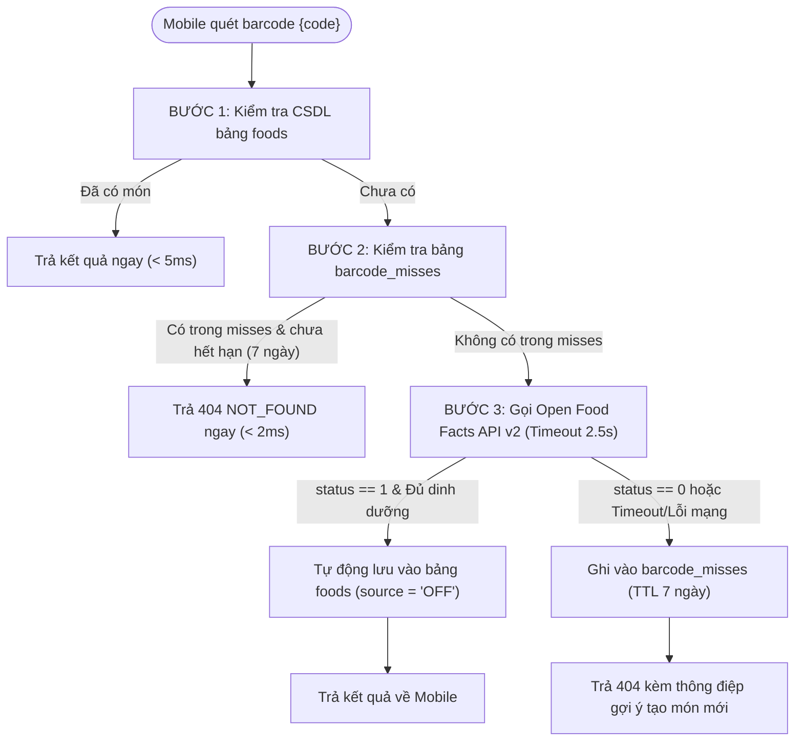
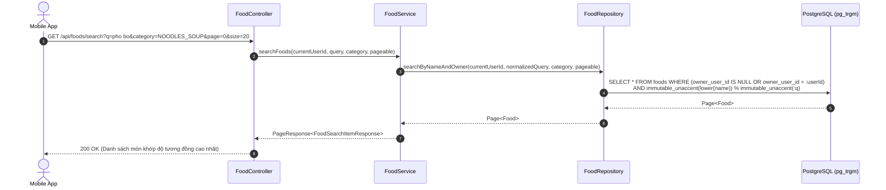
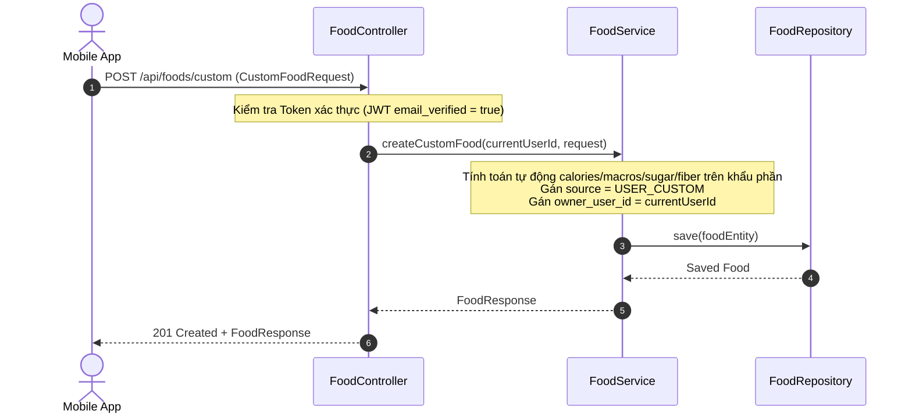
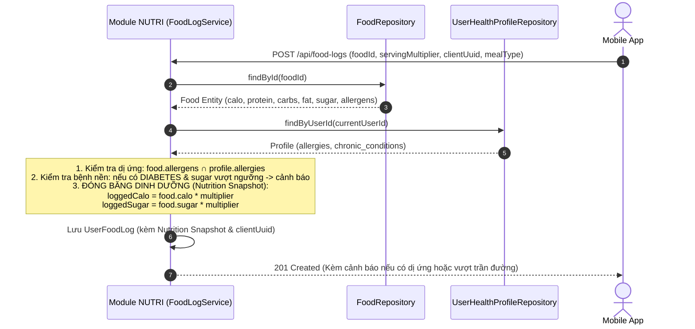

# Kế hoạch triển khai & Đặc tả chi tiết Module FOODDATA — Kallo Backend

**Ngày đồng bộ mã nguồn:** 23/11/2026
**Module:** FOODDATA — Dữ liệu món ăn & Quét mã vạch (SRS Mục 4.9, FR-FD-01 … FR-FD-07b)
**Tập dữ liệu AI tích hợp:** VietFood68 (68 lớp, seed Flyway)
**Phạm vi sở hữu:** Bảng `foods`, `barcode_misses`, tìm kiếm `pg_trgm`, Open Food Facts API v2.

> **Quy ước tài liệu:** `AS-IS` mô tả code/migration hiện tại. `TO-BE` ghi thiết kế đã thống nhất nhưng chưa có migration/entity/API; không coi là chức năng đang chạy.
> **AS-IS:** `foods` là bảng thực phẩm phẳng; dị ứng là `foods.allergens JSONB`; đã có `feature_vector` JSONB từ PLAN. Chưa có bảng `ingredients`, `food_ingredients`, `allergens`, `food_allergens` hoặc `user_allergies`.
> **TO-BE:** Cho phép tạo món từ các ingredient đã có trong danh mục bằng bảng liên kết, và chuẩn hóa dữ liệu dị ứng; xem mục 1.1 và mục 2.2.

---
**Lưu ý trạng thái:** Các bảng/API/module hiện được triển khai trong source; nội dung acceptance/performance phía dưới là mục tiêu thiết kế, trừ khi được xác minh riêng bằng test/benchmark.
---

## 1. Phạm vi, Mục tiêu & Thống nhất Kiến trúc

Module **FOODDATA** đóng vai trò là "kho từ điển thực phẩm và năng lượng" trung tâm của toàn bộ hệ thống Kallo. Mọi tác vụ ghi nhật ký ăn uống (**NUTRI**), tính toán tổng hợp calo hàng ngày (**DailySummary**), đề xuất thực đơn thông minh không dị ứng (**PLAN**), và hiển thị thống kê biểu đồ (**REPORT**) đều phụ thuộc trực tiếp vào tính chính xác của dữ liệu món ăn tại module này.

### 1.1. Cầu nối mô hình khái niệm và schema hiện tại

**AS-IS:** `foods` lưu thực phẩm dạng phẳng (món ăn, sản phẩm barcode, custom food), gồm nutrition trên 100g/serving, allergens JSONB, suitable meal types JSONB, và vector đặc trưng JSONB. Không có ingredient recipe relation hay normalized allergy catalog. Chi tiết đúng schema xem mục 2.1.

**TO-BE đã thống nhất (chưa triển khai):**

```text
foods 1 ── * food_ingredients * ── 1 ingredients
foods 1 ── * food_allergens * ── 1 allergens
user_health_profiles 1 ── * user_allergies * ── 1 allergens
user_health_profiles 1 ── * user_profile_conditions * ── 1 chronic_conditions
```

- Tạo món dạng recipe bằng cách chọn ingredient có sẵn và nhập lượng gram; backend tính nutrition tổng hợp và lưu snapshot vào các trường nutrition hiện có của `foods` để PLAN/NUTRI tiếp tục dùng.
- Dị ứng của recipe được tổng hợp từ nguyên liệu; dị ứng người dùng và nhãn thực phẩm liên kết tới cùng danh mục `allergens`.
- Bệnh nền dùng danh mục `chronic_conditions` và bảng liên kết `user_profile_conditions`; có thể thêm `diagnosed_at`, `severity` theo yêu cầu thiết kế.
- Ingredient/catalog chuẩn hóa hỗ trợ nguồn dinh dưỡng/kiểm chứng; chưa có dữ liệu sodium, purine, potassium hoặc phosphorus đáng tin cậy trong schema hiện tại. Không mô tả lọc bệnh nền là tư vấn/chứng nhận y tế.
- Các bảng đề xuất: `ingredients`, `food_ingredients(food_id, ingredient_id, quantity_grams)`, `allergens`, `food_allergens(food_id, allergen_id)`, `user_allergies(health_profile_id, allergen_id)`, `chronic_conditions`, `user_profile_conditions(health_profile_id, condition_id, diagnosed_at, severity)`. Đây là thiết kế TO-BE, chưa phải DDL đã chạy.
3. **Quy định giao ước với Nhật ký ăn uống (`UserFoodLog` - Module NUTRI):**
   - Không chỉ lưu `servingMultiplier` như sơ đồ lớp, mà bắt buộc áp dụng **Nutrition Snapshot**: Đóng băng trực tiếp các giá trị dinh dưỡng thực tế (`calories`, `protein_g`, `carbs_g`, `fat_g`, `sugar_g`) và lưu kèm `client_uuid` (Idempotency) khi ghi nhật ký.
4. **Phân quyền người dùng:** 
   - Quản lý tập trung trong bảng `users` bằng thuộc tính `role` (`ROLE_USER`, `ROLE_ADMIN`) và Spring Security, không tách bảng kế thừa `Admin extends Member`.
5. **Tách biệt logic tính toán:** 
   - Đặt các phép tính toán sinh học và khẩu phần trong **Domain Service** độc lập, không gắn chặt vào Entity JPA để đảm bảo khả năng viết Unit Test 100%.

---

### 1.2. Bảng ánh xạ yêu cầu chức năng (FR-FD-01 … FR-FD-07b)

| Mã yêu cầu | Tên yêu cầu nghiệp vụ | Mức ưu tiên | Mô tả chi tiết kỹ thuật | Trạng thái |
| :--- | :--- | :---: | :--- | :---: |
| **FR-FD-01** | Lưu danh mục món ăn chuẩn | **M** | Quản lý tên, nhóm món, khẩu phần, nutrition trên 100g/serving, ảnh, barcode, nguồn, dị ứng và bữa phù hợp. | AS-IS đã có |
| **FR-FD-02** | Phân cấp món ăn | **M** | System/OFF dùng chung; custom food gắn `owner_user_id`, chỉ chính chủ được sửa/xóa. | AS-IS đã có |
| **FR-FD-03** | Tìm kiếm món tiếng Việt không dấu | **M** | `unaccent` + `pg_trgm` và lọc category/phân trang theo repository hiện tại. | AS-IS đã có |
| **FR-FD-04** | Nhãn dị ứng thực phẩm | **M** | Hiện lưu trên `foods.allergens JSONB`; chuẩn hóa catalog/relation là TO-BE. | AS-IS JSONB; TO-BE normalized |
| **FR-FD-05** | Giá tham khảo | **S** | `reference_price_vnd` phục vụ hiển thị/PLAN. | AS-IS đã có |
| **FR-FD-06** | Hạt giống VietFood68 | **S** | Seed migration có 68 class id, nutrition, allergen JSONB và suitable meal types. | AS-IS đã có |
| **FR-FD-07a** | Tra cứu barcode nội bộ | **M** | Tra cứu `foods.barcode` và cache miss theo service hiện tại. | AS-IS đã có |
| **FR-FD-07b** | Open Food Facts read-through cache | **S** | Gọi OFF với timeout/cấu hình hiện tại rồi lưu `source=OFF` hoặc `barcode_misses`. | AS-IS đã có; hiệu năng là mục tiêu |
| **FR-FD-08 (TO-BE)** | Tạo recipe từ ingredient có sẵn | **M** | Chọn ingredient + quantity gram; backend tính nutrition/allergen và lưu recipe relations. | Chưa triển khai |

---

### 1.3. Tiêu chí chấp nhận (Acceptance Criteria)

- **AC1 (Hiệu năng tìm kiếm):** API tìm kiếm `GET /api/foods/search?q=...` phản hồi dưới **$100\text{ ms}$** với độ chính xác cao khi gõ tiếng Việt không dấu (ví dụ: gõ "pho bo", "banh mi", "bun cha" đều tìm thấy món tương ứng).
- **AC2 (Độ trễ quét mã vạch):** Tra cứu mã vạch có sẵn trong CSDL phản hồi $\le 10\text{ ms}$. Tra cứu Open Food Facts ngoài được kẹp timeout cứng 2500ms; nếu timeout hoặc lỗi mạng thì hệ thống không bị treo và trả về `404 Not Found` kèm gợi ý người dùng tự tạo món.
- **AC3 (Bảo vệ món hệ thống & Chống IDOR):** Món ăn hệ thống (`owner_user_id IS NULL`) không thể bị sửa hoặc xóa bởi người dùng thông thường (`403 CANNOT_MODIFY_SYSTEM_FOOD`). Món tùy chỉnh chỉ cho phép chính chủ nhân đọc/sửa/xóa.
- **AC4 (Ánh xạ 100% với AI YOLO):** 68 nhãn trong [data.yaml](file:///c:/Users/Loi/Desktop/FoodDetection/data.yaml) được ánh xạ chính xác qua cột `vietfood_class_id` (từ `0` đến `67`). Lớp đặc biệt `Con nguoi` (ID 27) được xử lý riêng biệt để không gây sai lệch dữ liệu dinh dưỡng.
- **AC5 (Hỗ trợ thông số bệnh nền):** Món ăn cung cấp đầy đủ thông tin đường (`sugar`) để phục vụ tính năng cảnh báo/kẹp trần đường đối với người dùng tiểu đường.

---

## 2. Kiến trúc CSDL & Tệp Migration Flyway

Toàn bộ lược đồ được triển khai tại file migration:  
`src/main/resources/db/migration/V20261118100000__food_schema.sql`

```sql
-- 1. Kích hoạt tiện ích mở rộng phục vụ tìm kiếm tiếng Việt không dấu
CREATE EXTENSION IF NOT EXISTS unaccent;
CREATE EXTENSION IF NOT EXISTS pg_trgm;

-- 2. Hàm chuyển đổi chuỗi bỏ dấu bất biến (Immutable) để đánh chỉ mục GIN
CREATE OR REPLACE FUNCTION immutable_unaccent(text)
RETURNS text AS $$
  SELECT public.unaccent('public.unaccent', $1);
$$ LANGUAGE sql IMMUTABLE PARALLEL SAFE STRICT;

-- 3. Bảng foods: Lưu trữ toàn bộ thực phẩm hệ thống, đóng gói và món tùy chỉnh
CREATE TABLE foods (
    id                      UUID PRIMARY KEY DEFAULT gen_random_uuid(),
    name                    VARCHAR(255) NOT NULL,
    name_unaccented         VARCHAR(255) NOT NULL,
    category                VARCHAR(50) NOT NULL,
    default_serving_name    VARCHAR(100) NOT NULL,
    default_serving_grams   NUMERIC(6, 1) NOT NULL CHECK (default_serving_grams > 0),
    
    -- Chỉ số dinh dưỡng trên 100g thực phẩm
    calories_per_100g       NUMERIC(6, 1) NOT NULL CHECK (calories_per_100g >= 0),
    protein_per_100g        NUMERIC(5, 1) NOT NULL CHECK (protein_per_100g >= 0),
    carbs_per_100g          NUMERIC(5, 1) NOT NULL CHECK (carbs_per_100g >= 0),
    fat_per_100g            NUMERIC(5, 1) NOT NULL CHECK (fat_per_100g >= 0),
    sugar_per_100g          NUMERIC(5, 1) NOT NULL DEFAULT 0.0 CHECK (sugar_per_100g >= 0),
    fiber_per_100g          NUMERIC(5, 1) NOT NULL DEFAULT 0.0 CHECK (fiber_per_100g >= 0),

    -- Chỉ số dinh dưỡng quy đổi trên 1 khẩu phần chuẩn (default serving)
    calories_per_serving    INTEGER NOT NULL CHECK (calories_per_serving >= 0),
    protein_per_serving     NUMERIC(5, 1) NOT NULL CHECK (protein_per_serving >= 0),
    carbs_per_serving       NUMERIC(5, 1) NOT NULL CHECK (carbs_per_serving >= 0),
    fat_per_serving         NUMERIC(5, 1) NOT NULL CHECK (fat_per_serving >= 0),
    sugar_per_serving       NUMERIC(5, 1) NOT NULL DEFAULT 0.0 CHECK (sugar_per_serving >= 0),
    fiber_per_serving       NUMERIC(5, 1) NOT NULL DEFAULT 0.0 CHECK (fiber_per_serving >= 0),

    image_url               TEXT,
    barcode                 VARCHAR(64),
    source                  VARCHAR(30) NOT NULL DEFAULT 'SYSTEM', -- SYSTEM, OFF, USER_CUSTOM
    vietfood_class_id       INTEGER UNIQUE CHECK (vietfood_class_id BETWEEN 0 AND 67),
    allergens               JSONB NOT NULL DEFAULT '[]'::jsonb,
    suitable_meal_types     JSONB NOT NULL DEFAULT '["BREAKFAST", "LUNCH", "DINNER"]'::jsonb,
    reference_price_vnd     INTEGER CHECK (reference_price_vnd IS NULL OR reference_price_vnd >= 0),
    
    is_verified             BOOLEAN NOT NULL DEFAULT TRUE,
    owner_user_id           UUID REFERENCES users (id) ON DELETE CASCADE,
    
    created_at              TIMESTAMPTZ NOT NULL DEFAULT now(),
    updated_at              TIMESTAMPTZ NOT NULL DEFAULT now()
);

-- Chỉ mục tìm kiếm Full-Text tiếng Việt không dấu (Trigram GIN)
CREATE INDEX idx_foods_name_trgm 
ON foods USING GIN (immutable_unaccent(lower(name)) gin_trgm_ops);

-- Chỉ mục phục vụ tìm kiếm theo mã vạch
CREATE INDEX idx_foods_barcode ON foods (barcode) WHERE barcode IS NOT NULL;

-- Chỉ mục phục vụ phân quyền dữ liệu người dùng
CREATE INDEX idx_foods_owner ON foods (owner_user_id);

-- Chỉ mục lọc theo nhóm món
CREATE INDEX idx_foods_category ON foods (category);

-- 4. Bảng barcode_misses: Lưu bộ đệm các mã vạch quét thất bại từ Open Food Facts
CREATE TABLE barcode_misses (
    barcode                 VARCHAR(64) PRIMARY KEY,
    queried_at              TIMESTAMPTZ NOT NULL DEFAULT now(),
    expires_at              TIMESTAMPTZ NOT NULL DEFAULT (now() + INTERVAL '7 days')
);

CREATE INDEX idx_barcode_misses_expiry ON barcode_misses (expires_at);
```

---

### 2.1. Từ điển dữ liệu bảng `foods`

| Tên cột | Kiểu dữ liệu | Ràng buộc | Ý nghĩa và mục đích sử dụng |
| :--- | :--- | :--- | :--- |
| `id` | `UUID` | `PRIMARY KEY` | Định danh duy nhất UUID v4 của món ăn. |
| `name` | `VARCHAR(255)` | `NOT NULL` | Tên đầy đủ tiếng Việt có dấu (ví dụ: *Phở bò*, *Bánh mì thịt*). |
| `name_unaccented` | `VARCHAR(255)` | `NOT NULL` | Tên viết thường không dấu phục vụ hiển thị hoặc tìm kiếm tiền tố. |
| `category` | `VARCHAR(50)` | `NOT NULL` | Phân loại món: `NOODLES_SOUP`, `RICE_DISH`, `BREAD_SANDWICH`, `ROLLS_CAKE`, `PANCAKE`, `STEW`, `GRILLED`, `VEGETABLES`, `FISH_SEAFOOD`, `MEAT`, `FASTFOOD`, `SNACK`, `SOUP`, `PORRIDGE`, `SALAD`, `STAPLE`, `DAIRY`, `EGG`, `PICKLED`. |
| `default_serving_name` | `VARCHAR(100)` | `NOT NULL` | Tên khẩu phần đời thực gần gũi: *1 tô vừa*, *1 dĩa*, *1 ổ*, *100g*, *1 chén*. |
| `default_serving_grams`| `NUMERIC(6, 1)` | `> 0` | Trọng lượng tương đương tính bằng gam (g) của một khẩu phần chuẩn. |
| `calories_per_100g` | `NUMERIC(6, 1)` | `>= 0` | Năng lượng (kcal) trên 100g thực phẩm. |
| `protein_per_100g` | `NUMERIC(5, 1)` | `>= 0` | Lượng chất đạm (gam) trên 100g. |
| `carbs_per_100g` | `NUMERIC(5, 1)` | `>= 0` | Lượng chất bột đường (gam) trên 100g. |
| `fat_per_100g` | `NUMERIC(5, 1)` | `>= 0` | Lượng chất béo (gam) trên 100g. |
| `sugar_per_100g` | `NUMERIC(5, 1)` | `>= 0` | Lượng đường đơn/đôi (gam) trên 100g (phục vụ kiểm soát tiểu đường). |
| `fiber_per_100g` | `NUMERIC(5, 1)` | `>= 0` | Lượng chất xơ (gam) trên 100g. |
| `calories_per_serving` | `INTEGER` | `>= 0` | Năng lượng tính sẵn trên 1 khẩu phần chuẩn (được làm tròn). |
| `protein_per_serving` | `NUMERIC(5, 1)` | `>= 0` | Lượng đạm (gam) trên 1 khẩu phần chuẩn. |
| `carbs_per_serving` | `NUMERIC(5, 1)` | `>= 0` | Lượng bột đường (gam) trên 1 khẩu phần chuẩn. |
| `fat_per_serving` | `NUMERIC(5, 1)` | `>= 0` | Lượng chất béo (gam) trên 1 khẩu phần chuẩn. |
| `sugar_per_serving` | `NUMERIC(5, 1)` | `>= 0` | Lượng đường (gam) trên 1 khẩu phần chuẩn. |
| `fiber_per_serving` | `NUMERIC(5, 1)` | `>= 0` | Lượng chất xơ (gam) trên 1 khẩu phần chuẩn. |
| `image_url` | `TEXT` | `NULLABLE` | Đường dẫn ảnh CDN/MinIO hoặc URL gốc từ Open Food Facts. |
| `barcode` | `VARCHAR(64)` | `NULLABLE` | Mã số mã vạch sản phẩm (EAN-13, EAN-8, UPC-A, GTIN). |
| `source` | `VARCHAR(30)` | `NOT NULL` | Nguồn dữ liệu: `SYSTEM` (hạt giống chuẩn), `OFF` (Open Food Facts), `USER_CUSTOM` (người dùng tạo). |
| `vietfood_class_id` | `INTEGER` | `UNIQUE, 0..67` | Mã lớp ánh xạ trực tiếp với chỉ số lớp của mô hình YOLO AI. |
| `allergens` | `JSONB` | `DEFAULT '[]'` | Mảng chuỗi các nhóm dị ứng: `PEANUT`, `CRUSTACEANS`, `FISH`, `GLUTEN`, `DAIRY`, `EGG`, `SOY`, `MOLLUSCS`. |
| `suitable_meal_types`| `JSONB` | `NOT NULL` | Danh sách bữa ăn phù hợp: `["BREAKFAST", "LUNCH", "DINNER", "SNACK"]`. |
| `reference_price_vnd` | `INTEGER` | `>= 0` | Giá ước tính (VNĐ) phục vụ thuật toán lên thực đơn theo ngân sách (Sprint 3). |
| `is_verified` | `BOOLEAN` | `DEFAULT TRUE` | Đánh dấu thực phẩm đã được xác thực chỉ số dinh dưỡng đáng tin cậy. |
| `owner_user_id` | `UUID` | `ON DELETE CASCADE` | `NULL` đối với món dùng chung toàn hệ thống; có giá trị đối với món tùy chỉnh của người dùng. |
| `feature_vector` | `JSONB` | PLAN migration, mặc định vector 12 chiều | Vector đặc trưng do PLAN dùng để xếp hạng theo preference; không có trong food migration nền. |
| `created_at`, `updated_at` | `TIMESTAMPTZ` | `NOT NULL` | Audit timestamps. |

### 2.2 TO-BE — recipe và dị ứng chuẩn hóa (chưa triển khai)

```sql
CREATE TABLE ingredients (
    id UUID PRIMARY KEY DEFAULT gen_random_uuid(),
    name VARCHAR(255) NOT NULL,
    calories_per_100g NUMERIC(6,1) NOT NULL,
    protein_per_100g NUMERIC(5,1) NOT NULL,
    carbs_per_100g NUMERIC(5,1) NOT NULL,
    fat_per_100g NUMERIC(5,1) NOT NULL,
    sugar_per_100g NUMERIC(5,1) NOT NULL DEFAULT 0,
    fiber_per_100g NUMERIC(5,1) NOT NULL DEFAULT 0,
    allergens JSONB NOT NULL DEFAULT '[]'::jsonb
);
CREATE TABLE food_ingredients (
    food_id UUID NOT NULL REFERENCES foods(id) ON DELETE CASCADE,
    ingredient_id UUID NOT NULL REFERENCES ingredients(id),
    quantity_grams NUMERIC(7,1) NOT NULL CHECK (quantity_grams > 0),
    PRIMARY KEY (food_id, ingredient_id),
    CHECK (food_id <> ingredient_id)
);
```

`ingredients` và `food_ingredients` chỉ là DDL đề xuất. Khi triển khai thực tế, nutrition per-serving/per-100g, allergens và feature vector của món recipe phải được backend tính từ ingredients và ghi lại vào `foods`; không nhận snapshot do client tự tính. Mở rộng sodium/purine/potassium/phosphorus chỉ thực hiện khi có nguồn dữ liệu dinh dưỡng có thể kiểm chứng.

---

## 3. Danh mục 68 Lớp VietFood68 (Ánh Xạ Chuẩn Tệp `data.yaml`)

Tệp migration hạt giống: `src/main/resources/db/migration/V20261118100001__seed_vietfood68.sql`

Toàn bộ 68 lớp được lấy nguyên vẹn theo đúng thứ tự index `0..67` trong [data.yaml](file:///c:/Users/Loi/Desktop/FoodDetection/data.yaml), bổ sung định lượng dinh dưỡng tiêu chuẩn (bao gồm Calo, P/C/F, Đường, Xơ) và nhóm bữa ăn phù hợp:

| ID | Nhãn `data.yaml` | Tên tiếng Việt | Nhóm món | Khẩu phần chuẩn | Calo/Khẩu phần | Đường/Xơ (g) | Dị ứng (`allergens`) | Bữa phù hợp (`suitable_meal_types`) |
| :---: | :--- | :--- | :--- | :--- | :---: | :---: | :--- | :--- |
| **0** | `Banh canh` | Bánh canh | `NOODLES_SOUP` | 1 tô vừa (450g) | 396 kcal | 2.5 / 1.8 | `["GLUTEN", "CRUSTACEANS"]` | `["BREAKFAST", "LUNCH", "DINNER"]` |
| **1** | `Banh chung` | Bánh chưng | `TRADITIONAL_CAKE` | 1 miếng (150g) | 338 kcal | 1.2 / 2.5 | `[]` | `["BREAKFAST", "LUNCH", "DINNER"]` |
| **2** | `Banh cuon` | Bánh cuốn | `ROLLS_CAKE` | 1 đĩa (250g) | 338 kcal | 1.8 / 1.5 | `[]` | `["BREAKFAST", "DINNER"]` |
| **3** | `Banh khot` | Bánh khọt | `PANCAKE` | 1 đĩa 6 cái (200g) | 420 kcal | 2.0 / 1.2 | `["CRUSTACEANS"]` | `["LUNCH", "DINNER", "SNACK"]` |
| **4** | `Banh mi` | Bánh mì thịt | `BREAD_SANDWICH` | 1 ổ (180g) | 450 kcal | 3.5 / 2.8 | `["GLUTEN", "DAIRY"]` | `["BREAKFAST", "LUNCH", "SNACK"]` |
| **5** | `Banh trang` | Bánh tráng | `SNACK` | 1 cái (50g) | 140 kcal | 0.5 / 0.8 | `[]` | `["SNACK"]` |
| **6** | `Banh trang tron`| Bánh tráng trộn | `SNACK` | 1 bịch (150g) | 390 kcal | 5.5 / 2.0 | `["PEANUT", "EGG", "CRUSTACEANS"]` | `["SNACK"]` |
| **7** | `Banh xeo` | Bánh xèo | `PANCAKE` | 1 cái vừa (250g) | 488 kcal | 2.5 / 3.0 | `["CRUSTACEANS"]` | `["LUNCH", "DINNER"]` |
| **8** | `Bo kho` | Bò kho | `STEW` | 1 tô vừa (350g) | 438 kcal | 4.2 / 2.5 | `[]` | `["BREAKFAST", "LUNCH", "DINNER"]` |
| **9** | `Bo la lot` | Bò lá lốt | `GRILLED` | 1 phần (200g) | 370 kcal | 2.8 / 2.2 | `["PEANUT", "FISH"]` | `["LUNCH", "DINNER"]` |
| **10**| `Bong cai` | Bông cải luộc | `VEGETABLES` | 1 đĩa (150g) | 53 kcal | 2.1 / 3.8 | `[]` | `["LUNCH", "DINNER"]` |
| **11**| `Bun` | Bún tươi | `STAPLE` | 1 bát (150g) | 165 kcal | 0.2 / 0.8 | `[]` | `["BREAKFAST", "LUNCH", "DINNER"]` |
| **12**| `Bun bo Hue` | Bún bò Huế | `NOODLES_SOUP` | 1 tô vừa (500g) | 630 kcal | 2.8 / 2.0 | `["CRUSTACEANS"]` | `["BREAKFAST", "LUNCH", "DINNER"]` |
| **13**| `Bun cha` | Bún chả | `NOODLES_DISH` | 1 phần (450g) | 594 kcal | 8.5 / 2.5 | `["FISH"]` | `["LUNCH", "DINNER"]` |
| **14**| `Bun dau` | Bún đậu mắm tôm | `NOODLES_DISH` | 1 mẹt (400g) | 660 kcal | 3.2 / 3.0 | `["CRUSTACEANS", "SOY"]` | `["LUNCH", "DINNER"]` |
| **15**| `Bun mam` | Bún mắm | `NOODLES_SOUP` | 1 tô (550g) | 633 kcal | 4.5 / 3.5 | `["FISH", "CRUSTACEANS", "MOLLUSCS"]` | `["LUNCH", "DINNER"]` |
| **16**| `Bun rieu` | Bún riêu cua | `NOODLES_SOUP` | 1 tô (500g) | 490 kcal | 3.0 / 2.5 | `["CRUSTACEANS", "SOY"]` | `["BREAKFAST", "LUNCH", "DINNER"]` |
| **17**| `Ca` | Cá hấp / chiên | `FISH_SEAFOOD` | 1 khúc (150g) | 218 kcal | 0.0 / 0.0 | `["FISH"]` | `["LUNCH", "DINNER"]` |
| **18**| `Ca chua` | Cà chua tươi | `FRUIT_VEG` | 1 quả (100g) | 18 kcal | 2.6 / 1.2 | `[]` | `["BREAKFAST", "LUNCH", "DINNER", "SNACK"]` |
| **19**| `Ca phao` | Cà pháo muối | `PICKLED` | 1 đĩa nhỏ (50g) | 14 kcal | 1.2 / 1.0 | `[]` | `["LUNCH", "DINNER"]` |
| **20**| `Ca rot` | Cà rốt luộc | `VEGETABLES` | 1 củ (100g) | 41 kcal | 4.7 / 2.8 | `[]` | `["LUNCH", "DINNER"]` |
| **21**| `Canh` | Canh rau thịt | `SOUP` | 1 tô (250g) | 120 kcal | 1.5 / 1.8 | `[]` | `["LUNCH", "DINNER"]` |
| **22**| `Cha` | Chả lụa | `PROCESSED_MEAT` | 1 khoanh (100g) | 230 kcal | 1.0 / 0.0 | `[]` | `["BREAKFAST", "LUNCH", "DINNER", "SNACK"]` |
| **23**| `Cha gio` | Chả giò (Nem rán) | `FRIED` | 3 cuốn (120g) | 342 kcal | 2.5 / 1.5 | `["EGG", "CRUSTACEANS"]` | `["LUNCH", "DINNER"]` |
| **24**| `Chanh` | Quả chanh | `FRUIT_VEG` | 1 quả (50g) | 15 kcal | 1.3 / 1.4 | `[]` | `["BREAKFAST", "LUNCH", "DINNER"]` |
| **25**| `Com` | Cơm trắng | `STAPLE` | 1 chén (150g) | 195 kcal | 0.1 / 0.6 | `[]` | `["LUNCH", "DINNER"]` |
| **26**| `Com tam` | Cơm tấm sườn bì chả | `RICE_DISH` | 1 dĩa (400g) | 728 kcal | 6.5 / 2.2 | `["EGG", "FISH"]` | `["BREAKFAST", "LUNCH", "DINNER"]` |
| **27**| `Con nguoi` | *(Người - Non-food)* | `NON_FOOD` | Không áp dụng | 0 kcal | 0.0 / 0.0 | `[]` | `[]` *(Tự động lọc bỏ khi AI trả về)* |
| **28**| `Cu kieu` | Củ kiệu muối | `PICKLED` | 1 đĩa nhỏ (50g) | 34 kcal | 6.5 / 0.8 | `[]` | `["LUNCH", "DINNER"]` |
| **29**| `Cua` | Cua biển hấp | `FISH_SEAFOOD` | 1 con (250g thịt) | 238 kcal | 0.0 / 0.0 | `["CRUSTACEANS"]` | `["LUNCH", "DINNER"]` |
| **30**| `Dau hu` | Đậu hũ | `SOY_PRODUCT` | 1 miếng (100g) | 90 kcal | 0.6 / 1.2 | `["SOY"]` | `["BREAKFAST", "LUNCH", "DINNER"]` |
| **31**| `Dua chua` | Dưa cải chua | `PICKLED` | 1 đĩa (100g) | 22 kcal | 1.0 / 1.8 | `[]` | `["LUNCH", "DINNER"]` |
| **32**| `Dua leo` | Dưa leo | `VEGETABLES` | 1 trái (100g) | 15 kcal | 1.7 / 0.5 | `[]` | `["BREAKFAST", "LUNCH", "DINNER", "SNACK"]` |
| **33**| `Goi cuon` | Gỏi cuốn tôm thịt | `ROLLS_CAKE` | 2 cuốn (160g) | 237 kcal | 2.5 / 2.0 | `["CRUSTACEANS", "PEANUT"]` | `["LUNCH", "DINNER", "SNACK"]` |
| **34**| `Hamburger` | Bánh burger | `FASTFOOD` | 1 cái (200g) | 520 kcal | 6.8 / 2.4 | `["GLUTEN", "DAIRY"]` | `["BREAKFAST", "LUNCH", "DINNER"]` |
| **35**| `Heo quay` | Thịt heo quay | `MEAT` | 1 phần (150g) | 420 kcal | 0.5 / 0.0 | `[]` | `["LUNCH", "DINNER"]` |
| **36**| `Hu tieu` | Hủ tiếu Nam Vang | `NOODLES_SOUP` | 1 tô (450g) | 473 kcal | 2.2 / 1.5 | `["CRUSTACEANS", "EGG"]` | `["BREAKFAST", "LUNCH", "DINNER"]` |
| **37**| `Kho qua thit`| Canh khổ qua nhồi thịt | `SOUP` | 1 khúc (150g) | 165 kcal | 1.8 / 2.8 | `[]` | `["LUNCH", "DINNER"]` |
| **38**| `Khoai tay chien`| Khoai tây chiên | `SNACK` | 1 phần (120g) | 374 kcal | 0.8 / 3.8 | `[]` | `["SNACK"]` |
| **39**| `Lau` | Lẩu thập cẩm | `HOTPOT` | 1 phần (350g) | 473 kcal | 3.5 / 4.0 | `["CRUSTACEANS", "FISH"]` | `["DINNER"]` |
| **40**| `Long heo` | Lòng heo luộc | `MEAT` | 1 đĩa (150g) | 285 kcal | 0.0 / 0.0 | `[]` | `["LUNCH", "DINNER"]` |
| **41**| `Mi` | Mì tôm / Mì gói | `NOODLES` | 1 tô (120g) | 456 kcal | 2.5 / 1.8 | `["GLUTEN"]` | `["BREAKFAST", "SNACK"]` |
| **42**| `Muc` | Mực hấp / xào | `FISH_SEAFOOD` | 1 con (150g) | 138 kcal | 0.0 / 0.0 | `["MOLLUSCS"]` | `["LUNCH", "DINNER"]` |
| **43**| `Nam` | Nấm tươi các loại | `VEGETABLES` | 1 đĩa (100g) | 32 kcal | 1.8 / 2.2 | `[]` | `["LUNCH", "DINNER"]` |
| **44**| `Oc` | Thịt ốc luộc | `FISH_SEAFOOD` | 1 đĩa (150g) | 128 kcal | 0.0 / 0.0 | `["MOLLUSCS"]` | `["LUNCH", "DINNER", "SNACK"]` |
| **45**| `Ot chuong` | Ớt chuông | `VEGETABLES` | 1 quả (100g) | 26 kcal | 4.2 / 2.1 | `[]` | `["LUNCH", "DINNER", "SALAD"]` |
| **46**| `Pho` | Phở bò | `NOODLES_SOUP` | 1 tô (500g) | 525 kcal | 2.5 / 1.5 | `[]` | `["BREAKFAST", "LUNCH", "DINNER"]` |
| **47**| `Pho mai` | Phô mai lát | `DAIRY` | 1 lát (25g) | 95 kcal | 0.5 / 0.0 | `["DAIRY"]` | `["BREAKFAST", "SNACK"]` |
| **48**| `Rau` | Rau sống tổng hợp | `VEGETABLES` | 1 đĩa (100g) | 20 kcal | 1.2 / 2.5 | `[]` | `["LUNCH", "DINNER"]` |
| **49**| `Salad` | Salad sốt mè | `SALAD` | 1 đĩa (150g) | 113 kcal | 4.5 / 3.0 | `[]` | `["LUNCH", "DINNER"]` |
| **50**| `Thit bo` | Thịt bò xào | `MEAT` | 1 phần (150g) | 278 kcal | 0.5 / 0.0 | `[]` | `["LUNCH", "DINNER"]` |
| **51**| `Thit ga` | Thịt gà luộc | `POULTRY` | 1 đùi/phần (150g) | 293 kcal | 0.0 / 0.0 | `[]` | `["LUNCH", "DINNER"]` |
| **52**| `Thit heo` | Thịt heo luộc | `MEAT` | 1 đĩa (150g) | 368 kcal | 0.0 / 0.0 | `[]` | `["LUNCH", "DINNER"]` |
| **53**| `Thit kho` | Thịt kho hột vịt | `STEW` | 1 phần (200g) | 470 kcal | 5.5 / 0.5 | `["EGG"]` | `["LUNCH", "DINNER"]` |
| **54**| `Thit nuong` | Thịt heo xiên nướng | `GRILLED` | 2 xiên (120g) | 312 kcal | 2.8 / 0.2 | `[]` | `["LUNCH", "DINNER", "SNACK"]` |
| **55**| `Tom` | Tôm luộc / hấp | `FISH_SEAFOOD` | 1 phần (120g) | 119 kcal | 0.0 / 0.0 | `["CRUSTACEANS"]` | `["LUNCH", "DINNER"]` |
| **56**| `Trung` | Trứng ốp la / luộc | `EGG` | 1 quả (55g) | 85 kcal | 0.4 / 0.0 | `["EGG"]` | `["BREAKFAST", "LUNCH", "DINNER"]` |
| **57**| `Xoi` | Xôi mặn | `STAPLE` | 1 gói (200g) | 490 kcal | 1.5 / 2.0 | `[]` | `["BREAKFAST", "SNACK"]` |
| **58**| `Banh beo` | Bánh bèo | `ROLLS_CAKE` | 1 mâm (180g) | 279 kcal | 1.8 / 1.2 | `["CRUSTACEANS", "FISH"]` | `["BREAKFAST", "SNACK"]` |
| **59**| `Cao lau` | Cao lầu Hội An | `NOODLES_DISH` | 1 tô (400g) | 500 kcal | 3.2 / 2.8 | `["GLUTEN", "SOY"]` | `["LUNCH", "DINNER"]` |
| **60**| `Mi Quang` | Mì Quảng | `NOODLES_DISH` | 1 tô (450g) | 576 kcal | 3.5 / 3.0 | `["PEANUT", "CRUSTACEANS"]` | `["BREAKFAST", "LUNCH", "DINNER"]` |
| **61**| `Com chien duong chau`| Cơm chiên Dương Châu| `RICE_DISH` | 1 đĩa (300g) | 585 kcal | 2.5 / 1.8 | `["EGG"]` | `["LUNCH", "DINNER"]` |
| **62**| `Bun cha ca`| Bún chả cá | `NOODLES_SOUP` | 1 tô (500g) | 475 kcal | 3.0 / 2.2 | `["FISH"]` | `["BREAKFAST", "LUNCH", "DINNER"]` |
| **63**| `Com chien ga` | Cơm chiên gà xối mỡ | `RICE_DISH` | 1 đĩa (350g) | 718 kcal | 1.2 / 1.5 | `[]` | `["LUNCH", "DINNER"]` |
| **64**| `Chao long` | Cháo lòng | `PORRIDGE` | 1 tô (450g) | 405 kcal | 1.0 / 1.2 | `[]` | `["BREAKFAST", "DINNER"]` |
| **65**| `Nom hoa chuoi`| Nộm hoa chuối | `SALAD` | 1 đĩa (250g) | 263 kcal | 5.2 / 4.5 | `["PEANUT"]` | `["LUNCH", "DINNER"]` |
| **66**| `Nui xao bo`| Nui xào bò | `PASTA_DISH` | 1 đĩa (300g) | 525 kcal | 3.8 / 2.5 | `["GLUTEN"]` | `["BREAKFAST", "LUNCH", "DINNER"]` |
| **67**| `Sup cua` | Súp cua | `SOUP` | 1 chén (250g) | 230 kcal | 2.2 / 1.0 | `["CRUSTACEANS", "EGG"]` | `["BREAKFAST", "SNACK", "DINNER"]` |

---

### 3.1. Cơ chế xử lý Lớp đặc biệt ID 27 (`Con nguoi` / Person)

Trong tệp `c:\Users\Loi\Desktop\FoodDetection\data.yaml` và mã nguồn AI `app.py`:
- Lớp số `27` mang nhãn `Con nguoi`. Đây là nhãn đối tượng người trong ảnh khi chụp bữa ăn.
- **Quy tắc xử lý bắt buộc tại Backend:**
  1. Trong file migration seed `V...__seed_vietfood68.sql`, không chèn bản ghi ăn uống thông thường hoặc chèn với cờ `category = 'NON_FOOD'` và `is_verified = false`.
  2. Tại dịch vụ tích hợp AI (`FoodRecognitionService` ở Sprint 2): Khi AI trả về danh sách `all_items`, Backend tự động loại bỏ các phần tử có `label == 'Con nguoi'` hoặc `vietfood_class_id == 27`.
  3. Nếu ảnh chỉ chụp người mà không có món ăn nào khác, hệ thống phản hồi lỗi `400 NON_FOOD_DETECTED` ("Không tìm thấy món ăn hợp lệ trong ảnh").

---

## 4. Tích Hợp Open Food Facts API v2 & Cơ Chế Read-Through Cache

Để hỗ trợ tính năng quét mã vạch thực phẩm đóng gói (`FR-FD-07a`, `FR-FD-07b`), Backend Kallo tích hợp với **Open Food Facts API v2** theo mô hình bộ đệm 3 bước:



### 4.1. Đặc tả Client `OpenFoodFactsClient`

- **Endpoint gọi ngoại vi:**  
  `GET https://world.openfoodfacts.org/api/v2/product/{barcode}?fields=code,product_name,product_name_vi,brands,nutriments,serving_size,serving_quantity,image_front_url,allergens_tags`
- **Header bắt buộc theo chính sách Open Food Facts:**  
  `User-Agent: KalloNutritionApp/1.0 (contact@kallo.vn)`
- **Cấu hình Timeout:**
  - `ConnectTimeout`: 2000 ms.
  - `ReadTimeout`: 2500 ms.
- **Tiêu chí chấp nhận sản phẩm:**
  - `status == 1` và có thông tin tên sản phẩm (`product_name` hoặc `product_name_vi`).
  - Có tối thiểu thông tin năng lượng `energy-kcal_100g` hoặc `energy-kcal_serving`. Nếu thiếu calo hoặc macro cơ bản, không tự động lưu vào `foods` mà trả 404 để người dùng tự nhập tay món tùy chỉnh.

---

## 5. Thiết Kế Chi Tiết Tầng Kỹ Thuật (Architecture & APIs)

Mô hình phân tầng theo chuẩn `com.healthcare.kallo.*`:

```
src/main/java/com/healthcare/kallo/
├── controller/food/
│   ├── FoodController.java           # /api/foods/** (Tìm kiếm, Chi tiết, CRUD món tùy chỉnh)
│   └── BarcodeController.java        # /api/foods/barcode/{code}
├── model/food/
│   ├── Food.java                     # JPA Entity cho bảng foods
│   ├── BarcodeMiss.java              # JPA Entity cho bảng barcode_misses
│   └── enums/
│       ├── FoodCategory.java         # Enum nhóm món ăn
│       ├── FoodSource.java           # Enum nguồn gốc (SYSTEM, OFF, USER_CUSTOM)
│       └── MealType.java             # Enum bữa ăn (BREAKFAST, LUNCH, DINNER, SNACK)
├── repository/food/
│   ├── FoodRepository.java           # Query pg_trgm unaccent, query barcode, query vietfood_class_id
│   └── BarcodeMissRepository.java    # Cache misses tra cứu
├── service/food/
│   ├── FoodService.java              # Interface nghiệp vụ tìm kiếm, CRUD custom food
│   ├── BarcodeService.java           # Interface xử lý Read-Through Cache mã vạch
│   ├── client/
│   │   └── OpenFoodFactsClient.java  # RestClient gọi API Open Food Facts v2
│   └── impl/
│       ├── FoodServiceImpl.java
│       └── BarcodeServiceImpl.java
└── dto/
    ├── request/food/
    │   └── CustomFoodRequest.java    # Payload tạo/sửa món ăn của người dùng (kèm sugar, fiber, mealTypes)
    └── response/food/
        ├── FoodResponse.java          # Chi tiết món ăn đầy đủ (kèm sugar, fiber, allergens, suitableMealTypes)
        └── FoodSearchItemResponse.java# Phần tử rút gọn trong danh sách tìm kiếm
```

### 5.1. Danh mục Endpoints REST API

| HTTP Method | Đường dẫn Endpoint | Quyền hạn | Mô tả chức năng |
| :--- | :--- | :---: | :--- |
| `GET` | `/api/foods/search` | `USER` | Tìm kiếm món ăn có phân trang (`q`, `category`, `page`, `size`). Tự động trả về món hệ thống + món của chính user. |
| `GET` | `/api/foods/{id}` | `USER` | Lấy chi tiết món ăn theo UUID (bao gồm Calo, P/C/F, Đường, Xơ, Dị ứng). |
| `GET` | `/api/foods/barcode/{code}` | `USER` | Tra cứu thực phẩm theo mã vạch qua bộ đệm 3 bước. |
| `GET` | `/api/foods/vietfood/{classId}` | `USER/INTERNAL` | Tra cứu món ăn theo `vietfood_class_id` (0..67) phục vụ AI Service. |
| `POST` | `/api/foods/custom` | `USER` | Tạo món ăn tùy chỉnh thuộc sở hữu cá nhân (`source = 'USER_CUSTOM'`). |
| `PUT` | `/api/foods/custom/{id}` | `USER` | Cập nhật món ăn tùy chỉnh (chỉ chính chủ mới sửa được). |
| `DELETE`| `/api/foods/custom/{id}` | `USER` | Xóa món ăn tùy chỉnh của mình. |

---

## 6. Sơ Đồ Trình Tự Nghiệp Vụ (Sequence Diagrams)

### 6.1. Tìm kiếm món ăn tiếng Việt không dấu (`GET /api/foods/search`)



### 6.2. Tạo món ăn tùy chỉnh của người dùng (`POST /api/foods/custom`)



### 6.3. Cung cấp Dữ liệu Dinh dưỡng Snapshot & Cảnh báo Sức khỏe cho Module NUTRI



---

## 7. Mã Lỗi Nghiệp Vụ Cần Bổ Sung (`ErrorCode.java`)

Các mã lỗi mới thuộc phạm vi của FOODDATA:

```java
public enum ErrorCode {
  FOOD_NOT_FOUND(HttpStatus.NOT_FOUND, "Food item not found"),
  CANNOT_MODIFY_SYSTEM_FOOD(HttpStatus.FORBIDDEN, "Cannot modify or delete system food"),
  INVALID_BARCODE(HttpStatus.BAD_REQUEST, "Invalid barcode format"),
  BARCODE_NOT_FOUND(HttpStatus.NOT_FOUND, "Barcode not found in local database or Open Food Facts"),
  NON_FOOD_DETECTED(HttpStatus.BAD_REQUEST, "Detected object is not a food item");
}
```

---

## 8. Kế Hoạch Kiểm Thử Toàn Diện (Test Matrix)

| Lớp kiểm thử | Phương thức / Kịch bản | Mục tiêu kiểm thử | Tiêu chuẩn đạt |
| :--- | :--- | :--- | :---: |
| `FoodSearchTest` | `testSearchVietnameseUnaccent` | Tìm kiếm các từ khóa: `"pho"`, `"banh mi"`, `"bun cha"`, `"ca kho"` trả về đúng món tương ứng dù gõ không dấu. | Độ trễ $\le 50$ms, trả về đúng món mục tiêu. |
| `FoodSearchTest` | `testDataIsolation` | Người dùng A không tìm thấy món tùy chỉnh của Người dùng B. Cả A và B đều thấy món hệ thống. | Bảo mật 100%, không rò rỉ dữ liệu chéo. |
| `BarcodeServiceTest`| `testReadThroughCache_LocalHit` | Quét mã vạch có sẵn trong CSDL. | Phản hồi $\le 5$ms, không kích hoạt HTTP client ra ngoài. |
| `BarcodeServiceTest`| `testReadThroughCache_MissCache`| Quét mã vạch nằm trong bảng `barcode_misses`. | Trả `404 Not Found` ngay lập tức, không gọi Open Food Facts. |
| `BarcodeServiceTest`| `testOpenFoodFactsClient_Success`| Mock response OFF API v2 trả về sản phẩm EAN-13 hợp lệ. | Lưu thành công vào bảng `foods` với `source = OFF`. |
| `FoodControllerTest`| `testDeleteSystemFood_Forbidden` | Gửi request `DELETE /api/foods/{system_food_id}`. | Trả lỗi `403 FORBIDDEN` (`CANNOT_MODIFY_SYSTEM_FOOD`). |
| `VietFoodMappingTest`| `testAll68ClassesMapped` | Quét qua toàn bộ 68 lớp từ `0` đến `67`, đảm bảo mỗi lớp đều có định lượng dinh dưỡng, calo, đường, xơ hợp lệ. | 100% khớp với [data.yaml](file:///c:/Users/Loi/Desktop/FoodDetection/data.yaml). |

---

## 9. Rủi Ro Kỹ Thuật & Biện Pháp Phòng Ngừa

1. **Rủi ro gọi API ngoài bị nghẽn (Open Food Facts):**
   - *Biện pháp:* Khai báo timeout chặt chẽ (Connect 2s, Read 2.5s). Nếu mạng chậm hoặc Open Food Facts sập, ngắt kết nối an toàn, ghi nhận vào bảng `barcode_misses` với thời hạn ngắn hơn để không chặn luồng người dùng.
2. **Tránh xung đột tên món giữa các người dùng:**
   - *Biện pháp:* Không đặt ràng buộc `UNIQUE(name)` trên toàn bảng. Chỉ đặt Unique trên `vietfood_class_id` (cho 68 món chuẩn) và `barcode` đối với món hệ thống. Người dùng có quyền đặt tên món tùy chỉnh trùng với người khác hoặc trùng với món hệ thống mà không gây lỗi xung đột CSDL.
3. **Tuân thủ bản quyền dữ liệu mở (ODbL):**
   - *Biện pháp:* Mọi món ăn lấy từ Open Food Facts lưu rõ `source = 'OFF'`, bảo toàn thuộc tính và ghi nhận nguồn dữ liệu theo đúng cam kết trong SRS.
4. **Tính nhất quán giữa Dữ liệu Món ăn và Hồ sơ Bệnh lý:**
   - *Biện pháp:* Thuộc tính đường (`sugar_per_serving`) và chất xơ (`fiber_per_serving`) trong `foods` luôn có giá trị mặc định (`0.0`), không để `null` để tránh lỗi tính toán `NullPointerException` khi module NUTRI và PLAN kiểm tra giới hạn đường đối với người dùng tiểu đường.
