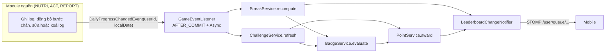

# Kế hoạch triển khai Module GAME — Kallo Backend

13/11/2026

Module GAME (streak và tạo động lực) gồm 9 phase (0–8), khoảng 17,5 ngày công cho một người, hoặc khoảng 12 ngày nếu hai người chia hai nhánh. Xong Phase 2 mobile có luồng kết bạn trọn vòng; xong Phase 5 có streak, huy hiệu và thử thách qua REST; xong Phase 6 có bảng xếp hạng bạn bè thời gian thực, tức là đủ năm yêu cầu mức M (FR-GAM-01 đến 05). Phase 7–8 là phần mức S và hoàn thiện.

> **Điều cần biết trước khi bắt đầu.** Repo hiện mới có module AUTH. Streak, huy hiệu và thử thách đều tính từ dữ liệu của PROFILE, NUTRI, ACT, REPORT (`DailySummary`, log bữa ăn, nước, bước chân) mà các module đó chưa vào repo. Kế hoạch này tách GAME khỏi chúng bằng một cổng `DailyProgressProvider` (mặc định rỗng, cùng mẫu với `ProfileStatusProvider` của AUTH) và một sự kiện `DailyProgressChangedEvent`. Nhờ vậy GAME làm và kiểm thử đầy đủ được ngay; khi các module nguồn vào repo, họ chỉ cần cài cổng và phát sự kiện. Phase 0 dùng để chốt hợp đồng này với người phụ trách các module đó.

## Phạm vi

| Trong phạm vi | Ngoài phạm vi (ghi nhận để làm sau) |
| --- | --- |
| FR-GAM-01 đến 07 (SRS §4.7); phần CRUD huy hiệu và thử thách của FR-ADM-02; NFR-PERF-05; AC1–AC3 của SRS §4.7 | Đóng băng streak (SRS xếp mức Could), chặn người dùng, nhóm hoặc clan, đổi điểm lấy quà, mở rộng WebSocket nhiều instance, giao diện quản trị web (FR-ADM-03) |

## Hiện trạng repo

Bảng dưới phản ánh mã trong `src/` và cấu hình tại thời điểm viết (chỉ có AUTH, chưa có mã GAME).

| Hạng mục | Hiện trạng | Hành động |
| --- | --- | --- |
| Nền tảng | Java 21, Spring Boot 4.1.1, Gradle | Giữ nguyên |
| Dependency | Đã có `spring-boot-starter-websocket`, `-websocket-test`, `data-redis`, `data-jpa`, `flyway`, `validation`, `oauth2-resource-server`, Testcontainers | Đủ cho GAME, không cần thêm thư viện |
| Xác thực | JWT HS256 với claim `sub`, `role`, `email_verified`; `CurrentUser.id(authentication)`; mọi đường dẫn ngoài `/api/auth/**` đi qua `emailVerifiedManager` | Mọi endpoint GAME tự động yêu cầu email đã xác minh |
| Chuẩn chung | `ApiResponse`, `ErrorCode`, `BusinessException`, `GlobalExceptionHandler`, `JpaConfig` (auditing) | Dùng tiếp, thêm mã lỗi mới ở Phase 0 |
| Mẫu cổng mặc định | `ProfileStatusProvider` + `ConditionalProfileStatusProvider` (`@ConditionalOnMissingBean`) | Lặp lại mẫu này cho `DailyProgressProvider` |
| Bất đồng bộ | `@EnableAsync` có sẵn nhưng `AsyncConfig` chỉ có executor `mailTaskExecutor` | Thêm executor `gameTaskExecutor` |
| Chưa có | `@EnableScheduling`, `@EnableMethodSecurity`, cấu hình WebSocket, `RateLimiter` (AUTH Phase 7 chưa làm), JaCoCo, bean `Clock` (các service AUTH tự dùng `Clock.systemUTC()` qua constructor phụ) | GAME tự bổ sung phần cần dùng; xem Phase 0 và 6 |
| Dữ liệu nguồn | Chưa có `DailySummary`, `UserFoodLog`, `WaterLog`, `ActivityLog`, `UserHealthProfile`, `Notification`, `DeviceToken` | Cổng liên module (D9), mục "Hợp đồng với module khác" |
| Flyway | Chỉ có `V1__init_schema.sql` (gộp cả bốn bảng AUTH, kể cả `email_verification_tokens`) | Số phiên bản kế tiếp chưa được cấp phát: thống nhất ở Phase 0 |
| Cây gói | Theo từng module con: `controller/auth`, `service/auth`, `model/auth`, `repository/auth`, `dto/request/auth`, ... | Thêm gói `game` song song, không đụng gói `auth` |
| Tài liệu | `docs/api-specs/auth.yaml`, `docs/tests/auth-test-cases.xlsx`, `docs/IMPLEMENT_MODULE_AUTH.md` | Tạo `game.yaml` và `game-test-cases.xlsx` tương ứng ở Phase 8 |
| CI | GitHub Actions chạy `./gradlew build` với Postgres, Redis, Elasticsearch | Giữ nguyên; test WebSocket chạy trong cùng job |

## Quyết định cần chốt trước khi code

Mười hai điểm dưới đây ảnh hưởng thiết kế. Cột "Đề xuất" là lựa chọn mà kế hoạch này áp dụng; G1, G5, G6 cần giảng viên hướng dẫn xác nhận (SRS Q4, Q5).

| # | Vấn đề | Đề xuất | Lý do |
| --- | --- | --- | --- |
| G1 | Thế nào là "hoàn thành mục tiêu ngày" (SRS Q4) | Ngày đạt khi `mealsLogged ≥ 2` (số **buổi ăn khác nhau** có log) **và** calo nạp nằm trong ±10% mục tiêu calo; hai ngưỡng cấu hình được. Cài bằng hàm thuần `DailyGoalPolicy` nhận số liệu thô. Ngày chưa có mục tiêu calo (chưa thiết lập hồ sơ) thì không đạt | Đúng ví dụ SRS §4.7; hàm thuần dễ thay khi giảng viên chốt khác |
| G2 | Ngày đang diễn ra tính thế nào | "Tạm tính": chuỗi hiện tại tính cả hôm nay nếu hôm nay đang đạt; chưa đạt thì giữ chuỗi đến hết ngày; chuỗi chỉ đứt khi một ngày **kết thúc** mà không đạt. Reset tính lười khi đọc, job chỉ ghi lại kết quả | Calo trong ngày tăng dần nên "đạt" chỉ chắc chắn vào cuối ngày; thoả AC1 (về 0 vào đầu ngày kế tiếp) mà không phụ thuộc job chạy đúng giờ |
| G3 | Cách tính streak | Tính lại từ lịch sử ngày đạt trong cửa sổ 400 ngày bằng hàm thuần `StreakCalculator`, không cộng dồn; `longest_streak = max(đã lưu, chuỗi dài nhất tìm được)` | Log đồng bộ ngoại tuyến (FR-SYS-05, 06) có thể bù ngày cũ, và sửa hoặc xoá log đổi trạng thái ngày; cộng dồn sẽ sai |
| G4 | Điểm dùng để xếp hạng | Sổ cái `point_transactions` chỉ có hai nguồn: hoàn thành thử thách (`points_reward`) và cấp huy hiệu (`points`); chống cộng trùng bằng unique `(user_id, source_type, source_id)`; không thu hồi điểm | SRS Q5 nêu "điểm thử thách"; sổ cái cho phép tính điểm theo tuần mà không cần job đặt lại. Điểm theo từng ngày đạt mục tiêu bị bỏ vì trạng thái ngày còn đổi (G2) |
| G5 | Tiêu chí và chu kỳ bảng xếp hạng (SRS Q5) | Ba tiêu chí: `STREAK` (chuỗi hiện tại), `POINTS` (điểm trong tuần), `STEPS` (bước chân trong tuần). Tuần thứ Hai–Chủ nhật theo múi giờ cố định `Asia/Ho_Chi_Minh` (cấu hình), tính theo cửa sổ nên không cần job đặt lại. Đồng hạng chung thứ hạng (1, 1, 3). `STEPS` tắt bằng cờ cho tới khi ACT cài `DailyProgressProvider` | Cả nhóm bạn cùng một kỳ dù khác múi giờ; không có job đặt lại nghĩa là không có chỗ để hỏng |
| G6 | Quyền riêng tư mặc định (FR-GAM-07) | Chia sẻ `streak` và `điểm` = bật; chia sẻ `bước chân` = tắt; `discoverable` = bật. Cân nặng tuyệt đối và email không bao giờ xuất hiện. Tắt một tiêu chí thì mình không hiện trong bảng của bạn ở tiêu chí đó, nhưng vẫn xem được bảng của mình | SRS §4.7 cấm hiện cân nặng; bước chân là dữ liệu hoạt động nên để người dùng tự bật |
| G7 | Tìm người dùng để kết bạn | Bằng `friend_code` (8 ký tự, khớp chính xác) hoặc tiền tố tên hiển thị (≥ 3 ký tự, chỉ người `discoverable`, `ACTIVE`, đã xác minh email). Không tìm theo email. Kết quả chỉ gồm id, tên, ảnh, trạng thái quan hệ | AUTH cố ý không lộ email nào đã đăng ký; mã kết bạn vẫn cho phép kết bạn khi người kia tắt `discoverable` |
| G8 | Lời mời kết bạn | Máy trạng thái `PENDING` → `ACCEPTED` hoặc `DECLINED`; chỉ người nhận được chấp nhận hoặc từ chối; người gửi huỷ được lời mời đang chờ; bị từ chối thì không gửi lại trong 24 giờ; lời mời chéo (A→B đang chờ mà B gửi cho A) tự động chấp nhận; mỗi cặp một dòng. Giới hạn 200 bạn, 50 lời mời đang chờ gửi đi, 20 lời mời mỗi giờ | Chống quấy rối và dữ liệu trùng; unique trên cặp ở DB chặn race giữa hai request đồng thời |
| G9 | Nối với module khác | Sự kiện nội bộ trong cùng JVM: module sở hữu `DailySummary` phát `DailyProgressChangedEvent(userId, localDate)` sau commit; GAME nghe bằng `@TransactionalEventListener(AFTER_COMMIT)` + `@Async("gameTaskExecutor")` và đọc số liệu qua cổng `DailyProgressProvider` do GAME định nghĩa. Mọi bước xử lý đều tính lại (idempotent) và có job đối soát | Giữ GAME độc lập với cách module nguồn lưu dữ liệu; listener bất đồng bộ có thể mất sự kiện khi khởi động lại nên không được cộng dồn |
| G10 | WebSocket | STOMP trên `/ws`. Bắt tay HTTP cho phép công khai; xác thực ở khung `CONNECT` bằng header `Authorization: Bearer` qua `JwtDecoder` chính (`@Primary`, không nhầm `googleJwtDecoder`) và kiểm `email_verified`. Đóng phiên khi token hết hạn; tối đa 3 phiên mỗi người; chỉ cho `SUBSCRIBE` vào `/user/queue/**`, cấm client `SEND`. Broker đơn giản trong bộ nhớ (một instance) | Trình duyệt không gắn được header vào bắt tay WebSocket, còn gửi token ở khung CONNECT là cách phổ biến của STOMP và chạy được ở mọi client (kể cả web khi thử bằng Expo). Hạ tầng này chatbot (FR-CHAT-03) cũng dùng nên cần một chủ duy nhất (SRS Q6) |
| G11 | Huy hiệu | Quy tắc dạng dữ liệu: cột `rule_type` + `threshold` thay cho chuỗi `condition` tự do của SRS §6.1; mỗi `rule_type` có một bean `BadgeRule`. Cấp bằng `INSERT ... ON CONFLICT DO NOTHING` trên unique `(user_id, badge_id)`. Không thu hồi huy hiệu khi dữ liệu sau đó thay đổi | Chuỗi tự do không đánh giá được bằng mã; unique ở DB bảo đảm AC2 ngay cả khi hai luồng cùng cấp |
| G12 | Thử thách | Ngày bắt đầu và kết thúc là ngày lịch địa phương của từng người; tiến độ luôn tính lại cả cửa sổ `[max(start, ngày tham gia), min(end, hôm nay)]`; chỉ tính từ ngày tham gia; không tham gia lại; thử thách đã có người tham gia không xoá cứng, chỉ vô hiệu hoá | Tính lại thì xử lý được log bù và sửa log; cửa sổ theo ngày địa phương khớp với khoá `(user_id, date)` của `DailySummary` |

## Lộ trình

| Phase | Nội dung | Ngày công | Cộng dồn | Yêu cầu |
| --- | --- | --- | --- | --- |
| 0 | Chốt quyết định, hợp đồng liên module, nền chung | 1 | 1 | — |
| 1 | Flyway, entity, repository | 1,5 | 2,5 | — |
| 2 | Kết bạn, tìm người dùng, quyền riêng tư | 2 | 4,5 | FR-GAM-04, 07 |
| 3 | Streak | 2 | 6,5 | FR-GAM-01 |
| 4 | Huy hiệu | 2 | 8,5 | FR-GAM-02 |
| 5 | Thử thách | 2,5 | 11 | FR-GAM-03 |
| 6 | WebSocket và bảng xếp hạng bạn bè | 3 | 14 | FR-GAM-05 |
| 7 | Thông báo và quản trị | 2 | 16 | FR-GAM-06, FR-ADM-02 |
| 8 | Hardening, tài liệu, nghiệm thu | 1,5 | 17,5 | AC, NFR |

Bốn cột mốc:

- **M1 (ngày 4,5)** — mobile có luồng kết bạn và cài đặt quyền riêng tư.
- **M2 (ngày 11)** — streak, huy hiệu, thử thách chạy qua REST.
- **M3 (ngày 14)** — bảng xếp hạng thời gian thực xong; đủ năm yêu cầu mức M.
- **M4 (ngày 17,5)** — nghiệm thu.

Nếu bắt đầu thứ Hai 16/11/2026 và làm liên tục một người: M1 khoảng 19–20/11, M2 khoảng 30/11, M3 khoảng 3/12, M4 khoảng 8–9/12/2026. Điều này nằm trong khung tuần 8–11 của giai đoạn "Thông minh và xã hội" ở SRS §10 và còn dư tuần 13–15 cho báo cáo và bảo vệ.

**Chia hai người:** Phase 0, 1, 8 làm chung. Nhánh A (xã hội và thời gian thực): Phase 2, 6, 7a. Nhánh B (động lực): Phase 3, 4, 5, 7b. Hai nhánh chỉ gặp nhau ở Phase 6b (bảng xếp hạng cần điểm và streak) nên tổng còn khoảng 12 ngày công lịch. Ước lượng chưa gồm thời gian chờ các module nguồn phát sự kiện thật; các phase chạy được nhờ cổng mặc định và bộ mô phỏng ở Phase 3.



## Hợp đồng với module khác

Đây là phần cần xác nhận bằng lời với người phụ trách các module khác ngay ở Phase 0, vì nó quyết định GAME chạy thật hay chạy giả.

| Ai | Việc | Ghi chú |
| --- | --- | --- |
| Chủ sở hữu `DailySummary` (NUTRI, ACT, REPORT) | Phát `DailyProgressChangedEvent(userId, localDate)` sau commit mỗi khi log bữa ăn, nước, hoạt động, bước chân hoặc cân nặng của ngày đó được thêm, sửa, xoá, kể cả log đồng bộ ngoại tuyến cho ngày cũ | Lớp sự kiện đặt ở `event/game` theo quy ước event của repo; module nguồn chỉ import hợp đồng sự kiện dùng chung này. |
| Cùng người trên | Cài `DailyProgressProvider` đọc `DailySummary` và mục tiêu từ `UserHealthProfile` | Giao diện nằm ở `service/game`, theo đúng tiền lệ `ProfileStatusProvider` nằm ở `service/auth` |
| Cùng người trên | Cung cấp `mealsLogged` = số **buổi ăn khác nhau** (sáng, trưa, tối, phụ) có ít nhất một log trong ngày | `DailySummary` ở SRS §6.1 chưa có trường này; thêm cột hoặc tính từ `UserFoodLog` |
| Người làm SYS (SRS Q6) | Cài `NotificationService` và FCM để Phase 7a ghi thông báo và gửi đẩy | Chưa có thì Phase 7a chỉ đẩy qua WebSocket |
| Người làm CHAT (SRS Q6) | Dùng lại `WebSocketConfig` và `RealtimePublisher` của Phase 6a thay vì viết cấu hình thứ hai | Hỏi ai đã bắt đầu WebSocket trước khi vào Phase 6a |
| GAME cung cấp | `RealtimePublisher.sendToUser(userId, type, payload)` cho thông báo trực tiếp và luồng chatbot | |

Dữ liệu tối thiểu mà cổng cần trả:

```java
public record DailyProgress(
    LocalDate localDate,
    int mealsLogged,        // số buổi ăn khác nhau có log
    Integer caloriesIn,
    Integer calorieGoal,    // null nếu chưa thiết lập hồ sơ
    int waterMl,
    Integer waterGoalMl,
    int steps,
    Integer caloriesBurned) {}
```

## Thiết kế streak

Phần này cụ thể hoá G1–G3. Ví dụ dưới đây cho hôm nay là ngày D:

| Các ngày đạt | Kết quả |
| --- | --- |
| D-3, D-2, D-1; hôm nay chưa đạt | `currentStreak = 3`, `atRisk = true` (còn giữ đến hết ngày) |
| D-3, D-2, D-1, D | `currentStreak = 4` |
| D-3, D-2 (D-1 trượt, hôm nay chưa đạt) | `currentStreak = 0` (AC1), `longestStreak` giữ ít nhất 2 |
| D-3, D-1, D (thiếu D-2) | `currentStreak = 2`; sau khi log bù cho D-2 được đồng bộ và đạt thì thành 4 |

- **Ngày theo múi giờ người dùng.** `UserDayResolver` đổi `Instant` sang ngày bằng `users.timezone`; mọi so sánh "hôm nay", "hôm qua" đều qua nó.
- **Đọc lười.** `GET /api/streak` trả 0 nếu `last_completed_date` trước ngày hôm qua của người đó, kể cả khi cột lưu còn số cũ. Job SQL chạy mỗi giờ chỉ ghi lại cho khớp.
- **Chống ghi đè.** Hai listener bất đồng bộ cho cùng một người có thể chạy chồng nhau; `recompute` khoá hàng `streaks` (`PESSIMISTIC_WRITE`) trước khi ghi.
- **Đối soát.** Mỗi đêm tính lại streak cho mọi người đang có `current_streak > 0` (số này nhỏ trong phạm vi đồ án) để vá các sự kiện đã mất.

## Thiết kế bảng xếp hạng và thời gian thực

| Tiêu chí | Nguồn dữ liệu | Cách tính |
| --- | --- | --- |
| `STREAK` | `streaks` | Chuỗi hiện tại, đọc lười theo múi giờ từng người |
| `POINTS` | `point_transactions` | Tổng điểm có `occurred_at` trong tuần hiện tại (Thứ Hai 00:00 đến Thứ Hai kế tiếp, theo `app.game.leaderboard-zone`) |
| `STEPS` | `DailyProgressProvider.sumSteps` | Tổng bước của các ngày địa phương nằm trong tuần; tắt bằng cờ cho tới khi ACT sẵn sàng |

- **Tập người xếp hạng:** chính mình cùng bạn `ACCEPTED`, loại người đã tắt chia sẻ tiêu chí đó, loại tài khoản `DISABLED`. Tối đa 50 mục trả về, kèm hạng của chính mình.
- **Hạng:** đồng hạng chung số (1, 1, 3); thứ tự hiển thị khi hoà theo tên hiển thị rồi id.
- **Đẩy thời gian thực:** khi giá trị của X đổi, `LeaderboardChangeNotifier` gom các thay đổi cùng `(userId, metric)` trong 500 ms rồi gửi `LEADERBOARD_UPDATE` tới X và từng bạn đang online của X, chỉ khi X chia sẻ tiêu chí đó. Client tự sắp xếp lại; khi mở màn hình hoặc nối lại thì gọi REST lấy bản chụp. Độ trễ nội bộ dự kiến dưới 1 giây, còn dư nhiều so với ngưỡng 3 giây của NFR-PERF-05.
- **Phạm vi một instance:** broker đơn giản trong bộ nhớ chỉ đúng khi chạy một instance. Nếu cần nhiều instance thì thêm relay qua Redis hoặc RabbitMQ; ngoài phạm vi.

Các kênh WebSocket (tiền tố người dùng `/user`, mỗi người chỉ nhận tin của mình):

| Đích | Loại tin | Payload chính |
| --- | --- | --- |
| `/user/queue/leaderboard` | `LEADERBOARD_UPDATE` | `metric`, `userId`, `value` |
| `/user/queue/game-events` | `BADGE_EARNED` | `badge` (`code`, `name`, `iconKey`), `points` |
| | `CHALLENGE_COMPLETED` | `challengeId`, `title`, `pointsAwarded`, `badge` (nếu có) |
| | `STREAK_UPDATED` | `currentStreak`, `longestStreak`, `todayCompleted` |
| | `FRIEND_REQUEST_RECEIVED`, `FRIEND_REQUEST_ACCEPTED` | `requestId`, `user` (`id`, `displayName`) |

Mọi tin có dạng `{ "type", "version": 1, "ts", "payload" }`; client bỏ qua `type` lạ để tương thích về sau.

## Mô hình dữ liệu

GAME cần tám bảng mới, bám SRS §6.1 và bổ sung `user_game_settings`, `point_transactions` (kế hoạch này thêm). Khối dưới là bản nháp của migration `V{n}__game_tables.sql`; `{n}` là số phiên bản kế tiếp sau khi nhóm thống nhất (mục "Số phiên bản Flyway" bên dưới). Huy hiệu mẫu nằm ở migration riêng `V{n+1}__seed_game_badges.sql`.

```sql
-- Cài đặt riêng tư và mã kết bạn (tạo lười lần đầu truy cập)
CREATE TABLE user_game_settings (
    user_id      UUID PRIMARY KEY REFERENCES users (id) ON DELETE CASCADE,
    friend_code  VARCHAR(12) NOT NULL,
    discoverable BOOLEAN     NOT NULL DEFAULT TRUE,
    share_streak BOOLEAN     NOT NULL DEFAULT TRUE,
    share_points BOOLEAN     NOT NULL DEFAULT TRUE,
    share_steps  BOOLEAN     NOT NULL DEFAULT FALSE,
    created_at   TIMESTAMPTZ NOT NULL DEFAULT now(),
    updated_at   TIMESTAMPTZ NOT NULL DEFAULT now()
);
CREATE UNIQUE INDEX uq_user_game_settings_friend_code ON user_game_settings (friend_code);

-- Hỗ trợ tìm theo tiền tố tên hiển thị (LIKE 'abc%')
CREATE INDEX idx_users_display_name_prefix ON users (lower(display_name) text_pattern_ops);

CREATE TABLE friendships (
    id           UUID PRIMARY KEY DEFAULT gen_random_uuid(),
    requester_id UUID        NOT NULL REFERENCES users (id) ON DELETE CASCADE,
    addressee_id UUID        NOT NULL REFERENCES users (id) ON DELETE CASCADE,
    status       VARCHAR(20) NOT NULL DEFAULT 'PENDING',
    created_at   TIMESTAMPTZ NOT NULL DEFAULT now(),
    responded_at TIMESTAMPTZ,
    updated_at   TIMESTAMPTZ NOT NULL DEFAULT now(),
    CONSTRAINT chk_friendships_not_self CHECK (requester_id <> addressee_id),
    CONSTRAINT chk_friendships_status   CHECK (status IN ('PENDING', 'ACCEPTED', 'DECLINED'))
);
-- Mỗi cặp một dòng, bất kể ai gửi trước
CREATE UNIQUE INDEX uq_friendships_pair
    ON friendships (LEAST(requester_id, addressee_id), GREATEST(requester_id, addressee_id));
CREATE INDEX idx_friendships_addressee ON friendships (addressee_id, status);
CREATE INDEX idx_friendships_requester ON friendships (requester_id, status);

CREATE TABLE streaks (
    user_id             UUID PRIMARY KEY REFERENCES users (id) ON DELETE CASCADE,
    current_streak      INTEGER     NOT NULL DEFAULT 0,
    longest_streak      INTEGER     NOT NULL DEFAULT 0,
    last_completed_date DATE,
    updated_at          TIMESTAMPTZ NOT NULL DEFAULT now(),
    CONSTRAINT chk_streaks_values CHECK (current_streak >= 0 AND longest_streak >= current_streak)
);

CREATE TABLE badges (
    id          UUID PRIMARY KEY DEFAULT gen_random_uuid(),
    code        VARCHAR(50)  NOT NULL UNIQUE,
    name        VARCHAR(100) NOT NULL,
    description VARCHAR(500) NOT NULL,
    icon_key    VARCHAR(200),                    -- tên icon bundle trong app, không phải URL
    rule_type   VARCHAR(30)  NOT NULL,           -- xem BadgeRuleType
    threshold   INTEGER,                         -- ví dụ 7, 30, 100; NULL với huy hiệu cấp bởi thử thách
    points      INTEGER      NOT NULL DEFAULT 0 CHECK (points >= 0),
    active      BOOLEAN      NOT NULL DEFAULT TRUE,
    sort_order  INTEGER      NOT NULL DEFAULT 0,
    created_at  TIMESTAMPTZ  NOT NULL DEFAULT now(),
    updated_at  TIMESTAMPTZ  NOT NULL DEFAULT now()
);

CREATE TABLE user_badges (
    id        UUID PRIMARY KEY DEFAULT gen_random_uuid(),
    user_id   UUID        NOT NULL REFERENCES users (id) ON DELETE CASCADE,
    badge_id  UUID        NOT NULL REFERENCES badges (id),
    earned_at TIMESTAMPTZ NOT NULL DEFAULT now(),
    CONSTRAINT uq_user_badges UNIQUE (user_id, badge_id)
);
CREATE INDEX idx_user_badges_user ON user_badges (user_id, earned_at DESC);

CREATE TABLE challenges (
    id            UUID PRIMARY KEY DEFAULT gen_random_uuid(),
    title         VARCHAR(150)  NOT NULL,
    description   VARCHAR(1000) NOT NULL,
    metric        VARCHAR(30)   NOT NULL,        -- xem ChallengeMetric
    target_value  INTEGER       NOT NULL CHECK (target_value > 0),
    start_date    DATE          NOT NULL,
    end_date      DATE          NOT NULL,
    points_reward INTEGER       NOT NULL DEFAULT 0 CHECK (points_reward >= 0),
    badge_id      UUID REFERENCES badges (id),   -- huy hiệu nhận khi hoàn thành (tuỳ chọn)
    active        BOOLEAN       NOT NULL DEFAULT TRUE,
    created_at    TIMESTAMPTZ   NOT NULL DEFAULT now(),
    updated_at    TIMESTAMPTZ   NOT NULL DEFAULT now(),
    CONSTRAINT chk_challenges_dates CHECK (end_date >= start_date)
);
CREATE INDEX idx_challenges_active_end ON challenges (active, end_date);

CREATE TABLE user_challenges (
    id                UUID PRIMARY KEY DEFAULT gen_random_uuid(),
    user_id           UUID        NOT NULL REFERENCES users (id) ON DELETE CASCADE,
    challenge_id      UUID        NOT NULL REFERENCES challenges (id),
    progress          INTEGER     NOT NULL DEFAULT 0 CHECK (progress >= 0),
    status            VARCHAR(20) NOT NULL DEFAULT 'ACTIVE',
    joined_at         TIMESTAMPTZ NOT NULL DEFAULT now(),
    joined_local_date DATE        NOT NULL,      -- ngày địa phương lúc tham gia, không đổi khi người dùng đổi múi giờ
    completed_at      TIMESTAMPTZ,
    updated_at        TIMESTAMPTZ NOT NULL DEFAULT now(),
    CONSTRAINT uq_user_challenges UNIQUE (user_id, challenge_id),
    CONSTRAINT chk_user_challenges_status CHECK (status IN ('ACTIVE', 'COMPLETED', 'EXPIRED'))
);
CREATE INDEX idx_user_challenges_user      ON user_challenges (user_id, status);
CREATE INDEX idx_user_challenges_challenge ON user_challenges (challenge_id);

CREATE TABLE point_transactions (
    id          UUID PRIMARY KEY DEFAULT gen_random_uuid(),
    user_id     UUID        NOT NULL REFERENCES users (id) ON DELETE CASCADE,
    points      INTEGER     NOT NULL CHECK (points > 0),
    source_type VARCHAR(30) NOT NULL,            -- BADGE hoặc CHALLENGE
    source_id   UUID        NOT NULL,            -- id huy hiệu hoặc thử thách
    occurred_at TIMESTAMPTZ NOT NULL DEFAULT now(),
    CONSTRAINT uq_point_source UNIQUE (user_id, source_type, source_id)
);
CREATE INDEX idx_point_transactions_user_time ON point_transactions (user_id, occurred_at);
```

- **Kiểu cột phải khớp entity.** Vì `ddl-auto: validate`: dùng `VARCHAR` (không `CHAR`), `INTEGER` (không `SMALLINT`), `DATE` cho `LocalDate`, `TIMESTAMPTZ` cho `Instant`. Lệch kiểu thì ứng dụng không khởi động.
- **Khoá ngoại tới `users` đều `ON DELETE CASCADE`** (quy ước AUTH, FR-AUTH-07): xoá một dòng `users` dọn sạch dữ liệu GAME của người đó, kể cả mọi quan hệ bạn bè hai chiều. Khoá ngoại tới `badges` và `challenges` cố ý **không** cascade để không xoá nhầm lịch sử của người khác; vì vậy huy hiệu và thử thách chỉ vô hiệu hoá, không xoá cứng khi đã có người dùng.
- **Không `CHECK` cho `metric`, `rule_type`, `source_type`.** Thêm giá trị enum mới sẽ không cần migration; chỉ `status` (ổn định) mới có `CHECK`.
- **`LEAST`/`GREATEST` trên `uuid`** trong chỉ mục biểu thức: kiểm tra trong test Testcontainers ở Phase 1 (PostgreSQL 17).
- **Số phiên bản Flyway.** Chỉ có `V1` trong repo; nhiều người cùng thêm migration dễ trùng số. Thống nhất bảng số cho từng module trước khi gộp nhánh, và không sửa migration đã chạy.
- **Challenge mẫu không seed bằng migration** vì có ngày cố định sẽ hết hạn; xem Phase 5.

## Hợp đồng API

Tiền tố `/api`; mọi phản hồi theo `ApiResponse`; user id luôn lấy từ token, không bao giờ từ client. Tài nguyên không thuộc người gọi trả 404 (không 403) để không lộ sự tồn tại (NFR-SEC-04). Các đường dẫn bám SRS §8.2; chỗ khác SRS ghi rõ ở cột cuối.

| Endpoint | FR | Phase | Body hoặc tham số | Kết quả và lỗi chính |
| --- | --- | --- | --- | --- |
| `GET /api/users/me/game-settings` | FR-GAM-07 | 2 | — | 200 + `friendCode`, `discoverable`, `shareStreak`, `sharePoints`, `shareSteps` (tạo lười lần đầu) |
| `PUT /api/users/me/game-settings` | FR-GAM-07 | 2 | `discoverable`, `shareStreak`, `sharePoints`, `shareSteps` | 200 + cài đặt mới |
| `GET /api/users/search?q=` | FR-GAM-04 | 2 | `q` (tên ≥ 3 ký tự hoặc mã kết bạn) | 200 + tối đa 20 người (`id`, `displayName`, `avatarUrl`, `relationship`); 400 `VALIDATION_ERROR` khi `q` quá ngắn |
| `POST /api/friends/requests` | FR-GAM-04 | 2 | đúng một trong `friendCode`, `userId` | 201 + `status` (`PENDING`, hoặc `ACCEPTED` khi lời mời chéo); 400 `CANNOT_FRIEND_SELF`; 409 `ALREADY_FRIENDS`, `FRIEND_REQUEST_PENDING`, `FRIEND_REQUEST_COOLDOWN`, `FRIEND_LIMIT_REACHED`; 429 `TOO_MANY_REQUESTS`; 404 khi không có người đó |
| `GET /api/friends/requests?direction=incoming` | FR-GAM-04 | 2 | `direction` = `incoming` hoặc `outgoing` | 200 + danh sách lời mời `PENDING` (thêm so với SRS) |
| `PUT /api/friends/requests/{id}` | FR-GAM-04 | 2 | `action` = `ACCEPT` hoặc `DECLINE` | 200; 404 khi không phải người nhận hoặc không còn `PENDING` |
| `DELETE /api/friends/requests/{id}` | FR-GAM-04 | 2 | — | 204, chỉ người gửi huỷ lời mời đang chờ (thêm so với SRS) |
| `GET /api/friends` | FR-GAM-04 | 2 | `page`, `size` | 200 + bạn bè (`id`, `displayName`, `avatarUrl`, `since`); không có email |
| `DELETE /api/friends/{friendUserId}` | FR-GAM-04 | 2 | — | 204, idempotent; `{friendUserId}` là id người bạn (SRS chưa nói rõ id nào) |
| `GET /api/streak` | FR-GAM-01 | 3 | — | 200 + `currentStreak`, `longestStreak`, `lastCompletedDate`, `todayCompleted`, `atRisk` |
| `GET /api/badges` | FR-GAM-02 | 4 | — | 200 + toàn bộ huy hiệu đang hoạt động kèm `earned`, `earnedAt`, `iconKey` |
| `GET /api/challenges?status=` | FR-GAM-03 | 5 | `status` = `available`, `joined`, `completed` | 200 + thử thách kèm `progress`, `target`, `daysLeft`, trạng thái tham gia của mình |
| `GET /api/challenges/{id}` | FR-GAM-03 | 5 | — | 200; 404 |
| `POST /api/challenges/{id}/join` | FR-GAM-03 | 5 | — | 201 + trạng thái tham gia; 409 `CHALLENGE_ALREADY_JOINED`, `CHALLENGE_NOT_JOINABLE`; 404 |
| `GET /api/leaderboard/friends?metric=` | FR-GAM-05 | 6 | `metric` = `STREAK`, `POINTS`, `STEPS` (mặc định `POINTS`) | 200 + `period`, `me`, `entries`; 400 `INVALID_PARAMETER` khi tiêu chí không hỗ trợ (ví dụ `STEPS` đang tắt) |
| `WebSocket /ws` (STOMP) | FR-GAM-05, 06 | 6 | `CONNECT` kèm `Authorization: Bearer <access token>` | xem bảng kênh WebSocket |
| `GET/POST/PUT /api/admin/badges`, `GET/POST/PUT /api/admin/challenges` | FR-ADM-02 | 7 | — | Chỉ `ROLE_ADMIN`: 403 với người thường |

Mã lỗi mới thêm vào `ErrorCode` ở Phase 0:

| Mã | HTTP |
| --- | --- |
| `CANNOT_FRIEND_SELF` | 400 |
| `ALREADY_FRIENDS` | 409 |
| `FRIEND_REQUEST_PENDING` | 409 |
| `FRIEND_REQUEST_COOLDOWN` | 409 |
| `FRIEND_LIMIT_REACHED` | 409 |
| `CHALLENGE_ALREADY_JOINED` | 409 |
| `CHALLENGE_NOT_JOINABLE` | 409 |

## Phase 0 — Chốt quyết định và nền chung (≈ 1 ngày, xong ở ngày 1)

Mục tiêu: các quyết định đã chốt, hợp đồng liên module đã được xác nhận bằng lời, có khung gói và cấu hình để các phase sau chỉ còn viết nghiệp vụ.

- [ ] Họp 30 phút với nhóm: chốt G1, G5, G6 (SRS Q4, Q5) hoặc ghi rõ "dùng mặc định chờ giảng viên"; xác nhận bảng "Hợp đồng với module khác" (ai phát sự kiện, ai cài cổng, `mealsLogged` lấy ở đâu, ai sở hữu WebSocket, số phiên bản Flyway kế tiếp); ghi kết quả vào mục "Quyết định" của file này.
- [ ] Tạo khung gói: `controller/game`, `service/game` (+ `impl`), `model/game` (+ `enums`), `repository/game`, `dto/request/game`, `dto/response/game`, và `event/game` cho lớp sự kiện dùng chung.
- [ ] `config/GameProperties` dạng `@ConfigurationProperties("app.game")` + `@Validated` (ngưỡng > 0, múi giờ hợp lệ) với các khoá: `daily-goal.min-meals` (2), `daily-goal.calorie-tolerance` (0,10), `streak-window-days` (400), `leaderboard.zone` (`Asia/Ho_Chi_Minh`), `leaderboard.steps-enabled` (false), `leaderboard.push-debounce` (500ms), `friend.max-friends` (200), `friend.max-pending-out` (50), `friend.decline-cooldown` (24h), `friend.requests-per-hour` (20), `search.min-length` (3), `search.max-results` (20), `challenge.expiry-grace` (1d), `ws.max-sessions-per-user` (3), `ws.allowed-origins`. Mọi giá trị đọc từ biến môi trường `APP_GAME_*` có giá trị mặc định, để CI không cần khai thêm; cập nhật `application.yml`, `application-test.yml`, `.env.example`, `docker-compose.yml`.
- [ ] `ErrorCode`: thêm bảy mã ở bảng trên.
- [ ] `AsyncConfig`: thêm executor `gameTaskExecutor` (core 2, max 4, queue 200, tiền tố `kallo-game-`) theo mẫu `mailTaskExecutor`; thêm `@EnableScheduling` (class cấu hình riêng).
- [ ] Cổng liên module: record `DailyProgress`, interface `DailyProgressProvider` (`find`, `findRange`, `sumSteps`) ở `service/game`, bean mặc định rỗng bằng `ConditionalDailyProgressProvider` theo mẫu `ConditionalProfileStatusProvider`; `DailyProgressChangedEvent(userId, localDate)` ở `event/game`.
- [ ] `UserDayResolver` (hôm nay của người dùng, đổi `Instant` sang ngày địa phương theo `users.timezone`), dùng `Clock` tiêm được như `EmailVerificationService` để kiểm thử.
- [ ] `DailyGoalPolicy` (G1) cùng unit test ngay: 1 bữa so với 2 bữa; calo đúng −10% và +10% (đạt) và lệch hơn (không đạt); `calorieGoal` null.
- [ ] `SecurityConfig`: thêm `requestMatchers("/api/admin/**").hasRole("ADMIN")` **trước** dòng `anyRequest()`. Repo chưa bật `@EnableMethodSecurity` nên dùng matcher thay cho `@PreAuthorize`.
- [ ] `./gradlew clean build` xanh; ứng dụng khởi động được khi chưa có module nguồn nào.

**Hoàn thành khi:** quyết định G1–G12 và hợp đồng liên module đã ghi lại; build xanh; ứng dụng khởi động với cổng mặc định rỗng.

## Phase 1 — Flyway, entity, repository (≈ 1,5 ngày, xong ở ngày 2,5)

Mục tiêu: lược đồ GAME tồn tại trong PostgreSQL và khớp entity, có test chứng minh điều đó.

- [ ] Tạo `V{n}__game_tables.sql` từ mục "Mô hình dữ liệu" và `V{n+1}__seed_game_badges.sql` với tám huy hiệu mẫu: `FIRST_LOG`, `STREAK_7`, `STREAK_30`, `STREAK_100`, `FIRST_FRIEND`, `CHALLENGER_1`, `CHALLENGER_5`, `WEIGHT_GOAL_REACHED`. Điểm gợi ý: 10, 20, 50, 150, 10, 20, 60, 100. `WEIGHT_GOAL_REACHED` để `active = false` cho tới khi có sự kiện đạt cân nặng mục tiêu.
- [ ] `model/game`: enum `FriendshipStatus`, `BadgeRuleType` (`STREAK_DAYS`, `FIRST_LOG`, `FRIENDS_COUNT`, `CHALLENGES_COMPLETED`, `WEIGHT_GOAL_REACHED`, `CHALLENGE`), `ChallengeMetric` (`WATER_GOAL_DAYS`, `CALORIE_GOAL_DAYS`, `LOG_DAYS`, `STEPS_TOTAL`), `ChallengeStatus`, `PointSource`. Entity `UserGameSettings`, `Friendship`, `Streak`, `Badge`, `UserBadge`, `Challenge`, `UserChallenge`, `PointTransaction` theo quy ước AUTH: `@Getter`/`@Setter` (không `@Data`), `equals`/`hashCode` theo id, `@Enumerated(EnumType.STRING)`, `Instant` và `LocalDate`.
- [ ] `repository/game`, các truy vấn cần:
  - Friendship: tìm theo cặp (cả hai chiều), danh sách id bạn `ACCEPTED`, lời mời đến và đi, đếm bạn, đếm lời mời đang chờ gửi đi.
  - Badge: `insertIfAbsent` (native `INSERT ... ON CONFLICT DO NOTHING`, trả số dòng).
  - PointTransaction: `insertIfAbsent` tương tự; `sumPoints(userIds, from, to)` bằng một câu `GROUP BY`.
  - Streak: upsert và khoá hàng `PESSIMISTIC_WRITE`.
  - UserChallenge: tìm theo user và trạng thái, tìm cái đang `ACTIVE` có cửa sổ chứa một ngày.
- [ ] Test tích hợp Testcontainers PostgreSQL: Flyway chạy sạch và Hibernate `validate` qua; cặp bạn bị chặn ở cả hai chiều (A→B rồi B→A); tự kết bạn bị `CHECK` chặn; `friend_code` trùng bị chặn; `(user_id, badge_id)` và `(user_id, source_type, source_id)` trùng bị chặn; **xoá `users` kéo theo xoá mọi dòng GAME** (kể cả friendship ở cả hai vai); test `information_schema` của AUTH Phase 6 (mọi khoá ngoại tới `users` đều `CASCADE`) vẫn xanh.

**Hoàn thành khi:** `./gradlew test` xanh khi Docker đang chạy; ứng dụng khởi động trên DB trống và migration tự chạy, không còn lỗi `Schema-validation`.

## Phase 2 — Kết bạn, tìm người dùng, quyền riêng tư (≈ 2 ngày, xong ở ngày 4,5)

Mục tiêu: người dùng tìm, mời, chấp nhận và huỷ kết bạn, và chỉnh được cài đặt riêng tư. Phase này bao phủ FR-GAM-04 và phần cài đặt của FR-GAM-07. Không phụ thuộc module khác nên làm được ngay và kiểm thử trọn vẹn. Đây là cột mốc M1.

- [ ] `UserGameSettingsService.getOrCreate(userId)`: `INSERT ... ON CONFLICT DO NOTHING` rồi đọc lại; sinh `friend_code` 8 ký tự từ bảng chữ không dễ nhầm `23456789ABCDEFGHJKMNPQRSTUVWXYZ` (không có 0, 1, I, L, O) bằng `SecureRandom`, thử lại tối đa 5 lần khi trùng unique.
- [ ] `GET` và `PUT /api/users/me/game-settings`; `friendCode` chỉ đọc.
- [ ] `FriendService` theo G8:
  - `sendRequest`: nhận đúng một trong `friendCode`, `userId`; kiểm tra tự kết bạn, đã là bạn, đã có lời mời đang chờ, thời gian chờ sau khi bị từ chối (gửi lại thì cập nhật cùng một dòng về `PENDING` và đổi `requester_id`), giới hạn 200 bạn và 50 lời mời đang chờ gửi đi (cả hai phía: bên nhận cũng không vượt 200); lời mời chéo thì chuyển luôn `ACCEPTED`.
  - Race: hai request A→B và B→A đồng thời, bắt `DataIntegrityViolationException` do unique cặp rồi đọc lại và áp dụng quy tắc lời mời chéo.
  - `respond`: chỉ người nhận, chỉ khi còn `PENDING`, ngược lại trả 404.
  - `cancel`, `listRequests`, `listFriends` (phân trang), `unfriend` (xoá hẳn dòng, idempotent).
  - Sau `ACCEPTED`: đánh giá huy hiệu `FRIENDS_COUNT` cho cả hai phía (nối ở Phase 4, tạm để chỗ gọi).
- [ ] `UserSearchService` (G7): hai chế độ (mã kết bạn khớp chính xác, hoặc tiền tố tên); thoát ký tự `%`, `_`, `\` trước khi ghép vào `LIKE ... ESCAPE`; `LEFT JOIN user_game_settings` với `COALESCE(discoverable, TRUE)`; lọc `ACTIVE` và `email_verified`; loại chính mình; giới hạn 20 kết quả; mỗi kết quả có `relationship` (`NONE`, `PENDING_OUT`, `PENDING_IN`, `FRIENDS`).
- [ ] Ảnh đại diện trong danh sách bạn và kết quả tìm kiếm ký bằng `StorageService.presignedUrl` của AUTH (phép ký cục bộ, chấp nhận được với tối đa 200 bạn).
- [ ] Controller `FriendController`, `UserSearchController`, `GameSettingsController`. DTO: `SendFriendRequest` kiểm tra đúng một trong hai trường, `friendCode` theo regex `^[2-9A-HJKMNP-Z]{8}$` (chuẩn hoá chữ hoa), `RespondFriendRequest`.
- [ ] Giới hạn tần suất: 20 lời mời mỗi giờ mỗi người. Nếu `RateLimiter` của AUTH Phase 7 chưa có thì tạm đếm bằng bảng `friendships` trong 1 giờ; giới hạn tìm kiếm để Phase 8.
- [ ] Test: đơn vị (Mockito) cho máy trạng thái theo bảng giá trị; `@WebMvcTest` cho validation và 401; tích hợp Postgres: gửi → chấp nhận → hai phía thấy nhau; người không phải người nhận chấp nhận → 404; bị từ chối rồi gửi lại trong 24 giờ → 409 `FRIEND_REQUEST_COOLDOWN`, sau 24 giờ (đổi `Clock`) gửi được; lời mời chéo tự chấp nhận; chạm giới hạn 200 và 50; tìm kiếm không trả email, không trả người `discoverable = false`, không trả tài khoản chưa xác minh hoặc `DISABLED`; huỷ kết bạn; xoá tài khoản xoá friendship của họ.

**Hoàn thành khi:** QT3, QT5, QT6, QT7 ở bảng truy vết có test xanh; hai người dùng kết bạn trọn vòng bằng HTTP trên Postgres thật.

## Phase 3 — Streak (≈ 2 ngày, xong ở ngày 6,5)

Mục tiêu: chuỗi ngày liên tiếp hoàn thành mục tiêu hiển thị đúng, đọc lười, tính lại được. Phase này bao phủ FR-GAM-01 và AC1.

- [ ] `StreakCalculator` hàm thuần: `compute(Set<LocalDate> metDates, LocalDate today, int storedLongest)` trả `current`, `longest`, `lastCompletedDate`, `todayCompleted`, `atRisk` theo G2 và G3 (bảng ví dụ ở mục "Thiết kế streak").
- [ ] `StreakService.recompute(userId)`: lấy `DailyProgress` 400 ngày qua cổng, áp `DailyGoalPolicy` để ra tập ngày đạt, gọi calculator, upsert `streaks` dưới khoá hàng; sau đó gọi `BadgeService.evaluate` cho `STREAK_DAYS` và `FIRST_LOG` (nối ở Phase 4).
- [ ] `GameEventListener.onDailyProgressChanged`: `@TransactionalEventListener(phase = AFTER_COMMIT)` + `@Async("gameTaskExecutor")`; gọi lần lượt `streakService.recompute` rồi (từ Phase 5) `challengeService.refresh`. Bắt mọi ngoại lệ và ghi log, không ném lại.
- [ ] `GET /api/streak`: đọc lười theo G2 (trả 0 khi `last_completed_date` trước ngày hôm qua theo múi giờ người dùng); không ghi DB trong GET.
- [ ] `StreakMaintenanceJob` (`@Scheduled`):
  - **Hằng giờ:** ghi lại reset bằng một câu SQL: `UPDATE streaks s SET current_streak = 0 FROM users u WHERE u.id = s.user_id AND s.current_streak > 0 AND s.last_completed_date < ((now() AT TIME ZONE u.timezone)::date - 1)`.
  - **Hằng đêm:** `recompute` cho mọi người có `current_streak > 0`, theo lô 500, để vá sự kiện đã mất.
- [ ] (Tuỳ chọn, chỉ `@Profile("dev")`, xoá khi module nguồn vào repo) `PUT /api/dev/game/daily-progress` nhận một `DailyProgress`, lưu vào bản cài đặt trong bộ nhớ của cổng và phát `DailyProgressChangedEvent`, để nhóm mobile thử streak, huy hiệu, thử thách trước khi NUTRI và ACT xong.
- [ ] Test: `StreakCalculatorTest` theo bảng (≥ 15 ca): không có ngày nào; chỉ hôm nay; hôm qua và hôm nay; hôm qua đạt nhưng hôm nay chưa (còn giữ, `atRisk`); trượt một ngày về 0 (AC1); log bù nối hai chuỗi; sửa log làm mất một ngày giữa chuỗi; `longest` giữ nguyên khi `current` về 0; ranh giới ngày với `Clock` cố định (23:30 UTC đã là 06:30 hôm sau ở Việt Nam); đổi múi giờ giữa chừng; một múi giờ có chuyển giờ mùa hè. Tích hợp: sự kiện sinh ra dòng `streaks`; `recompute` chạy hai lần cho cùng kết quả; hai sự kiện đồng thời cho một người không mất cập nhật; job SQL đặt đúng người; `GET /api/streak` trả 0 sau khi tiến `Clock` hai ngày.

**Hoàn thành khi:** AC1 của SRS §4.7 và QT1, QT8, QT9 có test xanh; `recompute` idempotent.

## Phase 4 — Huy hiệu (≈ 2 ngày, xong ở ngày 8,5)

Mục tiêu: cấp huy hiệu tự động, đúng một lần mỗi người, ghi điểm kèm theo. Phase này bao phủ FR-GAM-02 và AC2.

- [ ] Giao diện `BadgeRule` (`type()`, `isSatisfied(context, badge)`) và các bean: `StreakDaysRule` (dùng `longest_streak ≥ threshold`, vì đạt rồi thì giữ), `FirstLogRule` (`mealsLogged ≥ 1` ở sự kiện đang xử lý), `FriendsCountRule`, `ChallengesCompletedRule`, `WeightGoalReachedRule` (chờ sự kiện từ PROFILE hoặc ACT; huy hiệu để `active = false` tới lúc đó). Huy hiệu loại `CHALLENGE` không đánh giá chung mà được cấp trực tiếp khi hoàn thành thử thách (Phase 5).
- [ ] `PointService.award(userId, source, sourceId, points)`: `insertIfAbsent` vào `point_transactions`; trả cho biết có cộng mới hay không.
- [ ] `BadgeService.evaluate(userId, triggers)`: lấy huy hiệu `active` chưa đạt thuộc các loại trigger, kiểm rule, cấp bằng `insertIfAbsent`; **chỉ khi chèn được một dòng** mới `PointService.award` (cùng một transaction) và phát `BadgeEarnedEvent`. `grant(userId, badgeId)` dùng cho huy hiệu của thử thách.
- [ ] Nối các điểm kích hoạt: `StreakService.recompute` (`STREAK_DAYS`, `FIRST_LOG`), `FriendService` sau `ACCEPTED` (`FRIENDS_COUNT`, cả hai phía), và (Phase 5) `ChallengeService` (`CHALLENGES_COMPLETED`).
- [ ] `GET /api/badges`: một lời gọi trả toàn bộ huy hiệu `active` kèm `earned`, `earnedAt`, `iconKey`. Mobile bundle icon theo `iconKey` nên không phải ký URL MinIO.
- [ ] Test: hai luồng đồng thời cùng cấp một huy hiệu cho một người chỉ ra một dòng `user_badges` và một dòng điểm (AC2); đánh giá lại nhiều lần không cấp thêm; huy hiệu không bị thu hồi khi streak sau đó đứt; huy hiệu `active = false` không được cấp; huy hiệu `FRIENDS_COUNT` được cấp sau khi chấp nhận kết bạn; `GET /api/badges` đánh dấu `earned` đúng.

**Hoàn thành khi:** AC2 của SRS §4.7 có test xanh; chuỗi 7 ngày giả lập qua bộ mô phỏng ở Phase 3 cấp đúng huy hiệu `STREAK_7` một lần.

## Phase 5 — Thử thách (≈ 2,5 ngày, xong ở ngày 11)

Mục tiêu: người dùng tham gia thử thách có thời hạn, tiến độ tự cập nhật, hoàn thành thì nhận điểm và huy hiệu đúng một lần. Phase này bao phủ FR-GAM-03. Xong phase này là cột mốc M2.

- [ ] `ChallengeMetricEvaluator` theo từng `ChallengeMetric`, nhận danh sách `DailyProgress` của cửa sổ: `WATER_GOAL_DAYS` (số ngày `waterMl ≥ waterGoalMl` với mục tiêu > 0), `CALORIE_GOAL_DAYS` (số ngày đạt `DailyGoalPolicy`), `LOG_DAYS` (số ngày `mealsLogged ≥ 1`), `STEPS_TOTAL` (tổng bước).
- [ ] `ChallengeService.list` và `get`: thử thách `active` chưa kết thúc theo ngày địa phương của người gọi, ghép với trạng thái tham gia của họ (`progress`, `target`, `daysLeft`).
- [ ] `ChallengeService.join` (một transaction): kiểm `active` và chưa kết thúc; unique `(user_id, challenge_id)` chuyển thành 409 `CHALLENGE_ALREADY_JOINED`; đã kết thúc thì 409 `CHALLENGE_NOT_JOINABLE`; lưu `joined_local_date` theo múi giờ lúc đó; gọi `refresh` ngay để ngày hôm nay (nếu đã có dữ liệu) được tính.
- [ ] `ChallengeService.refresh(userId, localDate)` theo G12: với mỗi `user_challenges` đang `ACTIVE` có cửa sổ chứa `localDate`, tính lại tiến độ cả cửa sổ qua `findRange`. Khi `progress ≥ target`: khoá hàng, nếu vẫn `ACTIVE` thì đặt `COMPLETED` và `completed_at`, `PointService.award` (`CHALLENGE`), `BadgeService.grant` huy hiệu của thử thách, `BadgeService.evaluate` loại `CHALLENGES_COMPLETED`, rồi phát `ChallengeCompletedEvent`. Sau khi hoàn thành không cập nhật tiến độ nữa.
- [ ] Nối `GameEventListener` gọi `refresh` sau `StreakService.recompute`.
- [ ] `ChallengeExpiryJob` (`@Scheduled`, hằng giờ): với `user_challenges` đang `ACTIVE` mà `end_date + challenge.expiry-grace` đã qua theo ngày địa phương, chạy `refresh` lần cuối rồi mới đặt `EXPIRED`. Thời gian ân hạn (mặc định 1 ngày) cho log đồng bộ ngoại tuyến kịp về.
- [ ] Endpoint `GET /api/challenges`, `GET /api/challenges/{id}`, `POST /api/challenges/{id}/join`.
- [ ] Dữ liệu mẫu cho dev: `ApplicationRunner` chỉ ở `@Profile("dev")` tạo vài thử thách với cửa sổ **lăn** (bắt đầu đầu tuần này), ví dụ "Uống đủ nước 7 ngày" (`WATER_GOAL_DAYS`, mục tiêu 7) và "Đi 50.000 bước trong tuần" (`STEPS_TOTAL`, mục tiêu 50000). Thử thách thật tạo qua admin API ở Phase 7.
- [ ] Test: tham gia hai lần → 409; tham gia thử thách đã kết thúc → 409; tiến độ tính lại idempotent và đúng khi có log bù; chỉ tính từ ngày tham gia; hoàn thành cho điểm và huy hiệu đúng một lần kể cả khi hai `refresh` chạy đồng thời; hết hạn có ân hạn và có lần `refresh` cuối; người khác không đọc được tham gia của mình (404); mỗi evaluator có unit test; ca người dùng Việt Nam tham gia lúc 23:30 giờ địa phương.

**Hoàn thành khi:** QT2 và QT8 có test xanh; kịch bản "uống đủ nước 7 ngày" chạy trọn vòng với bộ mô phỏng: tham gia, bảy ngày dữ liệu, `COMPLETED`, một huy hiệu, một lần cộng điểm.

## Phase 6 — WebSocket và bảng xếp hạng bạn bè (≈ 3 ngày, xong ở ngày 14)

Mục tiêu: hạ tầng WebSocket an toàn dùng chung, và bảng xếp hạng bạn bè cập nhật trong 3 giây. Phase này bao phủ FR-GAM-05 và NFR-PERF-05. Xong phase này là cột mốc M3: đủ năm yêu cầu mức M. Làm theo thứ tự 6a → 6b.

### 6a Hạ tầng WebSocket dùng chung (≈ 1,5 ngày)

- [ ] **Spike nửa ngày đầu tiên:** dựng thử STOMP với JWT trên Spring Boot 4 và `@stomp/stompjs` ở một máy mobile thật (React Native cần cấu hình riêng như `forceBinaryWSFrames` và `appendMissingNULLonIncoming`; đối chiếu tài liệu thư viện khi tích hợp). Nếu spike hỏng, chốt phương án lui (xem mục rủi ro) trước khi làm tiếp.
- [ ] Hỏi người phụ trách chatbot và thông báo (SRS Q6) để chỉ có một `WebSocketConfig`. Nếu chưa ai làm thì GAME tạo ở đây và các module sau dùng lại.
- [ ] `config/WebSocketConfig` (`@EnableWebSocketMessageBroker`): endpoint `/ws`, broker đơn giản trên `/queue`, tiền tố người dùng `/user`, tiền tố ứng dụng `/app` (chưa có handler nào), heartbeat 10 giây hai chiều, giới hạn kích thước tin (8 KB) và `setTimeToFirstMessage`, nguồn gốc cho phép lấy từ `app.game.ws.allowed-origins`.
- [ ] `SecurityConfig`: cho phép công khai `/ws/**` ở lớp HTTP (bắt tay không mang dữ liệu), đặt **trước** `anyRequest()`.
- [ ] `StompAuthChannelInterceptor` trên kênh vào: ở `CONNECT` đọc `Authorization`, giải mã bằng `JwtDecoder` chính, từ chối khi thiếu, sai, hết hạn, `email_verified` khác `true`, hoặc người dùng `DISABLED`; đặt `Principal` có `name` là user id; lưu `exp` vào thuộc tính phiên. `SUBSCRIBE` chỉ cho `/user/queue/**`; mọi `SEND` từ client bị từ chối.
- [ ] Đóng phiên khi token hết hạn: giữ tham chiếu phiên (qua `WebSocketHandlerDecoratorFactory`) cùng `exp`, một tác vụ định kỳ 30 giây đóng phiên quá hạn; mobile phải làm mới token rồi nối lại (ghi vào hướng dẫn mobile). Tối đa 3 phiên mỗi người: phiên mới đóng phiên cũ nhất.
- [ ] `RealtimePublisher` (`sendToUser(userId, type, payload)`) bọc `SimpMessagingTemplate.convertAndSendToUser`, đóng gói theo phong bì `{ type, version, ts, payload }`.
- [ ] Test hạ tầng với `@SpringBootTest(webEnvironment = RANDOM_PORT)` và `WebSocketStompClient`: `CONNECT` không token, token sai, token hết hạn, `email_verified = false` đều bị từ chối; `SUBSCRIBE` ngoài `/user/queue/**` bị từ chối; client `SEND` bị chặn; hai người chỉ nhận tin của mình; phiên bị đóng khi token hết hạn; phiên thứ tư đẩy phiên cũ nhất ra.

### 6b Bảng xếp hạng (≈ 1,5 ngày)

- [ ] `LeaderboardService.get(userId, metric)` theo mục "Thiết kế bảng xếp hạng": tập người = mình cộng bạn `ACCEPTED` (loại người tắt chia sẻ tiêu chí đó và `DISABLED`), `STREAK` đọc lười theo múi giờ từng người, `POINTS` qua `sumPoints` một câu, `STEPS` qua `sumSteps` một lô (chỉ khi cờ bật). Trả `{ metric, period, me: { rank, value }, entries }`, tối đa 50 mục, đồng hạng chung số.
- [ ] `GET /api/leaderboard/friends?metric=` (mặc định `POINTS`); tiêu chí không hỗ trợ trả 400 `INVALID_PARAMETER`. Không bao giờ có cân nặng hay email trong phản hồi.
- [ ] `LeaderboardChangeNotifier`: gọi từ `PointService.award`, `StreakService.recompute` và listener bước chân; gom `(userId, metric)` trong `app.game.leaderboard.push-debounce` rồi gửi `LEADERBOARD_UPDATE` tới X và các bạn đang online của X (chỉ khi X chia sẻ tiêu chí đó). Dùng `SimpUserRegistry` để bỏ qua người không online.
- [ ] Test REST: đồng hạng; qua ranh giới Chủ nhật sang Thứ Hai theo `Asia/Ho_Chi_Minh` (đổi `Clock`) thì điểm tuần cũ không tính; tắt chia sẻ làm người đó biến khỏi bảng bạn; không có bạn thì chỉ có mình; người `DISABLED` bị loại; tối đa 50 mục.
- [ ] Test thời gian thực với `WebSocketStompClient`: hai người là bạn; điểm của X đổi thì Y nhận `LEADERBOARD_UPDATE` trong dưới 3 giây (assert thời gian thực đo được); người không phải bạn không nhận (AC3); X tắt `sharePoints` thì bạn ngừng nhận và X biến khỏi REST; huỷ kết bạn thì ngừng nhận.

**Hoàn thành khi:** AC3 và QT4, QT5, QT6 có test xanh; thử thật trên hai máy mobile: bảng xếp hạng cập nhật khi người kia đạt điểm.

## Phase 7 — Thông báo và quản trị (≈ 2 ngày, xong ở ngày 16)

Mục tiêu: thông báo khi có sự kiện game và công cụ quản trị tối thiểu. Phase này bao phủ FR-GAM-06 (mức S) và phần GAME của FR-ADM-02 (mức S). Đây là phần cắt đầu tiên nếu chậm.

### 7a Thông báo (≈ 1 ngày)

- [ ] Giao diện `GameNotifier` và các sự kiện: `BadgeEarnedEvent`, `ChallengeCompletedEvent`, `ChallengeEndingSoon` (job hằng ngày: thử thách `ACTIVE` còn ≤ 1 ngày mà chưa hoàn thành, mỗi `user_challenges` một lần), `FriendOvertakeEvent`.
- [ ] Kênh một: đẩy qua WebSocket `/user/queue/game-events` bằng `RealtimePublisher` (có sẵn từ Phase 6). Kênh hai: khi module SYS có `NotificationService` thì thêm bean cài `GameNotifier` ghi `Notification` và gửi FCM, tuân giới hạn ≤ 6 thông báo mỗi ngày của SRS §4.8; chưa có thì `GameNotifier` mặc định chỉ đẩy WebSocket.
- [ ] Phát hiện "bạn bè vượt thứ hạng": chỉ với `POINTS`. Khi điểm của X đổi từ `a` lên `b`, các bạn có điểm trong `[a, b)` vừa bị X vượt, thông báo cho họ; mỗi cặp tối đa một lần mỗi ngày. Không áp dụng cho `STEPS` vì cập nhật quá dày.
- [ ] Sự kiện `FRIEND_REQUEST_RECEIVED` và `FRIEND_REQUEST_ACCEPTED` qua WebSocket cho người đang online.
- [ ] Test: đạt huy hiệu thì người dùng nhận đúng một `BADGE_EARNED`; thông báo vượt hạng bị giới hạn một lần mỗi ngày mỗi cặp; lỗi gửi thông báo không làm hỏng việc cấp huy hiệu hay điểm.

### 7b Quản trị (≈ 1 ngày)

- [ ] `AdminBadgeController` và `AdminChallengeController` dưới `/api/admin/...` (đã có matcher `ROLE_ADMIN` từ Phase 0): tạo, sửa, vô hiệu hoá, liệt kê.
- [ ] Ràng buộc: `end_date ≥ start_date`, `target_value > 0`; không xoá cứng khi đã có người dùng; đổi `metric` hoặc `target_value` của thử thách đã có người tham gia trả 409 để không bất công với người đang chơi.
- [ ] Tài khoản `ADMIN` đến từ `ApplicationRunner` của AUTH (FR-ADM-01); nhắc nhóm tạo thử thách thật bằng API này thay cho dữ liệu mẫu dev.
- [ ] Test: không token 401, người thường 403, `ADMIN` 200; các ràng buộc ở trên.

**Hoàn thành khi:** QT10 có test xanh; đạt huy hiệu thì mobile nhận sự kiện trực tiếp (và một thông báo trong trung tâm thông báo khi SYS sẵn sàng).

## Phase 8 — Hardening, tài liệu và nghiệm thu (≈ 1,5 ngày, xong ở ngày 17,5)

Mục tiêu: chứng minh mọi tiêu chí chấp nhận đạt trước khi báo cáo và bảo vệ.

- [ ] Giới hạn tần suất hoàn chỉnh (dùng `RateLimiter` của AUTH Phase 7 nếu đã có, ngược lại làm một bản Redis hoặc Caffeine dùng chung): lời mời kết bạn 20 mỗi giờ, tìm kiếm 30 mỗi phút, kết nối WebSocket 10 mỗi phút mỗi IP; 429 kèm `Retry-After`.
- [ ] Rà soát IDOR: bảng mọi endpoint và nguồn của từng id; test tự động cho người B gọi từng endpoint bằng id của A, kỳ vọng 404 hoặc không có dữ liệu.
- [ ] Log sự kiện (`request_id`, `userId`; không ghi email): kết bạn, chấp nhận, huỷ, cấp huy hiệu, hoàn thành thử thách, kết nối WebSocket thất bại. Đếm số phiên WebSocket và độ trễ listener.
- [ ] Dọn dẹp định kỳ: xoá `friendships` ở trạng thái `DECLINED` cũ hơn 30 ngày (sau thời gian chờ, dòng đó không còn tác dụng).
- [ ] Hiệu năng với k6: `GET /api/leaderboard/friends` của người có 200 bạn đạt p95 ≤ 500 ms (NFR-PERF-01); 100 phiên WebSocket đồng thời cùng đợt cập nhật (NFR-PERF-04, 05). `EXPLAIN` các truy vấn danh sách bạn và `sumPoints`; thêm chỉ mục nếu cần.
- [ ] JaCoCo (nếu AUTH Phase 8 chưa thêm): `./gradlew check` đạt độ phủ tầng service GAME ≥ 60% (SRS §9.6).
- [ ] Bộ yêu cầu mẫu (Bruno hoặc `.http`) cho các luồng chính, cùng một trang hướng dẫn nối WebSocket cho nhóm mobile (header `Authorization` ở `CONNECT`, các đích `/user/queue/...`, làm mới token và nối lại khi hết hạn).
- [ ] Tài liệu: `docs/api-specs/game.yaml` (sinh từ OpenAPI rồi chỉnh), `docs/tests/game-test-cases.xlsx`, README (mục tính năng, biến `APP_GAME_*`, cách nối WebSocket), SRS (đánh dấu Q4, Q5 đã chốt; §8.2 theo đường dẫn thực tế gồm `/users/me/game-settings`, `/friends/requests` các biến thể, `DELETE /friends/{friendUserId}`; bảng mới `user_game_settings`, `point_transactions`; mã lỗi mới; kênh WebSocket) và thêm dòng vào lịch sử thay đổi (phiên bản 1.3).
- [ ] Script dữ liệu demo cho môi trường dev: tạo năm người dùng, quan hệ bạn bè, tiến độ giả và thử thách đang chạy để trình diễn trước hội đồng.
- [ ] Thử trên hai thiết bị thật cùng nhóm mobile: kết bạn, huy hiệu, thử thách, bảng xếp hạng cập nhật trực tiếp, rớt mạng rồi nối lại.

**Hoàn thành khi:** mọi dòng trong bảng truy vết xanh; `./gradlew check` xanh; nhóm mobile xác nhận bốn luồng chạy trên thiết bị thật: kết bạn, streak và huy hiệu, thử thách, bảng xếp hạng thời gian thực.

## Truy vết tiêu chí chấp nhận

SRS §4.7 nêu ba tiêu chí (AC1–AC3). QT1–QT11 bổ sung từ quy tắc nghiệp vụ, NFR và FR-GAM-04…07 để mỗi yêu cầu đều có ít nhất một bài test.

| Mã | Yêu cầu | Phase | Bài test cần có |
| --- | --- | --- | --- |
| AC1 | Bỏ lỡ một ngày thì streak về 0 vào đầu ngày kế tiếp | 3 | `StreakCalculator`: D-1 trượt thì 0; `Clock` đặt 00:00 địa phương của D; `GET /api/streak` trả 0 dù cột lưu còn số cũ; job SQL ghi lại 0 |
| AC2 | Huy hiệu chỉ cấp một lần cho mỗi người | 4, 5 | Hai luồng cùng cấp chỉ ra một dòng `user_badges` và một dòng điểm; đánh giá lại nhiều lần không cấp thêm |
| AC3 | Người không là bạn bè không xem được dữ liệu của nhau | 2, 6 | REST và WebSocket chỉ có bạn `ACCEPTED`; `PENDING`, `DECLINED`, chưa quan hệ không thấy; huỷ kết bạn xong biến mất; không có endpoint trả streak hoặc điểm theo id người khác |
| QT1 | FR-GAM-01: chuỗi hiện tại và dài nhất | 3 | `longest` giữ khi `current` về 0; log bù nối chuỗi |
| QT2 | FR-GAM-03: hoàn thành thử thách nhận điểm và huy hiệu đúng một lần | 5 | "Uống đủ nước 7 ngày" từ đầu đến cuối; hai `refresh` đồng thời |
| QT3 | FR-GAM-04: máy trạng thái lời mời | 2 | Gửi, chấp nhận, từ chối, huỷ; thời gian chờ 24 giờ; lời mời chéo tự chấp nhận; giới hạn 200 và 50 |
| QT4 | FR-GAM-05 và NFR-PERF-05: bảng xếp hạng cập nhật ≤ 3 giây | 6 | Test `WebSocketStompClient` đo thời gian từ lúc đổi điểm đến lúc bạn nhận tin |
| QT5 | FR-GAM-07: tắt chia sẻ thì ẩn khỏi bảng bạn bè | 2, 6 | Tắt `sharePoints` thì biến khỏi REST và ngừng đẩy WebSocket |
| QT6 | Không bao giờ lộ cân nặng tuyệt đối hay email | 2, 6 | Kiểm khoá JSON của danh sách bạn, kết quả tìm kiếm, bảng xếp hạng |
| QT7 | FR-AUTH-07: xoá tài khoản xoá toàn bộ dữ liệu GAME | 1, 2 | Xoá `users` thì mọi bảng GAME sạch, kể cả friendship ở cả hai vai; test `information_schema` của AUTH vẫn xanh |
| QT8 | Log bù ngoại tuyến (FR-SYS-05, 06) được tính lại đúng | 3, 5 | Ngày cũ được bù sau thì streak và tiến độ thử thách cập nhật đúng |
| QT9 | Ngày theo múi giờ người dùng | 3, 5, 6 | Ranh giới ngày với `Clock` cố định; đổi múi giờ; tuần xếp hạng theo `Asia/Ho_Chi_Minh` |
| QT10 | FR-ADM-02: chỉ `ADMIN` quản trị huy hiệu và thử thách | 7 | 401 không token, 403 người thường, 200 `ADMIN` |
| QT11 | NFR-SEC-04, 06: chống IDOR và giới hạn tần suất | 2, 8 | Người B dùng id của A nhận 404; vượt ngưỡng nhận 429 và hết cửa sổ thì dùng lại được |

## Rủi ro và lưu ý kỹ thuật

Rủi ro lớn nhất là GAME phụ thuộc dữ liệu của các module chưa vào repo, và độ ổn định của STOMP với JWT trên Spring Boot 4 và React Native. Nếu phải cắt phạm vi, giữ Phase 0–6 (FR-GAM-01 đến 05, mức M) và hoãn Phase 7 trước (thông báo vượt hạng, FCM, admin API; khi đó huy hiệu vẫn có từ migration, còn thử thách tạm thêm bằng SQL với ngày tháng thật), rồi đến tiêu chí `STEPS` của bảng xếp hạng.

| Rủi ro | Mức | Cách xử lý |
| --- | --- | --- |
| Module nguồn (NUTRI, ACT, REPORT, PROFILE) chưa vào repo nên GAME không có dữ liệu thật | Cao | Cổng `DailyProgressProvider` mặc định rỗng, bộ mô phỏng `@Profile("dev")` ở Phase 3, hợp đồng chốt ở Phase 0; tích hợp thật khi module nguồn xong, chỉ cần cài cổng và phát sự kiện |
| SRS Q4 và Q5 (định nghĩa mục tiêu ngày, tiêu chí xếp hạng) chưa được giảng viên chốt | Trung bình | Mọi ngưỡng là cấu hình, `DailyGoalPolicy` là hàm thuần dễ thay; ghi giá trị mặc định vào SRS khi chốt |
| Listener bất đồng bộ mất sự kiện khi ứng dụng khởi động lại giữa chừng | Trung bình | Mọi xử lý tính lại và idempotent (G9); job đối soát hằng đêm vá cho người đang có streak |
| STOMP với JWT và React Native có thể gặp lỗi tương thích (Spring Boot 4, Spring Security 7, thư viện client) | Trung bình | Spike nửa ngày ở đầu Phase 6a. Phương án lui: mobile gọi `GET /api/leaderboard/friends` định kỳ (khoảng 10 giây); sẽ không đạt ≤ 3 giây của NFR-PERF-05 nhưng vẫn chạy được |
| Phiên WebSocket sống lâu hơn access token 15 phút | Trung bình | Đóng phiên khi `exp` qua; mobile làm mới token rồi nối lại. Ghi vào hướng dẫn mobile; kiểm thử đường làm mới |
| Broker trong bộ nhớ không mở rộng nhiều instance | Thấp | Chấp nhận cho demo; nếu cần thì relay qua Redis hoặc RabbitMQ |
| Hai người cùng viết `WebSocketConfig` (GAME và CHAT) | Trung bình | Hỏi chủ sở hữu ở Phase 0 và Phase 6a; một cấu hình, một `RealtimePublisher` dùng chung |
| Trùng số phiên bản Flyway với migration của module khác | Trung bình | Thống nhất bảng số phiên bản ở Phase 0; dùng `{n}` cho tới khi gộp nhánh |
| Quấy rối hoặc dò người dùng qua kết bạn và tìm kiếm | Trung bình | G7, G8; không tìm theo email; giới hạn tần suất; chức năng chặn người dùng chưa có (ghi nhận làm sau) |
| Gian lận số liệu (client gửi bước chân giả để lên bảng xếp hạng) | Thấp | Ngoài phạm vi GAME; kiểm tra miền giá trị hợp lý thuộc module ACT |
| Tiến độ khoảng 17,5 ngày công trong khi các module khác cũng đang chạy đua tới 12/2026 | Trung bình | Chia hai nhánh (còn khoảng 12 ngày); cắt theo thứ tự ở đầu mục này; không chờ module nguồn nhờ cổng mặc định |
| Phụ thuộc hạng mục AUTH chưa xong (`RateLimiter` ở Phase 7, JaCoCo ở Phase 8) | Thấp | Phase 2 tạm đếm bằng bảng; Phase 8 tự làm bản dùng chung nếu AUTH chưa có |
