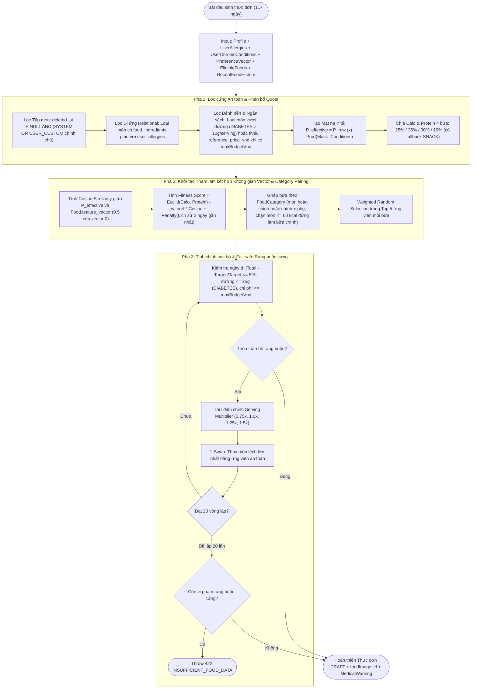

# Kế hoạch triển khai & Đặc tả chi tiết Module PLAN — Kallo Backend

**Ngày đồng bộ mã nguồn:** 25/11/2026  
**Module:** PLAN — Sinh thực đơn thông minh, gợi ý theo sở thích, quản lý bữa ăn & đổi món tương đương  
**Trạng thái đồng bộ:** Đã đồng bộ 100% với mã nguồn `FOODDATA` (`V20261124140000__food_schema.sql`, `V20261124140001__seed_ingredients.sql`, `V20261124140002__seed_vietfood68.sql`), `PROFILE` (`V20261124130000__init_profile_tables.sql`, `UserChronicConditionRepository`, `UserAllergyRepository`), và đặc tả `NUTRI` (`IMPLEMENT_MODULE_NUTRI.md`, `V20261125100000__nutri_schema.sql`).  
**Phạm vi sở hữu:** `meal_plans`, `meal_plan_foods`, `RuleBasedMenuGenerator`, `VectorSimilarityEngine`, `MealPlanService`, `MealPlanController`, `FoodPreferenceSyncAdapter`.  
**Phụ thuộc:** `FOODDATA` (`foods`, `ingredients`, `food_ingredients`), `PROFILE` (`user_health_profiles`, `user_allergies`, `user_chronic_conditions`, `chronic_conditions`), `NUTRI` (`FoodLogService`, `DailySummaryService`, `FoodPreferenceSyncPort`).

> **Nguyên tắc bất biến (Module Boundary Constraint):** Chỉ phát triển/chỉnh sửa trong phạm vi 4 module `food` (`FOODDATA`), `nutri` (`NUTRI`), `meal_plan` (`PLAN`), `profile` (`PROFILE`) và thêm hằng số mới ở `common/ErrorCode`. **Tuyệt đối không chỉnh sửa** mã nguồn hay cấu hình của các module chuẩn đã khóa (`AUTH`, `ACT`, `GAME`, `SYS`, `CHAT`, `GlobalExceptionHandler`).  
> **AS-IS:** PLAN đọc dữ liệu thực phẩm, ảnh (`image_url`), liên kết dị ứng chuẩn hóa từ `FOODDATA`/`PROFILE` và đọc bệnh mạn tính từ bảng quan hệ `user_chronic_conditions` $\bowtie$ `chronic_conditions`. Các claim hiệu năng/SRS là mục tiêu kiểm thử. Lọc y tế hiện dựa trên metadata hiện có, không phải tư vấn y khoa.  
> **TO-BE:** Tối ưu hóa thuật toán đa mục tiêu (Multi-Objective Optimization) và bổ sung dữ liệu vi chất định lượng (Sodium, Purine, Potassium, Phosphorus) cho các rule bệnh lý nâng cao.

---

## 1. Phạm vi, Mục tiêu & Đối chiếu Sơ đồ lớp (Conceptual vs Physical)

Module **PLAN** cung cấp khả năng tự động thiết kế thực đơn dinh dưỡng cá nhân hóa (1 ngày hoặc 7 ngày) dựa trên mục tiêu thể chất (TDEE, Calorie Goal, Macros), học sở thích ăn uống bằng content-based recommendation, và lọc theo danh mục dị ứng/bệnh nền chuẩn hóa. Đây là heuristic ứng dụng, không phải tư vấn hay chứng nhận an toàn dinh dưỡng y khoa.

### 1.1. Cầu nối đối chiếu Sơ đồ lớp (Visual Paradigm UML) & Mô hình CSDL Triển khai

```
┌────────────────────────────────────────────────────────────────────────┐
│                   MÔ HÌNH QUAN NIỆM (CONCEPTUAL UML)                   │
│  User ──1:N──> MealPlan ──1:N──> MealPlanFood ──N:1──> Food            │
│  UserHealthProfile: preferenceVector: Vector                           │
│  UserChronicCondition ──> ChronicCondition (code, name, is_active)     │
│  UserAllergy ──> Ingredient (isAllergen = true, ownerUserId IS NULL)   │
│  Food ──1:N──> FoodIngredient ──N:1──> Ingredient                      │
│  Food: featureVector, imageUrl, suitableMealTypes, calories, source... │
│  MealPlan: name, description, type, planDate, daysCount, status...     │
│  MealPlanFood: dayIndex, mealDate, mealType, servingMultiplier...      │
└────────────────────────────────────────────────────────────────────────┘
                                    │
                                    ▼  [Tinh chỉnh Kiến trúc & Đồng bộ Repo thực tế]
┌────────────────────────────────────────────────────────────────────────┐
│                   MÔ HÌNH VẬT LÝ TRIỂN KHAI (PHYSICAL)                 │
│  • Mở rộng `user_health_profiles` (CHỈ thêm preference_vector):        │
│    - `preference_vector JSONB`: Mảng 12 chiều thể hiện gu ăn uống.     │
│    - KHÔNG thêm `chronic_conditions JSONB` để tránh split-brain.       │
│  • Đọc Bệnh nền Chuẩn hóa từ `PROFILE`:                                │
│    - Đọc qua `UserChronicConditionRepository` (`user_chronic_conditions│
│      JOIN chronic_conditions`), đồng bộ với migration seed danh mục    │
│      bệnh chuẩn (`V20261125110000__seed_chronic_conditions.sql`).      │
│  • Tận dụng & Seed `foods.feature_vector` + `foods.image_url`:         │
│    - Đã tạo ở `V20261124140000__food_schema.sql`; migration `PLAN`     │
│      seed vector 12 chiều thực tế cho 67 món VietFood68, backfill NULL │
│      thành vector 0 và gán DEFAULT `[0.0,...,0.0]` cho món custom.     │
│    - Response trả kèm `foodImageUrl` ánh xạ từ `foods.image_url`.      │
│  • Lọc Dị ứng chuẩn hóa (Đồng bộ FOODDATA & PROFILE):                  │
│    - Join trực tiếp `user_allergies ua` (cột `ua.user_id`) với         │
│      `ingredients` hệ thống (`is_allergen = true AND owner_user_id IS  │
│      NULL AND is_active = true`) và `food_ingredients`.                │
│  • Phạm vi tập món hợp lệ (Chống IDOR & Soft Delete):                  │
│    - Chỉ nạp `deleted_at IS NULL` và (`source = 'SYSTEM'` hoặc         │
│      `includeCustomFoods = true AND source = 'USER_CUSTOM' AND          │
│      owner_user_id = currentUserId`); loại `OFF` ở v1.                 │
│  • Bảng `meal_plans` & `meal_plan_foods`:                              │
│    - Quản lý vòng đời (DRAFT -> SAVED -> APPLIED), hỗ trợ DAILY (1d)   │
│      và WEEKLY (tới 7d qua `day_index` + `meal_date`), đóng băng       │
│      snapshot dinh dưỡng và chi phí ước tính tại thời điểm tạo.        │
│  • Domain Engine `RuleBasedMenuGenerator`:                             │
│    - Heuristic 3 pha + Category-aware pairing + Cosine + Mặt nạ Y tế.  │
│  • Online Adaptive Learning (Decoupled via `FoodPreferenceSyncPort`):  │
│    - `NUTRI` (`FoodLogServiceImpl`) phát tín hiệu qua SPI tùy chọn khi │
│      user ghi nhật ký ăn thực tế; Apply plan không tự cập nhật.        │
└────────────────────────────────────────────────────────────────────────┘
```

1. **Hiện thực hóa trọn vẹn 2 Vector & Seed dữ liệu thật:**
   - `UserHealthProfile.preferenceVector` được lưu thành cột `preference_vector JSONB` (mảng 12 số thực trong đoạn $[0.0, 1.0]$).
   - `Food.featureVector` dùng chung cột `foods.feature_vector JSONB` do `FOODDATA` định nghĩa. Vì [V20261124140002__seed_vietfood68.sql](file:///c:/Users/Loi/Desktop/DoAn/BE/src/main/resources/db/migration/V20261124140002__seed_vietfood68.sql) chưa gán `feature_vector`, migration `V20261125120000__plan_schema.sql` **bắt buộc seed vector 12 chiều cho cả 67 món VietFood68** để Cosine Similarity và Online Learning hoạt động trên dữ liệu thật; chỉ các món `USER_CUSTOM` / Recipe chưa gán đặc trưng mới mang vector $0.0$ và được engine xử lý an toàn không chia cho $0$.
2. **Thống nhất Nguồn Chân lý Bệnh lý Mạn tính với `PROFILE`:**
   - Không tạo cột JSONB trùng lặp trên `user_health_profiles`. Đọc danh sách mã bệnh qua `UserChronicConditionRepository.findAllByUserIdWithCondition(userId)`.
   - Seed danh mục chuẩn ở `V20261125110000__seed_chronic_conditions.sql` khớp `profile.yaml` (`DIABETES_T2`, `DIABETES_T1`, `HYPERTENSION`, `GOUT`, `CHRONIC_KIDNEY_DISEASE`); rule tiểu đường khớp đồng nhất các mã `DIABETES`, `DIABETES_T1`, `DIABETES_T2`.
   - Nguyên tắc phân tầng an toàn: **Bệnh lý / Dị ứng $\succ$ Calo / Macro $\succ$ Sở thích cá nhân**.
3. **Quản lý Vòng đời Thực đơn & Hỗ trợ `DAILY` / `WEEKLY`:**
   - Trạng thái `MealPlan.status`: `DRAFT` $\to$ `SAVED` $\to$ `APPLIED`.
   - `MealPlan.type`: `DAILY` (`days = 1`) hoặc `WEEKLY` (`days = 2..7`), mỗi dòng `meal_plan_foods` mang `day_index` ($1\dots 7$) và `meal_date`, đóng băng toàn bộ calo, macro, đường, xơ, chi phí tại thời điểm tạo/đổi món.

---

### 1.2. Bảng ánh xạ yêu cầu chức năng (`FR-PLAN-01` … `FR-PLAN-06`)

| Mã | Nội dung yêu cầu chức năng | Mức ưu tiên | Trạng thái đồng bộ |
| :--- | :--- | :---: | :--- |
| **FR-PLAN-01** | Tạo plan 1 ngày (`DAILY`) hoặc nhiều ngày (`WEEKLY`, `days = 1..7`) theo calo, dị ứng chuẩn hóa, bệnh nền, ngân sách (gồm món `SYSTEM` và `USER_CUSTOM` chính chủ). | **M** | Đồng bộ FOODDATA & PROFILE |
| **FR-PLAN-02** | Chia theo meal type (`BREAKFAST`, `LUNCH`, `DINNER`, `SNACK`), trả món kèm ảnh (`foodImageUrl`), khẩu phần, tổng nutrition và chi phí từng ngày/toàn plan. | **M** | Đồng bộ FOODDATA |
| **FR-PLAN-03** | Swap một item theo ứng viên hợp lệ cùng `mealType`, bảo toàn dị ứng/bệnh nền, đường và ngân sách ngày. | **S** | Sẵn sàng triển khai |
| **FR-PLAN-04** | Save, list, get, delete, apply plan vào food logs (`NUTRI`) qua `FoodLogService.applyMealPlanItems(...)`. | **M** | Đồng bộ NUTRI |
| **FR-PLAN-05** | Lọc dị ứng qua `food_ingredients` / `user_allergies` và lọc bệnh nền qua `user_chronic_conditions`. | **M** | Đồng bộ FOODDATA & PROFILE |
| **FR-PLAN-06** | Xếp hạng theo Cosine Similarity với `preference_vector` và recent-food penalty (tránh lặp trong 2 ngày liên tiếp, kể cả giữa các ngày trong plan 7 ngày). | **C** | Sẵn sàng triển khai |

---

### 1.3. Tiêu chí chấp nhận (Acceptance Criteria)

- **AC1 (Độ chính xác Calo từng ngày):** Tổng calo mỗi ngày trong thực đơn nằm trong dung sai $\pm 5\%$ so với mục tiêu calo ngày:
  $$| \text{TotalCalories}_d - \text{DailyCalorieGoal} | \le 0.05 \times \text{DailyCalorieGoal}$$
  Và tổng `total_calories` của mỗi ngày luôn khớp chính xác `SUM(meal_plan_foods.calories)` của ngày đó (làm tròn nguyên từng item bằng `BigDecimal` `HALF_UP`).
- **AC2 (Lọc Dị ứng theo CSDL Chuẩn hóa):** Generator loại bỏ toàn bộ món ăn (`SYSTEM` lẫn `USER_CUSTOM` / Recipe) có liên kết tại `food_ingredients` trùng với `user_allergies` (chỉ tính `ingredients.is_allergen = true AND owner_user_id IS NULL AND is_active = true`). Danh mục 10 mã `code` dị ứng chuẩn khớp `V20261124140001__seed_ingredients.sql`: `PEANUT`, `CRUSTACEANS`, `FISH`, `GLUTEN`, `DAIRY`, `EGG`, `SOY`, `MOLLUSCS`, `TREE_NUTS`, `SESAME`.
- **AC3 (Các rule bệnh lý hiện có & Fail-safe):** Với `DIABETES` (`DIABETES_T1`/`DIABETES_T2`/`DIABETES`), generator loại món có đường cao ($> 10\text{ g}$/serving) và giữ tổng đường mỗi ngày $\le 25\text{ g}$ theo rule ứng dụng; với `GOUT`, `CHRONIC_KIDNEY_DISEASE`, `HYPERTENSION`, generator áp dụng mặt nạ điều chỉnh vector + gắn `medicalWarning` minh bạch giới hạn dữ liệu (chưa có Sodium/Purine/Potassium/Phosphorus định lượng). Nếu không đủ món thỏa ràng buộc cứng, ném `422 INSUFFICIENT_FOOD_DATA` (không trả thực đơn vi phạm).
- **AC4 (Cá nhân hóa theo Sở thích — Cosine Similarity):** Thực đơn ưu tiên món có độ tương đồng Cosine cao giữa $\vec{P}_{\text{effective}}$ và $\vec{F}_f$, xử lý an toàn trường hợp vector không ($\|\vec{F}_f\| = 0$) đối với món `USER_CUSTOM` / Recipe chưa gán vector bằng điểm trung lập `0.5`.
- **AC5 (Học thích nghi tự động — Online Learning):** Khi người dùng ghi nhận món ăn qua `POST /api/food-logs` (`source != MEAL_PLAN`), `NUTRI` gọi `FoodPreferenceSyncPort` (do `PLAN` cài đặt); nếu món có `feature_vector` khác vector $0$, vector sở thích $\vec{P}_u$ tự động cập nhật với hệ số học $\gamma = 0.05$.
- **AC6 (Kiểm soát Ngân sách & Xử lý Giá NULL):** Nếu request có `maxBudgetVnd`, tổng chi phí ước tính **mỗi ngày** $\le \text{max\_budget\_vnd}$. Generator loại bỏ các món có `foods.reference_price_vnd IS NULL` khỏi tập ứng viên khi lọc ngân sách.
- **AC7 (An toàn Dữ liệu & Chống IDOR):** Generator tuyệt đối không đưa món đã xóa mềm (`deleted_at IS NOT NULL`), món `USER_CUSTOM` của người dùng khác (`owner_user_id <> currentUserId`), hoặc món `OFF` vào thực đơn; mọi thao tác đọc/sửa/xóa/swap/apply trên `mealPlanId` của người khác trả `404 MEAL_PLAN_NOT_FOUND`.
- **AC8 (Thời gian sinh thực đơn):** Pure Java Engine phản hồi $< 20\text{ ms}$ cho 1 ngày (`days = 1`) và $< 80\text{ ms}$ cho 7 ngày (`days = 7`).
- **AC9 (Apply vào Nhật ký `NUTRI`):** Apply yêu cầu plan ở trạng thái `SAVED`, nhận query `date` tùy chọn (mặc định `planDate`) và `dayIndex` tùy chọn cho `WEEKLY` (nếu bỏ qua khi `WEEKLY`, apply toàn bộ các ngày liên tiếp từ `date`), kiểm tra lại dị ứng/bệnh nền theo hồ sơ hiện tại, từ chối nếu bữa ăn trong ngày đích đã có log (`409 MEAL_LOG_ALREADY_EXISTS`); gọi `FoodLogService.applyMealPlanItems(...)` batch insert `user_food_logs` (`source = MEAL_PLAN`) + `DailySummaryService.recalculate` và không kích hoạt cập nhật `preference_vector`.

---

## 2. Thiết kế Feature Vector & Cơ chế Xử lý Xung đột Y tế

### 2.1. Không gian Vector 12 Chiều (Explicit Feature Vector)

Mỗi vector $\vec{V} = [v_0, v_1, \dots, v_{11}] \in [0.0, 1.0]^{12}$ được định nghĩa tường minh:

| Chỉ số | Mã thuộc tính | Ý nghĩa đặc trưng | Ví dụ: Phở bò | Ví dụ: Cơm tấm | Ví dụ: Salad |
| :---: | :--- | :--- | :---: | :---: | :---: |
| $v_0$ | `SOUP_BASED` | Đồ nước (phở, bún, miến, canh, cháo, lẩu) | **1.0** | 0.0 | 0.0 |
| $v_1$ | `DRY_BASED` | Đồ khô (cơm, xôi, bánh mì, bánh cuốn) | 0.0 | **1.0** | 0.2 |
| $v_2$ | `BEEF` | Chứa thịt bò | **1.0** | 0.0 | 0.0 |
| $v_3$ | `PORK` | Chứa thịt heo/lợn | 0.0 | **1.0** | 0.0 |
| $v_4$ | `POULTRY` | Chứa thịt gà/vịt/gia cầm | 0.0 | 0.0 | 0.0 |
| $v_5$ | `SEAFOOD` | Chứa tôm, cá, cua, mực, ốc, hải sản | 0.0 | 0.0 | 0.0 |
| $v_6$ | `VEGETARIAN` | Đồ chay / nhiều rau xanh / thanh đạm | 0.1 | 0.1 | **0.9** |
| $v_7$ | `FRIED_FATTY` | Chiên, rán, xào, nhiều dầu mỡ | 0.2 | **0.8** | 0.1 |
| $v_8$ | `STEAMED_BOILED` | Luộc, hấp, thanh nhẹ | **0.8** | 0.2 | **0.9** |
| $v_9$ | `SPICY` | Vị cay nồng | 0.2 | 0.1 | 0.0 |
| $v_{10}$| `SWEET` | Vị ngọt / đồ tráng miệng / nhiều đường | 0.1 | 0.2 | 0.1 |
| $v_{11}$| `HIGH_PROTEIN` | Giàu đạm (tỷ lệ năng lượng từ protein $> 25\%$) | **0.8** | 0.6 | 0.2 |

### 2.2. Cơ chế Học Thích nghi (Online Adaptive Learning Loop)

1. **Khởi tạo:** Người dùng mới bắt đầu với $\vec{P}_0 = [0.5, 0.5, \dots, 0.5]$ (trung lập).
2. **Cập nhật lũy tiến:** Mỗi khi người dùng ghi log món ăn qua `NUTRI` (`source != MEAL_PLAN`) có vector đặc trưng $\vec{F}_{\text{logged}} \ne \vec{0}$:
   $$\vec{P}_{t} = (1 - \gamma) \cdot \vec{P}_{t-1} + \gamma \cdot \vec{F}_{\text{logged}} \quad (\gamma = 0.05)$$
   Nếu món `USER_CUSTOM` / Recipe chưa có vector đặc trưng ($\|\vec{F}_{\text{logged}}\| = 0$), bỏ qua bước cập nhật để không kéo $\vec{P}_u$ về $0$.

### 2.3. Ma trận Phân cấp & Xử lý Xung đột: Sở thích vs Bệnh lý

Nguyên tắc bất biến: **Clinical Safety Constraint $\succ$ Macronutrient Target $\succ$ User Preference**.

| Mã bệnh nền (Chuẩn `PROFILE`) | Ràng buộc cứng / Trần | Mặt nạ Vector $\vec{M}_{\text{clinical}}$ (các chiều khác $= 1.0$) | Cảnh báo `medicalWarning` |
| :--- | :--- | :--- | :--- |
| `DIABETES`, `DIABETES_T1`, `DIABETES_T2` | Loại món `sugar_per_serving > 10g`; tổng đường ngày $\le 25\text{ g}$ | `SWEET = 0.0`, `FRIED_FATTY = 0.3` | Nêu rõ giới hạn rule đường ứng dụng ($\le 25\text{ g}$/ngày), không thay thế tư vấn bác sĩ. |
| `HYPERTENSION` | Chưa có lọc cứng Sodium | `FRIED_FATTY = 0.3`, `SOUP_BASED = 0.6` | Nêu rõ CSDL chưa có Sodium định lượng, khuyến nghị hạn chế nước dùng/món mặn. |
| `GOUT` | Chưa có lọc cứng Purine | `SEAFOOD = 0.1`, `BEEF = 0.3`, `PORK = 0.4` | Nêu rõ CSDL chưa có Purine định lượng, đã giảm ưu tiên hải sản và thịt đỏ. |
| `CHRONIC_KIDNEY_DISEASE` | Chưa có lọc cứng K/P/Na | `HIGH_PROTEIN = 0.2`, `FRIED_FATTY = 0.4`, `SOUP_BASED = 0.5` | Nêu rõ CSDL chưa có Potassium/Phosphorus/Sodium định lượng, cần tham khảo bác sĩ. |

Vector sở thích hiệu dụng được tính bằng tích Hadamard của các mặt nạ bệnh lý đang mắc:
$$\vec{P}_{\text{effective}} = \vec{P}_u \odot \prod_{c \in \text{conditions}} \vec{M}_{c}$$

---

## 3. Các quyết định kỹ thuật cốt lõi (Architectural Decisions)

| # | Quyết định kỹ thuật | Giải pháp áp dụng | Lý do & Lợi ích |
| :---: | :--- | :--- | :--- |
| **D1** | **Chiến lược Thuật toán Sinh thực đơn** | **Heuristic 3 pha kết hợp Vector Space Model** trong Pure Java. | Phản hồi nhanh ($< 20\text{ ms}$ 1 ngày, $< 80\text{ ms}$ 7 ngày), không phụ thuộc LLM ngoài, kiểm soát chặt calo $\pm 5\%$. |
| **D2** | **Cá nhân hóa & Vector 0** | **Cosine Similarity**; trả điểm trung lập `0.5` nếu $\|\vec{F}_f\| = 0$ hoặc $\|\vec{P}_{\text{eff}}\| = 0$; đồng thời seed vector thật cho 67 món VietFood68. | Hỗ trợ mượt cả 67 món hệ thống lẫn món `USER_CUSTOM` / Recipe chưa có vector mà không gây `NaN`. |
| **D3** | **Lọc Dị ứng & Bệnh nền Chuẩn hóa** | Dị ứng lọc bằng `food_ingredients` $\leftrightarrow$ `ingredients` hệ thống $\leftrightarrow$ `user_allergies(user_id)`. Bệnh nền đọc từ `user_chronic_conditions` $\bowtie$ `chronic_conditions`. | Đồng bộ 100% với `FOODDATA` & `PROFILE`, không tạo cột `chronic_conditions JSONB` trùng lặp. |
| **D4** | **Tỷ lệ Phân bổ Calo, Protein & Fallback `SNACK`** | Sáng (25%), Trưa (35%), Tối (30%), Phụ (10%). Quota Protein mỗi bữa $P_m = \min(\text{profileProtein} \times r_m, C_m \times 0.35 / 4)$. Nếu thiếu món tag `SNACK` sau lọc, fallback món $\le 300\text{ kcal}$/serving hoặc dồn 10% về 3 bữa chính. | Tránh bị lệch calo khi `ProfileDomainService` tính `protein = 2.0 g/kg` khá cao, và tránh lỗi `INSUFFICIENT_FOOD_DATA` do thiếu tag `SNACK`. |
| **D5** | **Ghép món hợp lý theo `FoodCategory` & Đa dạng hóa** | Bữa chính (`BREAKFAST`/`LUNCH`/`DINNER`) ưu tiên món hoàn chỉnh (`NOODLE`, `RICE`, `SOUP`, `STAPLE` $\ge 150\text{ kcal}$) hoặc ghép cặp 1 món chính + 1 món phụ (`VEGETABLE`/`MEAT`/`SEAFOOD`), chia quota theo tỷ lệ khi chọn 2 món; chặn các gia vị/rau củ lẻ ($\le 60\text{ kcal}$ như *Chanh*, *Cà pháo*, *Củ kiệu*) đứng một mình làm bữa chính. Weighted Random Top 5 + Penalty $+5.0$ cho món đã ăn trong 2 ngày gần nhất (từ `NUTRI` hoặc ngày trước trong plan 7 ngày). | Khắc phục nhược điểm của tập VietFood68 chứa chung món hoàn chỉnh và thành phần lẻ; tránh trùng lặp thực đơn 7 ngày. |
| **D6** | **Khẩu phần Thực tế & Làm tròn đồng bộ** | Hệ số nhân khẩu phần trong $\{0.75, 1.0, 1.25, 1.5\}$. Calo/macro từng item làm tròn chuẩn `HALF_UP`; tổng ngày bằng `SUM(items)` sau làm tròn. | Khẩu phần thực tế tại Việt Nam, đảm bảo tổng các item luôn khớp 100% với header `meal_plans`. |
| **D7** | **Tinh chỉnh Pha 3 & Fail-safe Ràng buộc cứng** | Tối đa 20 vòng điều chỉnh `servingMultiplier` hoặc `1-Swap`. Nếu hết 20 vòng vẫn vi phạm ràng buộc cứng (đường `DIABETES` $> 25\text{ g}$, ngân sách `> maxBudgetVnd`, hoặc calo lệch $> \pm 5\%$ mà không thể swap), ném `422 INSUFFICIENT_FOOD_DATA`. | Tuyệt đối không trả về thực đơn vượt ngưỡng an toàn đường hoặc vượt trần ngân sách. |
| **D8** | **Đổi món (Swap) & Áp dụng (`Apply`)** | Swap cùng `mealType` (trong ngày `dayIndex` tương ứng), tối thiểu $|\Delta\text{Calo}| + 2|\Delta\text{Protein}|$ và tối đa Cosine Similarity, giữ nguyên ràng buộc ngày. Apply gọi `FoodLogService.applyMealPlanItems(...)` của `NUTRI` trong `@Transactional`, đổi trạng thái `APPLIED`. | Đồng bộ tức thì `daily_summaries`, `GAME` Streak và `SYS` alert mà không tạo phụ thuộc ngược hoặc sửa module ngoài. |

---

## 4. Mô hình Dữ liệu, Migration Flyway & Truy vấn Chuẩn

### 4.1. Flyway Migrations (Chạy tuần tự sau `NUTRI`)

1. **`src/main/resources/db/migration/V20261125110000__seed_chronic_conditions.sql`** *(Thuộc phạm vi `PROFILE`)*:
   Seed danh mục bệnh mạn tính chuẩn khớp `profile.yaml` và `PLAN`:
   ```sql
   INSERT INTO chronic_conditions (id, code, name, description, is_active) VALUES
   ('20000000-0000-0000-0000-000000000001', 'DIABETES_T2', 'Tiểu đường tuýp 2', 'Đái tháo đường tuýp 2 - kiểm soát đường tinh luyện và chỉ số đường huyết', true),
   ('20000000-0000-0000-0000-000000000002', 'DIABETES_T1', 'Tiểu đường tuýp 1', 'Đái tháo đường phụ thuộc insulin - kiểm soát lượng đường hấp thu', true),
   ('20000000-0000-0000-0000-000000000003', 'HYPERTENSION', 'Tăng huyết áp', 'Huyết áp cao - khuyến nghị hạn chế natri và chất béo bão hòa', true),
   ('20000000-0000-0000-0000-000000000004', 'GOUT', 'Bệnh Gút (Gout)', 'Tăng axit uric máu - khuyến nghị hạn chế thực phẩm giàu purine', true),
   ('20000000-0000-0000-0000-000000000005', 'CHRONIC_KIDNEY_DISEASE', 'Bệnh thận mạn tính', 'Hỗ trợ theo dõi đạm và hạn chế thực phẩm nhiều kali/natri/phốt pho', true)
   ON CONFLICT (code) DO NOTHING;
   ```

2. **`src/main/resources/db/migration/V20261125120000__plan_schema.sql`** *(Thuộc phạm vi `PLAN` & `FOODDATA`)*:

```sql
-- V20261125120000__plan_schema.sql
-- Module PLAN: Seed VietFood68 Feature Vectors, User Preference Vector, Meal Plans & Meal Plan Foods

-- 1. Seed 12D feature_vector cho 67 món VietFood68 (thứ tự: SOUP_BASED, DRY_BASED, BEEF, PORK, POULTRY, SEAFOOD, VEGETARIAN, FRIED_FATTY, STEAMED_BOILED, SPICY, SWEET, HIGH_PROTEIN)
-- (Khi triển khai PLAN-01, điền đủ 67 UPDATE/VALUES cho các class_id 0..67 <> 27)
UPDATE foods SET feature_vector = CASE vietfood_class_id
    WHEN 0  THEN '[1.0, 0.0, 0.0, 0.7, 0.0, 0.3, 0.1, 0.1, 0.9, 0.1, 0.1, 0.5]'::jsonb -- Bánh canh
    WHEN 1  THEN '[0.0, 1.0, 0.0, 0.8, 0.0, 0.0, 0.1, 0.4, 0.6, 0.1, 0.1, 0.3]'::jsonb -- Bánh chưng
    WHEN 4  THEN '[0.0, 1.0, 0.0, 0.8, 0.2, 0.0, 0.1, 0.4, 0.2, 0.2, 0.2, 0.4]'::jsonb -- Bánh mì
    WHEN 12 THEN '[1.0, 0.0, 0.8, 0.4, 0.0, 0.0, 0.1, 0.3, 0.7, 0.8, 0.1, 0.7]'::jsonb -- Bún bò Huế
    WHEN 26 THEN '[0.0, 1.0, 0.0, 1.0, 0.0, 0.0, 0.1, 0.8, 0.1, 0.1, 0.3, 0.5]'::jsonb -- Cơm tấm
    WHEN 46 THEN '[1.0, 0.0, 1.0, 0.0, 0.0, 0.0, 0.1, 0.2, 0.8, 0.2, 0.1, 0.7]'::jsonb -- Phở
    WHEN 49 THEN '[0.0, 0.2, 0.0, 0.0, 0.0, 0.0, 0.9, 0.1, 0.9, 0.0, 0.1, 0.2]'::jsonb -- Salad
    -- ... (hoàn thiện đầy đủ toàn bộ 67 lớp VietFood68 trong script migration thực tế)
    ELSE feature_vector
END
WHERE vietfood_class_id IS NOT NULL;

-- Backfill NULL còn lại (món custom/OFF cũ) thành vector 0 và đặt DEFAULT
UPDATE foods
SET feature_vector = '[0.0,0.0,0.0,0.0,0.0,0.0,0.0,0.0,0.0,0.0,0.0,0.0]'::jsonb
WHERE feature_vector IS NULL;

ALTER TABLE foods
ALTER COLUMN feature_vector SET DEFAULT '[0.0,0.0,0.0,0.0,0.0,0.0,0.0,0.0,0.0,0.0,0.0,0.0]'::jsonb;

-- 2. Bổ sung Vector sở thích vào bảng user_health_profiles (KHÔNG thêm chronic_conditions JSONB)
ALTER TABLE user_health_profiles
ADD COLUMN IF NOT EXISTS preference_vector JSONB NOT NULL DEFAULT '[0.5,0.5,0.5,0.5,0.5,0.5,0.5,0.5,0.5,0.5,0.5,0.5]'::jsonb;

-- 3. Bảng Thực đơn (Meal Plans)
CREATE TABLE meal_plans (
    id                          UUID PRIMARY KEY DEFAULT gen_random_uuid(),
    user_id                     UUID NOT NULL REFERENCES users(id) ON DELETE CASCADE,
    name                        VARCHAR(150) NOT NULL,
    description                 TEXT,
    type                        VARCHAR(30) NOT NULL DEFAULT 'DAILY' CHECK (type IN ('DAILY', 'WEEKLY')),
    plan_date                   DATE NOT NULL,
    days_count                  INTEGER NOT NULL DEFAULT 1 CHECK (days_count BETWEEN 1 AND 7),
    status                      VARCHAR(30) NOT NULL DEFAULT 'DRAFT' CHECK (status IN ('DRAFT', 'SAVED', 'APPLIED')),

    -- Mục tiêu & Tổng dinh dưỡng (tổng toàn plan; với DAILY bằng đúng 1 ngày)
    target_calories             INTEGER NOT NULL CHECK (target_calories > 0),
    total_calories              INTEGER NOT NULL DEFAULT 0 CHECK (total_calories >= 0),
    total_protein_g             NUMERIC(7, 1) NOT NULL DEFAULT 0.0 CHECK (total_protein_g >= 0),
    total_carbs_g               NUMERIC(7, 1) NOT NULL DEFAULT 0.0 CHECK (total_carbs_g >= 0),
    total_fat_g                 NUMERIC(7, 1) NOT NULL DEFAULT 0.0 CHECK (total_fat_g >= 0),
    total_sugar_g               NUMERIC(7, 1) NOT NULL DEFAULT 0.0 CHECK (total_sugar_g >= 0),
    total_fiber_g               NUMERIC(7, 1) NOT NULL DEFAULT 0.0 CHECK (total_fiber_g >= 0),
    estimated_cost_vnd          INTEGER NOT NULL DEFAULT 0 CHECK (estimated_cost_vnd >= 0),
    max_budget_vnd              INTEGER CHECK (max_budget_vnd IS NULL OR max_budget_vnd > 0),

    -- Điểm số tương thích sở thích & Cảnh báo y tế
    preference_match_score      NUMERIC(4, 2) NOT NULL DEFAULT 0.0,
    medical_warning             TEXT,

    -- Vết áp dụng nhật ký
    applied_at                  TIMESTAMPTZ,
    applied_date                DATE,

    created_at                  TIMESTAMPTZ NOT NULL DEFAULT now(),
    updated_at                  TIMESTAMPTZ NOT NULL DEFAULT now()
);

CREATE INDEX idx_meal_plans_user_date ON meal_plans (user_id, plan_date);
CREATE INDEX idx_meal_plans_status ON meal_plans (user_id, status);

-- 4. Bảng Chi tiết món ăn trong thực đơn (Meal Plan Foods)
CREATE TABLE meal_plan_foods (
    id                          UUID PRIMARY KEY DEFAULT gen_random_uuid(),
    meal_plan_id                UUID NOT NULL REFERENCES meal_plans(id) ON DELETE CASCADE,
    food_id                     UUID NOT NULL REFERENCES foods(id),
    day_index                   INTEGER NOT NULL DEFAULT 1 CHECK (day_index BETWEEN 1 AND 7),
    meal_date                   DATE NOT NULL,
    meal_type                   VARCHAR(20) NOT NULL CHECK (meal_type IN ('BREAKFAST', 'LUNCH', 'DINNER', 'SNACK')),

    serving_name                VARCHAR(100) NOT NULL,
    serving_grams               NUMERIC(6, 1) NOT NULL CHECK (serving_grams > 0),
    serving_multiplier          NUMERIC(4, 2) NOT NULL DEFAULT 1.00 CHECK (serving_multiplier > 0),

    -- Snapshot Dinh dưỡng món (đã nhân serving_multiplier và làm tròn chuẩn)
    calories                    INTEGER NOT NULL CHECK (calories >= 0),
    protein_g                   NUMERIC(6, 1) NOT NULL DEFAULT 0.0 CHECK (protein_g >= 0),
    carbs_g                     NUMERIC(6, 1) NOT NULL DEFAULT 0.0 CHECK (carbs_g >= 0),
    fat_g                       NUMERIC(6, 1) NOT NULL DEFAULT 0.0 CHECK (fat_g >= 0),
    sugar_g                     NUMERIC(6, 1) NOT NULL DEFAULT 0.0 CHECK (sugar_g >= 0),
    fiber_g                     NUMERIC(6, 1) NOT NULL DEFAULT 0.0 CHECK (fiber_g >= 0),
    estimated_price_vnd         INTEGER NOT NULL DEFAULT 0 CHECK (estimated_price_vnd >= 0),

    created_at                  TIMESTAMPTZ NOT NULL DEFAULT now(),
    updated_at                  TIMESTAMPTZ NOT NULL DEFAULT now()
);

CREATE INDEX idx_meal_plan_foods_plan ON meal_plan_foods (meal_plan_id, day_index, meal_type);
CREATE INDEX idx_meal_plan_foods_food ON meal_plan_foods (food_id);
```

### 4.2. Truy vấn chuẩn tải Tập Ứng viên Hợp lệ (Đã sửa khớp Schema `PROFILE` & `FOODDATA`)

Truy vấn tại `FoodRepository` phục vụ Pha 1 (join đúng `user_allergies.user_id` thay vì `user_health_profile_id`, hỗ trợ `:includeCustomFoods` và loại nguồn `OFF`):

```sql
SELECT f.*
FROM foods f
WHERE f.deleted_at IS NULL
  -- 1. Chống IDOR & Lọc nguồn hợp lệ (chỉ SYSTEM hoặc USER_CUSTOM chính chủ khi bật includeCustomFoods)
  AND (
      f.source = 'SYSTEM'
      OR (:includeCustomFoods = TRUE AND f.source = 'USER_CUSTOM' AND f.owner_user_id = :userId)
  )
  -- 2. Loại trừ món user chủ động bỏ qua (nếu có)
  AND (:hasExcludedIds = FALSE OR f.id NOT IN (:excludedFoodIds))
  -- 3. Nếu người dùng bật giới hạn ngân sách -> loại món chưa có giá tham khảo
  AND (:hasBudgetLimit = FALSE OR f.reference_price_vnd IS NOT NULL)
  -- 4. Lọc cứng dị ứng qua bảng liên kết chuẩn hóa food_ingredients <-> ingredients <-> user_allergies(user_id)
  AND NOT EXISTS (
      SELECT 1
      FROM food_ingredients fi
      INNER JOIN ingredients i ON i.id = fi.ingredient_id
      INNER JOIN user_allergies ua ON ua.ingredient_id = i.id
      WHERE fi.food_id = f.id
        AND ua.user_id = :userId
        AND i.is_allergen = TRUE
        AND i.owner_user_id IS NULL
        AND i.is_active = TRUE
  );
```

---

## 5. Chi tiết Thuật toán Sinh Thực đơn 3 Pha (3-Phase Generator Engine)

Thuật toán nằm tại: `com.healthcare.kallo.service.plan.engine.RuleBasedMenuGenerator`.



### 5.1. Công thức Hàm tính điểm ứng viên (Candidate Fitness Score)

Cho mỗi món ăn ứng viên $f$ đối với slot bữa ăn $m \in \{\text{BREAKFAST, LUNCH, DINNER, SNACK}\}$ với mục tiêu $(C_{\text{slot}}, P_{\text{slot}})$:

$$\text{CosineSim}(\vec{P}_{\text{effective}}, \vec{F}_f) = \begin{cases} 0.5 & \text{nếu } \|\vec{P}_{\text{effective}}\| = 0 \text{ hoặc } \|\vec{F}_f\| = 0 \\[6pt] \dfrac{\vec{P}_{\text{effective}} \cdot \vec{F}_f}{\|\vec{P}_{\text{effective}}\| \cdot \|\vec{F}_f\|} & \text{ngược lại} \end{cases}$$

$$\text{FitnessScore}(f, m) = w_c \cdot \left( \frac{C_f - C_{\text{slot}}}{C_{\text{slot}}} \right)^2 + w_p \cdot \left( \frac{P_f - P_{\text{slot}}}{P_{\text{slot}}} \right)^2 - w_{\text{pref}} \cdot \text{CosineSim}(\vec{P}_{\text{eff}}, \vec{F}_f) + \text{Penalty}(f)$$

Trong đó:
- $C_f, P_f$: Calo và Protein của món $f$.
- $C_{\text{slot}}, P_{\text{slot}}$: Mục tiêu Calo và Protein của slot (bằng $100\%$ quota bữa nếu chọn 1 món hoàn chỉnh; chia theo tỷ lệ khi ghép 2 món trong bữa).
- Trọng số: $w_c = 0.5$, $w_p = 0.2$, $w_{\text{pref}} = 1.5$.
- $\text{Penalty}(f) = +5.0$ nếu món $f$ đã xuất hiện trong 2 ngày gần nhất (từ `user_food_logs` hoặc các ngày trước đó trong cùng plan `WEEKLY`), ngược lại $= 0.0$.

---

## 6. Danh sách API Endpoints & Cấu trúc Response chi tiết

Toàn bộ Endpoint nằm dưới tiền tố `/api/meal-plans`, yêu cầu JWT Bearer Authentication (`email_verified = true`), trả về chuẩn wrapper `ApiResponse<T>` (`{ "success": true|false, "data": ..., "error": ... }`, riêng `DELETE` trả `204 No Content`).

| Phương thức | Đường dẫn Endpoint | Vai trò nghiệp vụ | Mã lỗi chính |
| :--- | :--- | :--- | :---: |
| `POST` | `/api/meal-plans/generate` | Sinh thực đơn 1..7 ngày (`planDate`, `days` mặc định `1`, `calorieTargetOverride`, `maxBudgetVnd`, `excludedFoodIds`, `includeCustomFoods` mặc định `true`). Override bị chặn dưới ngưỡng an toàn theo gender (`1500` Nam / `1200` Nữ). | `PROFILE_NOT_FOUND`, `INSUFFICIENT_FOOD_DATA`, `VALIDATION_ERROR` |
| `POST` | `/api/meal-plans/{id}/save` | Lưu thực đơn nháp (`DRAFT` $\to$ `SAVED`). | `MEAL_PLAN_NOT_FOUND` |
| `GET` | `/api/meal-plans` | Lấy danh sách thực đơn của người dùng hiện tại (phân trang `page`, `size`). | — |
| `GET` | `/api/meal-plans/{id}` | Lấy chi tiết thực đơn theo ngày/bữa kèm `foodImageUrl`, `medicalWarning` và `preferenceMatchScore`. | `MEAL_PLAN_NOT_FOUND` |
| `DELETE` | `/api/meal-plans/{id}` | Xóa một thực đơn (`204 No Content`). | `MEAL_PLAN_NOT_FOUND` |
| `POST` | `/api/meal-plans/{id}/items/{itemId}/swap` | Đổi món tương đương cùng `mealType` trong ngày của `itemId`, bảo toàn dị ứng/bệnh nền, trần đường và ngân sách ngày. | `MEAL_PLAN_NOT_FOUND`, `MEAL_PLAN_ITEM_NOT_FOUND`, `NO_SUITABLE_SWAP_FOOD` |
| `POST` | `/api/meal-plans/{id}/apply?date=YYYY-MM-DD&dayIndex=...` | Áp dụng thực đơn đã `SAVED` vào nhật ký `NUTRI` (`date` tùy chọn, mặc định `planDate`; `dayIndex` tùy chọn với `WEEKLY`). | `MEAL_PLAN_NOT_FOUND`, `MEAL_PLAN_NOT_SAVED`, `MEAL_PLAN_ALREADY_APPLIED`, `MEAL_LOG_ALREADY_EXISTS` |

### 6.1. Cấu trúc Response mẫu (`POST /api/meal-plans/generate` — Chuẩn `ApiResponse`)

> Lưu ý: `foodImageUrl` được ánh xạ từ `foods.image_url` (cho phép `null`). `medicalWarning` nêu rõ giới hạn metadata/rule hiện tại.

```json
{
  "success": true,
  "data": {
    "id": "e4b2d5a1-7c98-4f81-9b7e-8c3127a94b12",
    "name": "Thực đơn kiểm soát đường huyết 25/11/2026",
    "type": "DAILY",
    "planDate": "2026-11-25",
    "daysCount": 1,
    "status": "DRAFT",
    "targetCalories": 1850,
    "totalCalories": 1835,
    "totalProteinG": 115.0,
    "totalCarbsG": 205.0,
    "totalFatG": 52.0,
    "totalSugarG": 21.5,
    "totalFiberG": 28.0,
    "estimatedCostVnd": 130000,
    "maxBudgetVnd": 150000,
    "preferenceMatchScore": 0.82,
    "medicalWarning": "Hồ sơ có DIABETES_T2. Hệ thống đã áp dụng rule đường (<= 25g/ngày) dựa trên dữ liệu món hiện có; kết quả chỉ mang tính hỗ trợ, không thay thế tư vấn chuyên môn.",
    "days": [
      {
        "dayIndex": 1,
        "mealDate": "2026-11-25",
        "targetCalories": 1850,
        "totalCalories": 1835,
        "calorieDifferencePct": -0.81,
        "estimatedCostVnd": 130000,
        "meals": [
          {
            "mealType": "BREAKFAST",
            "targetCalories": 462,
            "totalCalories": 450,
            "items": [
              {
                "id": "a1111111-2222-3333-4444-555555555555",
                "foodId": "10000000-0000-0000-0000-00000000002e",
                "foodName": "Phở",
                "foodImageUrl": null,
                "foodSource": "SYSTEM",
                "servingName": "1 tô phở bò",
                "servingGrams": 500.0,
                "servingMultiplier": 1.0,
                "calories": 450,
                "proteinG": 29.0,
                "carbsG": 56.0,
                "fatG": 11.0,
                "sugarG": 4.0,
                "fiberG": 3.0,
                "estimatedPriceVnd": 50000
              }
            ]
          },
          {
            "mealType": "SNACK",
            "targetCalories": 185,
            "totalCalories": 175,
            "items": [
              {
                "id": "11111111-aaaa-bbbb-cccc-dddddddddddd",
                "foodId": "22222222-aaaa-bbbb-cccc-dddddddddddd",
                "foodName": "Bát Yến Mạch Dâu Tây (Recipe cá nhân)",
                "foodImageUrl": "https://cdn.kallo.app/foods/custom/oatmeal-bowl.jpg",
                "foodSource": "USER_CUSTOM",
                "servingName": "1 ly",
                "servingGrams": 150.0,
                "servingMultiplier": 1.0,
                "calories": 175,
                "proteinG": 12.0,
                "carbsG": 16.0,
                "fatG": 4.5,
                "sugarG": 6.0,
                "fiberG": 5.5,
                "estimatedPriceVnd": 20000
              }
            ]
          }
        ]
      }
    ]
  },
  "error": null
}
```

---

## 7. Phân rã công việc (Task Breakdown)

| Mã Task | Tên công việc kỹ thuật | Phụ thuộc | Thời lượng | Kết quả nghiệm thu (Deliverables) |
| :---: | :--- | :---: | :---: | :--- |
| **PLAN-01** | Tạo `V20261125110000__seed_chronic_conditions.sql` (`PROFILE`) và `V20261125120000__plan_schema.sql` (seed 67 vector VietFood68, backfill/default `foods.feature_vector`, thêm `user_health_profiles.preference_vector`, tạo `meal_plans` & `meal_plan_foods` có `day_index`). | `V20261124130000`, `V20261124140002`, `V20261125100000` | 0.75 ngày | Migration chạy sạch, `chronic_conditions` và 67 `feature_vector` có dữ liệu thật. |
| **PLAN-02** | Cập nhật Entities `UserHealthProfile` (`preferenceVector`), `Food` (`featureVector`), tạo Entities `MealPlan`, `MealPlanFood`, và query tải món hợp lệ trong `FoodRepository` (join `ua.user_id = :userId`). | PLAN-01 | 0.5 ngày | `ddl-auto: validate` pass; query lọc đúng `deleted_at IS NULL`, IDOR, `includeCustomFoods` và dị ứng. |
| **PLAN-03** | Xây dựng `VectorSimilarityEngine` (Cosine an toàn vector $0$, Mặt nạ 4 nhóm bệnh nền, Cập nhật thích nghi $\gamma = 0.05$). | PLAN-02 | 0.5 ngày | Engine toán học độc lập I/O, xử lý mượt cả món `USER_CUSTOM` / Recipe vector $0$. |
| **PLAN-04** | Xây dựng `RuleBasedMenuGenerator` (3 pha, hỗ trợ 1..7 ngày, Category pairing, lọc `DIABETES`, lọc `reference_price_vnd IS NOT NULL`, fallback `SNACK`, fail-safe `INSUFFICIENT_FOOD_DATA`). | PLAN-03 | 1.25 ngày | Tốc độ $< 20\text{ ms}$ (1 ngày) / $< 80\text{ ms}$ (7 ngày), sai số calo $\le \pm 5\%$. |
| **PLAN-05** | Xây dựng `MealPlanServiceImpl` (generate, save, list, get, delete, swap item cùng `mealType`, `medicalWarning`). | PLAN-04 | 1.0 ngày | Hoàn chỉnh nghiệp vụ sinh, quản lý và đổi món tương đương. |
| **PLAN-06** | Cài đặt `apply` kết nối `NUTRI` (`FoodLogService.applyMealPlanItems(...)` kiểm tra trùng bữa, batch insert `source = MEAL_PLAN`, `recalculate`, không học sở thích). | PLAN-05, `NUTRI-05` | 0.5 ngày | Áp dụng thực đơn an toàn, cập nhật `daily_summaries`, `GAME` Streak và `SYS` alert. |
| **PLAN-07** | Cài đặt bean `FoodPreferenceSyncAdapter implements FoodPreferenceSyncPort` cho `NUTRI` (bỏ qua vector $0$ và `source = MEAL_PLAN`). | PLAN-03, `NUTRI-05` | 0.5 ngày | Hệ thống học khẩu vị người dùng sau mỗi bữa ăn thực tế mà không sửa code ngoài `plan`/`nutri`. |
| **PLAN-08** | Xây dựng `MealPlanController`, DTOs chuẩn `ApiResponse`, bổ sung mã lỗi ở `common/ErrorCode.java` và viết `docs/api-specs/plan.yaml`. | PLAN-06 | 0.5 ngày | Cụm 7 endpoints RESTful chuẩn `ApiResponse` + Swagger/OpenAPI spec. |
| **PLAN-09** | Bộ Unit Tests & Integration Tests (10 mã dị ứng, `DIABETES_T2` từ `user_chronic_conditions`, `GOUT`/`HYPERTENSION` mask, 7-day WEEKLY, `USER_CUSTOM` vector $0$, soft delete, IDOR, giá NULL, fail-safe `INSUFFICIENT_FOOD_DATA`). | PLAN-07, PLAN-08 | 1.0 ngày | 100% test pass qua `./gradlew check`. |

---

## 8. Kế hoạch Kiểm thử & Ma trận Test Cases

| Phân loại | Tên ca kiểm thử | Điều kiện đầu vào | Kỳ vọng đầu ra |
| :--- | :--- | :--- | :--- |
| **Unit Test** | `testGeneratePlan_DiabetesConflictWithSweetPreference` | User có `user_chronic_conditions` trỏ `DIABETES_T2` nhưng vector có `SWEET = 1.0`. | - Tổng đường ngày $\le 25\text{ g}$.<br>- Không có món vượt $10\text{ g}$ đường/serving.<br>- Có `medicalWarning` trong response. |
| **Unit Test** | `testGeneratePlan_GoutAndHypertensionMasks` | User có `GOUT` hoặc `HYPERTENSION`. | Giảm điểm ưu tiên món `SEAFOOD`/`BEEF`/`FRIED_FATTY` tương ứng và trả `medicalWarning` minh bạch. |
| **Unit Test** | `testGeneratePlan_CosineSimilarityPreferenceMatch` | User thích đồ nước (`SOUP_BASED = 1.0`). | Thực đơn ưu tiên chọn phở, bún thay vì cơm khô. |
| **Unit Test** | `testGeneratePlan_ZeroFeatureVectorCustomRecipe` | Danh sách ứng viên chứa món Recipe `USER_CUSTOM` có `feature_vector = [0, ..., 0]`. | Engine không ném `NaN`/chia cho $0$, chấm điểm tương đồng trung lập `0.5`. |
| **Unit Test** | `testGeneratePlan_AllergyFilterStrict_SystemAndRecipe` | User khai báo `user_allergies` gồm `PEANUT`, `CRUSTACEANS`, `DAIRY`. DB có cả món `SYSTEM` và Recipe `USER_CUSTOM` chứa `DAIRY`. | Thực đơn loại bỏ $100\%$ cả món `SYSTEM` lẫn Recipe `USER_CUSTOM` chứa 3 nhóm dị ứng trên. |
| **Unit Test** | `testGeneratePlan_BudgetFilterExcludesNullPrice` | Request truyền `maxBudgetVnd = 120000`; DB có món `reference_price_vnd IS NULL`. | Loại bỏ món giá `NULL`, `estimatedCostVnd` mỗi ngày $\le 120000$. |
| **Unit Test** | `testGeneratePlan_SnackFallbackWhenNoSnackTag` | Tất cả món ứng viên chỉ có `suitable_meal_types = ["BREAKFAST", "LUNCH", "DINNER"]`. | Áp dụng cơ chế fallback, không ném `INSUFFICIENT_FOOD_DATA` và tổng calo vẫn đạt $\pm 5\%$. |
| **Unit Test** | `testGeneratePlan_HardConstraintFailsWithInsufficientFoodData` | `DIABETES_T2` nhưng mọi món ứng viên đều $> 10\text{ g}$ đường/serving hoặc vượt `maxBudgetVnd`. | Ném `422 INSUFFICIENT_FOOD_DATA`, không trả thực đơn vi phạm ràng buộc cứng. |
| **Unit Test** | `testGeneratePlan_Weekly7DaysPerformanceAndVariety` | `days = 7`, Calorie Target = `2000 kcal`. | Thời gian sinh $< 80\text{ ms}$, mỗi ngày đạt $[1900, 2100]\text{ kcal}$, không lặp món liên tiếp 2 ngày gần nhất. |
| **Unit Test** | `testAdaptiveLearning_PreferenceVectorShifts` | User ghi log 5 bữa liên tiếp qua `FoodPreferenceSyncPort` có `BEEF = 1.0`. | Chiều `BEEF` trong `preference_vector` tăng theo $\gamma = 0.05$; món vector $0$ không làm thay đổi vector. |
| **Integration Test** | `testGeneratePlan_ExcludesSoftDeletedOtherUserAndOffFoods` | DB có món User A đã `deleted_at IS NOT NULL`, món `USER_CUSTOM` User B và món `OFF`. | Thực đơn của User A không bao giờ chứa món đã xóa mềm, món User B hoặc món `OFF`; trả đúng `foodImageUrl`. |
| **Integration Test** | `testApplyMealPlan_CreatesFoodLogsAndUpdatesSummary` | Gọi `/apply` cho thực đơn 4 món ở trạng thái `SAVED`. | Tạo đúng 4 dòng `user_food_logs` (`source = MEAL_PLAN`), `daily_summaries` tính toán lại ngay, `preference_vector` giữ nguyên. |
| **Security Test** | `testCannotAccessSwapApplyOrDeleteOtherUserMealPlan` | User A thao tác trên `mealPlanId` của User B. | Trả `404 MEAL_PLAN_NOT_FOUND`. |
