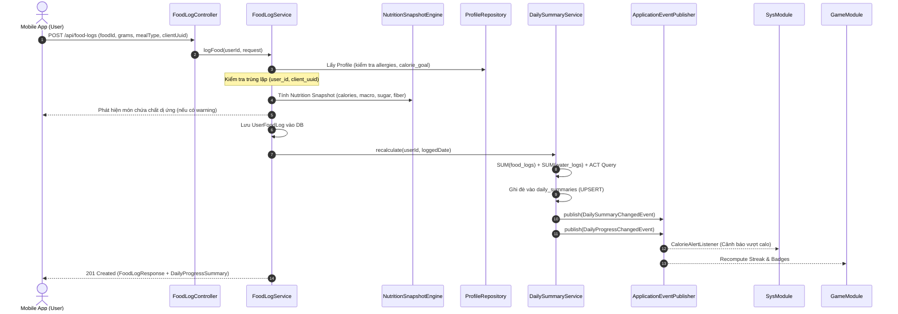

# Kế hoạch triển khai & Đặc tả chi tiết Module NUTRI — Kallo Backend

**Ngày đồng bộ mã nguồn:** 23/11/2026
**Module:** NUTRI — Nhật ký dinh dưỡng, nước uống & tổng hợp hàng ngày (SRS Mục 4.3, FR-NUT-01 … FR-NUT-13)
**Phạm vi sở hữu:** `user_food_logs`, `water_logs`, `daily_summaries`; `FoodLogService`, `WaterLogService`, `DailySummaryService`; tích hợp nhận diện AI theo cấu hình hiện tại.

> **AS-IS:** Schema, entity, service và controller đã có. Bảng giới hạn nước là `amount_ml <= 5000`. Dị ứng hiện lưu JSONB trên profile và food; cấu trúc chuẩn hóa (ingredients/allergens/conditions) là TO-BE, xem `IMPLEMENT_MODULE_FOODDATA.md`.
> **TO-BE:** Không coi các claim về MinIO/AI, offline sync, favorites hoặc event như đã triển khai nếu không có route/service tương ứng trong source.

---

## 1. Phạm vi, Mục tiêu & Đối chiếu Sơ đồ lớp (Conceptual vs Physical)

Module **NUTRI** đóng vai trò là **trái tim vận hành dữ liệu** của ứng dụng Kallo. Module này ghi nhận hành vi ăn uống và uống nước hàng ngày của người dùng, đóng băng giá trị dinh dưỡng theo thời gian thực (Snapshot), cập nhật bảng nóng `daily_summaries`, và kích hoạt các phản ứng liên module sang **GAME** (Streak, Badges, Leaderboard) và **SYS** (Thông báo, Cảnh báo vượt ngưỡng calo, Nhắc nhở).

### 1.1. Cầu nối đối chiếu Sơ đồ lớp (Visual Paradigm UML) & Mô hình CSDL Triển khai

```
┌────────────────────────────────────────────────────────────────────────┐
│                   MÔ HÌNH QUAN NIỆM (CONCEPTUAL UML)                   │
│  User ──1:N──> UserFoodLog ──N:1──> Food                               │
│  User ──1:N──> WaterLog                                                │
│  User ──1:N──> DailySummary (chứa các method nghiệp vụ tính toán)      │
│  UserFoodLog (chỉ có calories + servingMultiplier + calculateNutrition)│
└────────────────────────────────────────────────────────────────────────┘
                                    │
                                    ▼  [Tinh chỉnh Kiến trúc & Tối ưu Production]
┌────────────────────────────────────────────────────────────────────────┐
│                   MÔ HÌNH VẬT LÝ TRIỂN KHAI (PHYSICAL)                 │
│  • Bảng `user_food_logs`: Áp dụng Mẫu NUTRITION SNAPSHOT. Đóng băng    │
│    calories, protein_g, carbs_g, fat_g, sugar_g, fiber_g.             │
│    Ràng buộc UNIQUE(user_id, client_uuid) đảm bảo Idempotency.         │
│  • Bảng `water_logs`: Ràng buộc UNIQUE(user_id, client_uuid).          │
│  • Bảng `daily_summaries`: Mở rộng lưu các chỉ số định lượng cụ thể    │
│    (calories_consumed, target_calories, water_ml, steps, weight_kg...) │
│  • Tách các hàm tính toán ra DOMAIN SERVICES (DailySummaryService,     │
│    FoodLogService) để đảm bảo Clean Architecture và Transaction.       │
└────────────────────────────────────────────────────────────────────────┘
```

1. **Bảo toàn dữ liệu lịch sử bằng Nutrition Snapshot:**
   - Trong sơ đồ lớp, `UserFoodLog` chỉ liên kết tới `Food` và lưu `servingMultiplier`. Tuy nhiên, nếu sau này quản trị viên hoặc người dùng cập nhật thông tin dinh dưỡng trong từ điển `Food`, các báo cáo lịch sử của những tháng trước sẽ bị sai lệch.
   - Vì vậy, khi ghi log, hệ thống nhân sẵn và **đóng băng toàn bộ chỉ số** (`calories`, `protein_g`, `carbs_g`, `fat_g`, `sugar_g`, `fiber_g`) vào bản ghi `user_food_logs`.
2. **Chống trùng lặp khi chạy Offline (`client_uuid` Idempotency):**
   - Đáp ứng yêu cầu ngoại tuyến `FR-SYS-05`: Mobile App tạo sẵn `client_uuid` (UUID v4). CSDL đánh ràng buộc `UNIQUE (user_id, client_uuid)` trên cả hai bảng `user_food_logs` và `water_logs` để hỗ trợ cơ chế idempotent an toàn khi gửi lại request hoặc đồng bộ qua `/api/sync/push`.
3. **Mở rộng bảng nóng `daily_summaries`:**
   - Sơ đồ lớp khái niệm chỉ biểu diễn các cờ kiểm tra (`isGoalAchieved`, `isSugarExceeded`, `isProteinExceeded`).
   - Trong CSDL thực tế, bảng `daily_summaries` lưu trữ đầy đủ các số liệu định lượng (nạp vào, tiêu hao, nước uống, đa lượng macro, bước chân, cân nặng) để Dashboard và các màn hình thống kê đọc thẳng một dòng duy nhất với tốc độ `< 5ms`.
4. **Tách biệt Logic tính toán sang Domain Service:**
   - Các phương thức `calculateNutrition()` và `recalculate()` được tách khỏi Entity và đưa vào `FoodLogService` và `DailySummaryService` để quản lý giao dịch `@Transactional`, dễ viết Unit Test và kích hoạt phát sự kiện `ApplicationEventPublisher`.

---

### 1.2. Bảng ánh xạ yêu cầu chức năng (FR-NUT-01 … FR-NUT-13)

| Mã | Nội dung yêu cầu | Mức ưu tiên | Phase Sprint 2 | Trạng thái |
| :--- | :--- | :---: | :---: | :---: |
| **FR-NUT-01** | Ghi nhật ký bữa ăn theo 4 buổi: **Sáng (BREAKFAST), Trưa (LUNCH), Tối (DINNER), Bữa phụ (SNACK)**. | **M** | 1 | AS-IS đã có |
| **FR-NUT-02** | Chụp/chọn ảnh món ăn $\rightarrow$ Upload MinIO $\rightarrow$ Gọi AI Service (YOLOv11) $\rightarrow$ Trả về danh sách món nhận diện kèm độ tin cậy và dinh dưỡng. | **M** | 3 | AS-IS đã có |
| **FR-NUT-03** | Cho phép người dùng xác nhận, sửa món/khẩu phần hoặc thêm/bớt món trước khi lưu vào nhật ký. | **M** | 1 & 3 | AS-IS đã có |
| **FR-NUT-04** | Tra cứu món ăn theo tên (tiếng Việt không dấu qua PostgreSQL `pg_trgm`). | **M** | — | Đã xong ở FOODDATA, tái sử dụng |
| **FR-NUT-05** | Quét mã vạch thực phẩm đóng gói để tra cứu và ghi log. | **M** | — | Đã xong ở FOODDATA, tái sử dụng |
| **FR-NUT-06** | Tạo, sửa, xóa món ăn tùy chỉnh cá nhân (`source = USER_CUSTOM`, `owner_user_id = current_user_id`). | **M** | 1 | AS-IS đã có |
| **FR-NUT-07** | Xem nhật ký theo ngày: phân theo 4 buổi ăn, hiển thị tổng calo/macro đã nạp và so sánh với mục tiêu ngày. | **M** | 1 | AS-IS đã có |
| **FR-NUT-08** | Sửa/xóa mục log đã ghi; sao chép bữa ăn từ ngày khác; tự động kích hoạt tính toán lại `daily_summaries`. | **S** | 2 | AS-IS đã có |
| **FR-NUT-09** | Danh sách món gần đây (`recent`) để ghi log nhanh. Favorite list chưa có endpoint/schema riêng. | **S** | 1 | Recent: AS-IS; favorite: TO-BE |
| **FR-NUT-10** | Cảnh báo dị ứng: Đối chiếu thành phần món ăn với danh sách dị ứng (`allergies`) trong hồ sơ PROFILE của người dùng. | **S** | 1 & 3 | AS-IS đã có |
| **FR-NUT-11** | Ghi nhận lượng nước uống (ml), xóa log nước, theo dõi tổng nước trong ngày so với mục tiêu ngày. | **M** | 1 | AS-IS đã có |
| **FR-NUT-12** | Lưu trữ ảnh chụp gốc của bữa ăn lên Object Storage (MinIO) và lưu URL vào bản ghi nhật ký. | **M** | 3 | AS-IS đã có |
| **FR-NUT-13** | Cơ chế thu thập ảnh người dùng sửa sai nhãn AI để phục vụ cải thiện mô hình (lưu cờ `feedback_given`). | **C** | 3 | Thiết kế sẵn trường dữ liệu |

---

### 1.3. Tiêu chí chấp nhận (Acceptance Criteria)

- **AC1 (Tốc độ ghi log & Snapshot):** Ghi nhận `UserFoodLog` hoàn tất dưới **$150\text{ ms}$**. Các trường snapshot `calories`, `protein_g`, `carbs_g`, `fat_g` được lưu chính xác theo công thức:
  $$\text{Nutrient}_{\text{snapshot}} = \text{Nutrient}_{\text{per 100g}} \times \frac{\text{serving\_grams}}{100}$$
- **AC2 (Idempotency chống trùng lặp):** Khi mobile gửi 2 request giống hệt nhau có cùng cặp `(user_id, client_uuid)`, request thứ 2 không tạo thêm bản ghi mới và không làm tăng gấp đôi số calo/nước.
- **AC3 (Tính toán lại tức thời DailySummary):** Mọi hành động thêm, sửa, xóa trên `user_food_logs` hoặc `water_logs` phải kích hoạt hàm `DailySummaryService.recalculate(userId, date)`:
  - Cập nhật dòng `daily_summaries` tương ứng trong cùng giao dịch hoặc ngay sau commit.
  - Bắn sự kiện `DailySummaryChangedEvent` và `DailyProgressChangedEvent` sang các module nhánh B.
- **AC4 (AS-IS):** FoodLog service đối chiếu allergies trong profile với `foods.allergens` và trả cảnh báo theo response hiện tại. Dữ liệu hiện là JSONB; độ an toàn phụ thuộc tính đầy đủ/chính xác của metadata món. Chuẩn hóa qua ingredient/allergen relations là TO-BE.
- **AC5 (Độ trễ nhận diện ảnh AI):** Upload ảnh và nhận diện món ăn phản hồi dưới **$3.0\text{ s}$** với môi trường thật. Trường hợp ảnh không hợp lệ hoặc AI không nhận diện được (độ tin cậy $< 0.4$), hệ thống trả về danh sách rỗng kèm gợi ý tìm kiếm thủ công, không báo lỗi 500.

---

## 2. Hiện trạng Repo & Các cổng kết nối liên module

| Module đối tác | Chi tiết kết nối và trách nhiệm | Trạng thái tích hợp ở Sprint 2 |
| :--- | :--- | :--- |
| **PROFILE (Nhánh A)** | Đọc `daily_calorie_goal`, `water_goal_ml`, `allergies` từ `user_health_profiles`. | AS-IS tích hợp trong source; acceptance/benchmark kiểm riêng |
| **FOODDATA (Nhánh A)** | Đọc food system/custom/barcode từ `foods`. | AS-IS tích hợp trong source; dữ liệu recipe/allergen chuẩn hóa là TO-BE |
| **ACT (Nhánh B)** | Đọc `calories_burned`, `steps` và `weight_kg` để tổng hợp DailySummary. | AS-IS dùng `ActivityDailyAggregator` qua `ObjectProvider`; không có `ActivityWeightQueryPort` trong source hiện tại |
| **SYS (Nhánh B)** | Lắng nghe `DailySummaryChangedEvent` để gửi thông báo cảnh báo calo; `MealLoggedEvent`, `WaterLoggedEvent` cho bộ máy nhắc nhở. | Cần bắn event sau khi lưu log thành công |
| **GAME (Nhánh B)** | Cần đọc dữ liệu thực tế từ `DailyProgressProvider` để tính Streak, Leaderboard và Badges. | **Thay thế `EmptyDailyProgressProvider`** bằng triển khai đọc từ `daily_summaries` |
| **SYS — Sync (Nhánh B)** | Đồng bộ ngoại tuyến: Xử lý `SyncEntityType.FOOD_LOG` và `SyncEntityType.WATER_LOG`. | Cung cấp 2 bean `SyncEntityHandler` cho `SyncRegistry` |

---

## 3. Các quyết định kỹ thuật cốt lõi (Architectural Decisions)

| # | Vấn đề kỹ thuật | Quyết định áp dụng | Lý do & Lợi ích |
| :---: | :--- | :--- | :--- |
| **D1** | Mẫu thiết kế Dinh dưỡng | **Nutrition Snapshot Pattern**: Lưu cứng số calo và các chỉ số đa lượng tại thời điểm ăn vào `user_food_logs`. | Tránh biến động dữ liệu lịch sử của người dùng khi bảng `foods` được admin cập nhật. |
| **D2** | Khử trùng lặp ngoại tuyến | Áp dụng **Client UUID Idempotency**: `client_uuid` sinh bởi client; ràng buộc CSDL `UNIQUE (user_id, client_uuid)`. | Giải quyết triệt để vấn đề mất mạng gửi lại request làm nhân đôi calo/nước. |
| **D3** | Cập nhật bảng tổng hợp | Áp dụng **Full Recalculate** thay vì cộng dồn gia số (delta): Truy vấn `SUM()` trực tiếp từ các bảng log con của ngày đó rồi ghi đè. | Không bao giờ bị lệch dữ liệu khi có các thao tác sửa/xóa/đồng bộ hàng loạt diễn ra đồng thời. |
| **D4** | Nhận diện món ăn AI | Pipeline 3 bước: Upload MinIO lấy URL $\rightarrow$ Gọi AI Service FastAPI $\rightarrow$ Ánh xạ `vietfood_class_id` sang bảng `foods`. | Tách biệt hoàn toàn AI Service (Python) và Backend chính (Java); lưu trữ lâu dài ảnh bữa ăn. |
| **D5** | Phân quyền món tùy chỉnh | Tận dụng bảng `foods` với cột `owner_user_id` và `source = 'USER_CUSTOM'`. | Tái sử dụng chỉ mục tìm kiếm không dấu `pg_trgm`, không cần tạo thêm bảng món ăn riêng. |
| **D6** | Kiểm tra dị ứng | Đối chiếu trực tiếp `food.allergies` với `profile.allergies` tại tầng Service khi ghi log hoặc preview nhận diện. | Đáp ứng yêu cầu FR-NUT-10 mà không cần tốn thêm truy vấn phức tạp. |
| **D7** | Kết nối sang Module GAME | Cài đặt `DailySummaryProgressProviderImpl implements DailyProgressProvider`. | Ghi đè bean `@Fallback EmptyDailyProgressProvider` của nhánh B, giúp tính toán streak thật. |
| **D8** | Kết nối sang Module SYS | Cài đặt `DailySummaryUserActivityPortImpl implements UserActivityPort`. | Ghi đè bean `NoopUserActivityPort` của nhánh B, giúp bộ máy nhắc nhở biết giờ ăn/uống thật. |

---

## 4. Mô hình dữ liệu & Migration Flyway

Tệp migration dự kiến:  
`src/main/resources/db/migration/V20261120100000__nutri_schema.sql`

```sql
-- 1. Bảng nhật ký ăn uống
CREATE TABLE user_food_logs (
    id                      UUID PRIMARY KEY DEFAULT gen_random_uuid(),
    user_id                 UUID NOT NULL REFERENCES users(id) ON DELETE CASCADE,
    food_id                 UUID NOT NULL REFERENCES foods(id),
    meal_type               VARCHAR(20) NOT NULL, -- BREAKFAST, LUNCH, DINNER, SNACK
    serving_name            VARCHAR(100) NOT NULL,
    serving_grams           NUMERIC(6, 1) NOT NULL,
    serving_quantity        NUMERIC(4, 2) NOT NULL DEFAULT 1.0, -- ví dụ 1.5 tô
    source                  VARCHAR(30) NOT NULL DEFAULT 'SEARCH', -- AI_PHOTO, BARCODE, SEARCH, CUSTOM, MEAL_PLAN
    logged_date             DATE NOT NULL,
    logged_at               TIMESTAMPTZ NOT NULL DEFAULT now(),
    client_uuid             UUID NOT NULL,
    image_url               TEXT,
    
    -- Nutrition Snapshot (Đóng băng dinh dưỡng theo lượng ăn thực tế)
    calories                NUMERIC(6, 1) NOT NULL,
    protein_g               NUMERIC(6, 1) NOT NULL DEFAULT 0.0,
    carbs_g                 NUMERIC(6, 1) NOT NULL DEFAULT 0.0,
    fat_g                   NUMERIC(6, 1) NOT NULL DEFAULT 0.0,
    sugar_g                 NUMERIC(6, 1) NOT NULL DEFAULT 0.0,
    fiber_g                 NUMERIC(6, 1) NOT NULL DEFAULT 0.0,
    
    -- Metadata AI feedback
    ai_predicted_class_id   INTEGER,
    feedback_given          BOOLEAN NOT NULL DEFAULT FALSE,
    
    created_at              TIMESTAMPTZ NOT NULL DEFAULT now(),
    updated_at              TIMESTAMPTZ NOT NULL DEFAULT now(),

    CONSTRAINT uq_user_food_log_client_uuid UNIQUE (user_id, client_uuid)
);

CREATE INDEX idx_user_food_logs_user_date ON user_food_logs (user_id, logged_date);
CREATE INDEX idx_user_food_logs_food ON user_food_logs (food_id);

-- 2. Bảng nhật ký uống nước
CREATE TABLE water_logs (
    id                      UUID PRIMARY KEY DEFAULT gen_random_uuid(),
    user_id                 UUID NOT NULL REFERENCES users(id) ON DELETE CASCADE,
    amount_ml               INTEGER NOT NULL CHECK (amount_ml > 0 AND amount_ml <= 5000),
    logged_date             DATE NOT NULL,
    logged_at               TIMESTAMPTZ NOT NULL DEFAULT now(),
    client_uuid             UUID NOT NULL,
    note                    VARCHAR(255),
    
    created_at              TIMESTAMPTZ NOT NULL DEFAULT now(),
    updated_at              TIMESTAMPTZ NOT NULL DEFAULT now(),

    CONSTRAINT uq_water_log_client_uuid UNIQUE (user_id, client_uuid)
);

CREATE INDEX idx_water_logs_user_date ON water_logs (user_id, logged_date);

-- 3. Bảng tổng hợp nóng hàng ngày
CREATE TABLE daily_summaries (
    id                      UUID PRIMARY KEY DEFAULT gen_random_uuid(),
    user_id                 UUID NOT NULL REFERENCES users(id) ON DELETE CASCADE,
    summary_date            DATE NOT NULL,
    
    -- Năng lượng & Đa lượng nạp vào (Calories In)
    calories_consumed       INTEGER NOT NULL DEFAULT 0,
    target_calories         INTEGER NOT NULL DEFAULT 2000,
    protein_g               NUMERIC(6, 1) NOT NULL DEFAULT 0.0,
    carbs_g                 NUMERIC(6, 1) NOT NULL DEFAULT 0.0,
    fat_g                   NUMERIC(6, 1) NOT NULL DEFAULT 0.0,
    sugar_g                 NUMERIC(6, 1) NOT NULL DEFAULT 0.0,
    fiber_g                 NUMERIC(6, 1) NOT NULL DEFAULT 0.0,
    
    -- Nước uống
    water_ml                INTEGER NOT NULL DEFAULT 0,
    target_water_ml         INTEGER NOT NULL DEFAULT 2000,
    
    -- Vận động & Tiêu hao (Calories Out - Tích hợp từ ACT)
    calories_burned         INTEGER NOT NULL DEFAULT 0,
    steps                   INTEGER NOT NULL DEFAULT 0,
    weight_kg               NUMERIC(5, 1),
    
    -- Trạng thái mục tiêu (Khớp sơ đồ lớp UML)
    is_goal_achieved        BOOLEAN NOT NULL DEFAULT FALSE,
    is_sugar_exceeded       BOOLEAN NOT NULL DEFAULT FALSE,
    is_protein_exceeded     BOOLEAN NOT NULL DEFAULT FALSE,
    
    -- Bữa ăn đã ghi (Đếm số buổi: sáng/trưa/tối/phụ để đánh giá streak)
    meals_logged_count      INTEGER NOT NULL DEFAULT 0,
    
    created_at              TIMESTAMPTZ NOT NULL DEFAULT now(),
    updated_at              TIMESTAMPTZ NOT NULL DEFAULT now(),

    CONSTRAINT uq_daily_summary_user_date UNIQUE (user_id, summary_date)
);

CREATE INDEX idx_daily_summaries_user_date ON daily_summaries (user_id, summary_date);
```

---

## 5. Danh sách API Endpoints chi tiết

Toàn bộ Endpoint được bảo vệ bằng JWT và yêu cầu tài khoản đã xác minh email (`email_verified = true`).

### 5.1. Nhóm Nhật ký Bữa ăn (`/api/food-logs`)

| Phương thức | Đường dẫn Endpoint | Vai trò nghiệp vụ | Quyền |
| :--- | :--- | :--- | :---: |
| `POST` | `/api/food-logs` | Ghi nhận một mục ăn uống mới (hỗ trợ snapshot & chống trùng) | `USER` |
| `GET` | `/api/food-logs?date=YYYY-MM-DD` | Lấy chi tiết nhật ký ngày phân theo 4 bữa ăn kèm tổng dinh dưỡng | `USER` |
| `GET` | `/api/food-logs/{id}` | Lấy chi tiết một mục nhật ký ăn uống | `USER` |
| `PUT` | `/api/food-logs/{id}` | Cập nhật khẩu phần hoặc lượng ăn | `USER` |
| `DELETE` | `/api/food-logs/{id}` | Xóa một mục nhật ký ăn uống | `USER` |
| `POST` | `/api/food-logs/copy` | Sao chép toàn bộ bữa ăn từ một ngày trong quá khứ sang hôm nay | `USER` |
| `GET` | `/api/food-logs/recent` | Danh sách 10 món ăn người dùng đã ghi gần đây nhất | `USER` |
| `POST` | `/api/food-logs/recognize` | Tải ảnh lên MinIO, gọi AI YOLOv11 và trả về danh sách nhận diện | `USER` |

### 5.2. Nhóm Nhật ký Nước uống (`/api/water-logs`)

| Phương thức | Đường dẫn Endpoint | Vai trò nghiệp vụ | Quyền |
| :--- | :--- | :--- | :---: |
| `POST` | `/api/water-logs` | Ghi nhận lượng nước uống (ml) kèm `client_uuid` | `USER` |
| `GET` | `/api/water-logs?date=YYYY-MM-DD` | Lấy lịch sử uống nước trong ngày và tổng số ml | `USER` |
| `DELETE` | `/api/water-logs/{id}` | Xóa một lần uống nước | `USER` |

### 5.3. Nhóm Bảng tổng hợp Ngày (`/api/daily-summaries`)

| Phương thức | Đường dẫn Endpoint | Vai trò nghiệp vụ | Quyền |
| :--- | :--- | :--- | :---: |
| `GET` | `/api/daily-summaries/today` | Lấy bảng tổng hợp năng lượng ngày hôm nay (Quick Dashboard) | `USER` |
| `GET` | `/api/daily-summaries?date=YYYY-MM-DD`| Lấy bảng tổng hợp theo một ngày cụ thể | `USER` |
| `POST` | `/api/daily-summaries/recalculate` | Chủ động yêu cầu tính toán lại ngày hôm nay | `USER` |

---

## 6. Luồng nghiệp vụ & Hợp đồng giao tiếp

### 6.1. Quy trình Ghi nhật ký ăn uống & Tính toán lại DailySummary



### 6.2. Hợp đồng tích hợp Nhận diện Món ăn qua Ảnh (`POST /api/food-logs/recognize`)

1. **Client gửi Multipart File:** Gửi ảnh (`JPEG/PNG`, tối đa $5\text{MB}$).
2. **Lưu trữ MinIO:** Lưu ảnh vào bucket `kallo-foods/meals/{userId}/{uuid}.jpg` qua `StorageService`.
3. **Gọi AI Service (FastAPI):**
   - URL: `${app.ai.service-url}/ai/v1/detect` (mặc định `http://localhost:8000`).
   - Request Body: Gửi URL ảnh hoặc Multipart.
   - Response AI Service:
     ```json
     {
       "predictions": [
         {
           "class_id": 0,
           "class_name": "Phở bò",
           "confidence": 0.94,
           "box": [120, 85, 450, 380]
         }
       ]
     }
     ```
4. **Phối hợp dữ liệu:** Backend truy vấn bảng `foods` theo `vietfood_class_id = 0`, đối chiếu với `allergies` của người dùng, trả về danh sách gợi ý kèm khẩu phần chuẩn (`1 tô vừa = 400g`) để người dùng chỉ cần nhấn "Lưu" hoặc chỉnh số lượng.

---

## 7. Phân rã công việc (Task Breakdown) — lịch sử triển khai

> NUTRI hiện đã có các migration/source tương ứng. Bảng task dưới đây là kế hoạch ban đầu, không phải danh sách công việc còn tồn.

| Mã Task | Tên công việc kỹ thuật | Phụ thuộc | Thời lượng dự kiến | Kết quả nghiệm thu (Deliverables) |
| :---: | :--- | :---: | :---: | :--- |
| **NUTRI-01** | Viết migration Flyway `V20261120100000__nutri_schema.sql` cho 3 bảng. | — | 0.5 ngày | Migration chạy thành công, schema có đầy đủ index và constraint. |
| **NUTRI-02** | Xây dựng JPA Entities (`UserFoodLog`, `WaterLog`, `DailySummary`) và Enums. | NUTRI-01 | 0.5 ngày | Entities khớp chính xác sơ đồ lớp và kiến trúc Snapshot. |
| **NUTRI-03** | Xây dựng Spring Data Repositories với các câu truy vấn tổng hợp `SUM()`. | NUTRI-02 | 0.5 ngày | Các query `sumNutrientsByDate`, `findRecentFoods` hoạt động chính xác. |
| **NUTRI-04** | Xây dựng `FoodLogService` và `WaterLogService` (CRUD, Snapshot, Allergic Warning). | NUTRI-03 | 1.0 ngày | Logic đóng băng dinh dưỡng, kiểm tra dị ứng, chống trùng lặp `client_uuid`. |
| **NUTRI-05** | Xây dựng `DailySummaryService.recalculate` và tích hợp `ActivityDailyAggregator`. | NUTRI-04 | 1.0 ngày | Tính toán tổng hợp, cập nhật bảng `daily_summaries`, phát sự kiện. |
| **NUTRI-06** | Triển khai 2 Adapter: `DailySummaryProgressProvider` (cho GAME) và `UserActivityPort` (cho SYS). | NUTRI-05 | 0.5 ngày | Ghi đè bean rỗng, kết nối liền mạch sang module GAME và SYS. |
| **NUTRI-07** | Xây dựng các REST Controllers (`FoodLogController`, `WaterLogController`, `DailySummaryController`). | NUTRI-05 | 0.5 ngày | Hoàn thiện toàn bộ endpoints RESTful kèm Swagger OpenAPI. |
| **NUTRI-08** | Tích hợp MinIO upload và gọi AI Service nhận diện món ăn (`recognize`). | NUTRI-07 | 1.0 ngày | Upload ảnh thành công, gọi mô hình YOLO AI và ánh xạ nhãn món ăn. |
| **NUTRI-09** | Viết bộ kiểm thử Unit Test & Integration Test (Testcontainers / MockMvc). | NUTRI-08 | 1.0 ngày | 100% test pass, kiểm tra Idempotency và tính toán dinh dưỡng. |

---

## 8. Kế hoạch Kiểm thử & Ma trận Test Cases

| Phân loại | Tên ca kiểm thử | Kỳ vọng đầu ra |
| :--- | :--- | :--- |
| **Unit Test** | `testNutritionSnapshotCalculation` | Khẩu phần 150g của món có 200 kcal/100g phải tính ra chính xác 300.0 kcal. |
| **Unit Test** | `testAllergyWarningTriggered` | Món chứa `SEAFOOD`, người dùng dị ứng `SEAFOOD` $\rightarrow$ `hasAllergyWarning = true`. |
| **Integration Test** | `testFoodLogIdempotencyWithClientUuid` | Gửi 2 request cùng `client_uuid` chỉ tạo đúng 1 dòng trong DB. |
| **Integration Test** | `testRecalculateUpdatesDailySummaryAndEmitsEvents` | Thêm log món ăn $\rightarrow$ `daily_summaries` cập nhật, `DailySummaryChangedEvent` được bắn ra. |
| **Integration Test** | `testDeleteFoodLogTriggersRecalculate` | Xóa log món ăn $\rightarrow$ calo trong ngày tự động giảm tương ứng. |
| **Security Test** | `testCannotAccessOtherUserFoodLog` | Người dùng A không thể xem/sửa/xóa nhật ký ăn uống của người dùng B (403/404). |
| **Integration Test** | `testGameStreakIntegrationWithRealSummary` | Ghi đủ 2 bữa ăn trong ngày $\rightarrow$ module GAME xác nhận hoàn thành mục tiêu ngày. |

---

## 9. Định hướng phát triển tiếp theo (Sprint 3 & 4)

Sau khi nghiệm thu xong Sprint 2:
1. **Sprint 3 (Module PLAN):** Sử dụng các thực thể đã xây dựng để sinh thực đơn cá nhân hóa 3 pha, áp dụng thực đơn vào `user_food_logs` hàng loạt.
2. **Sprint 3 (Module REPORT):** Xây dựng các báo cáo biểu đồ tuần/tháng từ bảng nóng `daily_summaries` và giải thuật dự báo cân nặng 30 ngày (EMA).
3. **Sprint 4 (ADMIN):** Quản trị danh mục món ăn, kiểm thử tải và nghiệm thu đồ án.
