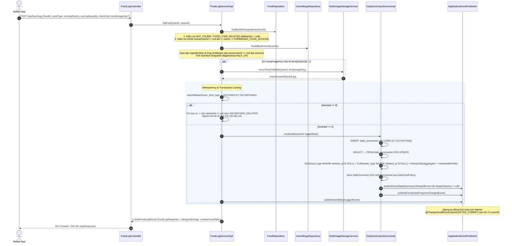
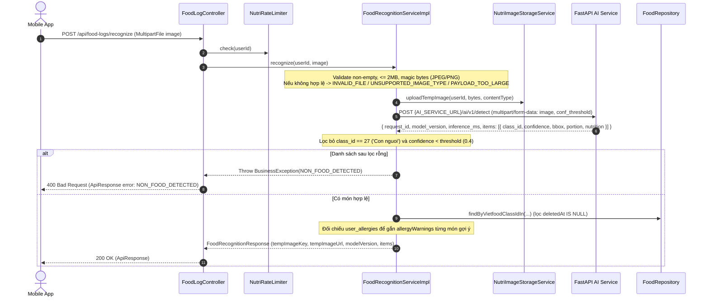

# Kế hoạch triển khai & Đặc tả chi tiết Module NUTRI — Kallo Backend

**Ngày đồng bộ mã nguồn:** 25/11/2026  
**Module:** NUTRI — Nhật ký dinh dưỡng, nước uống, nhận diện món AI & tổng hợp hàng ngày (SRS Mục 4.3, `FR-NUT-01` … `FR-NUT-13`)  
**Trạng thái đồng bộ:** Đã đối chiếu và đồng bộ 100% với mã nguồn thực tế trong repo (`AUTH`, `PROFILE`, `FOODDATA`, `ACT`, `GAME`, `SYS`, `CHAT`) và đặc tả `PLAN` (`IMPLEMENT_MODULE_MEAL_PLAN.md`).  
**Phạm vi sở hữu:** Bảng `user_food_logs`, `water_logs`, `daily_summaries`; `FoodLogService`, `WaterLogService`, `DailySummaryService`, `FoodRecognitionService`; Adapters cho `GAME` (`DailyProgressProvider`), `SYS` (`UserActivityPort`, `SyncEntityHandler`), `PLAN` (áp dụng thực đơn & sự kiện học sở thích).

---

## 1. Phạm vi, Mục tiêu & Đối chiếu Kiến trúc

Module **NUTRI** là trung tâm ghi nhận dữ liệu ăn uống, nước uống và duy trì bảng tổng hợp ngày `daily_summaries` cho toàn hệ thống Kallo (`GAME`, `SYS`, `CHAT`, `REPORT`, `PLAN`). Module thực hiện 6 nhiệm vụ cốt lõi:

> **Nguyên tắc bất biến (Module Boundary Constraint):** Chỉ được phép phát triển/chỉnh sửa trong phạm vi 4 module `food` (`FOODDATA`), `nutri` (`NUTRI`), `meal_plan` (`PLAN`), `profile` (`PROFILE`) và thêm hằng số mới ở `common/ErrorCode`. **Tuyệt đối không chỉnh sửa** mã nguồn, schema hay cấu hình hành vi của các module chuẩn đã khóa (`AUTH` gồm `StorageService`/`MinioStorageService`/`RedisRateLimiter`/`SecurityConfig`, `ACT`, `GAME`, `SYS`, `CHAT`, `GlobalExceptionHandler`, và giới hạn `spring.servlet.multipart` trong `application.yml`).

1. Ghi nhận nhật ký bữa ăn (4 buổi) và lượng nước uống theo múi giờ chuẩn của người dùng (`users.timezone` qua `UserTimeResolver`).
2. Đóng băng dinh dưỡng theo mẫu **Nutrition Snapshot** tại thời điểm ăn để không bị sai lệch khi món `USER_CUSTOM` / Recipe bị chỉnh sửa hoặc xóa mềm (`deleted_at`).
3. Cảnh báo dị ứng chính xác bằng giao tập giữa nguyên liệu của món ăn (`food_ingredients` $\to$ `ingredients` hệ thống) và hồ sơ dị ứng (`user_allergies`).
4. Cập nhật bảng nóng `daily_summaries` bằng **Full Recalculate** dưới khóa giao dịch bi quan (`SELECT ... FOR UPDATE`), đồng bộ hai chiều với `ACT` (`ActivityDataChangedEvent`) và `PROFILE` (`ProfileUpdatedEvent`).
5. Tích hợp đồng bộ ngoại tuyến với `SYS` (`SyncEntityType.FOOD_LOG`, `SyncEntityType.WATER_LOG`) và phát đầy đủ sự kiện sau commit (`DailySummaryChangedEvent`, `DailyProgressChangedEvent`, `MealLoggedEvent`, `WaterLoggedEvent`).
6. Tích hợp pipeline nhận diện món ăn AI (`POST /ai/v1/detect` theo SRS Mục 5.5) và vòng đời ảnh MinIO (`temp/` $\to$ `meals/`) thông qua service nội bộ của `NUTRI`.

### 1.1. Cầu nối đối chiếu Sơ đồ lớp (Conceptual UML vs Physical Implementation)

```
┌────────────────────────────────────────────────────────────────────────┐
│                   MÔ HÌNH QUAN NIỆM (CONCEPTUAL UML)                   │
│  User ──1:N──> UserFoodLog ──N:1──> Food                               │
│  User ──1:N──> WaterLog                                                │
│  User ──1:N──> DailySummary                                            │
│  UserFoodLog (calories + servingMultiplier + calculateNutrition)       │
└────────────────────────────────────────────────────────────────────────┘
                                    │
                                    ▼  [Tối ưu Production & Đồng bộ SYS/ACT/GAME]
┌────────────────────────────────────────────────────────────────────────┐
│                   MÔ HÌNH VẬT LÝ TRIỂN KHAI (PHYSICAL)                 │
│  • Bảng `user_food_logs`:                                              │
│    - Nutrition Snapshot: calories, protein_g, carbs_g, fat_g,          │
│      sugar_g, fiber_g.                                                 │
│    - Hạ tầng SYS Sync: `client_uuid` (UNIQUE theo user_id),            │
│      `updated_at` (client), `deleted_at` (tombstone), `sync_seq`,      │
│      `server_updated_at` + trigger `touch_sync()`.                     │
│  • Bảng `water_logs`:                                                  │
│    - Đầy đủ cột hạ tầng SYS Sync tương tự `user_food_logs`.            │
│  • Bảng `daily_summaries`:                                             │
│    - Lưu tổng hợp Calories In, Macros, Water, Calories Out (từ ACT),   │
│      steps, weight_kg, `meals_logged_count`, `is_goal_achieved`.       │
│    - `target_calories` & `target_water_ml` cho phép NULL khi user      │
│      chưa thiết lập `UserHealthProfile` (khớp `DailyProgressProvider`).│
│  • Tách Domain Services + External Event Listeners + Ports/Adapters.   │
└────────────────────────────────────────────────────────────────────────┘
```

#### Các tinh chỉnh kiến trúc bắt buộc để khớp Repo thực tế:
1. **Hợp đồng đồng bộ ngoại tuyến với `SYS` (`V20261113063404__sys_schema.sql`):**  
   `V20261113063404__sys_schema.sql` đã tạo sẵn sequence `sync_seq` và trigger function `touch_sync()`. Do đó `user_food_logs` và `water_logs` **bắt buộc** có các cột `deleted_at`, `sync_seq`, `server_updated_at` cùng trigger `BEFORE UPDATE` gọi `touch_sync()`, và mapping JPA đánh dấu `insertable = false, updatable = false` cho `syncSeq` & `serverUpdatedAt`.
2. **Idempotency an toàn trong Transaction (`INSERT ... ON CONFLICT DO NOTHING`):**  
   Giống `WeightLogServiceImpl` của module `ACT`, tuyệt đối **không** dùng `try/catch DataIntegrityViolationException` bên trong `@Transactional` vì PostgreSQL/Hibernate sẽ đánh dấu transaction là `rollbackOnly` (ném `UnexpectedRollbackException` khi tới `DailySummaryService.recalculate`). Dùng native query `insertIfAbsent(...)` với `ON CONFLICT (user_id, client_uuid) DO NOTHING`.
3. **Đồng bộ hai chiều với `ACT` và `PROFILE`:**  
   Khi người dùng log tập luyện/bước chân/cân nặng ở `ACT` (`ActivityDataChangedEvent`) hoặc cập nhật mục tiêu calo/nước ở `PROFILE` (`ProfileUpdatedEvent`), `NUTRI` lắng nghe sự kiện để cập nhật lại `daily_summaries` ngày tương ứng, đảm bảo Dashboard (`DailySummary`) và `GAME` luôn nhất quán kể cả ngày chỉ có vận động hoặc chỉ có uống nước.
4. **Hợp đồng AI Service (`SRS 5.5`) & Khoảng `vietfood_class_id`:**  
   - Gửi ảnh dạng `multipart/form-data` (trường `image`) tới `POST {AI_SERVICE_URL}/ai/v1/detect` và đọc danh sách `items[]` (thay vì gửi JSON URL).
   - Bảng `foods` (`V20261124140000__food_schema.sql`) đánh `vietfood_class_id` từ `0..67` loại trừ `27` (ví dụ `67` là `Súp cua`), nên `ai_predicted_class_id` phải check `BETWEEN 0 AND 67 AND ai_predicted_class_id <> 27` (không phải `0..66`).
5. **Lưu trữ MinIO không chạm vào `AUTH` (`StorageService`/`MinioStorageService`):**  
   `MinioStorageService` dùng 1 bucket cấu hình qua `app.storage.bucket` và chỉ cung cấp `upload`, `delete`, `deletePrefix`, `presignedUrl`. Để giữ nguyên module `AUTH`, `NUTRI` tạo `NutriImageStorageService` nội bộ trong `service/nutri/` dùng trực tiếp bean `@Qualifier("storageClient") MinioClient` + `StorageProperties` (từ `StorageConfig`) kết hợp `StorageService` sẵn có để thực hiện `copy`/`move` (`temp/` $\to$ `meals/`) và dọn file hết hạn. Bảng `user_food_logs.image_key` lưu **object key** (giống `users.avatar_url`), và response trả kèm presigned URL.

---

### 1.2. Bảng ánh xạ yêu cầu chức năng (`FR-NUT-01` … `FR-NUT-13`)

| Mã yêu cầu | Nội dung yêu cầu nghiệp vụ | Mức | Mô tả kỹ thuật & liên kết module | Trạng thái đồng bộ |
| :--- | :--- | :---: | :--- | :--- |
| **FR-NUT-01** | Ghi nhật ký bữa ăn theo 4 buổi | **M** | Tái sử dụng enum `com.healthcare.kallo.model.food.enums.MealType` (`BREAKFAST`, `LUNCH`, `DINNER`, `SNACK`). | Đồng bộ FOODDATA |
| **FR-NUT-02** | Chụp/chọn ảnh món ăn $\to$ AI YOLOv11 | **M** | Upload ảnh lên MinIO `temp/`, gọi `POST /ai/v1/detect` (`multipart/form-data`), lọc `class_id = 27` (`Con nguoi`), map `foods.vietfood_class_id`. | Đồng bộ SRS 5.5 |
| **FR-NUT-03** | Xác nhận & chỉnh khẩu phần trước khi lưu | **M** | Client gửi danh sách món đã chỉnh sửa (`foodId`, `servingGrams`, `servingQuantity`, `tempImageKey`, `aiPredictedClassId`) qua `POST /api/food-logs`. | Sẵn sàng |
| **FR-NUT-04** | Tra cứu món ăn tiếng Việt không dấu | **M** | Dùng API `GET /api/foods/search` của `FOODDATA` (Elasticsearch + PG Trigram fallback). | Tái sử dụng FOODDATA |
| **FR-NUT-05** | Quét mã vạch thực phẩm | **M** | Dùng API `GET /api/foods/barcode/{code}` của `FOODDATA` (Read-Through OFF). | Tái sử dụng FOODDATA |
| **FR-NUT-06** | Tạo, sửa, xóa món ăn tùy chỉnh | **M** | Dùng cụm API `/api/foods/custom` và `/api/foods/recipe` của `FOODDATA`. | Tái sử dụng FOODDATA |
| **FR-NUT-07** | Xem nhật ký theo ngày & phân bữa | **M** | `GET /api/food-logs?date=YYYY-MM-DD` gom 4 bữa kèm tổng dinh dưỡng và calo còn lại. | Sẵn sàng |
| **FR-NUT-08** | Sửa/Xóa log & Sao chép bữa ăn | **S** | `PUT/DELETE /api/food-logs/{id}` (soft delete tombstone) và `POST /api/food-logs/copy`; tự động `recalculate()`. | Đồng bộ SYS Sync |
| **FR-NUT-09** | Món ăn gần đây (`recent`) | **S** | Trả 10 món `DISTINCT` được ghi gần nhất, bỏ qua bản ghi và món có `deleted_at IS NOT NULL`, lọc IDOR. | Sẵn sàng |
| **FR-NUT-10** | Cảnh báo dị ứng thực phẩm | **S** | Giao tập `food_ingredients` với `user_allergies` trên `ingredients` (`is_allergen = true AND owner_user_id IS NULL AND is_active = true`). | Đồng bộ PROFILE/FOODDATA |
| **FR-NUT-11** | Ghi nhận & theo dõi nước uống | **M** | `POST/GET/DELETE /api/water-logs` ($1 \le \text{amount\_ml} \le 5000$), soft delete tombstone, đồng bộ ngoại tuyến `WATER_LOG`. | Đồng bộ SYS Sync |
| **FR-NUT-12** | Lưu ảnh log lên Object Storage | **M** | Move ảnh từ `temp/{userId}/...` sang `meals/{userId}/{uuid}.jpg` bằng `NutriImageStorageService` trong `NUTRI`. | Tái sử dụng StorageConfig |
| **FR-NUT-13** | Đóng góp sửa nhãn cải thiện AI | **C** | Lưu `ai_predicted_class_id`, `feedback_given` + cờ `user_consented_feedback` qua `POST /api/food-logs/{id}/feedback` (chỉ lưu dữ liệu khi có đồng ý, SRS 9.3). | Sẵn sàng |

---

### 1.3. Tiêu chí chấp nhận (Acceptance Criteria)

- **AC1 (Tốc độ & Công thức Nutrition Snapshot):**  
  `POST /api/food-logs` phản hồi $< 150\text{ ms}$ (không tính AI). Công thức snapshot theo `BigDecimal` (`RoundingMode.HALF_UP`, scale `1`):
  $$\text{Nutrient}_{\text{snapshot}} = \text{Nutrient}_{\text{per 100g}} \times \left(\frac{\text{serving\_grams} \times \text{serving\_quantity}}{100}\right)$$
  *(Nếu không truyền `servingGrams`, mặc định dùng `foods.default_serving_grams`.)*
- **AC2 (Idempotency chống trùng lặp & Tombstone):**  
  Khi client gửi lại `POST` với cùng `(user_id, client_uuid)`:
  - Nếu bản ghi tồn tại và `deleted_at IS NULL`: trả về `200 OK` với dữ liệu bản ghi đã có, không tạo dòng mới, không cộng đôi dinh dưỡng/nước.
  - Nếu bản ghi đã bị xóa mềm (`deleted_at IS NOT NULL`): trả `409 RECORD_DELETED` (không phục hồi bản ghi cũ, nhất quán với `ACT` và `SYS`).
- **AC3 (Full Recalculate & Phát sự kiện sau Commit):**  
  Mọi thay đổi Thêm/Sửa/Xóa (qua REST hoặc `SYS Sync`) trên `user_food_logs` hoặc `water_logs`, hoặc sự kiện từ `ACT`/`PROFILE`, đều gọi `DailySummaryService.recalculate(userId, localDate)`:
  - Chỉ tổng hợp các log có `deleted_at IS NULL`.
  - Dùng `INSERT ... ON CONFLICT DO NOTHING` + `SELECT ... FOR UPDATE` trên `daily_summaries`.
  - Publish `DailySummaryChangedEvent`, `DailyProgressChangedEvent`, `MealLoggedEvent` / `WaterLoggedEvent` để các listener `@TransactionalEventListener(phase = AFTER_COMMIT)` tại `SYS` và `GAME` xử lý sau khi giao dịch commit thành công.
- **AC4 (Cảnh báo Dị ứng & Phân quyền Món):**  
  - Món `USER_CUSTOM` của người khác (`owner_user_id IS NOT NULL AND owner_user_id <> currentUserId`) bị từ chối với `403 FORBIDDEN_FOOD_ACCESS` (REST) hoặc `SyncForbiddenReferenceException` (Sync).
  - Món chứa nguyên liệu trùng `user_allergies` trả `hasAllergyWarning = true` kèm danh sách `allergicIngredients` (`id`, `code`, `name`).
- **AC5 (Pipeline Nhận diện Ảnh AI & Lọc Class ID 27):**  
  - `POST /api/food-logs/recognize` áp dụng rate limit theo user qua `NutriRateLimiter`, kiểm tra dung lượng $\le 2\text{ MB}$ (khớp giới hạn nén ảnh client ở SRS Mục 4.3 và cấu hình `spring.servlet.multipart` hiện có) và magic bytes (JPEG/PNG).
  - Gọi `POST {AI_SERVICE_URL}/ai/v1/detect` (`multipart/form-data`), loại bỏ hoàn toàn `class_id = 27` (`Con nguoi`) và các item dưới ngưỡng `confidenceThreshold` (mặc định `0.4`).
  - Hỗ trợ đầy đủ 67 lớp món ăn hợp lệ (`0..67` trừ `27`, bao gồm lớp `67` = `Súp cua`). Nếu không còn món hợp lệ, ném `400 NON_FOOD_DETECTED`.
- **AC6 (Bảo vệ Món đã Soft Delete):**  
  - Không cho tạo log mới vào món có `foods.deleted_at IS NOT NULL` (`400 FOOD_ITEM_DELETED`).
  - Khi sao chép bữa ăn (`POST /api/food-logs/copy`), các món đã xóa mềm được bỏ qua và liệt kê trong `skippedFoods` của response.
- **AC7 (Múi giờ & Nhất quán `DailyGoalPolicy`):**  
  - Ngày địa phương (`logged_date`, `summary_date`) quy đổi theo `users.timezone` qua `UserTimeResolver` (mặc định `Asia/Ho_Chi_Minh`).
  - `daily_summaries.is_goal_achieved` áp dụng chính xác `DailyGoalPolicy` của `GAME` (`meals_logged_count >= app.game.daily-goal.min-meals` VÀ `calories_consumed` trong `±app.game.daily-goal.calorie-tolerance-percent%` của `target_calories`, với `target_calories != null`).

---

## 2. Tích hợp Liên Module (Ports, Events & Consumers)

Thay cho các interface giả định trước đây, bảng dưới đây ánh xạ **chính xác** tên class, package và event thực tế đang tồn tại trong `kallo-backend` mà **không chỉnh sửa** bất kỳ module nào ngoài `food`, `nutri`, `meal_plan`, `profile`:

| Module đối tác | Hướng giao tiếp | Hợp đồng kỹ thuật chuẩn trong Repo | Chi tiết nghiệp vụ |
| :--- | :--- | :--- | :--- |
| **PROFILE** | `NUTRI` $\to$ `PROFILE` | `UserHealthProfileRepository`, `UserAllergyRepository` | Đọc `dailyCalorieGoal`, `waterLiters` ($\times 1000 \to \text{targetWaterMl}$), `proteinGrams`, `carbGrams`, `fatGrams`. Nếu chưa có hồ sơ: `targetCalories = null`, `targetWaterMl = null`. |
| **PROFILE** | `PROFILE` $\to$ `NUTRI` | `ProfileUpdatedEvent` (`event.profile`) | Listener `@TransactionalEventListener(AFTER_COMMIT)` + `REQUIRES_NEW` gọi `DailySummaryService.recalculate(userId, today)` để cập nhật `target_calories`, `target_water_ml`, `is_goal_achieved`. |
| **FOODDATA** | `NUTRI` $\to$ `FOODDATA` | `FoodRepository`, `FoodIngredientRepository`, `MealType` (`model.food.enums`) | Tái sử dụng `MealType` của `FOODDATA`. Kiểm tra `food.getDeletedAt() == null` và quyền sở hữu `ownerUserId`. Lọc dị ứng trên `ingredients` có `is_allergen = true AND owner_user_id IS NULL AND is_active = true`. |
| **ACT** *(chỉ đọc)* | `NUTRI` $\to$ `ACT` | `ActivityDailyAggregator` (`service.act`), `UserTimeResolver` (`service.act`) | Gọi `aggregate(userId, date)` lấy `DailyActivityStats` (`totalSteps`, `totalCaloriesBurned`, `weightKg`). Dùng `UserTimeResolver` lấy `ZoneId` của user. |
| **ACT** *(chỉ nghe)* | `ACT` $\to$ `NUTRI` | `ActivityDataChangedEvent(userId, localDate)` (`event.act`) | Listener `@TransactionalEventListener(AFTER_COMMIT)` + `REQUIRES_NEW` gọi `DailySummaryService.recalculate(userId, localDate)` khi log tập luyện/bước chân/cân nặng thay đổi. |
| **GAME** *(cài cổng)* | `NUTRI` $\to$ `GAME` | `DailySummaryProgressProviderImpl implements DailyProgressProvider` (`service.game`), `DailyGoalPolicy`, `GameProperties` | Thay thế `EmptyDailyProgressProvider` (`@Fallback`). Trả `DailyProgress(date, mealsLogged, caloriesIn, calorieGoal, waterMl, waterGoalMl, steps, caloriesBurned)`. Chặn range $> \text{app.game.streak.window-days}$ (`400`). Phát `DailyProgressChangedEvent(userId, localDate)`. |
| **SYS** *(cài cổng)* | `NUTRI` $\to$ `SYS` | `DailySummaryUserActivityPortImpl implements UserActivityPort` (`service.sys`) | Thay thế `NoopUserActivityPort` (`@Fallback`). Query trên `water_logs` và `user_food_logs` với điều kiện `deleted_at IS NULL`, quy đổi giờ theo `users.timezone`. Phát `DailySummaryChangedEvent`, `MealLoggedEvent`, `WaterLoggedEvent`. |
| **SYS (Sync)** *(cài SPI)* | `SYS` $\leftrightarrow$ `NUTRI` | `FoodLogSyncEntityHandler`, `WaterLogSyncEntityHandler` implements `SyncEntityHandler` (`service.sys.sync`) | Đăng ký `SyncEntityType.FOOD_LOG` & `SyncEntityType.WATER_LOG`. Mọi `apply` đều đi qua `FoodLogService`/`WaterLogService` để cập nhật `DailySummary` và phát events (theo `IMPLEMENT_MODULE_SYS.md` 6.5). |
| **CHAT & REPORT** *(chỉ đọc)* | `CHAT`/`REPORT` $\to$ `NUTRI` | `DailyProgressProvider`, `DailySummaryRepository` | `HealthChatContextProvider` tự động đọc dữ liệu thật qua `DailyProgressProvider` mà không sửa code `CHAT`. `REPORT` đọc trực tiếp `daily_summaries`. |
| **PLAN** | `PLAN` $\leftrightarrow$ `NUTRI` | `FoodLogService` (batch apply) & `FoodPreferenceSyncPort` (optional bean) | Khi ghi log không phải từ `MEAL_PLAN`, gọi `ObjectProvider<FoodPreferenceSyncPort>` (nếu có module `PLAN`) để cập nhật `preference_vector`. Cung cấp hàm `applyMealPlanItems(...)` cho `PLAN` kiểm tra trùng bữa và batch insert `source = MEAL_PLAN` mà không học sở thích. |

---

## 3. Các quyết định kỹ thuật cốt lõi (Architectural Decisions)

| # | Vấn đề kỹ thuật | Quyết định áp dụng | Lý do & Lợi ích |
| :---: | :--- | :--- | :--- |
| **D1** | Bảo toàn lịch sử dinh dưỡng | **Nutrition Snapshot Pattern:** lưu cứng `calories`, `protein_g`, `carbs_g`, `fat_g`, `sugar_g`, `fiber_g` trong `user_food_logs`. | Không bị sai lệch lịch sử khi người dùng sửa/xóa món `USER_CUSTOM` hoặc Recipe. |
| **D2** | Chống trùng lặp Offline / Retry | **DB `INSERT ... ON CONFLICT (user_id, client_uuid) DO NOTHING`** + kiểm tra `deleted_at` (giống `WeightLogServiceImpl`). | Tránh lỗi `UnexpectedRollbackException` của Hibernate khi bắt `DataIntegrityViolationException` trong transaction. |
| **D3** | Tổng hợp bảng nóng `daily_summaries` | **Full Recalculate + Pessimistic Lock (`SELECT ... FOR UPDATE`)** kết hợp `INSERT ... ON CONFLICT DO NOTHING`. | Chống tuyệt đối Race Condition và Lost Update khi ghi đồng thời nhiều log hoặc nhận event từ `ACT`. |
| **D4** | Nhận diện ảnh AI & MinIO | **Multipart `POST /ai/v1/detect` (SRS 5.5)** + **MinIO Lifecycle 2 pha** (`temp/` $\to$ `meals/`). Lưu **object key** trong DB, trả presigned URL ở DTO. | Khớp contract AI service, không chứa ảnh rác trên MinIO, link ảnh không bị hết hạn trong DB. |
| **D5** | Cách ly chỉnh sửa với `AUTH` & `application.yml` | Tạo `NutriImageStorageService` và `NutriRateLimiter` ngay trong `service/nutri/` dùng lại các bean sẵn có (`MinioClient`, `StorageService`, `StorageProperties`, `RateLimiter`). Giữ nguyên giới hạn multipart `2 MB` hiện có của `application.yml` (khớp SRS 4.3). | Không đụng `StorageService`/`MinioStorageService`/`RedisRateLimiter` (`AUTH`) hay cấu hình multipart chung của hệ thống. |
| **D6** | Đồng bộ Offline (`SYS Sync`) | Thêm `deleted_at`, `sync_seq`, `server_updated_at` và trigger `touch_sync()` vào `user_food_logs` và `water_logs`. | Tận dụng trọn vẹn hạ tầng `sync_seq` của `V20261113063404__sys_schema.sql` và vượt qua `SyncHandlerContractTest`. |
| **D7** | Khi người dùng chưa có `UserHealthProfile` | `daily_summaries.target_calories` và `target_water_ml` cho phép `NULL`; `is_goal_achieved = false`; `DailySummaryChangedEvent` chỉ phát alert khi `calorieGoal > 0`. | Nhất quán tuyệt đối với contract `DailyProgressProvider` của `GAME` (không bịa mục tiêu giả `2000`). |
| **D8** | Đồng nhất logic đạt mục tiêu ngày | `DailySummaryService` dùng chung bean `DailyGoalPolicy` của `GAME` để tính `is_goal_achieved`. | Tránh tình trạng `daily_summaries.is_goal_achieved = true` nhưng `GAME` không cộng Streak do thiếu điều kiện `mealsLogged >= 2`. |
| **D9** | Tương thích module `PLAN` chưa triển khai | Tách cầu nối cập nhật `preference_vector` bằng interface/port tùy chọn (`ObjectProvider`), không import trực tiếp class thuộc `PLAN`. | `NUTRI` biên dịch và chạy hoàn chỉnh độc lập ngay cả trước khi `PLAN` được code. |
| **D10** | Đặt tên Flyway & Cascade Delete | Dùng timestamp UTC `V20261125100000__nutri_schema.sql` (sau `V20261124140002`); mọi FK tới `users(id)` có `ON DELETE CASCADE`. | Tránh đụng `foods` chưa tồn tại và vượt qua bài test `information_schema` của `AUTH` (`FR-AUTH-07`). |

---

## 4. Mô hình Dữ liệu & Migration Flyway

Tệp migration duy nhất của module `NUTRI`:  
`src/main/resources/db/migration/V20261125100000__nutri_schema.sql`  
*(Chạy sau `V20261113063404__sys_schema.sql`, `V20261124130000__init_profile_tables.sql`, và `V20261124140000__food_schema.sql`.)*

```sql
-- ============================================================
-- V20261125100000__nutri_schema.sql
-- Module NUTRI: Food Logs, Water Logs, Daily Summaries + SYS Sync Infrastructure
-- ============================================================

-- 1. Bảng nhật ký ăn uống (hỗ trợ Nutrition Snapshot & SYS Sync Tombstone)
CREATE TABLE user_food_logs (
    id                      UUID PRIMARY KEY DEFAULT gen_random_uuid(),
    user_id                 UUID NOT NULL REFERENCES users(id) ON DELETE CASCADE,
    food_id                 UUID REFERENCES foods(id),
    meal_type               VARCHAR(20) CHECK (meal_type IS NULL OR meal_type IN ('BREAKFAST', 'LUNCH', 'DINNER', 'SNACK')),
    serving_name            VARCHAR(100),
    serving_grams           NUMERIC(6, 1) CHECK (serving_grams IS NULL OR serving_grams > 0),
    serving_quantity        NUMERIC(4, 2) NOT NULL DEFAULT 1.00 CHECK (serving_quantity > 0),
    source                  VARCHAR(30) NOT NULL DEFAULT 'SEARCH'
                            CHECK (source IN ('AI_PHOTO', 'BARCODE', 'SEARCH', 'CUSTOM', 'MEAL_PLAN', 'COPY')),
    logged_date             DATE,
    logged_at               TIMESTAMPTZ NOT NULL DEFAULT now(),
    image_key               TEXT, -- MinIO object key (e.g. meals/{userId}/{uuid}.jpg)

    -- Nutrition Snapshot (Đóng băng dinh dưỡng theo lượng ăn thực tế)
    calories                NUMERIC(6, 1) CHECK (calories IS NULL OR calories >= 0),
    protein_g               NUMERIC(6, 1) NOT NULL DEFAULT 0.0 CHECK (protein_g >= 0),
    carbs_g                 NUMERIC(6, 1) NOT NULL DEFAULT 0.0 CHECK (carbs_g >= 0),
    fat_g                   NUMERIC(6, 1) NOT NULL DEFAULT 0.0 CHECK (fat_g >= 0),
    sugar_g                 NUMERIC(6, 1) NOT NULL DEFAULT 0.0 CHECK (sugar_g >= 0),
    fiber_g                 NUMERIC(6, 1) NOT NULL DEFAULT 0.0 CHECK (fiber_g >= 0),

    -- Metadata AI feedback (khớp VietFood68: 0..67 trừ 27)
    ai_predicted_class_id   INTEGER CHECK (
                                ai_predicted_class_id IS NULL
                                OR (ai_predicted_class_id BETWEEN 0 AND 67 AND ai_predicted_class_id <> 27)
                            ),
    feedback_given          BOOLEAN NOT NULL DEFAULT FALSE,
    user_consented_feedback BOOLEAN NOT NULL DEFAULT FALSE,

    -- Cột hạ tầng đồng bộ ngoại tuyến SYS (V20261113063404__sys_schema.sql)
    client_uuid             UUID NOT NULL,
    created_at              TIMESTAMPTZ NOT NULL DEFAULT now(),
    updated_at              TIMESTAMPTZ NOT NULL DEFAULT now(),
    deleted_at              TIMESTAMPTZ,
    sync_seq                BIGINT NOT NULL DEFAULT nextval('sync_seq'),
    server_updated_at       TIMESTAMPTZ NOT NULL DEFAULT clock_timestamp(),

    CONSTRAINT chk_user_food_logs_active_fields CHECK (
        deleted_at IS NOT NULL OR (
            food_id IS NOT NULL
            AND meal_type IS NOT NULL
            AND serving_name IS NOT NULL
            AND serving_grams IS NOT NULL
            AND logged_date IS NOT NULL
            AND calories IS NOT NULL
        )
    ),
    CONSTRAINT uq_user_food_log_client_uuid UNIQUE (user_id, client_uuid)
);

CREATE INDEX idx_user_food_logs_user_date
    ON user_food_logs (user_id, logged_date, logged_at DESC)
    WHERE deleted_at IS NULL;

CREATE INDEX idx_user_food_logs_food
    ON user_food_logs (food_id);

CREATE INDEX idx_user_food_logs_sync
    ON user_food_logs (user_id, sync_seq);

CREATE INDEX idx_user_food_logs_deleted
    ON user_food_logs (deleted_at)
    WHERE deleted_at IS NOT NULL;

CREATE TRIGGER trg_user_food_logs_sync
    BEFORE UPDATE ON user_food_logs
    FOR EACH ROW EXECUTE FUNCTION touch_sync();


-- 2. Bảng nhật ký uống nước (hỗ trợ SYS Sync Tombstone)
CREATE TABLE water_logs (
    id                      UUID PRIMARY KEY DEFAULT gen_random_uuid(),
    user_id                 UUID NOT NULL REFERENCES users(id) ON DELETE CASCADE,
    amount_ml               INTEGER CHECK (amount_ml IS NULL OR (amount_ml > 0 AND amount_ml <= 5000)),
    logged_date             DATE,
    logged_at               TIMESTAMPTZ NOT NULL DEFAULT now(),
    note                    VARCHAR(255),

    -- Cột hạ tầng đồng bộ ngoại tuyến SYS
    client_uuid             UUID NOT NULL,
    created_at              TIMESTAMPTZ NOT NULL DEFAULT now(),
    updated_at              TIMESTAMPTZ NOT NULL DEFAULT now(),
    deleted_at              TIMESTAMPTZ,
    sync_seq                BIGINT NOT NULL DEFAULT nextval('sync_seq'),
    server_updated_at       TIMESTAMPTZ NOT NULL DEFAULT clock_timestamp(),

    CONSTRAINT chk_water_logs_active_fields CHECK (
        deleted_at IS NOT NULL OR (
            amount_ml IS NOT NULL
            AND logged_date IS NOT NULL
        )
    ),
    CONSTRAINT uq_water_log_client_uuid UNIQUE (user_id, client_uuid)
);

CREATE INDEX idx_water_logs_user_date
    ON water_logs (user_id, logged_date, logged_at DESC)
    WHERE deleted_at IS NULL;

CREATE INDEX idx_water_logs_sync
    ON water_logs (user_id, sync_seq);

CREATE INDEX idx_water_logs_deleted
    ON water_logs (deleted_at)
    WHERE deleted_at IS NOT NULL;

CREATE TRIGGER trg_water_logs_sync
    BEFORE UPDATE ON water_logs
    FOR EACH ROW EXECUTE FUNCTION touch_sync();


-- 3. Bảng tổng hợp nóng hàng ngày (Daily Summaries)
CREATE TABLE daily_summaries (
    id                      UUID PRIMARY KEY DEFAULT gen_random_uuid(),
    user_id                 UUID NOT NULL REFERENCES users(id) ON DELETE CASCADE,
    summary_date            DATE NOT NULL,

    -- Năng lượng & Đa lượng nạp vào (Calories In)
    calories_consumed       INTEGER NOT NULL DEFAULT 0 CHECK (calories_consumed >= 0),
    target_calories         INTEGER CHECK (target_calories IS NULL OR target_calories > 0),
    protein_g               NUMERIC(6, 1) NOT NULL DEFAULT 0.0 CHECK (protein_g >= 0),
    carbs_g                 NUMERIC(6, 1) NOT NULL DEFAULT 0.0 CHECK (carbs_g >= 0),
    fat_g                   NUMERIC(6, 1) NOT NULL DEFAULT 0.0 CHECK (fat_g >= 0),
    sugar_g                 NUMERIC(6, 1) NOT NULL DEFAULT 0.0 CHECK (sugar_g >= 0),
    fiber_g                 NUMERIC(6, 1) NOT NULL DEFAULT 0.0 CHECK (fiber_g >= 0),

    -- Nước uống
    water_ml                INTEGER NOT NULL DEFAULT 0 CHECK (water_ml >= 0),
    target_water_ml         INTEGER CHECK (target_water_ml IS NULL OR target_water_ml > 0),

    -- Vận động & Tiêu hao (Calories Out - Tích hợp từ Module ACT)
    calories_burned         INTEGER NOT NULL DEFAULT 0 CHECK (calories_burned >= 0),
    steps                   INTEGER NOT NULL DEFAULT 0 CHECK (steps >= 0),
    weight_kg               NUMERIC(5, 1) CHECK (weight_kg IS NULL OR weight_kg > 0),

    -- Trạng thái mục tiêu & Cảnh báo
    is_goal_achieved        BOOLEAN NOT NULL DEFAULT FALSE,
    is_sugar_exceeded       BOOLEAN NOT NULL DEFAULT FALSE,
    is_protein_exceeded     BOOLEAN NOT NULL DEFAULT FALSE,

    -- Số bữa ăn độc lập trong ngày (COUNT(DISTINCT meal_type) với deleted_at IS NULL, tối đa 4)
    meals_logged_count      INTEGER NOT NULL DEFAULT 0 CHECK (meals_logged_count BETWEEN 0 AND 4),

    created_at              TIMESTAMPTZ NOT NULL DEFAULT now(),
    updated_at              TIMESTAMPTZ NOT NULL DEFAULT now(),

    CONSTRAINT uq_daily_summary_user_date UNIQUE (user_id, summary_date)
);

CREATE INDEX idx_daily_summaries_user_date
    ON daily_summaries (user_id, summary_date);
```

### 4.1. Quy ước cột quan trọng cho JPA & Sync
- Trên `UserFoodLog` và `WaterLog`:
  - `syncSeq` (`Long`): `@Column(name = "sync_seq", nullable = false, insertable = false, updatable = false)`
  - `serverUpdatedAt` (`Instant`): `@Column(name = "server_updated_at", nullable = false, insertable = false, updatable = false)`
  - `updatedAt` (`Instant`): **không** dùng `@LastModifiedDate` ghi đè khi sync đang chủ động truyền `updatedAt` theo quy tắc S10 (service chủ động gán `now` ở thao tác REST và `normalized.updatedAt()` ở thao tác Sync).
- Cột `daily_summaries.is_sugar_exceeded`: `true` khi `sugar_g > 50.0` (hoặc ngưỡng theo hồ sơ nếu cấu hình). `is_protein_exceeded`: `true` khi có `UserHealthProfile` và `protein_g > profile.proteinGrams * 1.2` (cảnh báo nạp đạm vượt ngưỡng mục tiêu).
- Hỗ trợ **Tombstone thuần** cho `SYS` Sync (quy tắc S10): khi client tạo rồi xóa lúc offline trước khi đồng bộ, bản tin `DELETE` có thể đến trước khi có `UPSERT` (chỉ gồm `clientUuid`). Nhờ hai ràng buộc `chk_user_food_logs_active_fields` và `chk_water_logs_active_fields`, các cột nghiệp vụ (`food_id`, `meal_type`, `serving_name`, `serving_grams`, `logged_date`, `calories`, `amount_ml`) vẫn bắt buộc `NOT NULL` đối với mọi bản ghi hoạt động (`deleted_at IS NULL`) nhưng cho phép `NULL` khi chèn bản ghi tombstone (`deleted_at IS NOT NULL`) để chặn `UPSERT` cũ đến muộn.

---

## 5. Danh mục Endpoints REST API & Hợp đồng Response

Toàn bộ API yêu cầu Bearer JWT (`email_verified = true`), trả về chuẩn `ApiResponse<T>` (`{ "success": true|false, "data": ..., "error": ... }`), riêng `DELETE` trả `204 No Content`. ID người dùng luôn lấy từ `CurrentUser.id(authentication)`. Tài nguyên thuộc người dùng khác hoặc đã xóa mềm trả `404` (`FOOD_LOG_NOT_FOUND` / `WATER_LOG_NOT_FOUND`) để chống dò IDOR.

### 5.1. Nhóm Nhật ký Bữa ăn (`/api/food-logs`)

| Method | Đường dẫn Endpoint | Status | Ý nghĩa & Mô tả chi tiết |
| :--- | :--- | :---: | :--- |
| `POST` | `/api/food-logs` | `201` / `200` | Ghi log bữa ăn mới; trả `200` nếu trùng `clientUuid` chưa xóa; tính Nutrition Snapshot, check dị ứng, move ảnh `temp/` $\to$ `meals/` nếu có `tempImageKey`, kích hoạt `recalculate()`. |
| `GET` | `/api/food-logs?date=YYYY-MM-DD` | `200` | Lấy chi tiết nhật ký trong ngày (mặc định hôm nay theo `users.timezone`), gom nhóm 4 bữa (`BREAKFAST`, `LUNCH`, `DINNER`, `SNACK`) kèm tổng kết ngày. |
| `GET` | `/api/food-logs/{id}` | `200` | Xem chi tiết 1 bản ghi log (kèm presigned `imageUrl` và cảnh báo dị ứng). |
| `PUT` | `/api/food-logs/{id}` | `200` | Cập nhật `mealType`, `servingGrams`, `servingQuantity` (tính lại Snapshot từ `foods`, hỗ trợ `clientUpdatedAt` conflict check, kích hoạt `recalculate()`). |
| `DELETE` | `/api/food-logs/{id}` | `204` | Xóa mềm (`deleted_at = now()`), idempotent, xóa ảnh `meals/` tùy chọn hoặc giữ theo chính sách xóa tài khoản, kích hoạt `recalculate()`. |
| `POST` | `/api/food-logs/copy` | `200` | Sao chép bữa ăn từ `sourceDate` sang `targetDate` (tùy chọn `mealType`); bỏ qua món có `foods.deleted_at IS NOT NULL` và trả kèm `skippedFoods`. |
| `GET` | `/api/food-logs/recent` | `200` | Lấy tối đa 10 món ăn `DISTINCT` được log gần đây nhất (lọc bỏ log/món đã `deleted_at IS NOT NULL` và món `USER_CUSTOM` không thuộc user). |
| `POST` | `/api/food-logs/recognize` | `200` | Upload ảnh (`<= 2MB`, JPEG/PNG, có Rate Limit qua `NutriRateLimiter`), lưu `temp/{userId}/{uuid}.jpg`, gọi FastAPI `/ai/v1/detect`, lọc `class_id = 27`, map `foods` + dị ứng. |
| `POST` | `/api/food-logs/{id}/feedback` | `200` | *(FR-NUT-13 - Mức C)* Lưu xác nhận đồng ý đóng góp sửa nhãn AI (`feedbackGiven = true`, `userConsentedFeedback = true`) khi người dùng sửa món AI đề xuất. |

### 5.2. Nhóm Nhật ký Nước uống (`/api/water-logs`)

| Method | Đường dẫn Endpoint | Status | Ý nghĩa & Mô tả chi tiết |
| :--- | :--- | :---: | :--- |
| `POST` | `/api/water-logs` | `201` / `200` | Ghi nhận lượng nước (`1..5000 ml`) kèm `clientUuid` (idempotent `200` nếu trùng, `409 RECORD_DELETED` nếu đã xóa), kích hoạt `recalculate()`. |
| `GET` | `/api/water-logs?date=YYYY-MM-DD` | `200` | Lấy lịch sử uống nước (`deleted_at IS NULL`) trong ngày theo `users.timezone` và tổng `totalWaterMl`. |
| `DELETE` | `/api/water-logs/{id}` | `204` | Xóa mềm (`deleted_at = now()`), idempotent, kích hoạt `recalculate()`. |

### 5.3. Nhóm Bảng tổng hợp Ngày (`/api/daily-summaries`)

| Method | Đường dẫn Endpoint | Status | Ý nghĩa & Mô tả chi tiết |
| :--- | :--- | :---: | :--- |
| `GET` | `/api/daily-summaries/today` | `200` | Lấy bảng tổng hợp ngày hôm nay theo `users.timezone` (nếu chưa có dòng DB vẫn trả summary mặc định từ `PROFILE` + `ACT` hoặc tự khởi tạo). |
| `GET` | `/api/daily-summaries?date=YYYY-MM-DD` | `200` | Lấy bảng tổng hợp theo ngày chỉ định. |
| `GET` | `/api/daily-summaries/range?from=YYYY-MM-DD&to=YYYY-MM-DD` | `200` | Lấy chuỗi tổng hợp tối đa 90 ngày phục vụ biểu đồ `REPORT` (`INVALID_TIME_RANGE` nếu `from > to` hoặc quá 90 ngày). |
| `POST` | `/api/daily-summaries/recalculate?date=YYYY-MM-DD` | `200` | Tính toán lại thủ công bảng tổng hợp cho ngày chỉ định (mặc định hôm nay). |

---

## 6. Logic Nghiệp Vụ & Sơ Đồ Trình Tự (Sequence Diagrams)

### 6.1. Luồng Ghi nhật ký ăn uống, Kiểm tra dị ứng & Cập nhật DailySummary



### 6.2. Luồng Nhận diện Ảnh AI (`POST /api/food-logs/recognize`) — Khớp SRS 5.5



### 6.3. Quy trình Sao chép Bữa ăn (`POST /api/food-logs/copy`)
1. Xác thực `targetDate`: dựa theo hôm nay tại `users.timezone` (`UserTimeResolver`), từ chối nếu `targetDate > today.plusDays(1)` (`FUTURE_DATE_NOT_ALLOWED`).
2. Truy vấn `user_food_logs` của `sourceDate` với `deleted_at IS NULL` (lọc theo `mealType` nếu được truyền).
3. Lấy thông tin `foods` tương ứng: bỏ qua các món có `foods.deleted_at IS NOT NULL` hoặc không còn quyền truy cập, đưa vào danh sách `skippedFoods`.
4. Với mỗi món hợp lệ: tính lại Nutrition Snapshot theo `foods` hiện hành (hoặc giữ khẩu phần gốc) và chèn `user_food_logs` mới với `source = 'COPY'`, `logged_date = targetDate`, `client_uuid = UUID.randomUUID()`.
5. Gọi `DailySummaryService.recalculate(userId, targetDate)` một lần duy nhất cho toàn bộ batch và phát `MealLoggedEvent` cho các buổi đã sao chép.

### 6.4. Đồng bộ hai chiều từ `ACT` / `PROFILE` & Offline Sync (`SYS`)
- **`NutriExternalEventListener`:**
  - `@TransactionalEventListener(phase = AFTER_COMMIT)` + `@Transactional(propagation = REQUIRES_NEW)` lắng nghe `ActivityDataChangedEvent(userId, localDate)` từ `ACT` $\to$ gọi `DailySummaryService.recalculate(userId, localDate)`.
  - `@TransactionalEventListener(phase = AFTER_COMMIT)` + `@Transactional(propagation = REQUIRES_NEW)` lắng nghe `ProfileUpdatedEvent(userId, ...)` từ `PROFILE` $\to$ gọi `DailySummaryService.recalculate(userId, todayInUserZone)`.
- **Offline Sync Handlers (`FoodLogSyncEntityHandler` & `WaterLogSyncEntityHandler`):**
  - `UPSERT`: Chuẩn hóa `updatedAt` (đã được `SyncServiceImpl` kẹp `maxFutureSkew`). Tìm bản ghi theo `(userId, clientUuid)`: nếu đã tồn tại và `existing.updatedAt >= op.updatedAt` (hoặc đã xóa mà `updatedAt` cũ hơn `deletedAt`) $\to$ trả `SyncApplyResult.conflictServerWins(...)` (S10). Nếu hợp lệ $\to$ gọi qua `FoodLogService`/`WaterLogService` để áp dụng và kích hoạt `recalculate()` + phát events. Với `FOOD_LOG`, kiểm tra `food_id` thuộc về `SYSTEM`/`OFF` hoặc `USER_CUSTOM` của chính `userId`; nếu thuộc user khác $\to$ ném `SyncForbiddenReferenceException` (`REJECTED / FORBIDDEN_REFERENCE`).
  - `DELETE`: Nếu tồn tại và `existing.updatedAt > op.updatedAt` $\to$ `conflictServerWins(...)`; nếu chưa tồn tại $\to$ tạo bản ghi tombstone (`deleted_at = now()`, `updated_at = op.updatedAt`) để chặn `UPSERT` cũ đến muộn; nếu tồn tại và chưa xóa $\to$ đánh dấu `deleted_at = now()`, `updated_at = op.updatedAt` và gọi `recalculate()`.
  - `changesSince(userId, sinceSeq, settledBefore, limitPlusOne)`: Query `WHERE user_id = :userId AND sync_seq > :sinceSeq AND server_updated_at <= :settledBefore ORDER BY sync_seq ASC LIMIT :limitPlusOne`, trả `SyncChange` (gồm `UPSERT` nếu `deleted_at IS NULL`, `DELETE` nếu `deleted_at IS NOT NULL`).
  - `cleanupTombstonesBefore(cutoff)`: `DELETE FROM ... WHERE deleted_at IS NOT NULL AND deleted_at < :cutoff`, được `SysMaintenanceJob` gọi hàng đêm.

---

## 7. Cấu trúc Gói Java & Cấu hình Ứng dụng

```
src/main/java/com/healthcare/kallo/
├── config/
│   └── NutriProperties.java                  # @ConfigurationProperties("app.nutri") có @DefaultValue
├── controller/nutri/
│   ├── FoodLogController.java                # /api/food-logs/**
│   ├── WaterLogController.java               # /api/water-logs/**
│   └── DailySummaryController.java           # /api/daily-summaries/**
├── model/nutri/
│   ├── UserFoodLog.java                      # JPA Entity cho user_food_logs
│   ├── WaterLog.java                         # JPA Entity cho water_logs
│   ├── DailySummary.java                     # JPA Entity cho daily_summaries
│   └── enums/
│       └── LogSource.java                    # SEARCH, AI_PHOTO, BARCODE, CUSTOM, MEAL_PLAN, COPY
│       # (Tái sử dụng com.healthcare.kallo.model.food.enums.MealType)
├── repository/nutri/
│   ├── UserFoodLogRepository.java
│   ├── WaterLogRepository.java
│   └── DailySummaryRepository.java
├── service/nutri/
│   ├── FoodLogService.java
│   ├── WaterLogService.java
│   ├── DailySummaryService.java
│   ├── FoodRecognitionService.java
│   ├── NutriImageStorageService.java         # Nội bộ NUTRI: move temp/ -> meals/ & cleanup bằng MinioClient + StorageService
│   ├── NutriRateLimiter.java                 # Wrapper fail-open quanh RateLimiter cho /recognize
│   ├── FoodPreferenceSyncPort.java           # Optional SPI cho module PLAN (adaptive learning)
│   ├── client/
│   │   ├── FoodAiClient.java                 # Interface gọi FastAPI /ai/v1/detect
│   │   ├── HttpFoodAiClient.java             # RestClient multipart/form-data
│   │   └── MockFoodAiClient.java             # Dùng cho dev/test khi ai.mock-enabled=true
│   ├── adapter/
│   │   ├── DailySummaryProgressProviderImpl.java # Implements GAME DailyProgressProvider
│   │   ├── DailySummaryUserActivityPortImpl.java # Implements SYS UserActivityPort
│   │   ├── FoodLogSyncEntityHandler.java         # Implements SYS SyncEntityHandler
│   │   └── WaterLogSyncEntityHandler.java        # Implements SYS SyncEntityHandler
│   ├── listener/
│   │   └── NutriExternalEventListener.java   # Nghe ActivityDataChangedEvent & ProfileUpdatedEvent
│   ├── job/
│   │   └── MinioTempCleanupScheduler.java    # Dọn prefix temp/ > 24h lúc 02:00 Asia/Ho_Chi_Minh
│   └── impl/
│       ├── FoodLogServiceImpl.java
│       ├── WaterLogServiceImpl.java
│       ├── DailySummaryServiceImpl.java
│       └── FoodRecognitionServiceImpl.java
└── dto/
    ├── request/nutri/
    │   ├── CreateFoodLogRequest.java
    │   ├── UpdateFoodLogRequest.java
    │   ├── CreateWaterLogRequest.java
    │   ├── CopyMealRequest.java
    │   └── FoodFeedbackRequest.java
    └── response/nutri/
        ├── FoodLogResponse.java
        ├── DailyFoodLogsResponse.java
        ├── CopyMealResponse.java
        ├── WaterLogResponse.java
        ├── DailyWaterLogsResponse.java
        ├── DailySummaryResponse.java
        └── FoodRecognitionResponse.java
```

### 7.1. Lưu ý Cấu hình & Không chỉnh sửa module chuẩn
1. **Không sửa `StorageService` / `MinioStorageService` (`AUTH`) hay `RedisRateLimiter` (`AUTH`):**
   - `NutriImageStorageService` đặt trong `service/nutri/`, tiêm trực tiếp `@Qualifier("storageClient") MinioClient`, `StorageProperties` (từ `StorageConfig`) và `StorageService` có sẵn để gọi `CopyObjectArgs` + `storage.delete(...)` cho move `temp/` $\to$ `meals/`, và `listObjects` + `storage.delete(...)` cho dọn ảnh quá 24h.
   - `NutriRateLimiter` đặt trong `service/nutri/`, bọc `RateLimiter` có sẵn với cơ chế fail-open khi Redis lỗi.
2. **Không sửa cấu hình `spring.servlet.multipart` (`2MB`) hay cấu hình của module khác trong `application.yml`:**
   - Giới hạn ảnh `<= 2 MB` khớp sẵn với `spring.servlet.multipart.max-file-size: 2MB` (và `GlobalExceptionHandler` đã tự động trả `413 PAYLOAD_TOO_LARGE` khi vượt quá).
   - `NutriProperties` dùng `@ConfigurationProperties("app.nutri")` kèm `@DefaultValue` trên toàn bộ thuộc tính (hỗ trợ chạy ngay cả khi chưa thêm block `app.nutri` vào `application.yml`; khi cần cấu hình qua env chỉ bổ sung nhánh riêng `app.nutri.*` mà không đụng các nhánh khác):
     ```yaml
     app:
       nutri:
         ai:
           base-url: ${AI_SERVICE_URL:http://localhost:8000}
           api-key: ${AI_SERVICE_API_KEY:}
           connect-timeout: ${NUTRI_AI_CONNECT_TIMEOUT:2s}
           read-timeout: ${NUTRI_AI_READ_TIMEOUT:5s}
           confidence-threshold: ${NUTRI_AI_CONFIDENCE_THRESHOLD:0.4}
           mock-enabled: ${NUTRI_AI_MOCK_ENABLED:false}
         rate-limit:
           recognize-per-minute: ${APP_RATE_LIMIT_RECOGNIZE_PER_MINUTE:10}
         storage:
           temp-prefix: ${APP_NUTRI_TEMP_PREFIX:temp/}
           meals-prefix: ${APP_NUTRI_MEALS_PREFIX:meals/}
           temp-retention: ${APP_NUTRI_TEMP_RETENTION:24h}
         sugar-warning-threshold-g: ${APP_NUTRI_SUGAR_WARNING_THRESHOLD_G:50.0}
         protein-warning-ratio: ${APP_NUTRI_PROTEIN_WARNING_RATIO:1.2}
     ```

---

## 8. Mã Lỗi Nghiệp Vụ (`common/ErrorCode.java`)

> Chỉ sử dụng lại các mã có sẵn hoặc **bổ sung thêm** hằng số mới cho `NUTRI` vào cuối enum dùng chung `common/ErrorCode.java`; không sửa đổi các hằng số cũ và **không sửa `GlobalExceptionHandler.java`** (đã hỗ trợ sẵn mọi `BusinessException(ErrorCode)`).

### 8.1. Tái sử dụng mã lỗi đã có trong `ErrorCode.java`
- `VALIDATION_ERROR` (`400`), `INVALID_FILE` (`400`), `INVALID_TIME_RANGE` (`400`), `NON_FOOD_DETECTED` (`400`)
- `FORBIDDEN_FOOD_ACCESS` (`403`)
- `NOT_FOUND` (`404`), `FOOD_NOT_FOUND` (`404`), `PROFILE_NOT_FOUND` (`404`)
- `RECORD_DELETED` (`409` — khi thao tác trên log đã xóa mềm hoặc gửi lại `clientUuid` của bản ghi đã bị xóa)
- `PAYLOAD_TOO_LARGE` (`413` — file ảnh vượt `2MB`)
- `TOO_MANY_REQUESTS` (`429` — vượt ngưỡng rate limit `/recognize`)

### 8.2. Bổ sung vào `ErrorCode.java`

```java
// Module NUTRI - Food & Water Logs
FOOD_LOG_NOT_FOUND(HttpStatus.NOT_FOUND, "Food log entry not found"),
WATER_LOG_NOT_FOUND(HttpStatus.NOT_FOUND, "Water log entry not found"),
INVALID_SERVING_AMOUNT(HttpStatus.BAD_REQUEST, "Serving grams and quantity must be greater than zero"),
INVALID_WATER_AMOUNT(HttpStatus.BAD_REQUEST, "Water amount must be between 1ml and 5000ml"),
FUTURE_DATE_NOT_ALLOWED(HttpStatus.BAD_REQUEST, "Cannot log meals or water for future dates"),
FOOD_ITEM_DELETED(HttpStatus.BAD_REQUEST, "This food item has been deleted and cannot be logged"),

// AI Recognition
UNSUPPORTED_IMAGE_TYPE(HttpStatus.BAD_REQUEST, "Only JPEG and PNG image formats are supported"),
AI_SERVICE_UNAVAILABLE(HttpStatus.SERVICE_UNAVAILABLE, "AI Recognition Service is temporarily unavailable"),

// Daily Summary
DAILY_SUMMARY_NOT_FOUND(HttpStatus.NOT_FOUND, "Daily summary data not found for the requested date"),
```

---

## 9. Phân rã công việc (Task Breakdown)

| Mã Task | Tên công việc kỹ thuật | Phụ thuộc | Thời lượng | Kết quả nghiệm thu (Deliverables) |
| :---: | :--- | :---: | :---: | :--- |
| **NUTRI-01** | Viết migration `V20261125100000__nutri_schema.sql` (3 bảng + cột SYS Sync + tombstone check + trigger `touch_sync()` + check class `0..67 <> 27`). | `V20261113063404`, `V20261124130000`, `V20261124140000` | 0.5 ngày | Flyway migrate sạch trên DB trống và test `information_schema` của `AUTH` xanh. |
| **NUTRI-02** | Tạo `NutriProperties` (có `@DefaultValue`), `NutriImageStorageService` (dùng lại `MinioClient`/`StorageService` của `AUTH`), `NutriRateLimiter`, bổ sung mã lỗi vào `common/ErrorCode.java`. | — | 0.5 ngày | Config bind hợp lệ với giá trị mặc định CI; MinIO move `temp/` $\to$ `meals/` hoạt động không sửa code `AUTH`. |
| **NUTRI-03** | Tạo Entities (`UserFoodLog`, `WaterLog`, `DailySummary`, `LogSource`) và Repositories (`insertIfAbsent`, `SELECT FOR UPDATE`, `findRecent`, sync queries). | NUTRI-01 | 0.5 ngày | `ddl-auto: validate` pass 100%; query không lấy nhầm bản ghi đã `deleted_at`. |
| **NUTRI-04** | Viết `DailySummaryServiceImpl` (`recalculate` với Pessimistic Lock, `DailyGoalPolicy`, `ActivityDailyAggregator`, phát `DailySummaryChangedEvent` & `DailyProgressChangedEvent`) + `NutriExternalEventListener`. | NUTRI-02, NUTRI-03 | 1.0 ngày | Tổng hợp chính xác khi concurrent update, không mất event từ `ACT`/`PROFILE`. |
| **NUTRI-05** | Viết `FoodLogServiceImpl` & `WaterLogServiceImpl` (Snapshot, Idempotency `insertIfAbsent`, IDOR, Allergy Check, Copy, Recent, Batch apply cho `PLAN`, phát `MealLoggedEvent`/`WaterLoggedEvent`). | NUTRI-04 | 1.5 ngày | Đủ nghiệp vụ CRUD, copy, recent, cảnh báo dị ứng, idempotency `client_uuid`. |
| **NUTRI-06** | Triển khai Adapters & Sync Handlers: `DailySummaryProgressProviderImpl`, `DailySummaryUserActivityPortImpl`, `FoodLogSyncEntityHandler`, `WaterLogSyncEntityHandler`. | NUTRI-05 | 1.0 ngày | `GAME` tính streak thật; `SYS` nhắc nhở/cảnh báo thật; pass `SyncHandlerContractTest`. |
| **NUTRI-07** | Tích hợp AI Service (`HttpFoodAiClient` `multipart/form-data`, `MockFoodAiClient`), `FoodRecognitionServiceImpl` (giới hạn `<= 2MB`, lọc ID 27, hỗ trợ lớp 67), `MinioTempCleanupScheduler`. | NUTRI-02, NUTRI-05 | 1.0 ngày | Nhận diện ảnh lọc bỏ class 27, move ảnh `temp/` $\to$ `meals/`, dọn rác lúc 02:00. |
| **NUTRI-08** | Viết DTOs, `FoodLogController`, `WaterLogController`, `DailySummaryController`, Swagger UI & `docs/api-specs/nutri.yaml`. | NUTRI-05, NUTRI-07 | 0.75 ngày | Toàn bộ endpoint chuẩn `ApiResponse`, OpenAPI spec đầy đủ. |
| **NUTRI-09** | Bộ kiểm thử Unit Tests & Integration Tests (Testcontainers PostgreSQL + Mock AI + Sync Contract + Concurrency + IDOR + Class 67 + Null Profile). | NUTRI-06, NUTRI-08 | 1.25 ngày | 100% test pass qua `./gradlew check`. |

---

## 10. Kế hoạch Kiểm thử Toàn diện (Test Matrix)

| Phân loại | Tên ca kiểm thử | Kịch bản & Dữ liệu đầu vào | Kỳ vọng đầu ra |
| :--- | :--- | :--- | :--- |
| **Unit Test** | `testNutritionSnapshotCalculation` | Log món $150\text{ g}$, $1.5$ khẩu phần, $200\text{ kcal}/100\text{ g}$. | `calories = 450.0` (scale 1, `HALF_UP`), snapshot không đổi dù sau đó sửa `foods`. |
| **Unit Test** | `testAllergyWarningTriggeredAndCustomIngredientIgnored` | Món chứa `PEANUT` (system allergen) và 1 nguyên liệu `USER_CUSTOM`; user dị ứng `PEANUT`. | `hasAllergyWarning = true`, `allergicIngredients` chỉ chứa `PEANUT`. |
| **Unit Test** | `testGoalAchievedAlignsWithDailyGoalPolicy` | User đạt `100%` calo mục tiêu nhưng mới log `1` bữa (`mealsLogged = 1`). | `isGoalAchieved = false` (khớp `DailyGoalPolicy` yêu cầu `minMeals = 2`). |
| **Unit Test** | `testDailySummaryWhenUserHasNoProfile` | User chưa tạo `UserHealthProfile` thực hiện log nước `250 ml`. | Tạo `daily_summaries` thành công với `targetCalories = null`, `targetWaterMl = null`, `isGoalAchieved = false`; không phát alert calo. |
| **Integration Test** | `testFoodLogIdempotencyAndTombstone` | Gửi đúp `POST /api/food-logs` cùng `clientUuid`; sau đó `DELETE` và gửi lại cùng `clientUuid`. | Lần 1 `201`; lần 2 `200` (không tăng calo); sau khi `DELETE` gửi lại trả `409 RECORD_DELETED`. |
| **Integration Test** | `testRecalculatePessimisticLocking` | 5 luồng gọi `recalculate()` đồng thời cho cùng `(userId, date)`. | Không deadlock/Lost Update; `caloriesConsumed` và `mealsLoggedCount` khớp tổng thực tế. |
| **Integration Test** | `testPreventLoggingDeletedAndOtherUserCustomFood` | Log `foodId` có `deleted_at != null` và `foodId` `USER_CUSTOM` của user khác. | Trả `400 FOOD_ITEM_DELETED` và `403 FORBIDDEN_FOOD_ACCESS`. |
| **Integration Test** | `testAIRecognitionFiltersClass27AndSupportsClass67` | Mock AI trả `class_id = 27`, `class_id = 0` (`Bánh canh`) và `class_id = 67` (`Súp cua`). | `class_id = 27` bị loại bỏ; `class_id = 0` và `67` được ánh xạ đúng món trong `foods`. |
| **Integration Test** | `testActivityAndProfileEventsUpdateDailySummary` | Phát `ActivityDataChangedEvent` và `ProfileUpdatedEvent`. | `daily_summaries` tự cập nhật `steps`, `caloriesBurned`, `weightKg`, `targetCalories`. |
| **Integration Test** | `testSyncHandlerContract_FoodAndWaterLogs` | Kế thừa `SyncHandlerContractTest` của `SYS` cho `FOOD_LOG` và `WATER_LOG`. | Pass 100%: idempotency, conflict `updated_at`, tombstone chặn upsert cũ, `sync_seq` pull, từ chối tham chiếu chéo (`FORBIDDEN_REFERENCE`), kích hoạt `DailySummary`. |
| **Integration Test** | `testGameStreakAndSysCalorieAlertIntegration` | Ghi 2 bữa vượt ngưỡng calo trong ngày hiện tại. | `GAME` cập nhật Streak qua `DailyProgressProvider`; `SYS` tạo đúng 1 thông báo `CALORIE_OVER` (dù ghi thêm log lần 3). |

---

## 11. Quản lý Rủi ro Technical & Vận hành

1. **Dọn dẹp ảnh rác MinIO (`temp/`):**  
   Ảnh upload qua `/recognize` được đặt ở `temp/{userId}/{uuid}.jpg`. Khi người dùng lưu log qua `POST /api/food-logs` kèm `tempImageKey`, service xác thực `tempImageKey.startsWith("temp/" + userId + "/")` (chống Path Traversal / IDOR giữa các user!) rồi chuyển sang `meals/{userId}/{uuid}.jpg`. `MinioTempCleanupScheduler` chạy lúc `02:00` (`Asia/Ho_Chi_Minh`) xóa các object trong `temp/` quá `24h`.
2. **Thứ tự Lock tránh Deadlock:**  
   Mọi thao tác ghi log thay đổi tổng hợp đều đi qua cùng thứ tự khóa: ghi dòng log (`user_food_logs` / `water_logs`) $\to$ `INSERT ... ON CONFLICT DO NOTHING` trên `daily_summaries` $\to$ `SELECT ... FOR UPDATE` dòng `daily_summaries` theo `(user_id, summary_date)`. Do chỉ khóa 1 dòng duy nhất của chính user theo ngày, không xảy ra deadlock vòng giữa các ngày hoặc các user.
3. **Ngăn chặn gọi AI tốn tài nguyên khi spam:**  
   `POST /api/food-logs/recognize` áp dụng `NutriRateLimiter` (bọc `RateLimiter` sẵn có với cơ chế fail-open khi Redis lỗi, không sửa `RedisRateLimiter`) theo user với ngưỡng cấu hình `app.nutri.rate-limit.recognize-per-minute` (mặc định `10` lần/phút) và timeout cứng (`connect: 2s`, `read: 5s`), không giữ connection DB trong lúc chờ phản hồi từ FastAPI AI Service.
