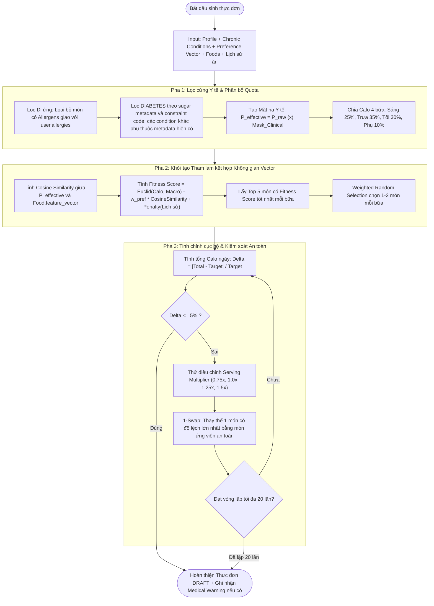

   # Kế hoạch triển khai & Đặc tả chi tiết Module PLAN — Kallo Backend

**Ngày đồng bộ mã nguồn:** 23/11/2026
**Module:** PLAN — Sinh thực đơn thông minh, gợi ý theo sở thích, quản lý bữa ăn & đổi món tương đương
**Phạm vi sở hữu:** `meal_plans`, `meal_plan_foods`, `foods.feature_vector`, `user_health_profiles.preference_vector/chronic_conditions`, `RuleBasedMenuGenerator`, `MealPlanService`, `MealPlanController`.

> **AS-IS:** PLAN đã có migration, entity, service, engine, DTO và 7 endpoint. Các claim hiệu năng/SRS là mục tiêu nếu chưa có benchmark. Lọc y tế hiện dựa trên metadata hiện có, không phải tư vấn y khoa.
> **TO-BE:** Chuẩn hóa ingredients, allergens và chronic conditions theo thiết kế trong `IMPLEMENT_MODULE_FOODDATA.md`; hiện PLAN vẫn đọc JSONB/profile và `foods.allergens`.

---

## 1. Phạm vi, Mục tiêu & Đối chiếu Sơ đồ lớp (Conceptual vs Physical)

Module **PLAN** cung cấp khả năng tự động thiết kế thực đơn dinh dưỡng cá nhân hóa dựa trên mục tiêu thể chất (TDEE, Calorie Goal, Macros), học sở thích ăn uống bằng content-based recommendation, và lọc theo metadata dị ứng/bệnh nền hiện có. Đây là heuristic ứng dụng, không phải tư vấn hay chứng nhận an toàn dinh dưỡng y khoa.

### 1.1. Cầu nối đối chiếu Sơ đồ lớp (Visual Paradigm UML) & Mô hình CSDL Triển khai

```
┌────────────────────────────────────────────────────────────────────────┐
│                   MÔ HÌNH QUAN NIỆM (CONCEPTUAL UML)                   │
│  User ──1:N──> MealPlan ──1:N──> MealPlanFood ──N:1──> Food            │
│  UserHealthProfile: preferenceVector: Vector, medicalHistory[]         │
│  MedicalHistory ──> ChronicCondition (limitsSugar, limitsFat...)      │
│  Food: featureVector: Vector, suitableMealTypes, calories...           │
│  MealPlan: name, description, type, planDate, totalCalories...         │
│  MealPlanFood: mealType, servingMultiplier, quantity, calories...      │
└────────────────────────────────────────────────────────────────────────┘
                                    │
                                    ▼  [Tinh chỉnh Kiến trúc & Tối ưu Production]
┌────────────────────────────────────────────────────────────────────────┐
│                   MÔ HÌNH VẬT LÝ TRIỂN KHAI (PHYSICAL)                 │
│  • Mở rộng `user_health_profiles`:                                     │
│    - `preference_vector JSONB`: Mảng 12 chiều thể hiện gu ăn uống.     │
│    - `chronic_conditions JSONB`: hiện lưu danh sách bệnh nền.          │
│  • Hiện `allergies`/`chronic_conditions` vẫn dùng JSONB; catalog và     │
│    bảng liên kết chuẩn hóa là TO-BE, chưa có migration.                 │
│  • Mở rộng `foods`:                                                    │
│    - `feature_vector JSONB`: Mảng 12 chiều đặc trưng món ăn.           │
│  • Bảng `meal_plans`: Quản lý vòng đời (DRAFT, SAVED, APPLIED).        │
│    Bổ sung `preference_match_score` và `medical_warning`.              │
│  • Bảng `meal_plan_foods`: Đóng băng dinh dưỡng theo servingMultiplier │
│    kèm snapshot đa lượng và chi phí ước tính.                          │
│  • Domain Engine `RuleBasedMenuGenerator`: Kết hợp Tối ưu Heuristic    │
│    với Không gian Vector (Vector Space Model - Cosine Similarity)      │
│    và Mặt nạ Y tế (Clinical Safety Masking). Phản hồi < 20ms.          │
│  • Cơ chế Học thích nghi (Online Adaptive Learning): `FoodLogService`  │
│    cập nhật `preference_vector` từ food log thực tế; apply plan không   │
│    tự cập nhật preference chỉ vì hệ thống đã đề xuất món.                │
└────────────────────────────────────────────────────────────────────────┘
```

1. **Hiện thực hóa trọn vẹn 2 Vector trong Sơ đồ lớp:**
   - Thuộc tính `UserHealthProfile.preferenceVector` được lưu thành cột `preference_vector JSONB` (mảng 12 số thực $[0.0, 1.0]$).
   - Thuộc tính `Food.featureVector` được lưu thành cột `feature_vector JSONB` (mảng 12 số thực $[0.0, 1.0]$ biểu thị độ nước/khô, nguồn đạm, chiên/luộc, vị ngọt/cay).
2. **Hiện thực hóa Ràng buộc Bệnh lý mạn tính (Khớp với `ChronicCondition`):**
   - Lưu trữ danh sách bệnh mạn tính trong `user_health_profiles.chronic_conditions` (ví dụ: `["DIABETES", "HYPERTENSION"]`).
   - Thiết lập nguyên tắc phân tầng an toàn: **Bệnh lý / Dị ứng $\succ$ Calo / Macro $\succ$ Sở thích cá nhân**.
3. **Quản lý Vòng đời Thực đơn & Bảo toàn Snapshot:**
   - Trạng thái `MealPlan.status`: `DRAFT` $\to$ `SAVED` $\to$ `APPLIED`.
   - Toàn bộ chỉ số calo, macro, đường, xơ, chi phí được đóng băng trong `meal_plan_foods` để đảm bảo dữ liệu lịch sử không bị thay đổi.

---

### 1.2. Bảng ánh xạ yêu cầu chức năng (FR-PLAN-01 … FR-PLAN-06)

| Mã | Nội dung yêu cầu chức năng | Mức ưu tiên | Phạm vi Sprint 3 | Trạng thái |
| :--- | :--- | :---: | :---: | :---: |
| **FR-PLAN-01** | Tạo plan theo calo, dị ứng, ngân sách, điều kiện dữ liệu hiện có. | **M** | — | AS-IS endpoint/service có |
| **FR-PLAN-02** | Chia theo meal type, trả món/khẩu phần/tổng nutrition/chi phí. | **M** | — | AS-IS endpoint/service có |
| **FR-PLAN-03** | Swap một item theo ứng viên hiện có. Regenerate toàn bộ là behavior/service giới hạn theo source. | **S** | — | AS-IS có swap; không cam kết equivalence y khoa |
| **FR-PLAN-04** | Save, list, get, delete, apply plan vào food logs. | **M** | — | AS-IS endpoints có |
| **FR-PLAN-05** | Lọc allergy và metadata bệnh nền hiện có. | **M** | — | AS-IS giới hạn theo metadata; không “tuyệt đối” lâm sàng |
| **FR-PLAN-06** | Xếp hạng theo cosine preference và recent-food penalty. | **C** | — | AS-IS heuristic có |

---

### 1.3. Tiêu chí chấp nhận (Acceptance Criteria)

- **AC1 (Độ chính xác Calo):** Tổng calo thực đơn ngày sinh ra nằm trong dung sai $\pm 5\%$ so với mục tiêu calo ngày của người dùng:
  $$| \text{TotalCalories} - \text{DailyCalorieGoal} | \le 0.05 \times \text{DailyCalorieGoal}$$
- **AC2 (AS-IS — lọc theo metadata có sẵn):** Generator loại món khi metadata `food.allergens` trùng với `profile.allergies`; độ tin cậy phụ thuộc dữ liệu món được gán đầy đủ. Đây không phải bảo đảm tuyệt đối nếu metadata thiếu/sai:
  $$\forall \text{food} \in \text{MealPlan}: \text{food.allergens} \cap \text{user.allergies} = \emptyset$$
- **AC3 (AS-IS — các rule đang có):** Với `DIABETES`, generator loại food vượt ngưỡng sugar theo serving/100g; với `GOUT`, `CHRONIC_KIDNEY_DISEASE`, `HYPERTENSION`, generator dùng rule metadata/name hiện có. Source hiện tại không có dữ liệu sodium/purine/potassium/phosphorus đầy đủ và không nên được mô tả là kiểm soát lâm sàng hoặc trần đường toàn ngày được chứng nhận.
- **AC4 (Cá nhân hóa theo Sở thích — Cosine Similarity):** Thực đơn ưu tiên các món có độ tương đồng Cosine cao giữa $\vec{P}_u$ và $\vec{F}_f$, tăng điểm hài lòng của người dùng mà vẫn thỏa mãn ràng buộc calo.
- **AC5 (Học thích nghi tự động — Online Learning):** Khi người dùng ghi nhận món ăn qua `POST /api/food-logs`, vector sở thích $\vec{P}_u$ tự động cập nhật với hệ số học $\gamma = 0.05$.
- **AC6 (Kiểm soát Ngân sách):** Tổng chi phí ước tính $\le \text{max\_budget\_vnd}$ (nếu có yêu cầu).
- **AC7 (Thời gian sinh thực đơn):** Thuật toán chạy trên Pure Java Engine phản hồi dưới **$20\text{ ms}$** cho 1 ngày, dưới **$80\text{ ms}$** cho 7 ngày.
- **AC8 (AS-IS — Apply):** Apply yêu cầu plan đã save, nhận query `date` tùy chọn (mặc định theo `planDate`), kiểm tra lại allergy/condition theo profile hiện tại và từ chối nếu meal type đã có log trong ngày đích; sau khi tạo logs sẽ recalculate daily summary. Apply không được xem là phản hồi xác nhận sở thích.

---

## 2. Thiết kế Feature Vector & Cơ chế Xử lý Xung đột Y tế

### 2.1. Không gian Vector 12 Chiều (Explicit Feature Vector)

Mỗi vector $\vec{V} = [v_0, v_1, \dots, v_{11}] \in [0.0, 1.0]^{12}$ được định nghĩa rõ ràng, minh bạch (Explainable AI):

| Chỉ số | Mã thuộc tính | Ý nghĩa đặc trưng | Ví dụ: Phở bò tái | Ví dụ: Cơm tấm sườn | Ví dụ: Salad ức gà |
| :---: | :--- | :--- | :---: | :---: | :---: |
| $v_0$ | `SOUP_BASED` | Đồ nước (phở, bún, miến, canh) | **1.0** | 0.0 | 0.0 |
| $v_1$ | `DRY_BASED` | Đồ khô (cơm, xôi, bánh mì) | 0.0 | **1.0** | 0.2 |
| $v_2$ | `BEEF` | Chứa thịt bò | **1.0** | 0.0 | 0.0 |
| $v_3$ | `PORK` | Chứa thịt heo/lợn | 0.0 | **1.0** | 0.0 |
| $v_4$ | `POULTRY` | Chứa thịt gà/vịt/gia cầm | 0.0 | 0.0 | **1.0** |
| $v_5$ | `SEAFOOD` | Chứa tôm, cá, mực, hải sản | 0.0 | 0.0 | 0.0 |
| $v_6$ | `VEGETARIAN` | Đồ chay / nhiều rau xanh / thanh đạm | 0.1 | 0.1 | **0.9** |
| $v_7$ | `FRIED_FATTY` | Chiên, rán, xào, nhiều dầu mỡ | 0.2 | **0.8** | 0.0 |
| $v_8$ | `STEAMED_BOILED` | Luộc, hấp, thanh nhẹ | **0.8** | 0.2 | **0.9** |
| $v_9$ | `SPICY` | Vị cay nồng | 0.2 | 0.1 | 0.0 |
| $v_{10}$| `SWEET` | Vị ngọt / đồ tráng miệng | 0.1 | 0.3 | 0.0 |
| $v_{11}$| `HIGH_PROTEIN` | Giàu đạm (tỷ lệ năng lượng từ protein $> 25\%$) | **0.8** | 0.6 | **0.9** |

### 2.2. Cơ chế Học Thích nghi (Online Adaptive Learning Loop)

1. **Khởi tạo:** Người dùng mới bắt đầu với $\vec{P}_0 = [0.5, 0.5, \dots, 0.5]$ (trung lập).
2. **Cập nhật lũy tiến:** Mỗi khi người dùng ghi log một món ăn có vector đặc trưng $\vec{F}_{\text{logged}}$:
   $$\vec{P}_{t} = (1 - \gamma) \cdot \vec{P}_{t-1} + \gamma \cdot \vec{F}_{\text{logged}} \quad (\gamma = 0.05)$$
   *Hệ quả:* Sau 2 tuần ghi nhật ký, hệ thống sẽ tự động nhận diện chính xác người dùng thích ăn đồ nước, thịt bò và đồ luộc mà không cần bắt người dùng làm khảo sát dài dòng.

### 2.3. Ma trận Phân cấp & Xử lý Xung đột: Sở thích vs Bệnh lý

Nguyên tắc bất biến: **Clinical Safety Constraint $\succ$ Macronutrient Target $\succ$ User Preference**.

```
┌────────────────────────────────────────────────────────────────────────┐
│                        4 BƯỚC XỬ LÝ XUNG ĐỘT                           │
│                                                                        │
│ 1. HARD CEILING (DIABETES): trần đường ngày <= 25g, theo rule code.     │
│    Đây là ngưỡng ứng dụng, không phải khuyến cáo lâm sàng phổ quát.     │
│    Loại bỏ mọi món có đường tinh luyện cao (> 10g/khẩu phần).         │
│                                                                        │
│ 2. CONSTRAINT MASKING: Nhân phần tử (Hadamard product) với mặt nạ:    │
│    P_raw (SWEET = 1.0)  (X)  Mask_Diabetes (SWEET = 0.0)               │
│    ==> P_effective (SWEET = 0.0)                                       │
│                                                                        │
│ 3. HEALTHY SUBSTITUTION: Thỏa mãn sở thích ngọt bằng món có GI thấp,   │
│    giàu chất xơ (táo xanh, ổi, sữa chua không đường kết hợp dâu tây).  │
│                                                                        │
│ 4. EXPLAINABLE FEEDBACK: Hiển thị thông báo y tế minh bạch ở kết quả.  │
└────────────────────────────────────────────────────────────────────────┘
```

1. **Mặt nạ điều chỉnh preference (AS-IS):**
   - Với `DIABETES`, engine giảm ưu tiên chiều `SWEET` và `FRIED_FATTY` theo vector mask.
   - Với `HYPERTENSION`, mask chỉ ảnh hưởng thứ hạng; vì chưa có sodium định lượng, đây không chứng minh món ít muối hoặc phù hợp chuẩn DASH.
2. **Vector Sở thích Hiệu dụng:**
   $$\vec{P}_{\text{effective}} = \vec{P}_u \odot \vec{M}_{\text{clinical}}$$

---

## 3. Các quyết định kỹ thuật cốt lõi (Architectural Decisions)

| # | Quyết định kỹ thuật | Giải pháp áp dụng | Lý do & Lợi ích |
| :---: | :--- | :--- | :--- |
| **D1** | **Chiến lược Thuật toán Sinh thực đơn** | **Thuật toán Tối ưu Tổ hợp Heuristic 3 pha kết hợp Vector Space Model**. | - Phản hồi cực nhanh ($< 20\text{ ms}$), không phụ thuộc LLM ngoài.<br>- Đảm bảo kiểm soát calo chặt chẽ $\pm 5\%$ và $100\%$ an toàn y tế. |
| **D2** | **Cá nhân hóa Khẩu vị** | Áp dụng **Cosine Similarity** giữa $\vec{P}_{\text{effective}}$ và $\vec{F}_f$ vào hàm tính điểm ứng viên. | Gợi ý đúng món người dùng thích ăn, tăng tỷ lệ tuân thủ thực đơn của người dùng. |
| **D3 (AS-IS — heuristic)** | Lọc/ranking theo condition metadata và sugar constraints trong generator. | Không có dữ liệu vi chất/natri đầy đủ; không phải rule lâm sàng. | Định hướng hiện tại là giới hạn rule-based theo nguồn dữ liệu sẵn có; cần TO-BE data/schema y tế trước khi tuyên bố hỗ trợ lâm sàng. |
| **D4** | **Tỷ lệ Phân bổ Calo Chuẩn** | Sáng (25%), Trưa (35%), Tối (30%), Phụ (10%). | Chuẩn khuyến nghị dinh dưỡng y học và khớp chính xác tài liệu SRS Phụ lục A. |
| **D5** | **Đa dạng hóa Thực đơn** | Sử dụng **Weighted Random Selection** trong Top 5 ứng viên kết hợp **Penalty (+5.0)** cho món đã ăn 2-3 ngày gần đây. | Mỗi lần nhấn "Tạo lại", hệ thống sinh thực đơn mới mẻ, không bị rập khuôn. |
| **D6** | **Khẩu phần Thực tế** | Hệ số nhân khẩu phần biến thiên trong tập: $\{0.75x, 1.0x, 1.25x, 1.5x\}$. | Phù hợp thực tế gia đình Việt Nam (3/4 bát, 1 bát, 1.5 bát). |
| **D7** | **Đổi món Tương đương (Swap)** | Tìm kiếm cục bộ trong tập ứng viên cùng `mealType`, cùng an toàn y tế, tối thiểu hóa $|\Delta\text{Calo}| + 2|\Delta\text{Protein}|$ và tối đa hóa $\text{CosineSimilarity}$. | Đổi món mượt mà mà không làm vỡ cơ cấu dinh dưỡng của ngày. |
| **D8** | **Áp dụng vào Nhật ký (Apply)** | `@Transactional`: Batch insert `UserFoodLog` (`source = MEAL_PLAN`) $\rightarrow$ Gọi `DailySummaryService.recalculate` $\rightarrow$ Đổi trạng thái `APPLIED`. | Đồng bộ tức thì bảng nóng `daily_summaries` và kích hoạt tính toán streak. |

---

## 4. Mô hình Dữ liệu & Migration Flyway

Tệp migration dự kiến:  
`src/main/resources/db/migration/V20261123100000__plan_schema.sql`

```sql
-- V20261123100000__plan_schema.sql
-- Module PLAN: Meal Plans, Vectors, and Medical Conditions

-- 1. Bổ sung Vector đặc trưng vào bảng foods
ALTER TABLE foods 
ADD COLUMN IF NOT EXISTS feature_vector JSONB DEFAULT '[0.0,0.0,0.0,0.0,0.0,0.0,0.0,0.0,0.0,0.0,0.0,0.0]'::jsonb;

-- 2. Bổ sung Vector sở thích & Bệnh lý vào bảng user_health_profiles
ALTER TABLE user_health_profiles 
ADD COLUMN IF NOT EXISTS preference_vector JSONB DEFAULT '[0.5,0.5,0.5,0.5,0.5,0.5,0.5,0.5,0.5,0.5,0.5,0.5]'::jsonb,
ADD COLUMN IF NOT EXISTS chronic_conditions JSONB DEFAULT '[]'::jsonb;

-- 3. Bảng Thực đơn (Meal Plans)
CREATE TABLE meal_plans (
    id                          UUID PRIMARY KEY DEFAULT gen_random_uuid(),
    user_id                     UUID NOT NULL REFERENCES users(id) ON DELETE CASCADE,
    name                        VARCHAR(150) NOT NULL,
    description                 TEXT,
    type                        VARCHAR(30) NOT NULL DEFAULT 'DAILY', -- DAILY, WEEKLY
    plan_date                   DATE NOT NULL,
    status                      VARCHAR(30) NOT NULL DEFAULT 'DRAFT', -- DRAFT, SAVED, APPLIED
    
    -- Mục tiêu & Tổng dinh dưỡng
    target_calories             INTEGER NOT NULL,
    total_calories              INTEGER NOT NULL DEFAULT 0,
    total_protein_g             NUMERIC(6, 1) NOT NULL DEFAULT 0.0,
    total_carbs_g               NUMERIC(6, 1) NOT NULL DEFAULT 0.0,
    total_fat_g                 NUMERIC(6, 1) NOT NULL DEFAULT 0.0,
    total_sugar_g               NUMERIC(6, 1) NOT NULL DEFAULT 0.0,
    total_fiber_g               NUMERIC(6, 1) NOT NULL DEFAULT 0.0,
    estimated_cost_vnd          INTEGER NOT NULL DEFAULT 0,
    
    -- Điểm số tương thích sở thích & Cảnh báo y tế
    preference_match_score      NUMERIC(4, 2) NOT NULL DEFAULT 0.0, -- Điểm Cosine trung bình (0.00 - 1.00)
    medical_warning             TEXT,
    
    -- Vết áp dụng nhật ký
    applied_at                  TIMESTAMPTZ,
    applied_date                DATE,
    
    created_at                  TIMESTAMPTZ NOT NULL DEFAULT now(),
    updated_at                  TIMESTAMPTZ NOT NULL DEFAULT now()
);

CREATE INDEX idx_meal_plans_user_date ON meal_plans (user_id, plan_date);
CREATE INDEX idx_meal_plans_status ON meal_plans (user_id, status);

-- 4. Bảng Chi tiết món ăn trong thực đơn (Meal Plan Foods)
CREATE TABLE meal_plan_foods (
    id                          UUID PRIMARY KEY DEFAULT gen_random_uuid(),
    meal_plan_id                UUID NOT NULL REFERENCES meal_plans(id) ON DELETE CASCADE,
    food_id                     UUID NOT NULL REFERENCES foods(id),
    meal_type                   VARCHAR(20) NOT NULL, -- BREAKFAST, LUNCH, DINNER, SNACK
    
    serving_name                VARCHAR(100) NOT NULL,
    serving_grams               NUMERIC(6, 1) NOT NULL,
    serving_multiplier          NUMERIC(4, 2) NOT NULL DEFAULT 1.0, -- 0.75, 1.0, 1.25, 1.5
    
    -- Snapshot Dinh dưỡng món
    calories                    INTEGER NOT NULL,
    protein_g                   NUMERIC(6, 1) NOT NULL DEFAULT 0.0,
    carbs_g                     NUMERIC(6, 1) NOT NULL DEFAULT 0.0,
    fat_g                       NUMERIC(6, 1) NOT NULL DEFAULT 0.0,
    sugar_g                     NUMERIC(6, 1) NOT NULL DEFAULT 0.0,
    fiber_g                     NUMERIC(6, 1) NOT NULL DEFAULT 0.0,
    estimated_price_vnd         INTEGER NOT NULL DEFAULT 0,
    
    created_at                  TIMESTAMPTZ NOT NULL DEFAULT now(),
    updated_at                  TIMESTAMPTZ NOT NULL DEFAULT now()
);

CREATE INDEX idx_meal_plan_foods_plan ON meal_plan_foods (meal_plan_id);
CREATE INDEX idx_meal_plan_foods_food ON meal_plan_foods (food_id);
```

---

## 5. Chi tiết Thuật toán Sinh Thực đơn 3 Pha (3-Phase Generator Engine)

Thuật toán nằm tại: `com.healthcare.kallo.service.plan.engine.RuleBasedMenuGenerator`.



### 5.1. Công thức Hàm tính điểm ứng viên (Candidate Fitness Score)

Cho mỗi món ăn ứng viên $f$ đối với bữa ăn $m \in \{\text{Sáng, Trưa, Tối, Phụ}\}$:

$$\text{CosineSim}(\vec{P}_{\text{effective}}, \vec{F}_f) = \frac{\vec{P}_{\text{effective}} \cdot \vec{F}_f}{\|\vec{P}_{\text{effective}}\| \cdot \|\vec{F}_f\|} \in [0.0, 1.0]$$

$$\text{FitnessScore}(f, m) = w_c \cdot \left( \frac{C_f - C_m}{C_m} \right)^2 + w_p \cdot \left( \frac{P_f - P_m}{P_m} \right)^2 - \mathbf{w_{\text{pref}} \cdot \text{CosineSim}(\vec{P}_{\text{eff}}, \vec{F}_f)} + \text{Penalty}(f)$$

Trong đó:
- $C_f, P_f$: Calo và Protein của món $f$.
- $C_m, P_m$: Mục tiêu Calo và Protein định mức của bữa $m$.
- Trọng số: $w_c = 0.5$, $w_p = 0.2$, $w_{\text{pref}} = 1.5$.
- $\text{Penalty}(f) = +5.0$ nếu món $f$ đã xuất hiện trong 2 ngày gần nhất, ngược lại $= 0.0$.
- Món nào vừa vặn dinh dưỡng **và** hợp gu người dùng sẽ có `FitnessScore` thấp nhất $\to$ ưu tiên vào thực đơn.

---

## 6. Danh sách API Endpoints chi tiết

Toàn bộ Endpoint nằm dưới tiền tố `/api/meal-plans`, yêu cầu JWT Authentication.

| Phương thức | Đường dẫn Endpoint | Vai trò nghiệp vụ | Mã lỗi chính |
| :--- | :--- | :--- | :---: |
| `POST` | `/api/meal-plans/generate` | Sinh daily plan; body tùy chọn `planDate`, `days` (DTO cho phép 1..7 nhưng generator hiện tạo DAILY), `calorieTargetOverride`, `maxBudgetVnd`, `excludedFoodIds`. Override bị chặn dưới ngưỡng an toàn theo gender. | `PROFILE_NOT_FOUND`, `INSUFFICIENT_FOOD_DATA`, `VALIDATION_ERROR` |
| `POST` | `/api/meal-plans/{id}/save` | Lưu thực đơn nháp vào kho thực đơn cá nhân (`status: SAVED`). | `MEAL_PLAN_NOT_FOUND` |
| `GET` | `/api/meal-plans` | Lấy danh sách thực đơn của người dùng. | — |
| `GET` | `/api/meal-plans/{id}` | Lấy chi tiết thực đơn kèm cảnh báo y tế và điểm sở thích. | `MEAL_PLAN_NOT_FOUND` |
| `DELETE` | `/api/meal-plans/{id}` | Xóa một thực đơn. | `MEAL_PLAN_NOT_FOUND` |
| `POST` | `/api/meal-plans/{id}/items/{itemId}/swap` | Đổi món tương đương về calo/macro và bảo toàn an toàn bệnh lý. | `MEAL_PLAN_ITEM_NOT_FOUND`, `NO_SUITABLE_SWAP_FOOD` |
| `POST` | `/api/meal-plans/{id}/apply?date=YYYY-MM-DD` | Áp dụng toàn bộ thực đơn đã saved vào nhật ký; `date` là tùy chọn. | `MEAL_PLAN_NOT_FOUND`, `MEAL_PLAN_NOT_SAVED`, `MEAL_PLAN_ALREADY_APPLIED`, `MEAL_LOG_ALREADY_EXISTS` |

### Cấu trúc Response mẫu khi có xung đột Tiểu đường & Thích ngọt (`POST /api/meal-plans/generate`)

> Đây là ví dụ minh họa. `medicalWarning` phải nêu giới hạn metadata/rule hiện tại; không diễn giải thành chứng nhận an toàn y khoa.

```json
{
  "code": 200,
  "message": "Meal plan generated with configured dietary constraints",
  "data": {
    "id": "e4b2d5a1-7c98-4f81-9b7e-8c3127a94b12",
    "name": "Thực đơn kiểm soát đường huyết 23/11/2026",
    "planDate": "2026-11-23",
    "status": "DRAFT",
    "targetCalories": 1850,
    "totalCalories": 1835,
    "totalProteinG": 115.0,
    "totalCarbsG": 205.0,
    "totalFatG": 52.0,
    "totalSugarG": 21.5,
    "totalFiberG": 28.0,
    "estimatedCostVnd": 130000,
    "calorieDifferencePct": -0.81,
    "preferenceMatchScore": 0.82,
    "medicalWarning": "Hồ sơ có DIABETES. Hệ thống đã áp dụng rule sugar dựa trên dữ liệu món hiện có; kết quả chỉ mang tính hỗ trợ, không thay thế tư vấn chuyên môn.",
    "meals": [
      {
        "mealType": "BREAKFAST",
        "targetCalories": 462,
        "totalCalories": 450,
        "items": [
          {
            "id": "a1111111-2222-3333-4444-555555555555",
            "foodId": "b2222222-3333-4444-5555-666666666666",
            "foodName": "Phở bò tái thanh đạm (ít bánh phở)",
            "servingName": "1 tô vừa",
            "servingGrams": 380.0,
            "servingMultiplier": 1.0,
            "calories": 450,
            "proteinG": 30.0,
            "carbsG": 54.0,
            "fatG": 11.0,
            "sugarG": 2.5,
            "fiberG": 3.0,
            "estimatedPriceVnd": 45000
          }
        ]
      },
      {
        "mealType": "SNACK",
        "targetCalories": 185,
        "totalCalories": 175,
        "items": [
          {
            "id": "11111111-aaaa-bbbb-cccc-dddddddddddd",
            "foodId": "22222222-aaaa-bbbb-cccc-dddddddddddd",
            "foodName": "Sữa chua không đường trộn dâu tây & hạt chia",
            "servingName": "1 ly",
            "servingGrams": 150.0,
            "servingMultiplier": 1.0,
            "calories": 175,
            "proteinG": 12.0,
            "carbsG": 16.0,
            "fatG": 4.5,
            "sugarG": 6.0,
            "fiberG": 5.5,
            "estimatedPriceVnd": 20000
          }
        ]
      }
    ]
  }
}
```

---

## 7. Phân rã công việc (Task Breakdown) — trạng thái AS-IS

> Các task bên dưới là lịch sử/phạm vi ban đầu. PLAN đã có source hiện tại; không đọc bảng này như danh sách việc chưa làm. Các kiểm thử là tên/kịch bản đặc tả, không khẳng định đã chạy nếu không có kết quả CI tương ứng.

| Mã Task | Tên công việc kỹ thuật | Phụ thuộc | Thời lượng | Kết quả nghiệm thu (Deliverables) |
| :---: | :--- | :---: | :---: | :--- |
| **PLAN-01** | Viết Flyway migration `V20261123100000__plan_schema.sql` (bổ sung cột vector, bệnh lý và 2 bảng thực đơn). | — | 0.5 ngày | Migration chạy thành công trên CSDL. |
| **PLAN-02** | Cập nhật Entities `UserHealthProfile`, `Food` và tạo Entities `MealPlan`, `MealPlanFood`. | PLAN-01 | 0.5 ngày | Toàn bộ Entity khớp 100% sơ đồ UML và mô hình vector. |
| **PLAN-03** | Xây dựng Pure Domain Engine `VectorSimilarityEngine` (Tính Cosine Similarity, Mặt nạ Y tế, Cập nhật thích nghi $\\gamma$). | PLAN-02 | 0.5 ngày | Engine toán học vector độc lập I/O, Unit test $100\\%$. |
| **PLAN-04** | Xây dựng Pure Domain Engine `RuleBasedMenuGenerator` (Thuật toán 3 pha + Lọc cứng tiểu đường trần 25g đường). | PLAN-03 | 1.0 ngày | Tốc độ $< 20\\text{ ms}$, sai số calo $\\le \\pm 5\\%$, an toàn bệnh lý. |
| **PLAN-05** | Xây dựng `MealPlanServiceImpl` (CRUD thực đơn, đổi món tương đương, cảnh báo y tế). | PLAN-04 | 1.0 ngày | Hoàn chỉnh nghiệp vụ sinh và quản lý thực đơn. |
| **PLAN-06** | Cài đặt logic "Apply to Diary": Tạo hàng loạt `UserFoodLog` và kích hoạt `DailySummaryService.recalculate`. | PLAN-05 | 0.5 ngày | Áp dụng thực đơn mượt mà, cập nhật bảng nóng tức thì. |
| **PLAN-07** | Tích hợp Online Adaptive Learning: Cập nhật `preference_vector` khi ghi nhật ký ăn uống ở `FoodLogServiceImpl`. | PLAN-03 | 0.5 ngày | Hệ thống tự động học khẩu vị người dùng sau mỗi bữa ăn. |
| **PLAN-08** | Xây dựng REST Controller `MealPlanController` và OpenAPI Swagger Docs. | PLAN-06 | 0.5 ngày | Cụm 7 endpoints RESTful chuẩn chỉnh. |
| **PLAN-09** | Bộ Unit Tests & Integration Tests (Kiểm tra xung đột Tiểu đường vs Thích ngọt, Cosine Similarity, Sai số calo). | PLAN-08 | 1.0 ngày | 100% test pass. |

### 7.1 Source of truth hiện tại

Migration `V20261123100000__plan_schema.sql` tạo `meal_plans`, `meal_plan_foods`, thêm `feature_vector`, `preference_vector`, `chronic_conditions`; migration kế tiếp thêm `max_budget_vnd`. Chuẩn hóa dị ứng/bệnh nền, ingredients/recipes, sodium/purine và các rule y khoa đầy đủ là TO-BE.

---

## 8. Kế hoạch Kiểm thử & Ma trận Test Cases

| Phân loại | Tên ca kiểm thử | Điều kiện đầu vào | Kỳ vọng đầu ra |
| :--- | :--- | :--- | :--- |
| **Unit Test** | `testGeneratePlan_DiabetesConflictWithSweetPreference` | User có `chronic_conditions = ["DIABETES"]` nhưng vector có `SWEET = 1.0`. | - Tổng đường ngày $\le 25\text{g}$.<br>- Không có món bánh ngọt/chè vượt 10g đường.<br>- Có `medicalWarning` trong response. |
| **Unit Test** | `testGeneratePlan_CosineSimilarityPreferenceMatch` | User thích đồ nước (`SOUP_BASED = 1.0`). | Thực đơn ưu tiên chọn phở, bún thay vì cơm khô. |
| **Unit Test** | `testGeneratePlan_AllergyFilterStrict` | User dị ứng `SEAFOOD` và `PEANUTS`. | Thực đơn sinh ra $100\%$ không chứa tôm, cua, đậu phộng. |
| **Unit Test** | `testGeneratePlan_CalorieToleranceWithin5Pct` | Calorie Target = 2000 kcal. | Tổng calo thực đơn nằm trong đoạn $[1900, 2100]\text{ kcal}$. |
| **Unit Test** | `testAdaptiveLearning_PreferenceVectorShifts` | User ghi log 5 bữa liên tiếp có `BEEF = 1.0`. | Chiều `BEEF` trong `preference_vector` của User tăng dần theo công thức $\gamma = 0.05$. |
| **Integration Test** | `testApplyMealPlan_CreatesFoodLogsAndUpdatesSummary` | Gọi `/apply` cho thực đơn 4 món. | Tạo đúng 4 dòng `user_food_logs` (`source = MEAL_PLAN`), `daily_summaries` được tính toán lại ngay. |
| **Security Test** | `testCannotAccessOrDeleteOtherUserMealPlan` | User A thao tác trên `mealPlanId` của User B. | Ném ngoại lệ `403 Forbidden` hoặc `404 Not Found`. |
