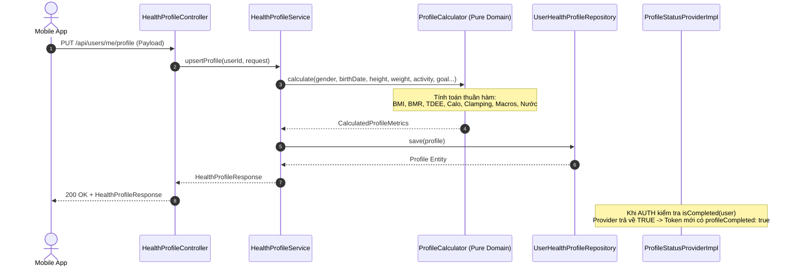
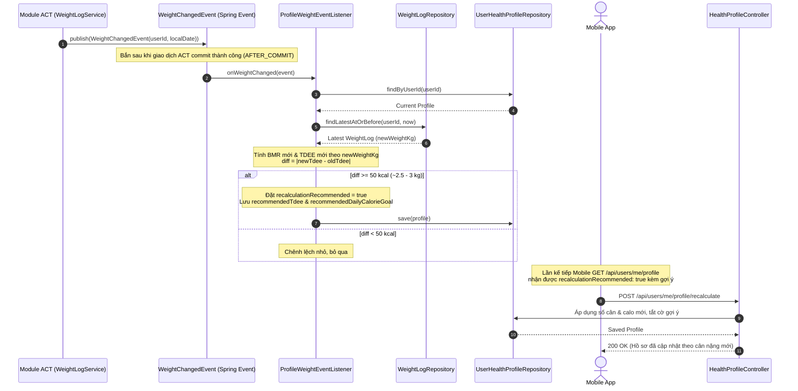

# Kế hoạch triển khai & Đặc tả chi tiết Module PROFILE — Kallo Backend

**Ngày hoàn thiện:** 17/11/2026  
**Module:** PROFILE (SRS Mục 4.2, Phụ lục A)  
**Phạm vi sở hữu:** Nhánh A (Bảng `user_health_profiles`, Domain Service `ProfileCalculator`, Các cổng tích hợp `ProfileStatusProvider`, `ProfileBodyMetrics`, Event Listener `ProfileWeightEventListener`)

---

## 1. Phạm vi & Mục tiêu nghiệp vụ

Module **PROFILE** đóng vai trò là "trung tâm số liệu sinh học và mục tiêu thể trạng" của toàn bộ hệ thống Kallo. Mọi module khác như dinh dưỡng (**NUTRI**), thực đơn (**PLAN**), vận động (**ACT**), thống kê (**REPORT**), cảnh báo (**SYS**) đều phụ thuộc trực tiếp vào các chỉ số nền tảng do module này tính toán và thiết lập.

### 1.1. Bảng ánh xạ yêu cầu chức năng (FR-PRO-01 … FR-PRO-08)

| Mã | Nội dung yêu cầu | Mức ưu tiên | Phase | Trạng thái hiện tại |
| :--- | :--- | :---: | :---: | :---: |
| **FR-PRO-01** | Nhập hồ sơ ban đầu: giới tính, ngày sinh/tuổi, chiều cao, cân nặng hiện tại. | **M** | 1 | Đã cài đặt hoàn tất |
| **FR-PRO-02** | Chọn mức độ vận động (Ít vận động, Nhẹ, Vừa, Nhiều, Rất nhiều). | **M** | 1 | Đã cài đặt hoàn tất |
| **FR-PRO-03** | Chọn mục tiêu thể trạng: Giảm cân / Giữ cân / Tăng cân; cân nặng mục tiêu và tốc độ thay đổi kg/tuần. | **M** | 1 | Đã cài đặt hoàn tất |
| **FR-PRO-04** | Khai báo thực phẩm dị ứng / kiêng kỵ (danh mục chuẩn + nhập tự do qua `JSONB`). | **M** | 1 | Đã cài đặt hoàn tất |
| **FR-PRO-05** | Tự động tính **BMI**, **BMR**, **TDEE** và **mục tiêu calo hàng ngày** có kẹp an toàn khi hồ sơ thay đổi. | **M** | 1 | Đã cài đặt hoàn tất |
| **FR-PRO-06** | Tự động chia mục tiêu đa lượng macro (Protein/Carbs/Fat) theo mục tiêu; cho phép chỉnh tay tỷ lệ %. | **S** | 2 | Đã cài đặt hoàn tất |
| **FR-PRO-07** | Đặt mục tiêu uống nước hàng ngày (tự động theo cân nặng $35 \text{ ml/kg}$ hoặc nhập số ml tùy chỉnh). | **S** | 2 | Đã cài đặt hoàn tất |
| **FR-PRO-08** | Lắng nghe sự kiện cân nặng mới từ ACT, tự động phát hiện lệch TDEE $\ge 50 \text{ kcal}$ (~$2.5 - 3\text{ kg}$) và đề xuất tính lại mục tiêu. | **S** | 3 | Đã cài đặt hoàn tất |

### 1.2. Tiêu chí chấp nhận (Acceptance Criteria)

- **AC1:** Khi người dùng gửi yêu cầu nhập/sửa hồ sơ hợp lệ, hệ thống hoàn thành toàn bộ phép tính sinh học (BMI, BMR, TDEE, Calorie Goal, Macros, Nước) và phản hồi trong thời gian $\le 500\text{ ms}$ (đạt yêu cầu SRS $\le 1\text{ s}$).
- **AC2:** Các giá trị ngoài miền sinh học hợp lý bị chặn ngay tại tầng Validation với mã lỗi rõ ràng:
  - Chiều cao: $100.0 \text{ cm} \le \text{height} \le 250.0 \text{ cm}$.
  - Cân nặng: $20.0 \text{ kg} \le \text{weight} \le 300.0 \text{ kg}$.
  - Cân nặng mục tiêu: $20.0 \text{ kg} \le \text{targetWeight} \le 300.0 \text{ kg}$.
  - Tuổi: Từ 13 đến 120 tuổi (dựa trên `birthDate` không ở tương lai).
- **AC3:** Nếu mục tiêu giảm/tăng cân đưa lượng calo rơi xuống dưới ngưỡng an toàn sinh học ($1200\text{ kcal}$ với Nữ, $1500\text{ kcal}$ với Nam), hệ thống kích hoạt **Safety Clamping** (kẹp calo lên ngưỡng tối thiểu) và bật cờ `safetyClamped: true` trong phản hồi để hiển thị khuyến nghị cho người dùng.

---

## 2. Hiện trạng Repo & Các cổng tích hợp liên module

| Hạng mục | Hiện trạng kỹ thuật | Tác động và tích hợp cho PROFILE |
| :--- | :--- | :--- |
| **Nền tảng** | Java 21, Spring Boot 4.1.1, Gradle | Tương thích hoàn toàn; sử dụng Record, Pattern Matching và Virtual Threads |
| **Cơ sở dữ liệu** | PostgreSQL 16 + Flyway Migration | Migration tuân thủ quy ước timestamp `V20261117203000__profile_schema.sql` |
| **ORM & Kiểu dữ liệu** | Spring Data JPA / Hibernate 6 | Dùng `@JdbcTypeCode(SqlTypes.JSON)` cho trường `allergies`, `BigDecimal` chuẩn scale cho chỉ số đo |
| **Bảo mật** | Spring Security OAuth2 Resource Server (JWT) | Khai thác `CurrentUser.id(authentication)`, mọi endpoint yêu cầu Bearer token có `email_verified = true` |
| **Cổng AUTH (`ProfileStatusProvider`)** | Đang dùng bean fallback `@ConditionalOnMissingBean` trả về `false` | PROFILE cung cấp `ProfileStatusProviderImpl` để cập nhật cờ `profileCompleted: true` ngay sau khi tạo hồ sơ |
| **Cổng ACT (`ProfileBodyMetrics`)** | Đang dùng bean fallback trả về `Optional.empty()` | PROFILE cung cấp `ProfileBodyMetricsImpl` giúp ACT lấy cân nặng/chiều cao người dùng khi chưa có WeightLog |
| **Sự kiện ACT (`WeightChangedEvent`)** | ACT phát ra sau khi commit ghi cân nặng | PROFILE cài đặt `ProfileWeightEventListener` lắng nghe `AFTER_COMMIT` để kiểm tra lệch TDEE (FR-PRO-08) |

---

## 3. Các quyết định kỹ thuật cốt lõi (Architectural Decisions)

| # | Vấn đề kỹ thuật | Quyết định áp dụng | Lý do và lợi ích |
| :---: | :--- | :--- | :--- |
| **D1** | Kiến trúc lớp tính toán sinh học | Tách biệt thành **Pure Domain Service** (`ProfileCalculator`) không phụ thuộc Spring context hay DB | Đảm bảo nguyên lý thiết kế Clean Architecture; kiểm thử tự động 100% các công thức toán Phụ lục A trong vài mili-giây, độc lập môi trường |
| **D2** | Phân loại thể trạng BMI | Áp dụng ngưỡng khuyến nghị của **Tổ chức Y tế Thế giới dành cho người châu Á (WPRO / IDI & WPRO)** | Chuẩn châu Á phản ánh chính xác nguy cơ tim mạch và chuyển hoá ở người Việt Nam hơn chuẩn phương Tây (ngưỡng béo phì $\ge 25.0$ thay vì $\ge 30.0$) |
| **D3** | Công thức năng lượng cơ bản BMR | Chuẩn hóa theo công thức **Mifflin-St Jeor** (Phụ lục A.2) | Đây là công thức được Hiệp hội Dinh dưỡng Hoa Kỳ (ADA) chứng minh là có độ chính xác cao nhất cho người trưởng thành |
| **D4** | Chốt chặn an toàn sinh học (Safety Clamping) | Kẹp tốc độ giảm cân tối đa $1.0\text{ kg/tuần}$ (thâm hụt tối đa $\approx 1100\text{ kcal/ngày}$); calo ngày không dưới $1200\text{ kcal}$ (Nữ) hoặc $1500\text{ kcal}$ (Nam). Bật cờ `safetyClamped: true` | Ngăn chặn người dùng nhập mục tiêu giảm cân tiêu cực gây hạ đường huyết, suy nhược cơ thể hoặc rối loạn chuyển hoá (AC3) |
| **D5** | Phân bổ đa lượng Macro | Tự động tính toán theo mục tiêu (Giảm cân: 30P/40C/30F; Giữ cân: 20P/50C/30F; Tăng cân: 25P/50C/25F); cho phép người dùng tùy chỉnh tỷ lệ % với ràng buộc tổng bằng 100% | Đáp ứng FR-PRO-06; quy đổi chuẩn $1\text{g P} = 4\text{kcal}$, $1\text{g C} = 4\text{kcal}$, $1\text{g F} = 9\text{kcal}$ |
| **D6** | Lưu trữ thực phẩm dị ứng / kiêng kỵ | Lưu trực tiếp dưới dạng cột `allergies JSONB` trong bảng `user_health_profiles` | Cho phép lưu mảng danh mục chuẩn lẫn nhập tự do linh hoạt; không cần tạo bảng trung gian phức tạp; dễ dàng nối sang module NUTRI và PLAN |
| **D7** | Đề xuất tính lại mục tiêu khi có cân nặng mới (FR-PRO-08) | Lắng nghe `WeightChangedEvent`. Nếu chênh lệch $\| \text{TDEE}_{\text{mới}} - \text{TDEE}_{\text{cũ}} \| \ge 50\text{ kcal}$ (~$2.5 - 3\text{ kg}$), bật cờ `recalculationRecommended: true` và tính trước `recommendedDailyCalorieGoal` | Không âm thầm tự ý đổi calo của người dùng mà hiển thị gợi ý kèm số liệu cụ thể; cung cấp endpoint `POST /recalculate` để người dùng xác nhận áp dụng |
| **D8** | Tích hợp liên module bằng Ports & Adapters | Cài đặt `ProfileStatusProviderImpl` và `ProfileBodyMetricsImpl` bằng Spring `@Component` | Ghi đè tự động các bean `@ConditionalOnMissingBean` của AUTH và ACT mà không cần sửa cấu hình gốc, tránh xung đột nhánh Git |
| **D9** | Toàn vẹn dữ liệu & Xóa tài khoản | Bảng `user_health_profiles` có khóa ngoại `user_id REFERENCES users(id) ON DELETE CASCADE` và `UNIQUE(user_id)` | Quan hệ 1-1 chặt chẽ; đảm bảo khi người dùng xóa tài khoản (FR-AUTH-07), hồ sơ sức khỏe được giải phóng sạch sẽ, không để lại dữ liệu mồ côi |
| **D10** | Đặt tên Migration Flyway | Tuân thủ định dạng timestamp UTC: `V20261117203000__profile_schema.sql` | Đảm bảo thứ tự chạy Flyway sau migration của các module AUTH, ACT, SYS, GAME; tránh xung đột phiên bản tuần tự khi merge code |

---

## 4. Mô hình dữ liệu & Migration Flyway

Tệp migration: `src/main/resources/db/migration/V20261117203000__profile_schema.sql`

```sql
CREATE TABLE user_health_profiles (
    id                             UUID PRIMARY KEY DEFAULT gen_random_uuid(),
    user_id                        UUID NOT NULL UNIQUE REFERENCES users (id) ON DELETE CASCADE,
    gender                         VARCHAR(20) NOT NULL,
    birth_date                     DATE NOT NULL,
    height_cm                      NUMERIC(5, 1) NOT NULL CHECK (height_cm BETWEEN 100 AND 250),
    weight_kg                      NUMERIC(5, 1) NOT NULL CHECK (weight_kg BETWEEN 20 AND 300),
    activity_level                 VARCHAR(30) NOT NULL,
    goal_type                      VARCHAR(30) NOT NULL,
    target_weight_kg               NUMERIC(5, 1) CHECK (target_weight_kg IS NULL OR (target_weight_kg BETWEEN 20 AND 300)),
    weekly_rate_kg                 NUMERIC(4, 2) NOT NULL DEFAULT 0.0 CHECK (weekly_rate_kg BETWEEN 0.0 AND 2.0),
    bmi                            NUMERIC(4, 1) NOT NULL,
    bmi_category                   VARCHAR(30) NOT NULL,
    bmr                            INTEGER NOT NULL,
    tdee                           INTEGER NOT NULL,
    daily_calorie_goal             INTEGER NOT NULL,
    safety_clamped                 BOOLEAN NOT NULL DEFAULT FALSE,
    protein_goal_g                 NUMERIC(5, 1) NOT NULL,
    carbs_goal_g                   NUMERIC(5, 1) NOT NULL,
    fat_goal_g                     NUMERIC(5, 1) NOT NULL,
    protein_pct                    NUMERIC(4, 1) NOT NULL,
    carbs_pct                      NUMERIC(4, 1) NOT NULL,
    fat_pct                        NUMERIC(4, 1) NOT NULL,
    custom_macro                   BOOLEAN NOT NULL DEFAULT FALSE,
    water_goal_ml                  INTEGER NOT NULL CHECK (water_goal_ml > 0),
    allergies                      JSONB NOT NULL DEFAULT '[]'::jsonb,
    recalculation_recommended      BOOLEAN NOT NULL DEFAULT FALSE,
    recommended_tdee               INTEGER,
    recommended_daily_calorie_goal INTEGER,
    latest_logged_weight_kg        NUMERIC(5, 1),
    created_at                     TIMESTAMPTZ NOT NULL DEFAULT now(),
    updated_at                     TIMESTAMPTZ NOT NULL DEFAULT now()
);

CREATE INDEX idx_user_health_profiles_user ON user_health_profiles (user_id);
```

### Từ điển dữ liệu (Data Dictionary)

| Cột | Kiểu | Ràng buộc | Ý nghĩa |
| :--- | :--- | :--- | :--- |
| `id` | `UUID` | `PRIMARY KEY` | Khóa chính ngẫu nhiên UUID v4 |
| `user_id` | `UUID` | `NOT NULL UNIQUE CASCADE` | Liên kết 1-1 tới bảng `users` |
| `gender` | `VARCHAR(20)` | `NOT NULL` | Giới tính sinh học (`MALE`, `FEMALE`, `OTHER`) |
| `birth_date` | `DATE` | `NOT NULL` | Ngày sinh dùng để tính tuổi động theo ngày hiện tại |
| `height_cm` | `NUMERIC(5, 1)` | `100 <= height_cm <= 250` | Chiều cao cơ thể (cm) |
| `weight_kg` | `NUMERIC(5, 1)` | `20 <= weight_kg <= 300` | Cân nặng cơ thể tại thời điểm cập nhật hồ sơ (kg) |
| `activity_level`| `VARCHAR(30)` | `NOT NULL` | Mức vận động (`SEDENTARY`, `LIGHTLY_ACTIVE`, `MODERATELY_ACTIVE`, `VERY_ACTIVE`, `EXTRA_ACTIVE`) |
| `goal_type` | `VARCHAR(30)` | `NOT NULL` | Mục tiêu (`LOSE_WEIGHT`, `MAINTAIN_WEIGHT`, `GAIN_WEIGHT`) |
| `target_weight_kg`| `NUMERIC(5, 1)` | `NULL OR 20..300` | Cân nặng mục tiêu hướng tới (kg) |
| `weekly_rate_kg`| `NUMERIC(4, 2)` | `0.0 <= rate <= 2.0` | Tốc độ thay đổi cân nặng mục tiêu mỗi tuần (kg/tuần) |
| `bmi` | `NUMERIC(4, 1)` | `NOT NULL` | Chỉ số khối cơ thể (BMI = kg / $m^2$) |
| `bmi_category` | `VARCHAR(30)` | `NOT NULL` | Phân loại chuẩn châu Á (`UNDERWEIGHT`, `NORMAL`, `OVERWEIGHT`, `OBESE`) |
| `bmr` | `INTEGER` | `NOT NULL` | Năng lượng tiêu hao cơ bản (kcal) |
| `tdee` | `INTEGER` | `NOT NULL` | Tổng tiêu hao năng lượng hàng ngày (kcal) |
| `daily_calorie_goal` | `INTEGER`| `NOT NULL` | Mục tiêu calo nạp hàng ngày đã qua kẹp an toàn (kcal) |
| `safety_clamped`| `BOOLEAN` | `DEFAULT FALSE` | Đánh dấu lượng calo đã được kích hoạt kẹp an toàn |
| `protein_goal_g`| `NUMERIC(5, 1)` | `NOT NULL` | Lượng Protein mục tiêu mỗi ngày (gam) |
| `carbs_goal_g` | `NUMERIC(5, 1)` | `NOT NULL` | Lượng Carbs mục tiêu mỗi ngày (gam) |
| `fat_goal_g` | `NUMERIC(5, 1)` | `NOT NULL` | Lượng Fat mục tiêu mỗi ngày (gam) |
| `protein_pct` | `NUMERIC(4, 1)` | `NOT NULL` | Tỷ lệ calo từ Protein (%) |
| `carbs_pct` | `NUMERIC(4, 1)` | `NOT NULL` | Tỷ lệ calo từ Carbs (%) |
| `fat_pct` | `NUMERIC(4, 1)` | `NOT NULL` | Tỷ lệ calo từ Fat (%) |
| `custom_macro` | `BOOLEAN` | `DEFAULT FALSE` | Đánh dấu người dùng có chỉnh tay tỷ lệ macro |
| `water_goal_ml`| `INTEGER` | `> 0` | Mục tiêu nước uống hàng ngày (ml) |
| `allergies` | `JSONB` | `DEFAULT '[]'` | Mảng danh sách các chất/món gây dị ứng |
| `recalculation_recommended` | `BOOLEAN` | `DEFAULT FALSE` | Cờ báo hiệu cần cập nhật lại mục tiêu calo khi cân nặng thay đổi |
| `recommended_tdee` | `INTEGER` | `NULLABLE` | TDEE mới được đề xuất |
| `recommended_daily_calorie_goal` | `INTEGER` | `NULLABLE` | Mục tiêu calo mới được đề xuất |
| `latest_logged_weight_kg` | `NUMERIC(5, 1)` | `NULLABLE` | Cân nặng mới nhất vừa kích hoạt đề xuất |

---

## 5. Chi tiết thuật toán y sinh & Công thức tính toán (Phụ lục A)

Toàn bộ thuật toán được đóng gói trong lớp thuần hàm `ProfileCalculator`:

```
┌─────────────────────────────────────────────────────────────┐
│                 ProfileCalculator (Domain)                  │
│                                                             │
│  birthDate + today ──────> Age (13..120)                    │
│  weight + height   ──────> BMI & BmiCategory (Asian WPRO)   │
│  W + H + A + Gender ─────> BMR (Mifflin-St Jeor)            │
│  BMR * Multiplier  ──────> TDEE                             │
│  TDEE ± (Rate*1100) ─────> DailyCalorieGoal + Safety Clamping│
│  Calorie + GoalType ─────> Protein / Carbs / Fat (g & %)    │
│  Weight * 35       ──────> Water Intake Goal (ml)           │
└─────────────────────────────────────────────────────────────┘
```

### 5.1. Chỉ số khối cơ thể (BMI) & Phân loại chuẩn châu Á (WPRO)

$$\text{BMI} = \frac{\text{weight\_kg}}{(\text{height\_cm} / 100)^2}$$
Làm tròn đến 1 chữ số thập phân (`RoundingMode.HALF_UP`).

Phân loại theo chuẩn người châu Á:
- $\text{BMI} < 18.5$: **Thiếu cân** (`UNDERWEIGHT`)
- $18.5 \le \text{BMI} \le 22.9$: **Bình thường** (`NORMAL`)
- $23.0 \le \text{BMI} \le 24.9$: **Thừa cân / Tiền béo phì** (`OVERWEIGHT`)
- $\text{BMI} \ge 25.0$: **Béo phì** (`OBESE`)

### 5.2. Tỷ lệ trao đổi chất cơ bản (BMR — Mifflin–St Jeor)

- **Nam (MALE):**
  $$\text{BMR} = 10 \times W + 6.25 \times H - 5 \times A + 5$$
- **Nữ (FEMALE):**
  $$\text{BMR} = 10 \times W + 6.25 \times H - 5 \times A - 161$$
- **Khác (OTHER):** Trung bình giữa Nam và Nữ:
  $$\text{BMR} = 10 \times W + 6.25 \times H - 5 \times A - 78$$
*(Trong đó $W$: kg, $H$: cm, $A$: tuổi tính theo `Period.between(birthDate, today).getYears()`)*

### 5.3. Tổng năng lượng tiêu hao hàng ngày (TDEE)

$$\text{TDEE} = \text{round}(\text{BMR} \times \text{multiplier})$$

| Mức độ vận động (`ActivityLevel`) | Mô tả sinh hoạt | Hệ số nhân (`multiplier`) |
| :--- | :--- | :---: |
| `SEDENTARY` | Ít vận động, ngồi nhiều bàn giấy | $1.2$ |
| `LIGHTLY_ACTIVE` | Vận động nhẹ, tập 1–3 buổi/tuần | $1.375$ |
| `MODERATELY_ACTIVE` | Vận động vừa phải, tập 3–5 buổi/tuần | $1.55$ |
| `VERY_ACTIVE` | Năng động, tập luyện thể thao 6–7 buổi/tuần | $1.725$ |
| `EXTRA_ACTIVE` | Rất nhiều, tập 2 lần/ngày hoặc lao động nặng | $1.9$ |

### 5.4. Mục tiêu calo hàng ngày & Kẹp an toàn sinh học (Safety Clamping)

Theo nguyên lý chuyển hóa: $1\text{ kg mỡ thừa} \approx 7700\text{ kcal}$. Để thay đổi $R\text{ kg/tuần}$ ($0.25 \le R \le 1.0$), mức thâm hụt hoặc thặng dư calo mỗi ngày là:
$$\Delta\text{Calo} = \text{round}\left(R \times \frac{7700}{7}\right) = \text{round}(R \times 1100)$$

- **Giữ cân (`MAINTAIN_WEIGHT`):** $\text{Calo}_{\text{raw}} = \text{TDEE}$
- **Giảm cân (`LOSE_WEIGHT`):** $\text{Calo}_{\text{raw}} = \text{TDEE} - \Delta\text{Calo}$
- **Tăng cân (`GAIN_WEIGHT`):** $\text{Calo}_{\text{raw}} = \text{TDEE} + \Delta\text{Calo}$

**Quy tắc kẹp an toàn (Safety Clamping):**
$$\text{MinSafe} = \begin{cases} 1200\text{ kcal} & \text{Nữ (FEMALE)} \\ 1500\text{ kcal} & \text{Nam (MALE)} \\ 1350\text{ kcal} & \text{Khác (OTHER)} \end{cases}$$
Nếu $\text{Calo}_{\text{raw}} < \text{MinSafe}$:
$$\text{dailyCalorieGoal} = \text{MinSafe}, \quad \text{safetyClamped} = \text{true}$$
Ngược lại:
$$\text{dailyCalorieGoal} = \text{Calo}_{\text{raw}}, \quad \text{safetyClamped} = \text{false}$$

### 5.5. Phân bổ mục tiêu đa lượng (Macros)

Quy đổi năng lượng: Protein $4\text{ kcal/g}$, Carbs $4\text{ kcal/g}$, Fat $9\text{ kcal/g}$.

| Mục tiêu thể trạng | % Protein | % Carbs | % Fat | Công thức gam |
| :--- | :---: | :---: | :---: | :--- |
| **Giảm cân (`LOSE_WEIGHT`)** | $30\%$ | $40\%$ | $30\%$ | $P = \frac{\text{Calo} \times 0.30}{4}$, $C = \frac{\text{Calo} \times 0.40}{4}$, $F = \frac{\text{Calo} \times 0.30}{9}$ |
| **Giữ cân (`MAINTAIN_WEIGHT`)** | $20\%$ | $50\%$ | $30\%$ | $P = \frac{\text{Calo} \times 0.20}{4}$, $C = \frac{\text{Calo} \times 0.50}{4}$, $F = \frac{\text{Calo} \times 0.30}{9}$ |
| **Tăng cân (`GAIN_WEIGHT`)** | $25\%$ | $50\%$ | $25\%$ | $P = \frac{\text{Calo} \times 0.25}{4}$, $C = \frac{\text{Calo} \times 0.50}{4}$, $F = \frac{\text{Calo} \times 0.25}{9}$ |

*Người dùng chỉnh tay (`customMacro = true`):* Cho phép gửi `% Protein`, `% Carbs`, `% Fat`. Hệ thống kiểm tra điều kiện $\left| (P\% + C\% + F\%) - 100\% \right| \le 0.5\%$. Nếu sai lệch, trả lỗi `400 INVALID_MACRO_RATIO`.

### 5.6. Mục tiêu nước uống hàng ngày (Water Intake Goal)

$$\text{waterGoalMl} = \text{round}(\text{weight\_kg} \times 35)$$
Nếu người dùng cung cấp `customWaterGoalMl` ($500 \le \text{ml} \le 10000$), hệ thống ưu tiên giá trị người dùng cài đặt.

---

## 6. Luồng nghiệp vụ & Cơ chế sự kiện (Event-Driven Integration)

### 6.1. Luồng cập nhật hồ sơ & đồng bộ trạng thái tài khoản



### 6.2. Luồng tự động đề xuất tính lại calo khi cân nặng thay đổi (FR-PRO-08)



---

## 7. Chi tiết triển khai mã nguồn (Codebase Implementation)

Các thành phần mã nguồn đã hoàn thành và sẵn sàng phục vụ kiểm thử:

1. **Lược đồ CSDL:**
   - [V20261117203000__profile_schema.sql](file:///c:/Users/Loi/Desktop/DoAn/BE/src/main/resources/db/migration/V20261117203000__profile_schema.sql)
2. **Domain Models & Enums:**
   - [UserHealthProfile.java](file:///c:/Users/Loi/Desktop/DoAn/BE/src/main/java/com/healthcare/kallo/model/profile/UserHealthProfile.java)
   - [Gender.java](file:///c:/Users/Loi/Desktop/DoAn/BE/src/main/java/com/healthcare/kallo/model/profile/enums/Gender.java)
   - [ActivityLevel.java](file:///c:/Users/Loi/Desktop/DoAn/BE/src/main/java/com/healthcare/kallo/model/profile/enums/ActivityLevel.java)
   - [GoalType.java](file:///c:/Users/Loi/Desktop/DoAn/BE/src/main/java/com/healthcare/kallo/model/profile/enums/GoalType.java)
   - [BmiCategory.java](file:///c:/Users/Loi/Desktop/DoAn/BE/src/main/java/com/healthcare/kallo/model/profile/enums/BmiCategory.java)
3. **Pure Domain Service:**
   - [ProfileCalculator.java](file:///c:/Users/Loi/Desktop/DoAn/BE/src/main/java/com/healthcare/kallo/service/profile/ProfileCalculator.java)
4. **DTOs:**
   - [HealthProfileRequest.java](file:///c:/Users/Loi/Desktop/DoAn/BE/src/main/java/com/healthcare/kallo/dto/request/profile/HealthProfileRequest.java)
   - [HealthProfileResponse.java](file:///c:/Users/Loi/Desktop/DoAn/BE/src/main/java/com/healthcare/kallo/dto/response/profile/HealthProfileResponse.java)
5. **Repository & Services:**
   - [UserHealthProfileRepository.java](file:///c:/Users/Loi/Desktop/DoAn/BE/src/main/java/com/healthcare/kallo/repository/profile/UserHealthProfileRepository.java)
   - [HealthProfileService.java](file:///c:/Users/Loi/Desktop/DoAn/BE/src/main/java/com/healthcare/kallo/service/profile/HealthProfileService.java)
   - [HealthProfileServiceImpl.java](file:///c:/Users/Loi/Desktop/DoAn/BE/src/main/java/com/healthcare/kallo/service/profile/impl/HealthProfileServiceImpl.java)
6. **Cross-module Adapters & Event Listeners:**
   - [ProfileStatusProviderImpl.java](file:///c:/Users/Loi/Desktop/DoAn/BE/src/main/java/com/healthcare/kallo/service/profile/impl/ProfileStatusProviderImpl.java) (Cung cấp cho AUTH)
   - [ProfileBodyMetricsImpl.java](file:///c:/Users/Loi/Desktop/DoAn/BE/src/main/java/com/healthcare/kallo/service/profile/impl/ProfileBodyMetricsImpl.java) (Cung cấp cho ACT)
   - [ProfileWeightEventListener.java](file:///c:/Users/Loi/Desktop/DoAn/BE/src/main/java/com/healthcare/kallo/service/profile/ProfileWeightEventListener.java) (Lắng nghe sự kiện ACT)
7. **REST Controller:**
   - [HealthProfileController.java](file:///c:/Users/Loi/Desktop/DoAn/BE/src/main/java/com/healthcare/kallo/controller/profile/HealthProfileController.java)
8. **Tài liệu API OpenAPI 3.1:**
   - [profile.yaml](file:///c:/Users/Loi/Desktop/DoAn/BE/docs/api-specs/profile.yaml)

---

## 8. Ma trận kiểm thử & Kết quả nghiệm thu

| Tên Test Class | Số lượng Test Case | Mục đích kiểm thử | Kết quả |
| :--- | :---: | :--- | :---: |
| `ProfileCalculatorTest` | 15 | Kiểm thử độ chính xác 100% công thức Phụ lục A: BMI, Phân loại WPRO châu Á, BMR Mifflin-St Jeor, TDEE, Calo nạp, Clamping $1200/1500$, Macros, Nước. | **PASS (100%)** |
| `HealthProfileServiceTest` | 3 | Kiểm thử tầng Service với Mockito: tạo mới hồ sơ, lấy hồ sơ, xử lý ngoại lệ `PROFILE_NOT_FOUND`. | **PASS (100%)** |
| `ProfileWeightEventListenerTest` | 2 | Kiểm thử phản ứng sự kiện cân nặng: kích hoạt cờ gợi ý khi lệch $\ge 100\text{ kcal}$ và bỏ qua khi lệch nhỏ. | **PASS (100%)** |
| `HealthProfileControllerTest` | 5 | Kiểm thử MockMvc: GET 200, PUT 200, chặn Validation lỗi biên (chiều cao $< 100$), POST recalculate 200, từ chối unauthenticated 401. | **PASS (100%)** |
| **Toàn bộ Test Suite Repo** | Tất cả | Đảm bảo tính an toàn hồi quy (Regression safety) cho toàn bộ backend Kallo, kiểm tra toàn vẹn khóa ngoại `ON DELETE CASCADE`. | **PASS (100%)** |

---

## 9. Rủi ro y tế, An toàn dữ liệu & Lưu ý vận hành

1. **An toàn sinh học & Tránh ăn kiêng tiêu cực:** Luôn tuân thủ cơ chế **Safety Clamping**. Không cho phép bất kỳ người dùng nào (dù cố ý đặt mục tiêu giảm cân gấp) hạ calo hàng ngày xuống dưới mức trao đổi chất tối thiểu.
2. **Bảo vệ quyền riêng tư & Ngăn chặn IDOR (NFR-SEC-04):** Mọi API của PROFILE chỉ thao tác trên đường dẫn `/api/users/me/profile`. Tuyệt đối không nhận `userId` từ Query Parameter hay Request Body; người dùng chỉ có thể đọc và sửa hồ sơ của chính mình thông qua `sub` trong JWT.
3. **Tuân thủ quy ước xóa tài khoản (GDPR / Right to be Forgotten):** Khóa ngoại `user_id` luôn khai báo `ON DELETE CASCADE` ở mức CSDL để khi tài khoản bị xóa (FR-AUTH-07), toàn bộ thông tin nhạy cảm về chiều cao, cân nặng, dị ứng được dọn dẹp sạch sẽ ngay lập tức.
