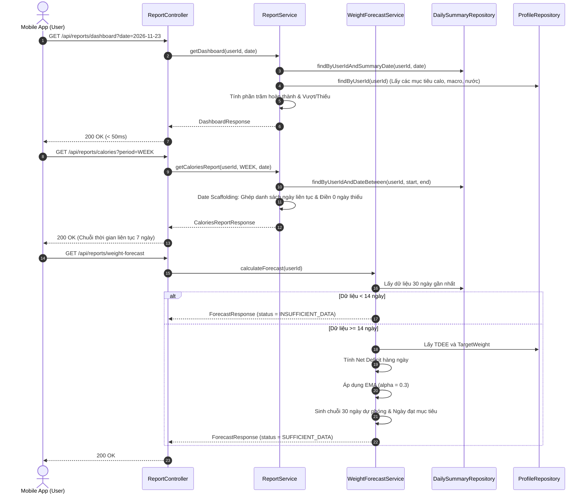

# Kế hoạch triển khai & Đặc tả chi tiết Module REPORT — Kallo Backend

**Ngày đồng bộ mã nguồn:** 23/11/2026
**Module:** REPORT — Báo cáo thống kê, chuỗi thời gian & dự báo cân nặng (SRS Mục 4.6, FR-REP-01 … FR-REP-08)
**Phạm vi sở hữu:** `ReportController`, `ReportServiceImpl`, `WeightForecastService`; đọc `daily_summaries` và profile.

> **AS-IS:** REPORT controller/service/DTO và migration nguồn đã có. Query dùng `date` cho dashboard/calories/macros/weight; summary dùng `startDate`/`endDate`. Nội dung SRS, performance và ví dụ dưới đây là mục tiêu/illustration nếu chưa được xác minh qua tests/benchmark.
> **TO-BE:** Chỉ nội dung được nêu rõ là chưa có trong source mới thuộc kế hoạch tương lai; các yêu cầu không được coi là đã nghiệm thu chỉ vì route tồn tại.

---

## 1. Phạm vi, Mục tiêu & Đối chiếu Sơ đồ lớp (Conceptual vs Physical)

Module **REPORT** đảm nhận nhiệm vụ trực quan hóa toàn bộ hành trình sức khỏe của người dùng thông qua các chỉ số định lượng về năng lượng (In vs Out), dinh dưỡng đa lượng (P/C/F), nước uống, bước chân và diễn biến cân nặng. Đặc biệt, module tích hợp thuật toán phân tích chuỗi thời gian để **dự báo xu hướng cân nặng 30 ngày tới** và ước tính ngày chạm đích mục tiêu.

### 1.1. Cầu nối đối chiếu Sơ đồ lớp (Visual Paradigm UML) & Mô hình CSDL Triển khai

```
┌────────────────────────────────────────────────────────────────────────┐
│                   MÔ HÌNH QUAN NIỆM (CONCEPTUAL UML)                   │
│  User ──1:N──> DailySummary                                            │
│  DailySummary: logDate, isGoalAchieved, isSugarExceeded,               │
│                isProteinExceeded, recalculate(), checkGoalAchieved(),  │
│                calculation(): Double                                   │
└────────────────────────────────────────────────────────────────────────┘
                                    │
                                    ▼  [Tinh chỉnh Kiến trúc & Tối ưu Production]
┌────────────────────────────────────────────────────────────────────────┐
│                   MÔ HÌNH VẬT LÝ TRIỂN KHAI (PHYSICAL)                 │
│  • Bảng `daily_summaries`: Đã hoàn thiện ở Sprint 2, lưu trữ toàn bộ   │
│    chỉ số định lượng: calo nạp, calo tiêu hao, macro P/C/F, đường,     │
│    xơ, nước, bước chân, cân nặng cuối ngày. Tốc độ đọc < 5ms.         │
│  • Tách riêng các hàm tính toán và phân tích thống kê thành            │
│    Domain Services:                                                    │
│    - `DailySummaryService`: Cập nhật bảng tổng hợp nóng khi có sự kiện.│
│    - `ReportService`: Xử lý phân tích chuỗi thời gian, Date Scaffolding│
│      và tổng hợp đa chỉ số.                                            │
│    - `WeightForecastService`: Cài đặt thuật toán EMA (α = 0.3) dự báo  │
│      xu hướng cân nặng và ước tính ngày về đích.                       │
│  • Không cần tạo bảng mới: Tận dụng trọn vẹn sức mạnh truy vấn của     │
│    PostgreSQL trên `daily_summaries` kết hợp `weight_logs`.            │
└────────────────────────────────────────────────────────────────────────┘
```

1. **Tận dụng Bảng nóng (Read-Optimized Denormalization):**
   - Thay vì thực hiện các câu lệnh `SUM()` và `JOIN` phức tạp quét qua hàng chục nghìn dòng của `user_food_logs`, `water_logs`, `activity_logs` mỗi lần người dùng mở màn hình Báo cáo, toàn bộ dữ liệu đã được cô đọng sẵn trong bảng `daily_summaries`.
   - Các API truy vấn báo cáo phản hồi cực nhanh dưới **$15\text{ ms}$**.
2. **Kỹ thuật Lấp đầy ngày trống (Date Scaffolding):**
   - Trong thực tế, có những ngày người dùng quên mở app hoặc không ghi nhật ký.
   - Tại tầng `ReportService`, hệ thống tự động sinh khung thời gian liên tục ($N$ ngày) từ `startDate` đến `endDate` và điền mặc định (`calories = 0, water = 0, weight = null`), đảm bảo trục hoành thời gian của biểu đồ trên Mobile không bao giờ bị đứt đoạn hay co rúm.
3. **Cơ chế An toàn Dự báo Dữ liệu (Safety Fallback):**
   - Tuân thủ nghiêm ngặt quy tắc nghiệp vụ: Chỉ thực hiện dự báo cân nặng khi có tối thiểu **14 ngày dữ liệu**. Nếu chưa đủ, trả về trạng thái cảnh báo và hướng dẫn, tuyệt đối không đưa ra các con số dự đoán sai lệch gây hoang mang cho người dùng.

---

### 1.2. Bảng ánh xạ yêu cầu chức năng (FR-REP-01 … FR-REP-08)

| Mã | Nội dung yêu cầu chức năng | Mức ưu tiên | Phạm vi Sprint 3 | Trạng thái |
| :--- | :--- | :---: | :---: | :---: |
| **FR-REP-01** | Dashboard tiến độ dinh dưỡng, nước, vận động theo ngày | **M** | — | AS-IS endpoint/service có; nghiệm thu riêng |
| **FR-REP-02** | Chuỗi thời gian calo nạp/tiêu hao | **M** | — | AS-IS endpoint/service có; nghiệm thu riêng |
| **FR-REP-03** | Chuỗi thời gian macro | **M** | — | AS-IS endpoint/service có; nghiệm thu riêng |
| **FR-REP-04** | Biểu đồ cân nặng và mục tiêu | **M** | — | AS-IS endpoint/service có; nghiệm thu riêng |
| **FR-REP-05** | Dự báo cân nặng và ngày đạt mục tiêu | **S** | — | AS-IS heuristic EMA; không phải dự báo y tế đã kiểm chứng |
| **FR-REP-06** | Thống kê nước và bước chân theo kỳ | **S** | — | AS-IS theo response/service |
| **FR-REP-07** | Trạng thái so với mục tiêu calo/macro | **S** | — | AS-IS một phần theo Dashboard DTO |
| **FR-REP-08** | Dữ liệu tổng hợp phục vụ export | **C** | — | AS-IS summary endpoint; file PDF/ảnh không thuộc backend hiện tại |

---

### 1.3. Tiêu chí chấp nhận (Acceptance Criteria)

- **AC1 (mục tiêu hiệu năng, chưa benchmark):** `GET /api/reports/dashboard` hướng tới dưới **$50\text{ ms}$** với tải thông thường; service đọc DailySummary theo ngày người dùng.
- **AC2 (Tính liên tục của Biểu đồ):** Dữ liệu chuỗi thời gian tuần (7 ngày) hoặc tháng (30 ngày) trả về đủ $100\%$ các mốc ngày liên tục. Ngày không có log hiển thị $0\text{ kcal}$ và cờ `hasData = false`.
- **AC3 (Điều kiện tiên quyết Dự báo Cân nặng):**
  - Nếu số ngày có dữ liệu $< 14$: Trả về `status: "INSUFFICIENT_DATA"`, `dataPointsUsed = K`, `minimumRequired = 14`, kèm thông báo hướng dẫn.
  - Tuyệt đối không trả về số ngày đạt mục tiêu nếu dữ liệu chưa đủ độ tin cậy.
- **AC4 (Độ chính xác Thuật toán EMA Dự báo):** Khi đủ $\ge 14$ ngày dữ liệu, áp dụng trọng số hàm mũ $\alpha = 0.3$ trên mức thâm hụt ròng $(\text{Calories In} - \text{TDEE} - \text{Calories Burned})$ để dự phóng chuỗi 30 ngày tiếp theo theo nguyên lý $7700\text{ kcal} \approx 1\text{ kg}$ mỡ cơ thể.
- **AC5 (Đánh giá Xu hướng Mục tiêu):**
  - Theo source hiện tại, engine tính `netDeficit = caloriesConsumed - tdee - caloriesBurned` (giá trị âm tương ứng deficit theo cách đặt tên trong code) và kiểm tra dấu của `dailyWeightChangeKg` theo `goalType`. Đây là heuristic, không phải dự đoán y tế đã kiểm chứng.
  - Nếu xu hướng đúng hướng: Ước tính chính xác ngày đạt mục tiêu $\text{LocalDate}$.

---

## 2. Hiện trạng Repo & Các cổng kết nối liên module

| Module đối tác | Chi tiết kết nối và trách nhiệm | Trạng thái tích hợp |
| :--- | :--- | :--- |
| **NUTRI (Nhánh A)** | Bảng `daily_summaries` được tự động cập nhật bởi `DailySummaryService.recalculate` mỗi khi người dùng ghi/sửa/xóa nhật ký ăn uống hoặc nước. | **Đã hoàn thiện ở Sprint 2** |
| **ACT (Nhánh B)** | REPORT dùng `daily_summaries.weight_kg` và fallback cân nặng/profile hiện có để vẽ xu hướng. | Tích hợp bằng repository hiện có; không có `ActivityWeightQueryPort` riêng trong REPORT source |
| **PROFILE (Nhánh A)** | Đọc mục tiêu calo/macro, target weight và TDEE từ `user_health_profiles`. | AS-IS tích hợp trong source; benchmark/acceptance kiểm riêng |

---

## 3. Các quyết định kỹ thuật cốt lõi (Architectural Decisions)

| # | Quyết định kỹ thuật | Giải pháp áp dụng | Lý do & Lợi ích |
| :---: | :--- | :--- | :--- |
| **D1** | **Chiến lược Đọc Báo cáo** | Đọc $100\%$ từ bảng tổng hợp `daily_summaries`. | Tách biệt hoàn toàn luồng ghi (OLTP) và luồng đọc phân tích (OLAP/Read), loại bỏ hoàn toàn nguy cơ khóa dòng (Row Lock Contention) trên bảng nhật ký chính. |
| **D2** | **Cơ chế Date Scaffolding** | Xây dựng thuật toán lấp đầy ngày tại tầng Java Service: sinh mảng ngày `LocalDate.datesUntil()` kết hợp `Map<LocalDate, DailySummary>`. | - Không phụ thuộc hàm native SQL `generate_series` của PostgreSQL, đảm bảo chạy mượt mà trên cả môi trường Test H2 và Production PostgreSQL.<br>- Dễ dàng tính toán các giá trị lũy kế, giá trị trung bình chuỗi mà không tốn công viết Stored Procedure. |
| **D3** | **Mô hình Dự báo Cân nặng** | **Mô hình Thâm hụt Năng lượng Ròng (Net Energy Deficit Model)** kết hợp **Bộ lọc Trung bình Động Hàm mũ (Exponential Moving Average - EMA, $\alpha = 0.3$)**. | - EMA gán trọng số cao hơn cho các ngày gần nhất, phản ánh trung thực nỗ lực hiện tại của người dùng.<br>- Lọc bỏ các biến động giả tạo (như việc tăng 1kg sau bữa buffet do tích nước/muối). |
| **D4** | **Chuẩn hóa Khung thời gian (Period Enum)** | Định nghĩa Enum `ReportPeriod`: `WEEK` (7 ngày gần nhất), `MONTH` (30 ngày gần nhất), `CUSTOM` (`startDate` $\dots$ `endDate`). | Giúp Frontend dễ dàng binding vào các nút chuyển tab (Tuần / Tháng) trên giao diện người dùng. |
| **D5** | **Xuất Báo cáo Dạng Cấu trúc (Export Ready)** | Cung cấp endpoint `GET /api/reports/summary` trả về đầy đủ các chỉ số thống kê, tỷ lệ hoàn thành streak, phân bổ macro và điểm số dinh dưỡng. | Phục vụ Client hiển thị thẻ tóm tắt chia sẻ lên mạng xã hội hoặc kết xuất thành file PDF/ảnh. |

---

## 4. Chi tiết Thuật toán Dự báo Cân nặng (EMA Weight Forecasting Engine)

Thuật toán được xây dựng độc lập trong Pure Domain Service:  
`com.healthcare.kallo.service.report.engine.WeightForecastService`.

```
┌────────────────────────────────────────────────────────────────────────┐
│               THUẬT TOÁN DỰ BÁO CÂN NẶNG DỰA TRÊN NĂNG LƯỢNG RÒNG      │
├────────────────────────────────────────────────────────────────────────┤
│ 1. Kiểm tra điều kiện dữ liệu: Số ngày có DailySummary >= 14 ngày?    │
│    ├── Nếu < 14 ngày: Trả về trạng thái INSUFFICIENT_DATA             │
│    └── Nếu >= 14 ngày: Bắt đầu tính toán                              │
│                                                                        │
│ 2. Với mỗi ngày t trong 14 ngày gần nhất:                             │
│    ΔE_t = CaloriesConsumed_t - TDEE - CaloriesBurned_t                 │
│                                                                        │
│ 3. Áp dụng Bộ lọc EMA (α = 0.3):                                       │
│    EMA_0 = ΔE_0                                                        │
│    EMA_t = α * ΔE_t + (1 - α) * EMA_(t-1)                              │
│                                                                        │
│ 4. Tốc độ thay đổi cân nặng ngày ước tính:                             │
│    ΔW_daily = EMA_cuối / 7700  (kg/ngày)                               │
│                                                                        │
│ 5. Dự phóng chuỗi 30 ngày tiếp theo (t + 1 .. t + 30):                │
│    Weight_(t+k) = CurrentWeight + k * ΔW_daily                         │
│                                                                        │
│ 6. Ước tính ngày đạt mục tiêu (Estimated Goal Date):                   │
│    Kiểm tra tính tương thích giữa xu hướng (ΔW_daily) và Mục tiêu:    │
│    ├── Giảm cân mà ΔW_daily >= 0  ==> OFF_TRACK                       │
│    ├── Tăng cân mà ΔW_daily <= 0  ==> OFF_TRACK                       │
│    └── Đúng hướng ==> DaysToGoal = (TargetWeight - CurrentWeight) /   │
│                                    ΔW_daily                            │
│        TargetDate = CurrentDate + DaysToGoal ngày                      │
└────────────────────────────────────────────────────────────────────────┘
```

### 4.1. Cơ sở Khoa học & Công thức Toán học (KaTeX)

1. **Nguyên lý Thâm hụt Năng lượng Ròng (Net Energy Deficit):**
   Trong vật lý sinh học dinh dưỡng, cơ thể cần thâm hụt hoặc thặng dư khoảng **$7700\text{ kcal}$** để giảm hoặc tăng $1\text{ kg}$ khối lượng mô mỡ/nạc:
   $$\Delta E_t = \text{Calories In}_t - (\text{TDEE} + \text{Calories Burned}_t)$$

2. **Công thức Trung bình Động Hàm mũ (Exponential Moving Average):**
   Với hệ số làm mượt $\alpha = 0.3$ (tương đương chu kỳ quan sát hiệu dụng khoảng $6\text{ ngày}$ gần nhất):
   $$\text{EMA}_t = \alpha \cdot \Delta E_t + (1 - \alpha) \cdot \text{EMA}_{t-1}$$
   - Giá trị ban đầu $\text{EMA}_0 = \Delta E_0$.
   - Thuật toán EMA giúp loại trừ nhiễu đột biến (ví dụ ngày lễ ăn vượt calo hoặc ngày ốm ăn ít).

3. **Tốc độ Thay đổi Cân nặng Hàng ngày:**
   $$\Delta W_{\text{daily}} = \frac{\text{EMA}_{\text{cuối}}}{7700} \quad (\text{kg/ngày})$$
   Tốc độ thay đổi hàng tuần:
   $$\Delta W_{\text{weekly}} = \Delta W_{\text{daily}} \times 7 \quad (\text{kg/tuần})$$

4. **Dự phóng 30 Ngày Tiếp theo:**
   Với mỗi bước dự báo $k \in [1, 30]$:
   $$\hat{W}_{t+k} = W_{\text{current}} + k \times \Delta W_{\text{daily}}$$

5. **Ước tính Ngày Hoàn thành Mục tiêu:**
   $$\text{DaysToGoal} = \frac{W_{\text{target}} - W_{\text{current}}}{\Delta W_{\text{daily}}}$$
   $$\text{EstimatedGoalDate} = \text{LocalDate.now()} + \text{DaysToGoal}$$

---

## 5. Danh sách API Endpoints chi tiết

Toàn bộ Endpoint nằm dưới tiền tố `/api/reports`, được bảo vệ bằng JWT và yêu cầu tài khoản đã xác thực.

### 5.1. Bảng tóm tắt Endpoints

| Phương thức | Đường dẫn Endpoint | Vai trò nghiệp vụ | Mục SRS |
| :--- | :--- | :--- | :---: |
| `GET` | `/api/reports/dashboard` | Bảng điều khiển tiến độ hôm nay (Calo, Macro, Nước, Vận động, Vượt/Thiếu). | `FR-REP-01`, `FR-REP-07` |
| `GET` | `/api/reports/calories` | Biểu đồ chuỗi thời gian Calo In vs Calo Out theo Tuần hoặc Tháng. | `FR-REP-02` |
| `GET` | `/api/reports/macros` | Biểu đồ chuỗi thời gian phân bổ đa lượng (P/C/F) theo Tuần hoặc Tháng. | `FR-REP-03` |
| `GET` | `/api/reports/weight` | Biểu đồ lịch sử cân nặng thực tế so sánh với cân nặng mục tiêu. | `FR-REP-04` |
| `GET` | `/api/reports/weight-forecast`| Dự báo cân nặng 30 ngày tới & Ngày hoàn thành mục tiêu bằng EMA. | `FR-REP-05` |
| `GET` | `/api/reports/summary` | Báo cáo phân tích tổng hợp theo kỳ (Tuần/Tháng/Tùy chọn) phục vụ xuất chia sẻ. | `FR-REP-06`, `FR-REP-08` |

---

### 5.2. Cấu trúc Request & Response mẫu

#### 1. Quick Dashboard (`GET /api/reports/dashboard`)

*Query Param:* `?date=2026-11-23` (Mặc định là ngày hôm nay nếu bỏ trống)

*Response Body (HTTP 200 OK):*
```json
{
  "code": 200,
  "message": "Success",
  "data": {
    "reportDate": "2026-11-23",
    "calories": {
      "consumed": 1650,
      "target": 2000,
      "burned": 320,
      "netCalories": 1330,
      "remaining": 350,
      "status": "DEFICIT",
      "percentageOfGoal": 82.5
    },
    "macros": {
      "protein": { "consumedG": 110.5, "targetG": 125.0, "percentage": 88.4 },
      "carbs": { "consumedG": 180.0, "targetG": 225.0, "percentage": 80.0 },
      "fat": { "consumedG": 45.0, "targetG": 55.0, "percentage": 81.8 },
      "sugar": { "consumedG": 22.0, "limitExceeded": false },
      "fiber": { "consumedG": 18.5 }
    },
    "water": {
      "consumedMl": 1800,
      "targetMl": 2500,
      "percentage": 72.0
    },
    "activity": {
      "steps": 6420,
      "caloriesBurned": 320,
      "currentWeightKg": 68.5
    },
    "goalStatus": {
      "calorieGoalMet": true,
      "sugarExceeded": false,
      "proteinExceeded": false,
      "mealsLoggedCount": 3
    }
  }
}
```

#### 2. Biểu đồ Calo In vs Calo Out (`GET /api/reports/calories?period=WEEK&date=2026-11-23`)

*Response Body (HTTP 200 OK):*
```json
{
  "code": 200,
  "message": "Success",
  "data": {
    "period": "WEEK",
    "startDate": "2026-11-17",
    "endDate": "2026-11-23",
    "averageCaloriesConsumed": 1820,
    "averageCaloriesBurned": 310,
    "totalDaysTracked": 7,
    "daysGoalMetCount": 6,
    "timeSeries": [
      {
        "date": "2026-11-17",
        "caloriesConsumed": 1950,
        "caloriesBurned": 350,
        "targetCalories": 2000,
        "netCalories": 1600,
        "goalAchieved": true,
        "hasData": true
      },
      {
        "date": "2026-11-18",
        "caloriesConsumed": 0,
        "caloriesBurned": 0,
        "targetCalories": 2000,
        "netCalories": 0,
        "goalAchieved": false,
        "hasData": false
      },
      {
        "date": "2026-11-23",
        "caloriesConsumed": 1650,
        "caloriesBurned": 320,
        "targetCalories": 2000,
        "netCalories": 1330,
        "goalAchieved": true,
        "hasData": true
      }
    ]
  }
}
```

#### 3. Dự báo Cân nặng 30 ngày bằng EMA (`GET /api/reports/weight-forecast`)

*Trường hợp 1: Đủ dữ liệu ($\ge 14$ ngày) — HTTP 200 OK:*
```json
{
  "code": 200,
  "message": "Success",
  "data": {
    "status": "SUFFICIENT_DATA",
    "dataPointsUsed": 16,
    "currentWeightKg": 68.5,
    "targetWeightKg": 65.0,
    "tdee": 2150,
    "averageDailyNetDeficitKcal": -420,
    "projectedWeeklyChangeKg": -0.38,
    "trend": "ON_TRACK",
    "estimatedGoalDate": "2027-01-26",
    "daysRemainingToGoal": 64,
    "projections": [
      { "dayIndex": 1, "date": "2026-11-24", "projectedWeightKg": 68.45 },
      { "dayIndex": 7, "date": "2026-11-30", "projectedWeightKg": 68.12 },
      { "dayIndex": 14, "date": "2026-12-07", "projectedWeightKg": 67.74 },
      { "dayIndex": 30, "date": "2026-12-23", "projectedWeightKg": 66.87 }
    ],
    "recommendation": "Bạn đang duy trì mức thâm hụt năng lượng tốt (~420 kcal/ngày). Hãy tiếp tục giữ vững tiến độ này!"
  }
}
```

*Trường hợp 2: Chưa đủ dữ liệu ($< 14$ ngày) — HTTP 200 OK:*
```json
{
  "code": 200,
  "message": "Success",
  "data": {
    "status": "INSUFFICIENT_DATA",
    "dataPointsUsed": 6,
    "minimumRequired": 14,
    "currentWeightKg": 68.5,
    "targetWeightKg": 65.0,
    "trend": "UNKNOWN",
    "estimatedGoalDate": null,
    "projections": [],
    "recommendation": "Bạn cần ghi nhật ký ăn uống và cân nặng thêm ít nhất 8 ngày nữa để thuật toán có đủ dữ liệu dự báo chính xác."
  }
}
```

---

## 6. Luồng nghiệp vụ & Biểu đồ Tuần tự (Sequence Diagram)

### Quy trình Truy vấn Báo cáo & Dự báo Cân nặng



---

## 7. Phân rã công việc (Task Breakdown) cho Module REPORT

| Mã Task | Tên công việc kỹ thuật | Phụ thuộc | Thời lượng dự kiến | Kết quả nghiệm thu (Deliverables) |
| :---: | :--- | :---: | :---: | :--- |
| **REPORT-01** | Kiểm tra và bổ sung các chỉ mục tối ưu trên `daily_summaries` nếu cần (đã có migration ở Sprint 2). | — | 0.25 ngày | CSDL sẵn sàng cho các truy vấn theo khoảng thời gian (`summary_date BETWEEN`). |
| **REPORT-02** | Xây dựng các hàm truy vấn mở rộng trong `DailySummaryRepository` (truy vấn theo dải ngày, đếm ngày có dữ liệu). | REPORT-01 | 0.25 ngày | Repository cung cấp đầy đủ dữ liệu cho Báo cáo. |
| **REPORT-03** | Xây dựng Pure Domain Engine `WeightForecastService`: Cài đặt giải thuật EMA ($\alpha = 0.3$), kiểm tra ngưỡng 14 ngày, dự báo 30 ngày. | REPORT-02 | 1.0 ngày | Giải thuật toán học chuẩn xác, độc lập I/O, Unit test $100\%$. |
| **REPORT-04** | Xây dựng `ReportServiceImpl`: Cài đặt cơ chế Date Scaffolding, tổng hợp Dashboard ngày, tính chuỗi thời gian Calo và Macro. | REPORT-02 | 1.0 ngày | Toàn bộ nghiệp vụ báo cáo tuần/tháng hoạt động trơn tru. |
| **REPORT-05** | Xây dựng REST Controller `ReportController` và hệ thống DTOs Request/Response theo đúng chuẩn OpenAPI Swagger. | REPORT-03, REPORT-04 | 0.5 ngày | Cụm 6 endpoints `/api/reports/**` hoàn tất. |
| **REPORT-06** | Xây dựng endpoint xuất báo cáo tổng hợp `GET /api/reports/summary` (Structured data cho PDF/ảnh). | REPORT-05 | 0.5 ngày | Dữ liệu xuất khẩu đầy đủ các chỉ số thống kê kỳ. |
| **REPORT-07** | Viết bộ kiểm thử Unit Test & Integration Test (Testcontainers / MockMvc). | REPORT-05 | 0.5 ngày | 100% test pass: Test Dashboard, Date Scaffolding không sót ngày, Test EMA với $\ge 14$ ngày và $< 14$ ngày. |

---

## 8. Kế hoạch Kiểm thử & Ma trận Test Cases

| Phân loại | Tên ca kiểm thử | Điều kiện đầu vào | Kỳ vọng đầu ra |
| :--- | :--- | :--- | :--- |
| **Unit Test** | `testWeightForecast_InsufficientData` | Chỉ có 7 ngày dữ liệu `daily_summaries`. | Trả về `status: INSUFFICIENT_DATA`, `estimatedGoalDate: null`, thông báo yêu cầu thêm 7 ngày. |
| **Unit Test** | `testWeightForecast_EmaCalculationAccurate` | 14 ngày dữ liệu với thâm hụt cố định $500\text{ kcal/ngày}$. | Tốc độ giảm cân ước tính $\approx \frac{-500 \times 7}{7700} = -0.45\text{ kg/tuần}$; chuỗi 30 ngày giảm đều đặn. |
| **Unit Test** | `testWeightForecast_OffTrackDetected` | Mục tiêu `LOSE_WEIGHT`, nhưng calo ăn vào dư thừa thặng dư $+300\text{ kcal/ngày}$. | Trả về `trend: OFF_TRACK`, cảnh báo người dùng đang ăn vượt calo. |
| **Unit Test** | `testCaloriesReport_DateScaffolding` | Khoảng 7 ngày nhưng người dùng chỉ log ngày 1, 3, 7. | Trả về đủ 7 phần tử, các ngày 2, 4, 5, 6 có `caloriesConsumed = 0`, `hasData = false`. |
| **Integration Test**| `testGetDashboard_ReturnsTodaySummary` | Người dùng đã log bữa ăn trong ngày hôm nay. | Dữ liệu Dashboard hiển thị chính xác tổng calo, tỷ lệ P/C/F và calo còn lại. |
| **Security Test** | `testCannotViewOtherUserReport` | User A gọi endpoint báo cáo với token của mình nhưng truyền userId khác (nếu có param). | Hệ thống chỉ đọc userId từ JWT token (`CurrentUser.id`), không lộ dữ liệu người khác. |
